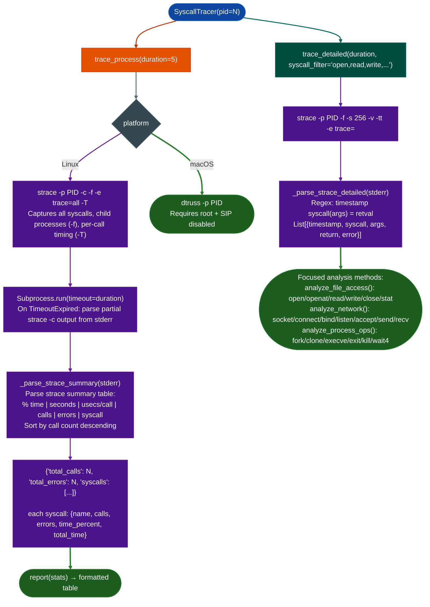

# System-Call Tracing

Attach to a running process via `strace` (Linux) or `dtruss` (macOS) and summarize its filesystem, network, and process-creation system call behavior: producing a frequency table of every syscall observed during the trace window with per-call timing and error counts.

---

## Why this exists

1. **Dynamic analysis reveals what static analysis cannot see.** A binary that passes all strings through a runtime config lookup, an obfuscated decoding routine, or an encrypted config file produces no useful static strings. `strace` intercepts the actual file paths passed to `open()`, the actual command strings passed to `execve()`, and the actual host/port pairs passed to `connect()`: regardless of how the binary constructs those values at runtime.

2. **Syscall frequency profiles fingerprint behavior classes.** A daemon that makes 10,000 `recv()` calls and 0 `fork()` calls is a network listener; one that calls `execve()` in response to network input is a command-execution target. The `trace_process()` summary table surfaces this behavioral profile in seconds: before any disassembly is needed, and directs the analyst toward the specific syscall categories worth tracing in detail.

3. **Filtered detail traces narrow the attack surface.** The three focused trace methods `analyze_file_access`, `analyze_network`, `analyze_process_ops` each run a `strace -e trace=...` filter pass, returning only the syscalls relevant to the analyst's current question. An analyst asking "what files does this service write during a config change?" runs `analyze_file_access()` and reads a list of `open()` and `write()` calls with full path arguments, not 10,000 lines of mixed output.

---

## How it works



---

## Usage

```python
from modules.syscall_trace import SyscallTracer

tracer = SyscallTracer(pid=31337)

# Summary profile: what syscall categories dominate?
stats = tracer.trace_process(duration=10)
print(tracer.report(stats))

# Raw syscall list sorted by frequency
for sc in stats['syscalls'][:10]:
    print(f"  {sc['name']:<20} {sc['calls']:>6} calls  {sc['errors']:>4} errors  {sc['time_percent']:.1f}%")

# File access trace: what paths does the daemon touch?
file_calls = tracer.analyze_file_access(duration=5)
for entry in file_calls:
    if entry.get('syscall') == 'openat' and not entry.get('error'):
        print(f"  {entry['timestamp']}  openat({entry['args']}) = {entry['return']}")

# Network connections: which hosts does the daemon connect to?
net_calls = tracer.analyze_network(duration=5)
for entry in net_calls:
    if entry.get('syscall') == 'connect':
        print(f"  CONNECT {entry['args']}")

# Process creation: does the daemon shell out?
proc_calls = tracer.analyze_process_ops(duration=5)
execve_calls = [e for e in proc_calls if e.get('syscall') == 'execve']
if execve_calls:
    print(f"Process executes {len(execve_calls)} child processes:")
    for e in execve_calls:
        print(f"  execve({e['args'][:120]})")
```

---

## Example output

```
Syscall Trace Summary
------------------------------------------------------------
Total calls: 42817
Total errors:  1204

Top syscalls by call count:
Syscall              Calls      Errors     Time %
------------------------------------------------------------
recv                 18241        0         41.2%
poll                  9831        0         22.2%
send                  8012        0         18.1%
openat                2209      214          5.0%
futex                 1874        0          4.2%
read                  1103       31          2.5%
execve                  12        0          0.1%
...

execve calls observed:
  08:41:22.191234  execve("/bin/bash", ["/bin/bash", "-c", "show version"], ...) = 0
  08:41:22.912345  execve("/usr/bin/logger", ["logger", "-t", "httpsd", "..."], ...) = 0
```

---

## False positives

**Partial output on timeout.** `strace -c` accumulates statistics in kernel memory and prints the summary table when the tracee exits or the tracing process terminates. When `trace_process()` calls `subprocess.run(timeout=duration)` on a long-running daemon, it raises `TimeoutExpired` and parses whatever partial `strace -c` output was written to `stderr` at that point. For short-running processes, the summary is complete. For daemons, always set `duration` longer than the activity window you want to capture.

**`strace` overhead changes timing ratios.** Each intercepted syscall passes through ptrace, adding latency. The `time_percent` and `total_time` fields reflect traced timing: typically 5–20× slower than native. Do not use timing fields to characterize performance; use them only to identify which syscall categories dominate CPU time in the syscall table.

**macOS coverage gap.** The macOS path uses `dtruss -p PID`, which requires root and System Integrity Protection disabled. In normal macOS environments, `dtruss` is unavailable or blocked. The parsed output provides syscall counts but not timing data (`time_percent=0.0` for all entries on macOS).

---

## Pipeline position

**Before this module:** Start the target process. Obtain the PID via `process_enum.py` or by launching the binary in a controlled environment.

**After this module:** If `execve()` calls appear in the trace, use `analyze_process_ops()` to recover the full argument list, then run `GoSubprocessScanner` or `SinkArgClassifier` on the binary to confirm how those calls are constructed in code. If unexpected `openat()` paths appear, check whether user-controlled data reaches those paths in the static analysis.

---

## Platform compatibility

| Platform | Method | Root required | Notes |
|---|---|---|---|
| Linux | `strace -c` / `strace -e trace=...` | `CAP_SYS_PTRACE` or root | Full support, best coverage |
| macOS | `dtruss -p` | Root + SIP disabled | Count-only; no timing; limited availability |

---

## Reading output

`SyscallTracer(pid).trace_process(duration=5)` returns a plain `dict`:

| Key | Content |
|:---|:---|
| `total_calls` | Total syscall invocations captured |
| `total_errors` | Total calls that returned an error |
| `syscalls` | `List[dict]`: one entry per syscall, each with `name`, `calls`, `errors`, `time_percent`, `total_time` |
| `error` | Error string if tracing failed for example `'strace not installed'`; absent on success |

`SyscallTracer(pid).trace_detailedduration, syscall_filter` returns per-call argument records. Pass `syscall_filter='execve,open,read'` to narrow the trace.

---

## See also

- [Process Enumeration](process-enum.md): enumerate running processes to find target PIDs
- [Sink Arg Classifier](sink-arg-classifier.md): static confirmation of `execve`-class calls found in trace
- [Go Dangerous Call Graph](go-dangerous-call-graph.md): static Go `os/exec` surface preceding dynamic trace
