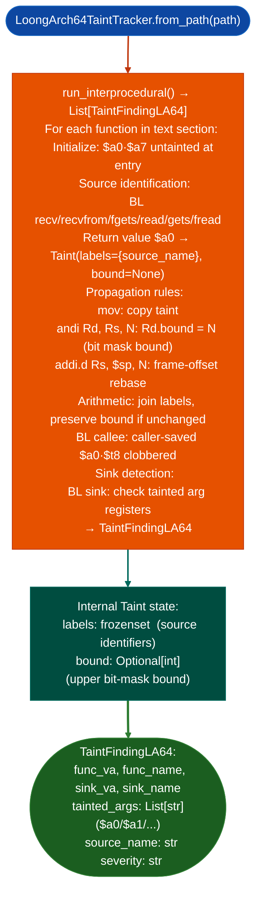

# LoongArch64 Taint Analysis

Track data flow through LoongArch64 binaries using a labeled taint model: propagating taint through the LP64 ABI's eight argument registers (`$a0`–`$a7`), bounding taint ranges via `andi` upper-bit zeroing, and tracking `addi.d $sp` frame-offset rebases: with sources at `recv`/`recvfrom`/`recvmsg`/`read`/`fgets`/`gets`/`fread` return values.

---

## Why this exists

1. LoongArch64 uses the LP64 ABI with eight argument registers (`$a0`–`$a7`): significantly more than the four registers used by ARM64 AAPCS or x86-64 SystemV. Without a LoongArch64-specific taint tracker, sinks with more than four arguments common in complex kernel call sites cannot be analyzed: the standard tracker would not know which register holds the fifth argument.

2. `andi` on LoongArch64 zeroes the upper bits of the result: if `$a0` holds a tainted value and `andi $t0, $a0, 0xff` is executed, the result is bounded to `[0, 255]`. `LoongArch64TaintTracker` internal `Taint.bound` records this upper bound, enabling `SinkArgClassifier`-equivalent reasoning: a tainted byte that is bounded to `0xff` cannot cause a heap overflow via a size argument to `malloc`.

3. `addi.d $sp, $sp, -N` tracks frame-offset rebases: stack allocations on LoongArch64 are expressed as subtractions from `$sp`. When `$sp` is used as a base for address computation, `LoongArch64TaintTracker` rebases taint labels to the new frame offset, maintaining correct stack-slot tracking across function prologues and mid-function allocations.

---

## How it works



---

## Usage

```python
from ablation.analyzers.taint_tracker_loongarch64 import LoongArch64TaintTracker

tracker = LoongArch64TaintTracker.from_path('/path/to/tencentos_target.elf')

findings = tracker.run_interprocedural()
for f in findings:
    print(f"  {f.sink_name}  args={f.tainted_args}  source={f.source_name}")
```

---

## Example output

The following illustrates LoongArch64 taint analysis output format. Actual addresses and values are binary-specific.

```
LoongArch64TaintTracker: tencentos_target.elf

Sources: recv, recvfrom, read, fgets
Sinks:   memcpy, strcpy, system, execv

Findings: <N>

  memcpy at <va>
    $a2 (size arg): tainted  labels={'recv'}  bound=None
    CRITICAL: unbound taint reaches memcpy size argument

  memcpy at <va>
    $a2 (size arg): tainted  labels={'recv'}  bound=0xff
    MEDIUM: bounded taint [0,255] reaches memcpy size
```

---

## False positives

**`andi` bound detection uses the immediate operand as the bound**: a multi-step bound for example `andi` followed by `addi` to shift the range produces an incorrectly loose bound. Verify that the `andi` is the final bounding operation before the sink.

**LP64 ABI caller-saved register clobbering**: `$a0`–`$t8` are caller-saved and the tracker conservatively clears their taint on every `bl` call to a non-source. This may produce false negatives if taint is preserved in callee-saved registers (`$s0`–`$s8`) across calls.

---

## Pipeline position

Run `TaintTrackerLA64` after `LA64MaxNotMinScanner` to confirm that compiler-bug findings produce a reachable taint path. Also use as the primary taint analysis tool for all LoongArch64 ELF targets TencentOS kernel modules, LoongArch64 system daemons.

---

## Reading findings

`LoongArch64TaintTracker.run()` returns a list of `TaintFindingLA64` objects:

| Attribute | Content |
|:---|:---|
| `func_va` | VA of the function containing the sink |
| `func_name` | Name of the function (from `ctx.name()`) |
| `sink_va` | VA of the sink call instruction |
| `sink_name` | Name of the sink function for example `memcpy`, `system` |
| `tainted_args` | `List[str]`: LoongArch64 argument register names with taint for example `['$a2']` |
| `source_name` | Name of the taint source function for example `recv` |
| `severity` | `"HIGH"` (default) |

Bound information (the `andi` upper-bit mask) is tracked in the internal `Taint` state during analysis; it is not exposed as a field on `TaintFindingLA64`.

---

## See also

- [LoongArch64 Compiler Bug Detection](loongarch64-2.md): `LA64MaxNotMinScanner` findings verified by this tracker
- [LoongArch64 KASAN-Aware Decoding](hisilicon-risc-v-extensions.md): `LoongArchDecoderV2` for debug kernel taint analysis
- [Named Taint Sources and Bounds](named-taint-sources-and-bounds.md): ARM64/x86-64 equivalent for non-LoongArch targets
