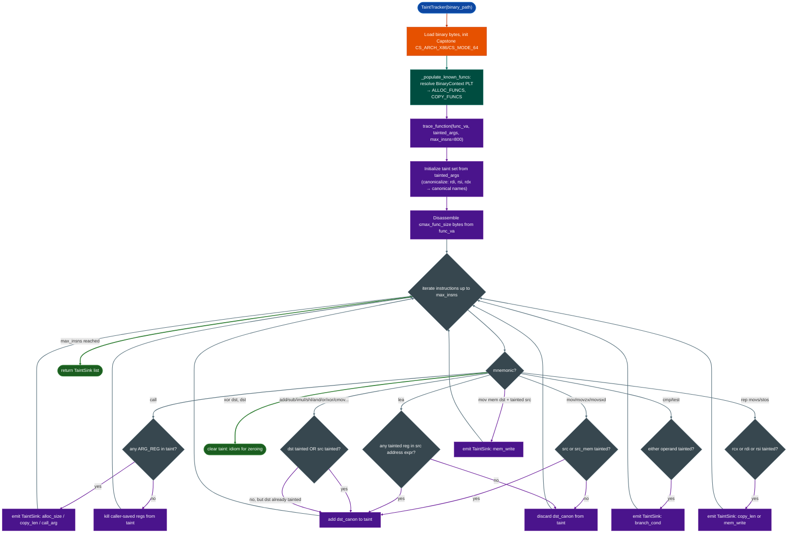

# Taint Analysis

Forward-propagate attacker-controlled data through a function's instruction stream and report every instruction where tainted values reach security-sensitive sinks: allocation size arguments, copy length operands, memory write destinations, call arguments, and branch conditions.

---

## Why this exists

1. **A finding from a scanner is a hypothesis: taint analysis converts it to a verdict.** When the `HeapVulnScanner` reports an integer overflow before `malloc`, or the `FormatStringScanner` reports that a format register originates from a function argument, neither tool has answered the critical question: does that value come from attacker-controlled network input? `TaintTracker` takes those findings as starting points and traces the data forward through the function body, answering precisely which instruction paths are reachable from tainted data.

2. **Register aliasing defeats naive taint propagation.** The x86-64 instruction set allows code to write to `eax` (32-bit) and then read from `rax` (64-bit), or write to `al` (8-bit) and read from `rax`. A taint propagator that tracks registers by name only not canonical form will silently lose taint when the compiler emits a `movzx eax, byte ptr [rbp-8]` followed by `mov [rdi+rcx*4], rax`. This tracker normalizes every register reference to its 64-bit canonical form before any propagation operation: `al`, `ax`, `eax`, and `rax` are all tracked as `rax`.

3. **Intra-function taint analysis covers the highest-value vulnerability patterns without requiring symbolic execution.** The majority of remotely exploitable firmware vulnerabilities: heap overflows, format string bugs, and buffer overreads: are exploitable within a single function: attacker data arrives as a function argument and reaches a sink within that same function body. This tool provides that analysis in milliseconds, without SMT solvers, without symbolic path constraints, and without the operational overhead of a full binary analysis platform.

---

## How it works

The tracker executes a single forward pass through the disassembled function body, maintaining a live taint set of canonical register names and named stack slots.



### Register canonicalization

Every register reference in the instruction stream is normalized to its 64-bit canonical form before any taint operation:

| Input forms | Canonical |
|---|---|
| `rax`, `eax`, `ax`, `al`, `ah` | `rax` |
| `rcx`, `ecx`, `cx`, `cl`, `ch` | `rcx` |
| `rdx`, `edx`, `dx`, `dl`, `dh` | `rdx` |
| `rbx`, `ebx`, `bx`, `bl`, `bh` | `rbx` |
| `rsi`, `esi`, `si`, `sil` | `rsi` |
| `rdi`, `edi`, `di`, `dil` | `rdi` |
| `r8`–`r15` and their 32/16/8-bit variants | `r8`–`r15` |

This means `movzx eax, byte [rsp+8]; test rax, rax` is correctly handled: the `movzx` write to `eax` is tracked on `rax`, and the subsequent `test rax, rax` sees the correct taint state.

### Sink detection

The five sink types and their detection conditions:

| Sink type | Detection condition |
|---|---|
| `alloc_size` | A tainted argument register is in `rdi`/`rsi`/`rdx` at `CALL malloc` / `calloc` / `realloc` |
| `copy_len` | A tainted `rcx` at `rep movs`, or a tainted argument at `CALL memcpy` / `memmove` |
| `mem_write` | Tainted source register in a `MOV [mem], reg` instruction |
| `branch_cond` | Tainted operand in a `CMP` or `TEST` instruction controls a conditional branch |
| `call_arg` | Any tainted argument register at any `CALL` not already classified as alloc/copy |

### Conservative propagation semantics

The tracker is **path-insensitive**: it does not branch-fork the taint state at conditional jumps. Instead, it assumes all code paths execute the union of all paths. This means:

- Every `CMOV` instruction conservatively taints the destination if either operand is tainted.
- A value that is tainted on one branch of a conditional is considered tainted after the merge point.
- This prevents false negatives at the cost of some false positives on paths that are not actually reachable together.

`setcc` instructions such as `sete al` are treated as always untainted: they produce a known 0/1 value derived from flags, not from tainted data, so they do not propagate taint.

---

## TaintTracker

```python
from ablation.analyzers.taint_tracker import TaintTracker

tt = TaintTracker('/path/to/binary')

# Trace function at 0x22ccc0 with rdi, rsi tainted at entry
sinks = tt.trace_function(
    func_va=0x22ccc0,
    tainted_args=['rdi', 'rsi'],
    max_insns=500,
)

for sink in sinks:
    print(sink)
```

### Integration with BinaryContext

```python
from ablation.analyzers.binary_context import BinaryContext
from ablation.analyzers.taint_tracker import TaintTracker
from ablation.analyzers.heap_vuln_scanner import HeapVulnScanner

ctx = BinaryContext.load_or_build('/fw/fortigate/httpsd')
heap_scanner = HeapVulnScanner.from_context(ctx)
heap_findings = heap_scanner.scan()

tt = TaintTracker('/fw/fortigate/httpsd')

# Confirm that each HIGH finding's function receives tainted input
for f in [x for x in heap_findings if x.severity == 'HIGH']:
    sinks = tt.trace_function(
        func_va=f.func_va,
        tainted_args=['rdi', 'rsi', 'rdx'],  # assume first three args tainted
    )
    alloc_sinks = [s for s in sinks if s.sink_type == 'alloc_size']
    if alloc_sinks:
        print(f"CONFIRMED: 0x{f.func_va:x} — tainted size reaches allocator")
        for s in alloc_sinks:
            print(f"  {s}")
```

### Extending allocator and copy function sets

```python
from ablation.analyzers.taint_tracker import TaintTracker
from ablation.analyzers.binary_context import BinaryContext

ctx = BinaryContext.load_or_build('/fw/cisco/lina')
tt = TaintTracker('/fw/cisco/lina')

# Register custom allocator VAs from the PLT
for va, name in ctx.plt.items():
    if 'pool_alloc' in name or 'zone_alloc' in name:
        tt.ALLOC_FUNCS.add(va)
```

---

## Usage

```python
from ablation.analyzers.taint_tracker import TaintTracker

tt = TaintTracker('/fw/fortigate/sslvpnd')
sinks = tt.trace_function(
    func_va=0x40a200,
    tainted_args=['rdi'],        # attacker controls first argument
    max_insns=1000,
    max_func_size=0x4000,
)

for sink in sinks:
    print(f"  [{sink.sink_type:12s}]  0x{sink.address:x}  {sink.instruction}")
    if sink.note:
        print(f"               NOTE: {sink.note}")
```

---

## Example output

```
0x40a214  [call_arg]  call 0x401050  (tainted: rdi): arg1 at call
0x40a228  [branch_cond]  test rax, rax  (tainted: rax)
0x40a250  [alloc_size]  call 0x401030  (tainted: rdi): ALLOC SIZE ARG
0x40a270  [mem_write]  mov qword ptr [rbx+0x10], rax  (tainted: rax)
0x40a290  [copy_len]  call 0x401060  (tainted: rsi): COPY LEN/ADDR ARG
```

---

## False positives

**Path-insensitive analysis on guarded code.** A function that validates user input at the top and returns early on invalid input will still show taint reaching sinks on the guarded fast path: the tracker does not model the fact that the early return prevents the tainted value from ever reaching the allocation on the valid-input path. Manually verify that the branch at the `branch_cond` sink does not guard the `alloc_size` sink.

**`xor reg, reg` tracking.** The tracker special-cases `xor dst, src` when `dst == src` as a zero-initializer clears taint. However, some compilers use `xor eax, eax` as a NOP-substitute or pipeline filler without intent to zero. When `xor eax, eax` immediately precedes a `call` that returns a value into `rax`, the resulting `rax` write on return is from the call, not the xor, and the tracker correctly handles this because the call return kills all caller-saved taint.

**Large functions with loops.** The `max_insns` limit default 800 prevents runaway disassembly on pathological functions, but it means a function with a long loop prologue may not reach all sinks. If the function is of interest, increase `max_insns` or increase `max_func_size`.

**Memory taint.** The tracker does not model memory taint: only register and stack-slot taint. If tainted data is stored to memory and later reloaded into a register, the reload is treated as untainted. This is a fundamental limitation of the intra-function, register-only model; full memory taint requires a different analysis tier.

---

## Pipeline position

**Before this module:** `HeapVulnScanner`, `FormatStringScanner`, or any other scanner that identifies candidate functions and initial tainted registers. `BinaryContext` supplies the PLT for allocator and copy function resolution.

**After this module:** `branch_cond` sinks at `TaintSink.sink_type` with a subsequent `alloc_size` sink can be escalated to a `PathSolver` analysis to check whether a feasible execution path exists from function entry to the allocation. Confirmed `alloc_size` or `copy_len` sinks feed directly into vulnerability report generation.

---

## Reading findings

| Field | Content |
|:---|:---|
| `address` | Virtual address of the sink instruction |
| `sink_type` | `alloc_size` / `copy_len` / `mem_write` / `branch_cond` / `call_arg` |
| `instruction` | Full instruction text: `mnemonic op_str` |
| `tainted_operand` | The register name that is tainted at this instruction |
| `note` | Contextual annotation: `ALLOC SIZE ARG`, `COPY LEN/ADDR ARG`, `arg1 at call`, etc. |

---

## See also

- [Heap Vulnerability Scanner](heap-vulnerability-scanner.md): generates the function candidates that `TaintTracker` confirms
- [Format String Scanner](format-string-scanner.md): produces `arg_passthrough` candidates for taint confirmation
- [Binary Context](binary-context.md): required for PLT-based allocator and copy-function resolution
- [Path Solver](path-solver.md): feasibility analysis for confirmed taint paths
- [Sink Arg Classifier](sink-arg-classifier.md): pre-classify all sink arguments before full taint tracing
