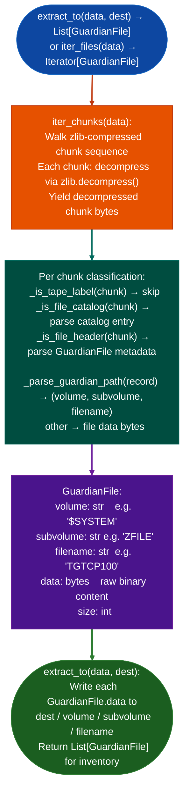

# Tandem Guardian PAK Extraction

Extract and enumerate files from Tandem NonStop Guardian PAK archives: the proprietary zlib-compressed BACKUP tape format used to distribute corrective service fixes for Guardian/NSK systems: enabling RE of MIPS32 big-endian Guardian-native binaries, via `ablation/core/guardian_pak_extractor.py`.

---

## Why this exists

1. **Guardian PAK archives are the only publicly accessible corpus of Tandem NonStop binaries.** NSK platform source code, ABI, and file-format specs are covered by NDA; no public documentation or disassembler exists. The only documented extractor (`UNPAK`) requires a live Tandem NSK system. `guardian_pak_extractor.py` provides extraction in pure Python without any NSK dependency.

2. **Guardian PAK files are distributed with a `.ZIP` extension but are not ZIP archives.** `unzip`, `file`, `binwalk`, and every standard archive tool reject these files: they contain Tandem's proprietary PAK format (zlib-compressed chunks wrapping the Guardian BACKUP(8) on-tape format), not ZIP records. Without `guardian_pak_extractor.py`, the analyst has no means to access the binary content at all.

3. **`iter_files()` resolves Guardian paths to `GuardianFile` entries**: each entry includes the Guardian-format path (`volume.subvolume.filename`), file size, and extracted bytes. The MIPS32 big-endian binaries inside are NRL object format files that can be disassembled directly with Capstone `CS_ARCH_MIPS` + `CS_MODE_MIPS32` + `CS_MODE_BIG_ENDIAN`.

---

## How it works



---

## Usage

```python
from ablation.core.guardian_pak_extractor import extract_to
from pathlib import Path

pak_data = Path('/path/to/T9999H01_AAB.ZIP').read_bytes()
dest = Path('/tmp/guardian_pak_extracted')
dest.mkdir(exist_ok=True)

files = extract_to(pak_data, dest)
print(f"Extracted {len(files)} Guardian files")
for f in files:
    print(f"  {f.volume}.{f.subvolume}.{f.filename}  ({f.size} bytes)")

# MIPS32 BE binaries are ready for analysis
mips_files = [f for f in files if f.size > 256]
for gf in mips_files:
    ctx = BinaryContext.load_or_build(str(dest / gf.volume / gf.subvolume / gf.filename))
```

---

## Example output

The following illustrates Guardian PAK extraction output format.

```
extract_to: T9999H01_AAB.ZIP

Extracted <N> Guardian files:

  $SYSTEM.ZSYSGEN.TACL      (<S1> bytes)
  $SYSTEM.ZFILE.TGTCP100    (<S2> bytes)   ← MIPS32 BE binary
  $SYSTEM.ZFILE.TCPDNSPM    (<S3> bytes)   ← MIPS32 BE binary
  $SYSTEM.ZFILE.SYSGEN      (<S4> bytes)
```

---

## False positives

**`_is_tape_label()`, `_is_file_catalog()`, `_is_file_header()` are pattern-based heuristics**: an unusual PAK variant may not match expected chunk signatures, causing files to be skipped. Verify extracted file count against the PAK's own catalog if available.

**Guardian path parsing**: `volume`, `subvolume`, and `filename` are extracted from the BACKUP(8) on-tape record format. Paths with unusual characters or non-standard encodings may produce truncated names. The `data` field is always correct regardless of name parsing.

---

## Pipeline position

Run `extract_to()` on any Guardian PAK `.ZIP` file before all other analysis. The extracted MIPS32 BE binaries feed `BinaryContext.load_or_build()` with `arch=mips`, `bits=32`, `big_endian=True`. No other tool in the pipeline can access the binaries without this extraction step.

---

## Reading output

`extract_todata: bytes, dest: Path` is a module-level function in `ablation/core/guardian_pak_extractor.py`. It returns `List[GuardianFile]`:

| Attribute | Content |
|:---|:---|
| `path` | Full Guardian path string for example `$DEV2.ZMQP00.1EALTMQF` |
| `volume` | Volume component for example `$DEV2` |
| `subvolume` | Subvolume component for example `ZMQP00` |
| `filename` | Filename component for example `1EALTMQF` |
| `data` | Extracted file bytes |
| `arch` | Always `"mips32be"` for Himalaya K-series targets |

Load a `GuardianFile` for RE by calling `BinaryContext.load_or_build()` with the file content written to a temp path.

---

## See also

- [AIX BFF Extraction](aix-bff-extractor.md): `BffExtractor` for AIX BFF/liblpp.a archives similar COTS-alternative-extraction pattern
- [Persistent Analysis Context](persistent-analysis-context.md): `BinaryContext` for MIPS32 BE analysis after extraction
