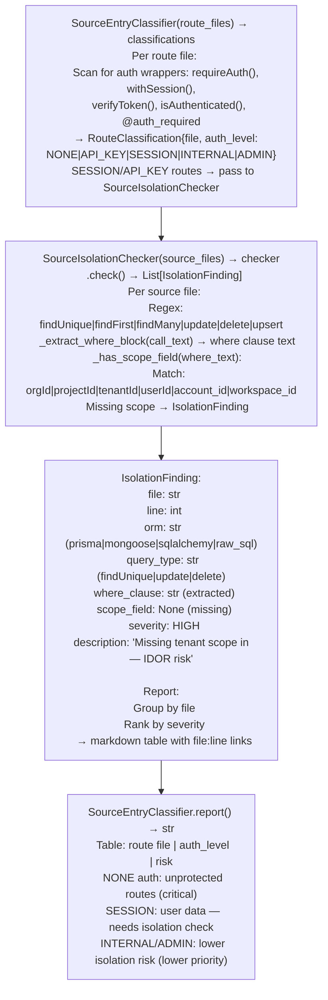

# Tenant Isolation Checks

Scan source code for ORM queries (Prisma, Mongoose, SQLAlchemy, raw SQL) that fetch or mutate multi-tenant data without scoping to the authenticated tenant's `orgId`, `projectId`, or `userId` — detecting IDOR and cross-tenant data leak patterns before code reaches production — via `ablation/analyzers/source_isolation_checker.py` `SourceIsolationChecker`.

---

## Why this exists

1. **Missing tenant scope in ORM queries is the highest-yield IDOR pattern in multi-tenant SaaS codebases** — a `findUnique({ where: { id: resourceId } })` that does not also include `orgId: currentUser.orgId` allows any authenticated user to fetch any resource in the system by guessing or brute-forcing the resource ID. `SourceIsolationChecker` detects exactly this pattern: ORM calls with a `where` clause that lacks a tenant-scoping field.

2. **`SourceIsolationChecker.check()` analyzes source files without executing them** — it reads source text, identifies ORM call patterns via regex AST-level extraction (`findUnique`, `findFirst`, `findMany`, `update`, `delete`, `upsert` for Prisma; `findOne`, `find` for Mongoose; `filter()`, `get()` for SQLAlchemy), extracts the `where` clause content, and checks whether a tenant-scoping field (`orgId`, `projectId`, `tenantId`, `userId`, `account_id`, `workspace_id`) appears in the clause. Queries that pass only a resource ID as the filter condition are flagged as `MISSING_TENANT_SCOPE`.

3. **Integration with `SourceEntryClassifier`** — `source_entry_classifier.py` classifies each API route by authentication level (`NONE`, `API_KEY`, `SESSION`, `INTERNAL`, `ADMIN`). Routes classified as `SESSION` or `API_KEY` handle user-supplied input and are the most relevant targets for `SourceIsolationChecker` analysis. Running `SourceEntryClassifier` first to identify user-facing routes narrows the scope for isolation checking from the full codebase to the routes that actually process cross-tenant data.

---

## How it works



---

## Usage

```python
from ablation.analyzers.source_isolation_checker import SourceIsolationChecker
from ablation.analyzers.source_entry_classifier import SourceEntryClassifier

# Step 1: classify routes by auth level
from ablation.analyzers.source_ingestion import SourceContext
ctx = SourceContext.from_path('/path/to/project')
route_files = [f for f in ctx.source_files if 'route' in f.path or 'api' in f.path]

entry_classifier = SourceEntryClassifier(route_files)
classifications = entry_classifier.classify_all()
session_routes = [c for c in classifications if c.auth_level in ('SESSION', 'API_KEY')]

# Step 2: check isolation in user-facing routes
checker = SourceIsolationChecker([c.file for c in session_routes])
findings = checker.check()
for f in findings:
    print(f"  [{f.severity}] {f.file}:{f.line}  {f.query_type} missing {f.scope_field or 'tenant scope'}")
    print(f"    where: {f.where_clause[:80]}")
```

---

## Example output

The following illustrates tenant isolation check output format.

```
SourceEntryClassifier:

  routes/api/documents.ts   AUTH_LEVEL: SESSION
  routes/api/users.ts       AUTH_LEVEL: SESSION
  routes/admin/internal.ts  AUTH_LEVEL: ADMIN

SourceIsolationChecker (SESSION routes):

  [HIGH] routes/api/documents.ts:142
    findUnique({ where: { id: documentId } })
    Missing: orgId / projectId — any user can read any document by ID

  [HIGH] routes/api/documents.ts:201
    update({ where: { id: documentId }, data: { ... } })
    Missing: orgId — any user can update any document
```

---

## False positives

**Resources without tenant scope by design** — public content, globally-shared configuration objects, and system resources legitimately have no tenant scope in their queries. Verify the route's access control model before reporting: a `findUnique({ where: { slug: publicSlug } })` on a public blog post is not an IDOR finding.

**Tenant scope via JOIN rather than where clause** — some ORM patterns apply tenant scoping via a relation join (`include: { project: { where: { orgId } } }`) rather than a direct `where` field. `_has_scope_field()` only checks the direct `where` block; scoping via joins is a false positive for this check. Review the full query context for join-based scoping.

---

## Pipeline position

Run tenant isolation checks as part of source code review after `SourceEntryClassifier` identifies user-facing API routes. The check is fast (regex-based, no execution required) and should run on every route file touching shared data models.

---

## See also

- [Repository Ingestion and Search](repository-ingestion-and-search.md) — `SourceContext` for indexing the codebase before running isolation checks
- [Container Isolation Escape Surface](container-isolation-escape-surface.md) — infrastructure-level isolation checks complementary to application-layer tenant isolation
