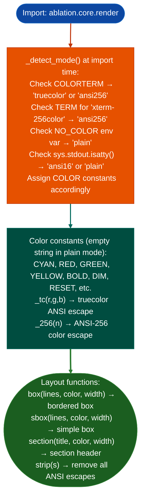

# Terminal Presentation

Render colored terminal output, section headers, and structured boxes for Ablation scan reports: automatically detecting truecolor, ANSI-256, ANSI-16, or plain-text terminal capability at import time: via `ablation/core/render.py`.

---

## Why this exists

1. All terminal output in Ablation goes through `render.py`: without it, every module would need its own color detection logic and ANSI escape sequence management. `render.py` exports color constants `CYAN`, `RED`, `BOLD`, etc. as empty strings in plain mode, so calling code works correctly in both colored and non-colored terminals without any mode checks.

2. **Capability detection at import time prevents ANSI escape contamination in redirected output.** `_detect_mode()` checks `TERM`, `COLORTERM`, and `NO_COLOR` environment variables, and whether `sys.stdout.isatty()` returns true. When output is piped to a file or another process, `TERM` is unset or `isatty()` returns false, so plain mode is selected automatically. This makes `render.py` output safe for shell pipelines.

3. **`box()`, `sbox()`, and `section()`** provide the three structural primitives used across all Ablation sweep output: `box()` draws a bordered box around a list of lines; `sbox()` draws a simpler box; `section()` renders a section header (`── TITLE ──────`). These are the building blocks for `FuncProfiler.report()`, `TaintTracker.report()`, and all other report methods.

---

## How it works



---

## Usage

```python
from ablation.core.render import CYAN, BOLD, RESET, section, box, strip

# Section header
print(section("TAINT ANALYSIS RESULTS", color=CYAN))

# Structured box
lines = [
    f"Binary: firmware.so",
    f"Findings: 3 HIGH, 1 CRITICAL",
]
print(box(lines, color=BOLD))

# Strip ANSI for writing to file
raw = strip(section("RESULTS", color=CYAN))
Path('report.txt').write_text(raw)
```

---

## Example output

The following illustrates terminal output format. Actual color sequences are terminal-specific.

```
── TAINT ANALYSIS RESULTS ──────────────────────────────────
┌─────────────────────────────────────────────────────────┐
│ Binary: firmware.so                                      │
│ Findings: 3 HIGH, 1 CRITICAL                            │
└─────────────────────────────────────────────────────────┘
```

---

## False positives

**`_detect_mode()` runs once at import time**: if a script redirects stdout after importing `render`, the color mode will not update. For scripts that need explicit plain mode regardless of terminal, set `NO_COLOR=1` in the environment before importing.

**`strip()` uses a regex that removes all ANSI CSI sequences**, this will also strip cursor movement and other non-color ANSI codes. For output that embeds non-color ANSI, use a more targeted stripping approach.

---

## Pipeline position

`render.py` is a foundational utility, it is not called directly in analysis workflows. All user-facing output methods in analyzers and sweeps call it internally. Override terminal behavior with `NO_COLOR=1` or by redirecting stdout.

---

## Reading output

`ablation/core/render.py` exposes module-level functions, not a class:

| Function | Return |
|:---|:---|
| `strip(s: str) -> str` | Plain text with all ANSI escape sequences removed |
| `boxlines, color, width -> str` | Multi-line bordered box double-line border |
| `sboxlines, color, width -> str` | Single-line border variant of `box()` |
| `sectiontitle, color, width -> str` | Section header bar with title and horizontal rule |
| `arrowlabel, color -> str` | Right-pointing arrow with optional label |

All functions detect terminal color capability at import time truecolor → ANSI-256 → ANSI-16 → plain text and respect the `NO_COLOR` environment variable.

---

## See also

- [JSON and SARIF Export](json-and-sarif-export.md): structured export that bypasses terminal presentation for machine-readable output
- [Markdown Research Reports](markdown-research-reports.md): `generate_report()` for human-readable markdown no ANSI escapes
