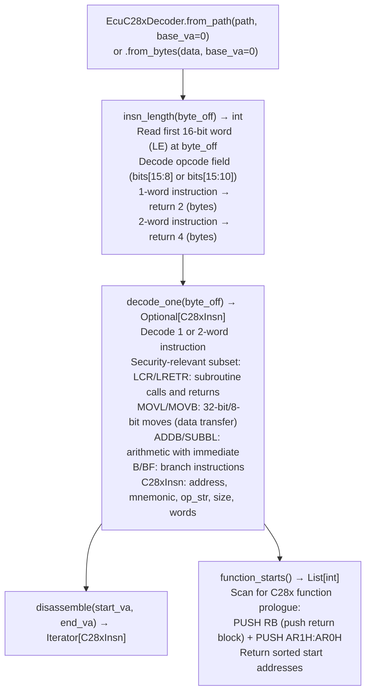

# TI C28x DSP/MCU Decoding

Decode Texas Instruments TMS320C28x firmware — implementing the 16-bit word-addressed ISA from SPRU430F in pure Python (Capstone has no C28x support) — distinguishing 16-bit single-word from 32-bit dual-word instructions for F28x-series MCUs (F28P55x, F28335, F2837x, F2838x) used in EV/HEV traction inverter control units and motor-drive ECUs.

---

## Why this exists

1. **Capstone 5.x has no C28x support.** The TMS320C28x is TI's primary 32-bit fixed-point DSP/MCU core for real-time control applications — EV/HEV traction inverter firmware compiled with `cl2000` or `c29clang` is C28x firmware. Without `ecu_c28x_decoder.py`, this entire class of automotive and industrial firmware cannot be disassembled by any existing pipeline tool.

2. **C28x uses 16-bit program words stored in little-endian byte order with word addressing** — each address refers to one 16-bit word, not one byte. This is structurally different from byte-addressed ISAs and requires the decoder to correctly translate word addresses to byte offsets before reading instruction words. `EcuC28xDecoder` handles this transparently via the `base_va` parameter.

3. **C28x instruction width is determined by the first word's opcode field** — 16-bit instructions (`1-word`) use opcodes that fit in a single word; 32-bit instructions (`2-word`) use an extended encoding. `EcuC28xDecoder.insn_length(byte_off)` reads the first word and returns either 2 (16-bit) or 4 (32-bit) bytes, enabling O(1) sequential decode.

---

## How it works



---

## Usage

```python
from ablation.analyzers.ecu_c28x_decoder import EcuC28xDecoder

decoder = EcuC28xDecoder.from_path('/path/to/ti_f28335_inverter.bin', base_va=0x3E8000)

starts = decoder.function_starts()
print(f"Found {len(starts)} C28x functions")

for insn in decoder.disassemble(starts[0], starts[0] + 0x40):
    print(f"  {insn.address:#x} ({insn.size}B): {insn.mnemonic} {insn.op_str}")
```

---

## Example output

The following illustrates C28x disassembly output format. Actual addresses are firmware-specific.

```
EcuC28xDecoder: ti_f28335_inverter.bin  (base_va=0x3e8000)

function_starts(): <N> C28x functions

Disassembly at 0x3e8000:
  0x3e8000 (2B): PUSH  RB
  0x3e8002 (4B): MOVL  XAR4, #0x1234  (32-bit 2-word)
  0x3e8006 (2B): ADDB  ACC, #10
  0x3e8008 (4B): LCR   <target>
```

---

## False positives

**`function_starts()` heuristic requires `PUSH RB` prologue** — functions that do not save the return block (leaf functions or interrupt service routines) are not detected. Supplement with ELF symbol table entries from `TiCoffLoader` if available, or with call-graph reachability from detected starts.

**Word-addressed instruction decoding at incorrect byte offsets** — C28x word addresses must be even byte offsets. Passing an odd byte offset to `decode_one()` produces incorrect decoding. `function_starts()` seeds use valid even offsets; callers must ensure alignment when using `decode_one()` directly.

---

## Pipeline position

Run `EcuC28xDecoder` on any TI F28x-series firmware after `EcuArchDetector` confirms C28x architecture. Function starts seed C28x-specific taint analysis. Pair with `TiCoffLoader` for symbol names when the firmware was compiled with debug symbols.

---

## Reading output

`EcuC28xDecoder.decode_frames_clean(va, size)` returns `List[C28xInstruction]`:

| Attribute | Content |
|:---|:---|
| `va` | Instruction VA |
| `size` | Instruction size in bytes (2 or 4 for C28x 16/32-bit encoding) |
| `mnemonic` | Instruction mnemonic (e.g., `MOVL`, `LCR`, `ADDB`) |
| `operands` | Operand string |

`EcuC28xDecoder.function_starts()` returns `List[int]` — VAs of identified C28x function entry points.

---

## See also

- [TI COFF Archive Loading](ti-coff-archive-loading.md) — `TiCoffLoader` for symbol names in COFF2-format C28x firmware
- [TI Neural Network Artifact Detection](ti-neural-network-artifacts.md) — `TiNNCScanner` for detecting TVM inference modules in C28x firmware
- [Flat ROM Function Discovery](flat-rom-function-discovery.md) — `EcuArchDetector` for architecture identification
