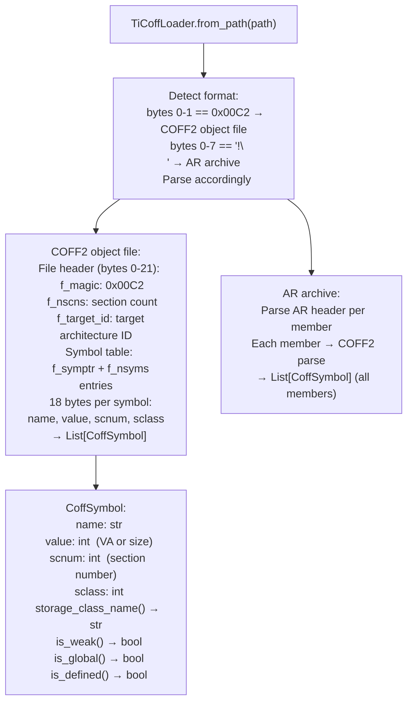

# TI COFF Archive Loading

Parse Texas Instruments COFF2 object files (`.obj`) and AR archives (`.a`) produced by TI Code Generation Tools (`cl2000`, `c29clang`, `tiarmclang`) — extracting symbol tables, section bindings, and storage class information for TI embedded targets where the binary format is COFF2, not ELF.

---

## Why this exists

1. **TI Code Generation Tools for C28x and C29x targets produce COFF2 object files, not ELF.** `BinaryContext.load_or_build()` uses `lief` for ELF loading and cannot parse COFF2. Without `TiCoffLoader`, TI COFF firmware (F28P55x DSP, C2000 series) cannot be analyzed by any Ablation tool. `TiCoffLoader` fills this gap with native Python COFF2 parsing.

2. **TI AR archives (`.a`) package multiple COFF2 members** — the same `!<arch>\n` Unix AR format used by `AixBigArExtractor`, but with COFF2 members instead of AIX Big Archive members. `TiCoffLoader` parses both the standalone `.obj` and the `.a` archive format, extracting all members for bulk symbol analysis.

3. **`CoffSymbol.storage_class_name()`, `is_weak()`, `is_global()`, `is_defined()`** provide the same boolean interface as `lief.ELF.Symbol` for downstream tools. `TiNNCSanner` uses `TiCoffLoader` to detect `tvmgen_*` symbols in COFF-format C28x firmware — it calls `TiCoffLoader` transparently when the target is COFF2, and `lief` when the target is ELF, through a unified `NormSymbol` interface.

---

## How it works



---

## Usage

```python
from ablation.analyzers.ti_coff_loader import TiCoffLoader

loader = TiCoffLoader.from_path('/path/to/ti_c28x_module.obj')
symbols = loader.symbols()

# Find all globally defined functions
global_funcs = [s for s in symbols if s.is_global() and s.is_defined()]
print(f"Global symbols: {len(global_funcs)}")
for s in global_funcs[:10]:
    print(f"  {s.name}  va={s.value:#x}  class={s.storage_class_name()}")
```

---

## Example output

The following illustrates TI COFF loading output format. Actual symbols are target-specific.

```
TiCoffLoader: ti_c28x_module.obj  (COFF2, target_id=28)

Symbols: <N>

Global defined:
  init_motor_control    va=0x0000  class=C_EXT
  update_pwm_duty       va=0x0040  class=C_EXT
  __c28xabi_divI32      va=0x0080  class=C_WEAKEXT
```

---

## False positives

**`is_weak()` uses storage class `C_WEAKEXT`** — TI COFF2 represents weak symbols via `C_WEAKEXT` (storage class 22), which is TI-specific. Standard COFF weak symbol conventions differ from ELF; verify that `is_weak()` results align with TI CGT documentation for the specific target.

**AR archive parsing assumes Unix AR format with COFF2 members** — if the `.a` file contains non-COFF2 members (e.g., a manifest or index), those members will fail to parse. Non-COFF2 members are skipped silently.

---

## Pipeline position

Run `TiCoffLoader` on any TI COFF2 `.obj` or `.a` file before `TiNNCScanner` or any COFF-specific analysis. `TiNNCScanner` calls `TiCoffLoader` internally when it detects a COFF2 target — direct use is only needed when performing custom symbol analysis.

---

## See also

- [TI Neural Network Artifact Detection](ti-neural-network-artifacts.md) — `TiNNCScanner` that uses `TiCoffLoader` for C28x targets
- [AIX Big Archive Extraction](aix-big-ar-extractor.md) — `AixBigArExtractor` for AIX Big Archive format (similar archive structure)
