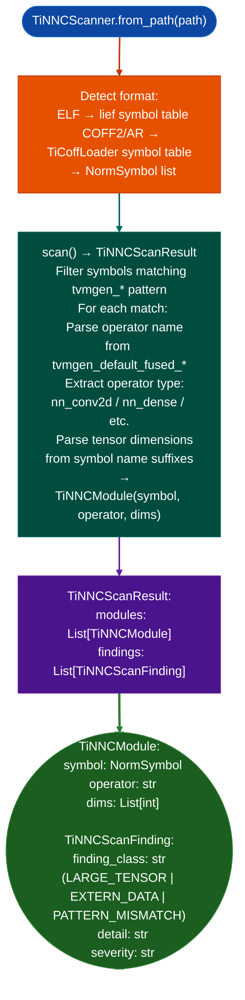

# TI Neural Network Artifact Detection

Detect TVM-generated `tvmgen_*` inference symbols in TI MCU firmware compiled by the TI Neural Network Compiler NNC, built on Apache TVM: identifying embedded ML inference modules, their operator types, and tensor shapes: across both ELF targets Cortex-M0+/M33/M4/R5, C29x and TI COFF2 targets (C28x F28P55x via `TiCoffLoader`).

---

## Why this exists

1. **Firmware that runs embedded ML inference has a larger attack surface than firmware without ML.** A `tvmgen_*` symbol indicates that the binary includes a compiled ML model. The inference operator `tvmgen_default_fused_nn_conv2d`, `tvmgen_default_fused_nn_dense` names the operation type and indirectly the input tensor shape: both relevant for assessing the firmware's input handling complexity and the attack surface of the inference path.

2. TI NNC targets both ELF and COFF2 binary formats: Cortex-M33/M4/R5 and C29x targets produce ELF; C28x F28P55x targets produce COFF2. `TiNNCScanner` handles both through a unified `NormSymbol` interface: ELF via `lief`, COFF2 via `TiCoffLoader`. This single API covers all TI NNC target architectures without requiring the caller to know the binary format.

3. **`TiNNCScanResult.modules`** lists all detected `TiNNCModule` entries: each with the operator name, symbol VA, and inferred tensor dimensions from operator name parsing. `TiNNCScanFinding` records security-relevant observations: large tensor sizes that require heap allocation, extern data symbols that indicate off-chip tensor storage, and mismatched operator/symbol-name patterns.

---

## How it works



---

## Usage

```python
from ablation.analyzers.ti_nnc_scanner import TiNNCScanner

scanner = TiNNCScanner.from_path('/path/to/ti_mcus_firmware.elf')
result = scanner.scan()

print(f"TVM inference modules: {len(result.modules)}")
for m in result.modules:
    print(f"  {m.symbol.name}  op={m.operator}  dims={m.dims}")

if result.findings:
    for f in result.findings:
        print(f"  [{f.severity}] {f.finding_class}: {f.detail}")
```

---

## Example output

The following illustrates TI NNC artifact detection output format. Actual symbols are firmware-specific.

```
TiNNCScanner: ti_mspm0_firmware.elf

TVM inference modules: <N>

  tvmgen_default_fused_nn_dense_0      op=nn_dense    dims=[32, 64]
  tvmgen_default_fused_nn_conv2d_0     op=nn_conv2d   dims=[1, 3, 224, 224]
  tvmgen_default_fused_nn_softmax_0    op=nn_softmax  dims=[1, 1000]

Findings:
  [MEDIUM] LARGE_TENSOR: conv2d tensor dims=[1,3,224,224] requires heap allocation
```

---

## False positives

**`tvmgen_*` pattern matching will detect symbols in non-inference code that happens to use the same prefix**, this is unlikely but possible in codebases that use `tvmgen_` as a conventional prefix for their own code. Verify that the matched symbols follow the standard TVM operator naming convention before treating them as NNC artifacts.

**Tensor dimension parsing from symbol name**: operator names sometimes omit tensor dimensions entirely or use abbreviated forms. In such cases, `dims=[]` is returned; this is not an error but a limitation of static name parsing.

---

## Pipeline position

Run `TiNNCScanner` on any TI MCU firmware as part of initial triage. ML inference presence changes the attack surface assessment and directs deeper analysis toward the inference data path input tensor provenance, parameter loading.

---

## Reading findings

`TiNNCScanner.scan()` returns a `TiNNCScanResult`:

| Attribute | Content |
|:---|:---|
| `binary_path` | Path to the scanned binary |
| `has_npu_init` | `True` if `TI_NPU_init` symbol is present: confirms hardware NPU mode |
| `modules` | `List[TiNNCModule]`: one entry per detected `tvmgen_<name>_run` model |
| `findings` | `List[TiNNCScanFinding]`: all security findings |

Each `TiNNCModule`:

| Attribute | Content |
|:---|:---|
| `name` | Model name extracted from symbol for example `'default'`, `'a'` |
| `run_va` | VA of the `tvmgen_<name>_run` function |
| `execution_mode` | `'npu_hw'` / `'npu_soft'` / `'unknown'` |
| `has_finished_flag` | `True` if `tvmgen_<name>_finished` symbol is present |
| `norm_symbols` | `List[NormSymbol]`: all normalization data symbols for this model |
| `weak_norm_symbols` | `List[str]`: subset of `norm_symbols` with WEAK ELF binding |

---

## See also

- [TI COFF Archive Loading](ti-coff-archive-loading.md): `TiCoffLoader` used internally for C28x COFF2 targets
- [TI C28x Decoding](ti-c28x-decoding.md): `EcuC28xDecoder` for full C28x instruction analysis
