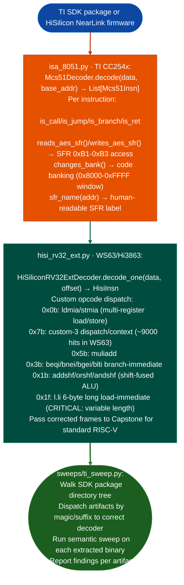

# TI SDK Package and Embedded MCU Sweeping

Decode TI CC254x Enhanced 8051 firmware (BLE 4.0 SoC) using the MCS-51 ISA model and HiSilicon WS63/Hi3863 NearLink SoC firmware using the proprietary `riscv31` ISA extensions: dispatching COFF, ARM, ARM64, and flat-ROM artifacts across SDK package directories: via `modules/isa_8051.py` and `ablation/analyzers/hisi_rv32_ext.py`.

---

## Why this exists

1. **TI CC254x CC2540/CC2541 uses an Enhanced 8051 core with hardware AES at SFR 0xB1–0xB3.** `isa_8051.py` models the MCS-51 dual data space IRAM direct/indirect vs XDATA via MOVX and the CC254x SFR map. `Mcs51Insn.reads_aes_sfr()` and `writes_aes_sfr()` identify cryptographic key setup and AES engine invocations, which are the primary attack surface in BLE 4.0 firmware: incorrect key scheduling or ECB mode use in the AES SFR block.

2. HiSilicon WS63/Hi3863 NearLink SoCs use a proprietary RISC-V extension named `riscv31`: Capstone 5.x mishandles all five custom opcode spaces. The most critical gap is opcode `0x1f` (`l.li`): Capstone decodes it as a 4-byte instruction but it is a 6-byte load-immediate, causing a 2-byte misalignment cascade that invalidates all subsequent disassembly. `HiSiliconRV32ExtDecoder` corrects all six custom opcode spaces before passing clean instruction frames to Capstone for the standard RISC-V instruction set.

3. SDK packages contain heterogeneous artifacts: TI SDK packages include ARM Cortex-M4 ELF, C28x COFF2, and flat ROM binaries alongside ARM64 host tools. `ti_sweep.py` the sweep coordinator dispatches each artifact to the correct decoder chain: ELF targets to `BinaryContext`, COFF2 to `TiCoffLoader`, flat ROM to `EcuArchDetector`, and 8051/riscv31 binaries to their respective ISA decoders.

---

## How it works



---

## Usage

```python
# 8051 firmware
from modules.isa_8051 import Mcs51Decoder, sfr_name
decoder = Mcs51Decoder()
insns = decoder.decode(fw_data, base_addr=0x0000)
aes_accesses = [i for i in insns if i.reads_aes_sfr() or i.writes_aes_sfr()]
for i in aes_accesses:
    print(f"  {i.addr:#x}: {i}  → {sfr_name(i.sfr_addr)}")

# HiSilicon riscv31 firmware
from ablation.analyzers.hisi_rv32_ext import HiSiliconRV32ExtDecoder
decoder = HiSiliconRV32ExtDecoder()
for offset in range(0, len(fw_data), 4):
    insn = decoder.decode_one(fw_data, offset)
    if insn:
        print(f"  {insn.address:#x}: {insn.mnemonic} {insn.op_str}")
```

---

## Example output

The following illustrates TI/HiSilicon sweep output format.

```
isa_8051: cc2541_ble_firmware.hex
  AES SFR accesses:
    0x0a40: mov 0xb3, a  → ENCCS (AES control)
    0x0a44: mov 0xb1, a  → ENCDI (AES data in)
    0x0a50: mov a, 0xb2  → ENCDO (AES data out, read)

hisi_rv32_ext: ws63_nearlink.bin
  Fixed: 6-byte l.li at 0x10204  (Capstone misread as 4-byte)
  Custom-3 dispatches: <N>
  Branch-immediate: beqi a0, 0x10300
```

---

## False positives

**`reads_aes_sfr()` / `writes_aes_sfr()`**: direct IRAM addresses 0xB1–0xB3 accessed via direct addressing mode (not `@Ri` indirect) are SFR accesses. Indirect addressing via `@R0`/`@R1` at the same addresses accesses upper IRAM, not SFRs. `Mcs51Insn.__post_init__()` disambiguates addressing mode from the instruction encoding; only direct-mode accesses trigger the AES SFR flag.

**HiSilicon `0x7b` custom-3 opcode space is dense**: the `conservative=True` flag in `_make_custom3()` limits disassembly to confirmed dispatch/context operations. Setting `conservative=False` enables aggressive decoding of the full custom-3 space but may produce incorrect results on novel opcode encodings.

---

## Pipeline position

Run TI SDK sweeping on any TI SDK package directory or HiSilicon NearLink firmware image. `ti_sweep.py` handles artifact dispatch; run it from the command line against the SDK root. For manual analysis, use `Mcs51Decoder` (8051) or `HiSiliconRV32ExtDecoder` (riscv31) directly.

---

## Reading output

**MCS-51 8051 firmware:** `Mcs51Decoderdata, base_va.decode_rangeoffset, size` yields `Mcs51Insn`. See [isa-8051](isa-8051.md) for the full `Mcs51Insn` field reference `offset`, `raw`, `mnemonic`, `operands`, `insn_type`, `target`, `size`.

**HiSilicon WS63 (NearLink firmware):** `HiSiliconRV32ExtDecoderbinary, base_va.scan_custom3code, base_va` returns `List[HisiInsn]`. See [hisi-rv32-ext](hisi-rv32-ext.md) for the full `HisiInsn` field reference `address`, `size`, `mnemonic`, `op_str`, `rd`, `rs1`, `rs2`, `funct3`, `funct7`.

---

## See also

- [TI C28x Decoding](ti-c28x-decoding.md): `EcuC28xDecoder` for C28x DSP targets in the same TI SDK
- [TI COFF Archive Loading](ti-coff-archive-loading.md): `TiCoffLoader` for COFF2 artifacts in TI SDK packages
