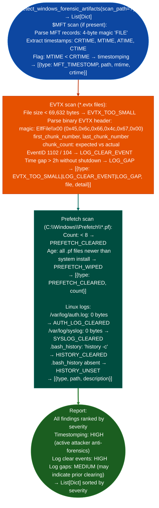

# Timestamp/Log Anomaly Checks

Detect Windows timestomping Modified timestamp predating Created timestamp in $MFT, identify emptied or deleted log files zero-byte EVTX files, missing Prefetch entries, detect Linux `syslog` and `auth.log` truncation, and identify forensic artifact manipulation patterns: via `modules/forensics_enum.py` `detect_windows_forensic_artifacts()`.

---

## Why this exists

1. `detect_windows_forensic_artifacts()` detects timestomping in $MFT records: the Windows NTFS Master File Table stores four timestamps per file: Created (CRTIME), Modified (MTIME), Accessed (ATIME), and Changed CTIME, attribute change. Timestomping sets the Modified timestamp to a date earlier than the Created timestamp: a physical impossibility in normal filesystem operation. `detect_windows_forensic_artifacts()` scans the $MFT for records where `MTIME < CRTIME` and flags these as timestomped. Attackers use timestomping to make malware appear to have been on the system for years.

2. EVTX log tampering detection: Windows event logs are stored as binary EVTX files. `detect_windows_forensic_artifacts()` checks three conditions: (1) EVTX files with size < 69,632 bytes the minimum size of an EVTX file with the standard 65KB header + one chunk: indicating log truncation or recreation; (2) presence of Event ID 1102 Security audit log cleared or Event ID 104 System log cleared within the logs themselves; and (3) temporal gaps > 2 hours in event sequence numbers without a corresponding System ID 1074 system shutdown: indicating that events were deleted from the middle of the log.

3. Linux log tampering: `detect_windows_forensic_artifacts()` also covers Linux artifact detection when run on a mounted Linux filesystem: zero-byte `/var/log/auth.log`, `/var/log/syslog`, or `/var/log/secure` files indicate log clearing; `.bash_history` files containing `history -c` or `unset HISTFILE` commands indicate shell history tampering. Prefetch file counts below the Windows minimum < 8 files for a production system indicate Prefetch clearing or an unusually clean system.

---

## How it works



---

## Usage

```python
from modules.forensics_enum import detect_windows_forensic_artifacts

# Windows volume (mounted or native)
# Returns [{severity, title, detail, host, port}]
artifacts = detect_windows_forensic_artifacts('/mnt/windows')

# Filter by title keyword (MFT_TIMESTOMP, LOG_CLEAR_EVENT, EVTX_TOO_SMALL, etc.)
for a in artifacts:
    if 'TIMESTOMP' in a['title']:
        print(f"  [{a['severity']}] TIMESTOMP: {a['detail']}")
    elif 'LOG_CLEAR' in a['title'] or 'EVTX' in a['title']:
        print(f"  [{a['severity']}] {a['title']}: {a['detail'][:80]}")

# Linux forensic artifacts (same function, different scan_path)
linux_artifacts = detect_windows_forensic_artifacts('/')
for a in linux_artifacts:
    if 'CLEARED' in a['title'] or 'HISTORY' in a['title']:
        print(f"  [{a['severity']}] {a['title']}: {a['detail'][:80]}")
```

---

## Example output

The following illustrates timestamp and log anomaly output format.

```
detect_windows_forensic_artifacts: /mnt/windows

  [HIGH] MFT_TIMESTOMP: C:\Users\user\Desktop\implant.exe
    MTIME=2020-01-15  CRTIME=2026-10-16 14:22:31  (MTIME predates system install)

  [HIGH] LOG_CLEAR_EVENT: Security.evtx  EventID=1102 at 2026-10-16T14:30:01
    "The audit log was cleared. Subject: user\\administrator"

  [MEDIUM] LOG_GAP: System.evtx  2026-10-16T12:00 → 2026-10-16T16:22  (4h22m gap)
    No shutdown event in gap window — event deletion likely

  [HIGH] PREFETCH_CLEARED: C:\Windows\Prefetch count=0
```

---

## False positives

**`MTIME < CRTIME` on extracted archives**: files extracted from ZIP or tar archives inherit the archive's embedded modification timestamp, which predates the extraction date. All such files will appear timestomped. Filter by the directory: files in `%USERPROFILE%\Desktop\`, `%TEMP%\`, or `%APPDATA%\` that are timestomped outside archive extraction context are genuine findings.

**Short EVTX files on fresh systems**: a newly provisioned Windows system with minimal activity may have EVTX files smaller than 69,632 bytes simply because few events have been generated. Cross-reference with system install date and uptime before concluding that a small EVTX file indicates tampering.

---

## Pipeline position

Run timestamp and log anomaly checks during post-compromise forensic analysis, after volatile state capture. Timestomping and log clearing findings narrow the attacker's active window; combine with EVTX event ID 4624/4625 logon/logon failure timeline for lateral movement reconstruction.

---

## Reading findings

Timestamp and log anomaly detection functions return `List[{severity, title, detail}]`:

| Field | Content |
|:---|:---|
| `severity` | `HIGH` timestomp, log clear / `MEDIUM` log gap, future timestamp |
| `title` | Finding code for example `MFT_TIMESTOMP`, `LOG_CLEAR_EVENT`, `LOG_GAP`, `FUTURE_TIMESTAMP` |
| `detail` | File path, EventID, timestamp values, or gap duration |

For `MFT_TIMESTOMP`: `detail` contains the file path, MTIME, and CRTIME values.
For `LOG_CLEAR_EVENT`: `detail` contains the EVTX file name and EventID.

---

## See also

- [Windows Artifact Discovery](windows-artifact-discovery.md): $MFT, LNK, Prefetch, and EVTX analysis for host-activity timeline
- [Volatile and Linux Artifact Triage](volatile-and-linux-artifact-triage.md): Linux log tampering and volatile state capture
