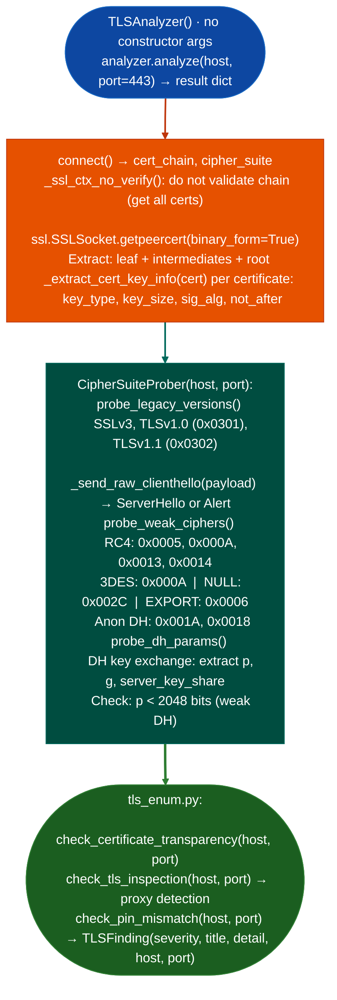

# TLS Certificate and Protocol Probing

Inspect TLS certificate chains, key strength, legacy protocol version support TLS 1.0/1.1, SSLv3, weak cipher suites RC4, 3DES, NULL, EXPORT, anonymous DH, and DH parameter properties: by directly establishing TLS connections and exchanging raw ClientHello records: via `ablation/core/tls_analyzer.py` and `modules/tls_enum.py`.

---

## Why this exists

1. **`TLSAnalyzer` extracts the full certificate chain including intermediate certificates**: `_extract_cert_key_info()` inspects each certificate's key type, key size, signature algorithm, and validity period. RSA keys below 2048 bits, MD5/SHA1 signatures on leaf certificates, and certificates expiring within 30 days are each flagged as findings. This is performed without external certificate verification libraries: `ssl.getpeercert()` provides the DER bytes; `_cert_sha256()` and `_get_san_names()` parse the certificate structure in pure Python.

2. **`CipherSuiteProber` sends raw ClientHello messages with specific cipher suites**, it constructs a `_build_clienthello()` with the target cipher IDs and calls `_send_raw_clienthello()` to determine whether the server accepts them. This detects cipher suite support that is invisible to `ssl.SSLContext`-based connections which use the OS TLS library's cipher preference list, not the server's. RC4 `0x0005`, `0x000A` and 3DES (`0x000A`) are individually probed.

3. **`tls_enum.py` extends the analysis with HSTS/CT/mTLS policy checks**: `check_certificate_transparency()` queries the Google CT log for the leaf certificate's SCT extensions; `check_tls_inspection()` detects TLS inspection proxies different CA on intermediate certificate vs. leaf; `check_pin_mismatch()` identifies HPKP/certificate pinning bypass conditions.

---

## How it works



---

## Usage

```python
from ablation.core.tls_analyzer import TLSAnalyzer, CipherSuiteProber

# TLSAnalyzer() takes no constructor args; host/port go to analyze()
analyzer = TLSAnalyzer()
result = analyzer.analyze('target.example.com', port=443)

# cert_chain: [{subject_cn, issuer_cn, key_algorithm, key_bits, sig_algorithm,
#               not_after, sans, is_self_signed, sha256, ...}]
for cert in result['cert_chain']:
    print(f"  {cert['subject_cn']}  key={cert['key_bits']}b {cert['key_algorithm']}"
          f"  sig={cert['sig_algorithm']}  expires={cert['not_after']}")

# findings: [{severity, title, detail, host, port}]
for finding in result['findings']:
    print(f"  [{finding['severity']}] {finding['title']}: {finding['detail']}")

# CipherSuiteProber(host, port) — probe_version_support() → {version_str: supported}
prober = CipherSuiteProber('target.example.com', port=443)
version_support = prober.probe_version_support()
for version, supported in version_support.items():
    if supported:
        print(f"  LEGACY TLS SUPPORTED: {version}")
```

---

## Example output

The following illustrates TLS probing output format.

```
TLSAnalyzer: target.example.com:443

Certificate chain:
  leaf:         CN=target.example.com  key=2048b RSA  sig=SHA256withRSA  expires=2026-12-01
  intermediate: CN=DigiCert CA          key=4096b RSA  sig=SHA256withRSA
  root:         CN=DigiCert Root CA

CipherSuiteProber:
  [HIGH] TLS 1.0: accepted (POODLE/BEAST risk)
  [HIGH] RC4 cipher 0x0005: accepted
  [MEDIUM] DH key 1024 bits: weak Diffie-Hellman parameters
```

---

## False positives

**`probe_legacy_versions()` may produce false positives on hosts with TLS middleboxes**: some load balancers return a ServerHello that echoes back the offered version regardless of actual support. Verify by completing the TLS handshake (not just checking for ServerHello presence) before treating legacy version support as a confirmed finding.

**`_build_clienthello()` with non-standard cipher lists**: some servers close the connection immediately on receiving an unrecognized cipher list, returning an empty response that the prober interprets as rejection. A TCP-RST on the first ClientHello is not the same as a TLS Alert indicating cipher rejection.

---

## Pipeline position

Run TLS certificate and protocol probing on all management interfaces discovered during network reconnaissance. Certificate chain analysis runs first no cipher probing; weak cipher and legacy version probing follows when the management interface requires TLS hardening as an assessment scope item.

---

## Reading output

`TLSAnalyzer().analyzehost, port` returns a dict:

| Key | Content |
|:---|:---|
| `host` / `port` | Target host and port |
| `tls_version` | Negotiated TLS version string, or `None` |
| `cipher` | Negotiated cipher suite name, or `None` |
| `cert_chain` | `list`: certificate chain dicts leaf to root |
| `findings` | `List[{type, severity, host, port, detail, exploit}]`: policy violations |
| `quantum_inventory` | Algorithm inventory for PQC readiness assessment |
| `error` | `None` on success; error string if connection failed |

`CipherSuiteProberhost, port.probe_version_support()` returns `Dict[str, bool]`: TLS version string → supported.

---

## See also

- [TLS Policy Checks](tls-policy-checks.md): HSTS/CT/mTLS policy layer above protocol probing
- [TLS Session Downgrade Surfaces](tls-session-downgrade-surfaces.md): `TaintTrackerPPC64` for binary-level TLS downgrade analysis
