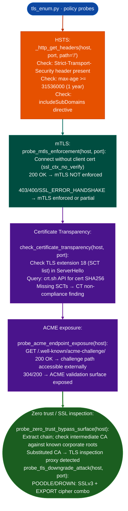

# TLS Policy Checks

Probe TLS policy enforcement: HSTS header presence and max-age, HTTP→HTTPS redirect behavior, mTLS enforcement, HPKP/certificate pinning bypass surfaces, Certificate Transparency SCT presence, ACME challenge endpoint exposure, and zero-trust proxy SSL inspection bypass: via `modules/tls_enum.py`.

---

## Why this exists

1. mTLS enforcement is often misconfigured at the path level: `probe_mtls_enforcement()` tests whether the server requires a client certificate by attempting an unauthenticated TLS connection no client certificate. A successful HTTP response without a client certificate means mTLS is not enforced, even if the endpoint is documented as mTLS-protected. The check sends the connection to both the root path and well-known API paths.

2. ACME challenge endpoint exposure: `probe_acme_endpoint_exposure()` checks whether `/.well-known/acme-challenge/` is accessible from the external network. If so, an attacker who controls a DNS response can redirect the ACME validation request to issue a fraudulent certificate for the target domain. This check is relevant for any service that uses ACME Let's Encrypt, ZeroSSL for certificate provisioning.

3. **`probe_zero_trust_bypass_surface()` and `probe_cloud_proxy_ssl_inspection_bypass()`** test whether TLS inspection proxies introduce certificate chain substitution: a common zero-trust deployment pattern that breaks certificate pinning and introduces a trust path the client did not consent to. These checks detect the proxy's CA certificate in the chain and compare it against a list of known corporate root CA signatures.

---

## How it works



---

## Usage

```python
from modules.tls_enum import (
    probe_mtls_enforcement, probe_acme_endpoint_exposure,
    check_certificate_transparency, probe_zero_trust_bypass_surface
)

host = 'api.target.example.com'

for finding in probe_mtls_enforcement(host) + \
               probe_acme_endpoint_exposure(host) + \
               check_certificate_transparency(host) + \
               probe_zero_trust_bypass_surface(host):
    print(f"  [{finding['severity']}] {finding['title']}: {finding['detail']}")
```

---

## Example output

The following illustrates TLS policy check output format.

```
tls_enum: api.target.example.com

[HIGH]   mTLS NOT enforced: unauthenticated TLS connection returns 200 OK
[MEDIUM] HSTS missing: Strict-Transport-Security header absent on port 443
[MEDIUM] ACME challenge path exposed: /.well-known/acme-challenge/ returns 200
[INFO]   Certificate Transparency: SCT extension present, CT compliant
[INFO]   Zero trust proxy: not detected (chain intact)
```

---

## False positives

**`probe_mtls_enforcement()` false negatives at the load balancer**: some deployments terminate mTLS at a load balancer that is not the host being probed. An unauthenticated connection to the load balancer may succeed while mTLS is enforced at the backend. Always verify mTLS enforcement at the backend service layer, not only at the first TLS termination point.

**ACME challenge path exposure is context-dependent**: ACME challenge path accessibility is expected for domain validation services; it is a finding only for services where the domain should not be accessible to ACME validation internal-only services, services behind a WAF that should block public ACME traffic.

---

## Pipeline position

Run TLS policy checks after `TLSAnalyzer` certificate chain analysis. Policy checks require an operational TLS endpoint not just a certificate file and produce network findings. They are not run on firmware binaries.

---

## Reading findings

TLS policy probe functions return `List[{severity, title, detail, host, port}]`:

| Field | Content |
|:---|:---|
| `severity` | `HIGH` / `MEDIUM` / `INFO` |
| `title` | Finding code for example `MTLS_NOT_ENFORCED`, `HSTS_MISSING`, `ACME_CHALLENGE_EXPOSED`, `CT_COMPLIANT` |
| `detail` | Policy requirement, header value, or response code |
| `host` | Target hostname |
| `port` | TLS port |

---

## See also

- [TLS Certificate and Protocol Probing](tls-certificate-and-protocol-probing.md): `TLSAnalyzer`/`CipherSuiteProber` for certificate and cipher analysis
- [RSA/ECDSA and Randomness Checks](rsa-ecdsa-and-randomness-checks.md): key material analysis for TLS certificates
