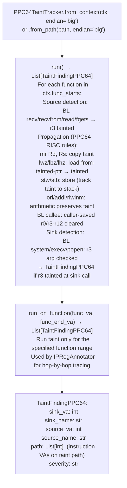

# PPC64 Taint Analysis

Track data flow through PPC64 big-endian and little-endian ELF binaries — supporting both ELFv1 (AIX, old Linux PPC64) and ELFv2 (modern OpenPOWER Linux, POWER8+) ABIs with 8 integer argument registers (`r3`–`r10`), and propagating taint from `recv`/`read`/`recvfrom` sources through to exec-class sinks.

---

## Why this exists

1. **PPC64 BE is the architecture for FortiOS 6.x and earlier binaries** — the target architecture for the original FortiGate taint analysis work. `PPC64TaintTracker` provides the same labeled-taint model as `TaintTrackerARM64` but for PPC64 BE, covering `r3`–`r10` argument registers and the `r2` TOC pointer that distinguishes ELFv1 from ELFv2.

2. **ELFv1 (AIX, old Linux PPC64) uses function descriptors in `.opd`** — each function is a 3-pointer struct (code VA, TOC, environment). `PPC64TaintTracker.from_context(ctx, endian='big')` handles ELFv1 automatically when `Ppc64ElfV1Resolver` has patched the context; pass `endian='little'` for ELFv2 LE (modern IBM POWER servers, RHEL PPC64LE).

3. **`PPC64TaintTracker.run_on_function(func_va, func_end_va)` enables targeted analysis** — rather than running the full binary taint analysis, the caller specifies the function VA bounds and receives taint findings only for that function. This is the mechanism used by `IPRegAnnotator` to extend taint chains across function boundaries without re-running the full corpus.

---

## How it works



---

## Usage

```python
from ablation.analyzers.taint_tracker_ppc64 import PPC64TaintTracker
from ablation.analyzers.binary_context import BinaryContext
from ablation.analyzers.ppc64_elfv1_resolver import Ppc64ElfV1Resolver

ctx = BinaryContext.load_or_build('/path/to/fortios_6x_httpd')
# Patch ELFv1 OPD if needed
Ppc64ElfV1Resolver(ctx).patch_context()

tracker = PPC64TaintTracker.from_context(ctx, endian='big')
findings = tracker.run()

for f in findings:
    print(f"  {f.sink_name} at {f.sink_va:#x}  source={f.source_name}@{f.source_va:#x}")
```

---

## Example output

The following illustrates PPC64 taint analysis output format. Actual addresses are binary-specific.

```
PPC64TaintTracker: fortios_6x_httpd  (big-endian, ELFv1)

Sources: recv, recvfrom, read, fgets
Sinks:   system, execv, popen

Findings: <N>

  system at <va>
    source: recv() at <va>
    path: [<va>, <va>, <va>, ...]
    CRITICAL: unbound taint reaches r3 of system()
```

---

## False positives

**ELFv1 function descriptor resolution requires `Ppc64ElfV1Resolver.patch_context()` to run first** — if the context is not patched, PLT entries point to OPD descriptors rather than code VAs, and `run()` will not find sink call sites. Always run `Ppc64ElfV1Resolver` before `PPC64TaintTracker` on ELFv1 targets.

**`r2` TOC pointer tracking is approximate** — ELFv2 binaries expect `r2` to be set by the caller's `TOC` save slot. If `r2` is used as a general-purpose register in a compiler-optimized function (rare but valid), the tracker may misidentify it as a taint propagation through `r2`.

---

## Pipeline position

Run `PPC64TaintTracker` on any PPC64 BE ELF binary (FortiOS 6.x, Cell PPU PS3 system binaries, IBM POWER server daemons). For ELFv1 targets, always run `Ppc64ElfV1Resolver.patch_context()` first. For PPC64 LE (RHEL, Ubuntu PPC64LE), pass `endian='little'`.

---

## See also

- [PPC64 ELFv1 Resolution](ppc64-elfv1-resolution.md) — `Ppc64ElfV1Resolver` required preprocessing for ELFv1 targets
- [PPC64 BE Sink Classification](ppc64-be-sink-classification.md) — `Ppc64BeSinkClassifier` for gap-filling before PPC64TaintTracker
- [Named Taint Sources and Bounds](named-taint-sources-and-bounds.md) — ARM64/x86-64 equivalent
