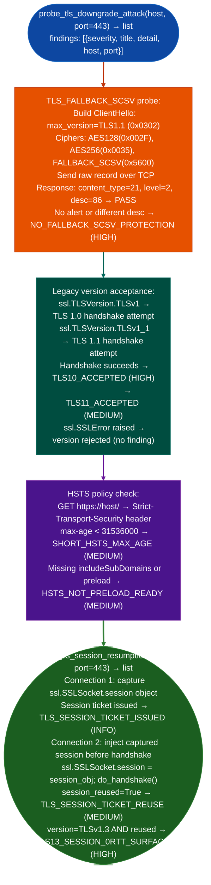

# TLS Session Downgrade Surfaces

Detect TLS protocol downgrade weaknesses: absence of `TLS_FALLBACK_SCSV` protection RFC 7507, legacy version acceptance TLS 1.0/1.1, session ticket reuse enabling retroactive decryption, and TLS 1.3 0-RTT replay surfaces: by sending raw ClientHello records and probing session resumption behavior via `modules/tls_enum.py`.

---

## Why this exists

1. **`probe_tls_downgrade_attack()` confirms whether the server enforces `TLS_FALLBACK_SCSV` RFC 7507**: a client that cannot negotiate TLS 1.3 falls back to a lower version. An active MITM attacker can force this fallback by blocking higher-version records. RFC 7507 requires servers to respond with a fatal `inappropriate_fallback` alert content type 21, level 2, description 86 when they see `TLS_FALLBACK_SCSV` (0x5600) in a ClientHello with a version below the server's maximum. Absence of this alert means the server does not reject forced downgrades. `probe_tls_downgrade_attack()` sends a TLS 1.1 ClientHello containing `TLS_FALLBACK_SCSV` and checks for the alert response.

2. **Legacy TLS version acceptance creates a persistent downgrade surface**: TLS 1.0 and 1.1 were deprecated by RFC 8996 in March 2021. Both versions use MAC-then-Encrypt with CBC cipher suites that are vulnerable to BEAST (TLS 1.0) and POODLE class attacks. `probe_tls_downgrade_attack()` attempts a TLS 1.0 and TLS 1.1 handshake using `ssl.SSLContext.minimum_version = ssl.TLSVersion.TLSv1` and flags servers that complete the handshake as `TLS10_ACCEPTED` / `TLS11_ACCEPTED`.

3. **`probe_tls_session_resumption()` tests session ticket reuse and TLS 1.3 0-RTT replay risk**: session tickets encrypt the server's session state under a ticket encryption key. A server that accepts session resumption (`session_reused=True` on second handshake) means that any attacker who captured prior TLS ciphertext and later compromises the ticket key can retroactively decrypt those sessions. On TLS 1.3 connections, session resumption enables 0-RTT early data: a channel that does not provide replay protection and that an on-path attacker can replay without triggering a handshake failure.

---

## How it works



---

## Usage

```python
from modules.tls_enum import probe_tls_downgrade_attack, probe_tls_session_resumption

host = '<target-host>'

# All findings: {severity, title, detail, host, port}
for finding in probe_tls_downgrade_attack(host, port=443):
    print(f"  [{finding['severity']}] {finding['title']}: {finding['detail'][:100]}")

# Session resumption / 0-RTT check
for finding in probe_tls_session_resumption(host, port=443):
    print(f"  [{finding['severity']}] {finding['title']}: {finding['detail'][:100]}")
```

---

## Example output

The following is a schematic example showing output structure and field names. Values are illustrative.

```
probe_tls_downgrade_attack: <target-host>:443

  [HIGH]   NO_FALLBACK_SCSV_PROTECTION
           Server did not return inappropriate_fallback alert (RFC 7507) when
           TLS_FALLBACK_SCSV was presented with a downgraded version

  [HIGH]   TLS10_ACCEPTED
           Server accepted TLS 1.0 — deprecated since RFC 8996 (2021)

  [MEDIUM] SHORT_HSTS_MAX_AGE
           HSTS max-age=<n> is below 31536000 (1 year)

probe_tls_session_resumption: <target-host>:443

  [INFO]   TLS_SESSION_TICKET_ISSUED
           TLS session ticket issued (version TLSv1.3) — ticket key rotation
           policy determines forward secrecy window

  [HIGH]   TLS13_SESSION_0RTT_SURFACE
           TLS 1.3 session ticket reused — 0-RTT early data replay attack surface
```

---

## False positives

**`TLS10_ACCEPTED` on hosts behind a TLS-terminating load balancer**: the probe connects to the load balancer, which may accept legacy versions while the backend application only sees TLS 1.3 traffic. Confirm the version the application itself receives by checking server-side TLS configuration or using an internal probe.

**`TLS_SESSION_TICKET_REUSE` on TLS 1.3 with short-lived tickets**: RFC 8446 §4.6.1 requires TLS 1.3 session tickets to have a `ticket_lifetime` of at most 7 days. If the server rotates ticket keys every few hours, the blast radius of ticket key compromise is bounded. Treat `TLS_SESSION_TICKET_REUSE` as a configuration finding to document, not a direct exploitability indicator.

**`NO_FALLBACK_SCSV_PROTECTION` on TLS 1.3-only servers**: a server that refuses all connections below TLS 1.3 at the TCP/TLS layer will terminate the connection before evaluating `TLS_FALLBACK_SCSV`. In this case the probe may see a connection reset rather than a `ServerHello`, and the finding may not fire. Absence of the finding on a TLS 1.3-only server is a correct negative.

---

## Pipeline position

Run TLS session downgrade checks after `TLSAnalyzer.analyze()` establishes the server's advertised cipher and version support. Findings from `probe_tls_downgrade_attack()` and `probe_tls_session_resumption()` confirm active downgrade risk; combine with `check_weak_cipher_suites()` and `probe_mtls_enforcement()` for a complete TLS posture picture.

---

## Reading findings

TLS downgrade probe functions return `List[{severity, title, detail, host, port}]`:

| Field | Content |
|:---|:---|
| `severity` | `HIGH` active downgrade / `MEDIUM` deprecated version accepted |
| `title` | Finding code for example `NO_FALLBACK_SCSV_PROTECTION`, `TLS10_ACCEPTED`, `TLS11_ACCEPTED` |
| `detail` | RFC reference and exploitation context |
| `host` | Target hostname |
| `port` | TLS port (typically `443`) |

---

## See also

- [TLS Certificate and Protocol Probing](tls-certificate-and-protocol-probing.md): `TLSAnalyzer` for certificate chain and cipher suite inventory
- [TLS Policy Checks](tls-policy-checks.md): mTLS enforcement, ACME endpoint exposure, certificate pinning
