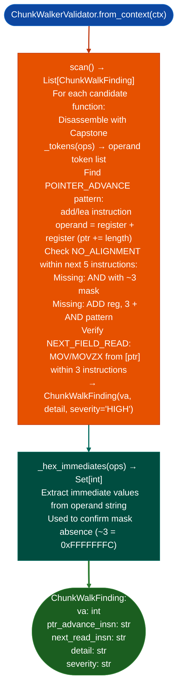

# TLV/Chunk Alignment Checks

Detect TLV/chunk parser implementations that advance the chunk pointer by the raw user-supplied length field without rounding up to the next 4-byte boundary: a parsing desynchronization vulnerability class that causes subsequent chunks to be parsed with padding bytes as their type/length fields: via `modules/chunk_walker_validator.py`.

---

## Why this exists

1. **SCTP RFC 9260, DNS RFC 1035, GRE, PPTP, and IS-IS all require TLV/chunk boundaries to be 4-byte aligned.** A parser that uses `ptr += length` without `length + 3 & ~3` rounding will process valid packets correctly when chunks happen to be naturally aligned, but will misparse the protocol state machine when padding bytes appear. This class of bug produces protocol confusion findings rather than traditional stack overflows.

2. **`ChunkWalkFinding` is the C13-class candidate pattern** from stripped protocol parser binaries: `C13` refers to the internal finding class identifier for SCTP chunk alignment gaps. The pattern requires three sequential conditions in the disassembly: (1) `ptr += length` with a raw `add/lea` instruction; (2) no `(len + 3) & ~3` mask within the next 5 instructions; (3) a field read from the advanced pointer next chunk type/length read begins. All three must be present.

3. **`_build_reg_families()` and `_reg_family()`** group processor registers by function accumulator, general-purpose, base pointer families so that the pattern matcher handles the case where the same TLV length was moved to a different register before the `ptr += length` instruction: a common compiler optimization that naive byte-pattern matching cannot detect.

---

## How it works



---

## Usage

```python
from modules.chunk_walker_validator import ChunkWalkerValidator
from ablation.analyzers.binary_context import BinaryContext

ctx = BinaryContext.load_or_build('/path/to/sctp_parser.so')
validator = ChunkWalkerValidator.from_context(ctx)
findings = validator.scan()

print(f"Chunk alignment gaps: {len(findings)}")
for f in findings:
    print(f"  {f.va:#x}  [{f.severity}]  {f.detail}")
    print(f"    ptr_advance: {f.ptr_advance_insn}")
    print(f"    next_read:   {f.next_read_insn}")
```

---

## Example output

The following illustrates TLV chunk alignment check output format.

```
ChunkWalkerValidator: sctp_parser.so

Chunk alignment gaps: <N>

  0xXXXXXX  [HIGH]  ptr += length without (len+3)&~3
    ptr_advance: add rdi, rdx
    next_read:   movzx eax, word ptr [rdi]
```

---

## False positives

**Not all `ptr += register` patterns are TLV/chunk length advances**: the pattern fires on any add instruction where a pointer is incremented by a register value, including loop counters and array index calculations. Filter results to functions whose names (from `SemanticSearcher`) suggest protocol parsing or TLV processing.

**Protocol-specific alignment requirements vary**: some protocols use 2-byte alignment; others have no alignment requirement. The scanner always checks for 4-byte alignment (`~3` mask). For protocols with non-4-byte alignment, the finding may be a false positive. Verify against the protocol RFC before reporting.

---

## Pipeline position

Run `ChunkWalkerValidator` on network protocol parser binaries after `SemanticSearcher` identifies TLV/chunk processing candidates. Complement with `TaintTracker` to confirm that the `length` field originates from untrusted network input rather than a constant.

---

## Reading findings

`ChunkWalkerValidator.scan()` returns a list of finding dicts:

| Field | Content |
|:---|:---|
| `severity` | `HIGH` |
| `title` | Finding code for example `CHUNK_LENGTH_NO_ALIGNMENT`, `CHUNK_ADVANCE_UNSIGNED` |
| `va` | VA of the unaligned pointer advance instruction |
| `ptr_advance` | Disassembly of the advance instruction for example `add rdi, rdx` |
| `next_read` | Disassembly of the subsequent read using the advanced pointer |
| `detail` | Description of the alignment gap |

---

## See also

- [Named Taint Sources and Bounds](named-taint-sources-and-bounds.md): `TaintTracker` to confirm the length value is network-sourced
- [Sink Argument Classification](sink-argument-classifier.md): `SinkArgClassifier` for the SCTP/protocol sink calls in the same function
