```mermaid
flowchart TD
    A(["SinkPropagator.from_path(path)\n  or .from_context(ctx)"]):::input --> B["propagate() → List[SinkWrapper]\n  Initial seed: all known PLT sinks\n    (system, popen, execve, execl, execvp, etc.)\n  add_sink(name, arg_pos) to extend"]:::primary
    B:::primary --> C["Level 1 scan:\n  For each function in binary:\n    Does it call a known sink with its own arg at sink_arg_pos?\n    i.e., 'call system' where rdi ← rdi (function entry arg 0)?\n    → new SinkWrapper(name=func, arg_pos=0, chain=['system'])"]:::secondary
    C:::secondary --> D["Iterate to fixed point:\n  Use Level 1 wrappers as new sinks\n  Find Level 2 wrappers that call Level 1 wrappers\n  Repeat until no new wrappers found\n  Max depth: configurable (default: unlimited)"]:::tertiary
    D:::tertiary --> E["SinkWrapper:\n  wrapper_name: str\n  wrapper_arg_pos: int\n  chain: List[str]  (full call chain to base sink)\n  depth: int  (1 = direct wrapper, 2 = wrapper of wrapper, ...)\n  fmt() → formatted chain\n  as_dict() → structured output"]:::tertiary
    E:::tertiary --> F(["report(wrappers) → str\n  Group by depth level\n  Show wrapper name + chain for each"]):::output
    classDef input     fill:#0d47a1,stroke:#1565c0,color:#fff
    classDef primary   fill:#e65100,stroke:#bf360c,color:#fff
    classDef secondary fill:#004d40,stroke:#00695c,color:#fff
    classDef tertiary  fill:#4a148c,stroke:#6a1b9a,color:#fff
    classDef neutral   fill:#37474f,stroke:#546e7a,color:#fff
    classDef output    fill:#1b5e20,stroke:#2e7d32,color:#fff
    linkStyle 0 stroke:#bf360c,stroke-width:2px
    linkStyle 1 stroke:#00695c,stroke-width:2px
    linkStyle 2 stroke:#6a1b9a,stroke-width:2px
    linkStyle 3 stroke:#6a1b9a,stroke-width:2px
    linkStyle 4 stroke:#2e7d32,stroke-width:3px
```

<a id="sinkpropagator"></a>
# Input Validation & Call Wrappers

Compute the transitive closure of passthrough wrappers around known exec sinks: finding all wrapper functions at any depth that propagate their argument to `system`/`popen`/`execve`, so that `TaintTracker` can use the expanded sink list to find injection paths hidden behind multi-level custom wrappers.

---

## Why this exists <sup>[↑](#sinkpropagator)</sup>

1. **When a binary wraps `system()` behind `doSystem(string)` which is called by `systemLog(char*)`: three levels deep: `TaintTracker` finds zero injection sites while the vulnerability is reachable.** `SinkPropagator.propagate()` discovers all three wrapper functions by iterating to a fixed point: if `addUser()` passes its arg to `doSystem()`, and `doSystem()` passes its arg to `systemLog()`, and `systemLog()` calls `system()`: all three are returned as `SinkWrapper` findings with their full call chain lineage.

2. The expanded wrapper list enables a single `TaintTracker` run to trace injection from the entry point to the ultimate exec sink: without wrapper discovery, the analyst must manually identify wrapper chains by reading call graphs, a process that takes 20–60 minutes per wrapper level. `SinkPropagator` completes this in under 10 seconds on typical firmware binaries.

3. `SinkPropagator` handles multi-parameter wrappers: some wrappers forward argument 1 (`rsi`) to the sink rather than argument 0 (`rdi`). `SinkWrapper.wrapper_arg_pos` records which argument of the wrapper corresponds to the sink's dangerous argument, so `TaintTracker.add_sinkname, arg_pos=wrapper_arg_pos` is called with the correct position.

---

## How it works <sup>[↑](#sinkpropagator)</sup>



---

## Usage <sup>[↑](#sinkpropagator)</sup>

```python
from ablation.analyzers.sink_propagator import SinkPropagator
from ablation.analyzers.sink_arg_classifier import SinkArgClassifier
from ablation.analyzers.binary_context import BinaryContext

ctx = BinaryContext.load_or_build('/path/to/target.elf')

# Discover wrapper chain
propagator = SinkPropagator.from_context(ctx)
propagator.add_sink('fad_csystem', arg_pos=0)  # vendor-specific wrapper
wrappers = propagator.propagate()
print(propagator.report(wrappers))

# Expand SinkArgClassifier with discovered wrappers
clf = SinkArgClassifier.from_context(ctx)
for w in wrappers:
    clf.add_sink(w.wrapper_name, w.wrapper_arg_pos)

# Now classify all sinks including wrappers
results = clf.classify_all()
```

### Check sanitization coverage

`SanitizerDetector` identifies likely validation and normalization routines, while `coverage()` checks whether calls to those routines appear near a selected function's sinks.

```python
from ablation.analyzers.sanitizer_detector import SanitizerDetector

sanitizers = SanitizerDetector.from_context(ctx)
profiles = sanitizers.detect()
print(sanitizers.report(profiles))

for profile in profiles:
    if profile.score >= 3:
        print(hex(profile.func_va), profile.fmt())
```

A sanitizer profile is evidence about a function's behavior, not proof that it makes every input safe. Wrapper propagation likewise shows argument flow, not whether a wrapper preserves dangerous content. Inspect transformations and validation semantics before downgrading a finding.

---

## Example output <sup>[↑](#sinkpropagator)</sup>

The following illustrates the wrapper discovery output format. Actual wrapper names and chain depths are binary-specific.

```
SinkPropagator: <binary>

Level 1 wrappers (direct callers of base sinks):
  doSystem(arg0) → system  (chain: system)
  exec_cmd(arg1) → popen   (chain: popen)

Level 2 wrappers (callers of level-1 wrappers):
  systemLog(arg0) → doSystem → system  (chain: doSystem → system)
  run_command(arg0) → doSystem → system

Level 3:
  addUser(arg0) → systemLog → doSystem → system

Total: <N> wrappers at depth 1-3
```

---

## False positives <sup>[↑](#sinkpropagator)</sup>

**`SinkPropagator` detects argument passthrough by checking whether the wrapper's call to the sink uses the wrapper's own entry argument register**: a wrapper that modifies the argument before passing it for example adds a prefix string will be classified as a wrapper even though it is partially safe. `SinkWrapper.chain` shows the full call path for manual verification.

**Propagation to a fixed point with large binaries may return hundreds of wrappers**: most will be utility functions that happen to call exec with a caller-provided path. Filter by `depth <= 3` and focus on wrappers that appear in the `SemanticSearcher` sweep results as handler candidates.

---

## Pipeline position <sup>[↑](#sinkpropagator)</sup>

Run `SinkPropagator.propagate()` before `SinkArgClassifier.classify_all()` on any binary where the initial `SinkArgClassifier` run returns few `ARG_PROPAGATED` results but the `SemanticSearcher` sweep suggests exec sinks in handler functions. Wrapper discovery unblocks the taint analysis when direct sink detection produces no results.

---

## Reading output <sup>[↑](#sinkpropagator)</sup>

`SinkPropagator.propagate()` returns `List[SinkWrapper]`: one entry per discovered wrapper function:

| Attribute | Content |
|:---|:---|
| `va` | VA of the wrapper function |
| `name` | Demangled name (or `sub_VA` if stripped) |
| `param_idx` | Which parameter (0-based) is propagated to the sink |
| `call_va` | VA of the call instruction inside this wrapper |
| `wraps_va` | VA of the immediate sink being called |
| `wraps_name` | Name of the immediate sink |
| `chain` | `List[str]`: lineage from root PLT sink to this wrapper |

Add wrapper names to `SinkArgClassifier` by calling `SinkPropagator.add_sinkname, arg_pos` to extend coverage before running the classifier.

---

## See also <sup>[↑](#sinkpropagator)</sup>

- [Sink Argument Classifier](sink-argument-classifier.md): consumes the expanded sink list from `SinkPropagator`
- [Vendor Sink Profiles](vendor-sink-profiles.md): vendor-specific wrappers registered explicitly via YAML profile
- [Cross-Library Analysis](cross-library-analysis.md): extends wrapper discovery across library boundaries
