# Unknown HTTP API Mapping

Autonomously reverse-engineer an unknown HTTP API from a base URL: detecting framework, harvesting OpenAPI specs, fuzzing paths and methods, probing injection surfaces path traversal, SQLi, SSTI, SSRF, XXE, prototype pollution, JWT attack surface alg=none, weak secret, kid injection, jku SSRF, BOLA/IDOR, GraphQL introspection, OAuth2/OIDC metadata, gRPC reflection, SOAP/WSDL discovery, JSON-RPC enumeration, and webhook SSRF: producing a structured `APIMap` with discovered endpoints, parameters, vulnerability signals, and findings.

---

## Why this exists

1. **APIs served behind NX-API proxies, ML inference servers, and voice synthesis endpoints do not publish schema documentation externally: the only way to determine what parameters they accept, what authentication they use, and which attack surfaces they expose is to probe them systematically.** `api_re.py` covers the 16 phases that precede behavioral analysis: framework detection from `Server` headers and framework-specific path signatures, OpenAPI schema harvesting from 18 known paths `/openapi.json`, `/swagger.json`, `/api-docs`, `/_schema/`, etc., threaded path fuzzing across a 95-entry wordlist, and per-parameter injection probing with confirming-signal gating. Without this, each RE session starts from a manual `curl` baseline.

2. **Injection probing without confirming-signal gating produces hundreds of false positives: `PATH_ACCESS` file-not-found error in body fires for path traversal, SQL injection, SSRF, and XXE payloads indiscriminately.** `CONFIRMING_SIGNALS` maps each injection category to the signal set that confirms it: `sql_injection` requires `SQL_REFLECT` (MySQL/Postgres/ORA- syntax errors), not just `PATH_ACCESS`; `ssrf` requires `SSRF_ACTIVE` connection refused / no route or `SSRF_CLOUD_METADATA` ami-id, instance-id in body, without errno; `ssti` requires `SSTI_EVAL` (payload `{{7*7}}` produces `49` in body). Only findings with a confirmed signal are reported.

3. **JWT attacks: alg=none bypass, HS256 weak-secret cracking, kid SQL/path injection, and jku SSRF: are invisible to standard vulnerability scanners because they require token extraction from response bodies and headers before manipulation.** `analyze_tokens_in_response()` extracts JWTs using `eyJ[A-Za-z0-9_-]+\.eyJ...` regex from both response body and headers, decodes without signature verification, and runs four attacks: forge `alg=none` and resend with `Authorization: Bearer <forged>`; crack HS256 against 18 weak secrets; check `kid` header claim presence SQLi/path traversal in key lookup; check `jku`/`x5u`/`jwks_uri` header claims SSRF via JWK Set URL.

---

## How it works

```mermaid
flowchart TD
    A(["run_re(base_url, depth='normal', focus=None)"]):::input --> B["Phase 1: detect_framework(base):\n  GET / → Server header: uvicorn→FastAPI, gunicorn→Flask, nginx→proxy\n  GET /openapi.json, /docs, /redoc → FastAPI 0.95\n  GET /config, /queue/status + 'gradio' in body → Gradio 0.95\n  GET /graphql|/gql|/query + 'graphql' in body → GraphQL 0.90"]:::primary
    B:::primary --> C["Phase 2: harvest_openapi(base):\n  18 paths: /openapi.json, /swagger.json, /api-docs, /_schema/, /spec.json...\n  Returns spec dict if 'paths'/'openapi'/'swagger' in parsed JSON\n  parse_openapi(spec): Endpoint(path, methods, params, responses) per operation\n  params: {name: {location, required, schema}} + __body__ for requestBody"]:::secondary
    C:::secondary --> D["Phase 2b: discover_versions(base):\n  7 version patterns × versions 1-5: /v{n}, /api/v{n}, /rest/v{n}...\n  Non-404/400/405 → VERSION detected (shadow API candidate)"]:::tertiary
    D:::tertiary --> E["Phase 3: fuzz_paths(base, workers=30):\n  95-entry PATH_WORDLIST × ('GET','POST')\n  Non-404/405 → found endpoint\n  ThreadPoolExecutor(max_workers=30)"]:::tertiary
    E:::tertiary --> F["Phase 3b: probe_graphql(base):\n  6 paths: /graphql, /api/graphql, /gql...\n  POST __schema introspection → all types/fields\n  Error 'did you mean' → field suggestion leakage\n  POST mutation { __typename } → mutations enabled"]:::tertiary
    F:::tertiary --> G["Phase 3c: discover_hidden_params(base):\n  8 JS paths: /static/js/main.js, /assets/index.js...\n  5 PARAM_PATTERNS regex over JS bundle text\n  Extracts undocumented param names"]:::tertiary
    G:::tertiary --> H["Phase 4: probe_param(base, path, param, method):\n  7 injection categories × payloads\n  Per result: check CONFIRMING_SIGNALS\n  PATH_TRAVERSAL: FILE_READ|PATH_ACCESS\n  SQL: SQL_REFLECT ('syntax error', 'mysql', 'ora-')\n  SSTI: SSTI_EVAL ('49' in body when {{7*7}})\n  SSRF: SSRF_ACTIVE|SSRF_CLOUD_METADATA (no errno guard)\n  XXE: FILE_READ|SSRF_ACTIVE\n  Only confirmed categories reported"]:::tertiary
    H:::tertiary --> I["Phase 4b-4f (parallel):\n  4b: probe_verb_tampering · 12 HTTP methods + 3 override headers × DELETE/PUT/PATCH\n  4c: probe_content_type_switch · JSON/XML/form-encoded body on POST/PUT\n  4d: probe_param_pollution · duplicate params: safe&sql-payload\n  4e: probe_mass_assignment · 18 admin fields in POST body, check reflection\n  4f: probe_bola · {placeholder} substitution + /path/1,2,admin,UUID suffix"]:::tertiary
    I:::tertiary --> J["Phase 4g: analyze_tokens_in_response():\n  Extract JWT regex from body+headers\n  Decode header+payload (no verification)\n  forge_jwt_alg_none: alg=none, resend, check non-401\n  crack_jwt_secret: HMAC against 18 weak secrets\n  kid claim: log SQLi/path injection candidate\n  jku/x5u: log SSRF via JWK URL candidate"]:::tertiary
    J:::tertiary --> K["Phase 5: extract_info_from_errors():\n  POST/GET with empty body, 1000-char string, __proto__:admin, invalid types\n  400/422/500 with 'detail' → validation_error (FastAPI schema leak)\n  400/422/500 with 'Traceback' → stack_trace_leak\n  /home/|/var/|/usr/ in body → path_disclosure"]:::tertiary
    K:::tertiary --> L(["Phase 8: probe_oauth2(base):\n  13 discovery paths: /.well-known/openid-configuration, /oauth/token...\n  Extract issuer/token_endpoint/authorization_endpoint/jwks_uri\n  redirect_uri: evil.com, javascript:alert, localhost (non-400 → open redirect)\n  client_credentials with 6 default client:secret pairs\n  Follow jwks_uri → log JWKS exposure"]):::output
    M(["Phase 9: probe_grpc(base):\n  3 gRPC-Web paths: ListServices payload b'\\x00\\x00\\x00\\x00\\x02\\x0a\\x00'\n  'grpc' in content-type → gRPC endpoint\n  REST gateway paths: /v1/services, /grpc/services, /reflection"]):::input
    N(["Phase 12: probe_wsdl_soap(base):\n  12 WSDL paths: /?wsdl, /service?wsdl, /soap...\n  body has 'wsdl'|<definitions|<schema → parse operation/type names\n  POST SOAP_XXE body → 'root:' in response → XXE confirmed"]):::input
    O(["Phase 13: probe_jsonrpc(base):\n  10 paths × system.listMethods, system.describe, rpc.discover, help\n  result non-null → methods exposed\n  POST array → batch execution supported"]):::input
    P(["Phase 15: probe_webhook_ssrf(base):\n  12 webhook paths + discovered endpoints\n  13 webhook param names × 3 cloud metadata URLs\n  sentinel baseline comparison: response diff = param consumed\n  ami-id/instance-id in body → SSRF metadata confirmed"]):::input
    Q(["Phase 16: probe_default_creds(base):\n  16 auth path patterns × POST with 14 default pairs\n  status code difference (valid vs invalid username) → user enumeration\n  200 with token/access_token in JSON → auth success"]):::input
    classDef input     fill:#0d47a1,stroke:#1565c0,color:#fff
    classDef primary   fill:#e65100,stroke:#bf360c,color:#fff
    classDef secondary fill:#004d40,stroke:#00695c,color:#fff
    classDef tertiary  fill:#4a148c,stroke:#6a1b9a,color:#fff
    classDef neutral   fill:#37474f,stroke:#546e7a,color:#fff
    classDef output    fill:#1b5e20,stroke:#2e7d32,color:#fff
    linkStyle 0 stroke:#bf360c,stroke-width:2px
    linkStyle 1 stroke:#00695c,stroke-width:2px
    linkStyle 2 stroke:#6a1b9a,stroke-width:2px
    linkStyle 3 stroke:#6a1b9a,stroke-width:2px
    linkStyle 4 stroke:#6a1b9a,stroke-width:2px
    linkStyle 5 stroke:#6a1b9a,stroke-width:2px
    linkStyle 6 stroke:#6a1b9a,stroke-width:2px
    linkStyle 7 stroke:#6a1b9a,stroke-width:2px
    linkStyle 8 stroke:#6a1b9a,stroke-width:2px
    linkStyle 9 stroke:#6a1b9a,stroke-width:2px
    linkStyle 10 stroke:#2e7d32,stroke-width:3px
```



### Injection categories and confirming signals

| Category | Confirming signals | Payloads (sample) |
|---|---|---|
| `path_traversal` | `FILE_READ`, `PATH_ACCESS` | `../../../../etc/passwd`, `/proc/self/environ` |
| `sql_injection` | `SQL_REFLECT` | `' OR '1'='1`, `1' AND SLEEP(3)--` |
| `ssti` | `SSTI_EVAL` | `{{7*7}}`, `${7*7}`, `<%= 7*7 %>` |
| `ssrf` | `SSRF_ACTIVE`, `SSRF_CLOUD_METADATA` | `http://169.254.169.254/`, `file:///etc/passwd` |
| `xxe` | `FILE_READ`, `SSRF_ACTIVE` | DOCTYPE + SYSTEM entity to `/etc/passwd` |
| `pickle_rce` | `PICKLE_DESERIALIZE` | `/etc/passwd`, `/proc/self/maps` |
| `prototype_pollution` | `PROTO_POLLUTION_REFLECT` | `{"__proto__":{"admin":true}}` |

### `--focus` mode mapping

| Focus | Phases activated |
|---|---|
| `injection` | 4, 19 (NoSQL), 24 second-order, deep only, 25 null byte/WAF |
| `jwt` or `auth` | 4g, 8, 16, 17 (CORS), 18 alg confusion, 20 (BFLA), 26 OAuth dynamic reg, 30 OAuth state/PKCE |
| `bola` | 4f, 20 (BFLA), 28 pagination, deep only |
| `oauth2` | 8, 26, 30 |
| `grpc` | 9 |
| `graphql` | 3b, 10 advanced, 27 (WebSocket) |
| `soap` | 12 |
| `ssrf` | 15, 22 host header |
| `schema` or `shadow` | 21 (PII), 27, 28, 29 shadow versions |
| `None` (default) | All phases |

---

## Usage

```python
from modules.api_re import run_re, probe_param, probe_graphql, probe_oauth2

# Full pipeline
api = run_re('http://192.168.1.100:5000', depth='normal')
print(f"Framework: {api.framework}")
print(f"Endpoints: {len(api.endpoints)}")
for ep in api.endpoints:
    vuln = f" [VULN: {ep.vuln_signals}]" if ep.vuln_signals else ""
    print(f"  {' '.join(ep.methods)} {ep.path}{vuln}")

# Focus on injection only (faster for targeted assessment)
api2 = run_re('http://target:8080', depth='normal', focus='injection')

# Deep scan (adds state mapping, timing oracle, second-order injection, pagination)
api3 = run_re('http://target:8080', depth='deep')

# CLI modes
# python api_re.py http://target:5000
# python api_re.py http://target:5000 --depth deep
# python api_re.py http://target:5000 --focus jwt
# python api_re.py http://target:5000 --focus bola
# python api_re.py http://target:5000 --focus oauth2
# python api_re.py http://target:5000 --focus grpc
# python api_re.py http://target:5000 --focus soap
# python api_re.py http://target:5000 --fuzz-params /control
# python api_re.py http://target:5000 --output report.json
# python api_re.py http://target:5000 --verbose

# Targeted injection probe on a specific endpoint and parameter
from modules.api_re import probe_param
signals = probe_param('http://target:5000', '/api/v1/tts', 'text', method='GET')
for category, results in signals.items():
    for r in results:
        print(f"[{category}] signals={r['confirmed_signals']} body={r['body'][:60]}")

# JWT-only run
from modules.api_re import analyze_tokens_in_response, APIMap, Endpoint
# Build minimal endpoint list manually
ep = Endpoint(path='/api/v1/me', methods=['GET'])
jwt_findings = analyze_tokens_in_response('http://target:5000', [ep])
for f in jwt_findings:
    print(f"[{f['type']}] alg={f.get('alg')} secret={f.get('secret')}")

# Save JSON report
api4 = run_re('http://target:5000', depth='normal')
import json
from dataclasses import asdict
report = {
    'base_url': api4.base_url,
    'framework': api4.framework,
    'endpoints': [asdict(ep) for ep in api4.endpoints],
    'findings': api4.findings,
}
open('api_map.json', 'w').write(json.dumps(report, indent=2))
```

---

## Example output

The following illustrates the console output format and evidence structure for representative findings. Actual framework names, endpoint paths, parameter names, JWT claims, and OAuth metadata URLs will reflect the specific target.

```
============================================================
API-RE: http://<target>:<port>
============================================================

[1] Framework detection...
  <Framework>: <confidence>% confidence

[2] OpenAPI schema harvest...
  Found OpenAPI spec: <n> endpoints
  POST <path> | params: ['<param>', '<param>', ...]
  GET <path> | params: []

[4] Injection probing...
  [!] path_traversal CONFIRMED on param='<param>': ['FILE_READ'] | root:x:0:0:root:/root:/bin/bash

[4g] JWT analysis...
  [JWT] Found at <path>: alg=<alg> | payload_keys=['<claim>', '<claim>', '<claim>']
  [JWT_ALG_NONE] alg=none accepted at <path>: HTTP 200

[8] OAuth2/OIDC attack surface...
  [OAUTH2_META] /.well-known/openid-configuration: ['issuer', 'authorization_endpoint', 'jwks_uri']
  [JWKS] <jwks_uri>: {"keys":[{"kty":"RSA","kid":"<kid>","alg":"RS256",...}]}
```

---

## False positives

**`probe_param()` with `SSRF_ACTIVE` signal fires on any connection-refused error, not only from injected SSRF payloads.** If the target API itself calls an external service that happens to be down, any response with `connection refused` will trigger `SSRF_ACTIVE` regardless of which payload triggered it. Verify by checking that the error appears only with SSRF URL payloads `http://127.0.0.1/`, `http://169.254.169.254/` and not with benign string payloads. Retry with `VERBOSE=True` to see non-confirming probe signals.

**`probe_oauth2()` discovers OAuth metadata but `redirect_uri` manipulation fires on any non-400 response: including redirect to the legitimate callback URL.** The check flags a redirect URI as not rejected if the response status is not 400/422. An OAuth server that returns 302 to a legitimate redirect URI not the evil.com value still triggers the finding if the status check alone fires. Inspect `r.text` or `r.headers['location']` to confirm that the evil URI was accepted, not just that the authorization request was processed.

**`analyze_tokens_in_response()` JWT cracking against 18 weak secrets misses custom short secrets.** The weak-secret list covers common defaults `secret`, `password`, `123456`, `jwt`, `token`. Secrets like `app-specific-key-2024` or environment-variable-named secrets are not in the list. A JWT with no weak-secret match still gets `jwt_found` recorded: run `hashcat -m 16500` with a domain-specific wordlist for thorough cracking.

---

## Pipeline position

**Before this module:** Confirm network reachability and port number with `tiptoe` or a direct `curl -I http://target:port/`. Verify TLS versus plain HTTP: `run_re` uses `requests.Session` which handles both automatically, but HTTPS targets with self-signed certificates require `SESSION.verify = False` set this manually before running on targets with untrusted certs.

**After this module:** For `path_traversal FILE_READ` findings: expand the payload set to extract `/etc/nginx/nginx.conf`, `/proc/self/environ`, and `/root/.ssh/id_rsa`. For `jwt_alg_none_bypass` findings: forge a modified payload for example `role=admin` and replay. For `oauth2_discovery` findings: feed `authorization_endpoint`, `token_endpoint`, and `jwks_uri` to `probe_jwt_alg_confusion()` directly. Write confirmed findings to `~/VDT/VULNERABILITIES-<ip>.md`.

---

## Reading findings

| Field | Content |
|:---|:---|
| `api.framework` | Detected framework string or `"unknown"` |
| `api.endpoints` | `[Endpoint]`: each with `.path`, `.methods`, `.params`, `.vuln_signals` |
| `ep.vuln_signals` | Injection categories with confirmed signals for example `['path_traversal', 'ssrf']` |
| `ep.params` | `{name: {location, required, schema}}`: from OpenAPI or path fuzzing |
| `api.findings` | Phase 17-30 results: CORS, BFLA, PII, host injection, OAuth, shadow versions, etc. |

---

## See also

- [Business Logic and Version Exposure](business-logic-and-version-exposure.md): phases 17-30: CORS, BFLA, PII scanner, host injection, timing oracle, shadow versions, OAuth state/PKCE, WebSocket enumeration
- [Nginx Fingerprinting and Exposure](nginx-fingerprinting-and-exposure.md): fingerprint nginx version and CVEs when the API is served behind nginx
- [LLM Inference Endpoint Enumeration](inference-endpoint-enumeration.md): ML-inference-specific endpoint and parameter probing
