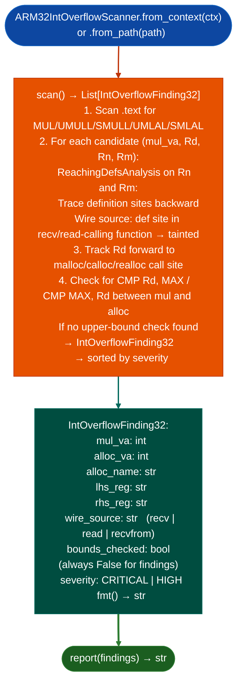

# ARM32 Integer Overflow Detection

Detect integer overflow vulnerabilities in ARM32 ELF binaries: finding `MUL`/`UMULL`/`SMULL` instructions whose operands are wire-controlled (traced to `recv`/`read` sources) and whose result flows into an allocation (`malloc`/`calloc`/`realloc`) without an intervening CMP-based upper-bound check: directly targeting heap size calculation overflows.

---

## Why this exists

1. **ARM32 is the primary architecture for embedded Linux targets where integer overflow in allocation sizing produces heap overflows.** `TaintTracker` on ARM32 tracks register flow but does not detect the structural pattern of multiplication without bounds check. `ARM32IntOverflowScanner` detects this pattern directly using `ReachingDefsAnalysis` to find wire-sourced operands.

2. **`MUL/UMULL/SMULL` with wire-controlled operands and no upper-bound check before `malloc`** is the specific pattern for CVE-class heap size overflows. A `recv` buffer whose length is multiplied by an element size: without `len > MAX_ELEMENTS` guard: produces a wrapped size argument. `ARM32IntOverflowScanner` finds all such patterns automatically.

3. **`UMLAL`/`SMLAL` accumulate-multiply instructions** are also checked: they compute `Rd = Rn * Rm + Rd_hi:Rd_lo`, and an overflow in the accumulate produces a wrapped result just as `UMULL` does. These are commonly missed by scanners that only check basic `MUL`.

---

## How it works



---

## Usage

```python
from ablation.analyzers.intoverflow_scanner_arm32 import ARM32IntOverflowScanner
from ablation.analyzers.binary_context import BinaryContext

ctx = BinaryContext.load_or_build('/path/to/arm32_target.so')
scanner = ARM32IntOverflowScanner.from_context(ctx)

findings = scanner.scan()
print(ARM32IntOverflowScanner.report(findings))

for f in findings:
    print(f"  MUL at {f.mul_va:#x} → {f.alloc_name} at {f.alloc_va:#x}")
    print(f"  Wire source: {f.wire_source}")
```

---

## Example output

The following illustrates ARM32 integer overflow detection output format. Actual addresses are binary-specific.

```
ARM32IntOverflowScanner: arm32_target.so

[CRITICAL] UMULL at <va> → malloc at <va>
  Operands: r2 × r3 (wire source: recv() at <va>)
  No CMP upper-bound check between MUL and malloc
  Heap overflow on size wraparound

[HIGH] MUL at <va> → calloc at <va>
  Operands: r1 × r4 (wire source: read() at <va>)
```

---

## False positives

**`ReachingDefsAnalysis` may not trace through all calling conventions**: a wire-controlled value passed via a callee-saved register across multiple function boundaries may not be traced back to its `recv` source. Findings with `wire_source=UNKNOWN` require manual trace verification.

**CMP upper-bound check detection looks for `CMP Rd, IMM` within the basic-block range between `mul_va` and `alloc_va`**: a bounds check in a called helper function not inline is not detected. Verify that `bounds_checked=False` findings are not guarded by an out-of-line check.

---

## Pipeline position

Run `ARM32IntOverflowScanner` on any ARM32 ELF binary as part of initial triage, alongside `SinkArgClassifierARM32`. Integer overflow heap size findings are high-value because they require no additional taint work: the pattern itself is the finding.

---

## Reading findings

`ARM32IntOverflowScanner.scan()` returns a list of finding dicts:

| Field | Content |
|:---|:---|
| `severity` | `CRITICAL` |
| `title` | Finding code for example `UMULL_TO_MALLOC_UNCHECKED`, `MUL_SIZE_NO_OVERFLOW_GUARD` |
| `mul_va` | VA of the UMULL/MUL instruction |
| `sink_va` | VA of the allocation or memcpy sink that receives the multiplied size |
| `operands` | String describing the multiplied registers |
| `source_va` | VA of the taint source for example `recv(`) if recoverable |
| `detail` | Full description of the overflow path |

---

## See also

- [ARM32 Sink Argument Classification](arm32-sink-arg-classification.md): `SinkArgClassifierARM32` for full 4-verdict sink arg provenance
- [Named Taint Sources and Bounds](named-taint-sources-and-bounds.md): `TaintTracker` for full ARM32 dataflow
