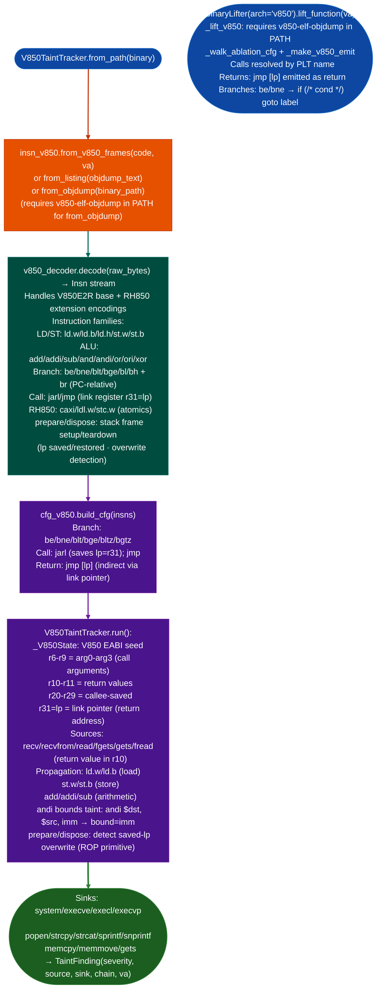

# V850/RH850 ISA Support

Labeled-taint analysis, structural lifting, and instruction decoding for Renesas V850/RH850 embedded microcontroller firmware: covering V850E2R, V850E3V5, NEC V850ES/SJ3, RH850/G3M, and RH850/G3MH automotive ECU targets.

---

## Why this exists

1. **V850/RH850 is the dominant ISA for Renesas automotive ECU firmware: engine control units, transmission controllers, and ADAS modules running on RH850/G3M cores are shipped in large volumes and frequently contain network-accessible surfaces via CAN/UDS/DoIP protocols.** ARM Cortex-M and x86 analysis pipelines do not support V850/RH850 instruction encoding. Without a dedicated taint tracker, recv-equivalent CAN frame handlers, which receive attacker-controlled data directly from the vehicle network: cannot be traced to downstream string or memory operation sinks. `taint_tracker_v850.py` fills this gap for V850 EABI targets.

2. **V850 EABI uses a non-standard calling convention: `r6-r9` as argument registers not the ARM r0-r3 convention and `r10-r11` as return values, that requires explicit ABI seed configuration in the taint state machine.** A generic taint tracker seeded with ARM or MIPS ABI conventions will miss argument flows from `r6-r9` arguments entirely. `_V850State` seeds the register file from `isa_v850.CALL_ARGS = r6, r7, r8, r9` and `isa_v850.RETURN_REGS = r10, r11` so that all argument-register taint paths are tracked.

3. **RH850/G3M uses the V850 ISA as its base with RH850-specific extensions for atomic operations `caxi`, `ldl.w`, `stc.w` and vector operations: a decoder that handles only V850 base instructions silently skips RH850 extended-format instructions, producing incomplete CFG edges at atomic operation sites.** `v850_decoder.py` handles both V850 base encoding and RH850 instruction extensions, and `insn_v850.py` provides a uniform `Insn` model for both.

---

## How it works



### Module inventory

| Module | Role |
|:---|:---|
| `taint_tracker_v850.py` | Labeled-taint tracker: V850 EABI, `prepare`/`dispose` stack tracking, `andi` bound model |
| `insn_v850.py` | V850/RH850 instruction model: `Insn`, `Mem`, `Reg`, `RegList`, `Sym`; `from_listing`, `from_objdump`, `from_v850_frames` |
| `v850_decoder.py` | Low-level binary decoder: V850E2R base + RH850 extension instruction formats |
| `cfg_v850.py` | CFG builder: branch/call/return edges; `jmp [lp]` return detection |
| `analysis_v850.py` | CFG-level fixpoint taint analysis |
| `isa_v850.py` | ISA constant tables: register names, EABI calling convention, `CALL_ARGS`, `RETURN_REGS` |

---

## Usage

```python
from ablation.analyzers.taint_tracker_v850 import V850TaintTracker

# From binary (requires v850-elf-objdump in PATH for disassembly)
tracker = V850TaintTracker.from_path('/path/to/rh850.elf')
findings = tracker.run()
for f in findings:
    print(f"[{f.severity}] {f.source_name} → {f.sink_name} @ {f.sink_va:#x}")

# Interprocedural (call-graph traversal, depth-limited)
chains = tracker.run_interprocedural(depth=4)

# From objdump listing text (no toolchain dependency)
from ablation.analyzers.insn_v850 import from_listing
from ablation.analyzers.taint_tracker_v850 import V850TaintTracker
insns = list(from_listing(objdump_listing_text))
tracker = V850TaintTracker(insns)
findings = tracker.run()

# Structural lifting via BinaryLifter (requires v850-elf-objdump in PATH)
from ablation.analyzers.binary_lifter import BinaryLifter
lifter = BinaryLifter.from_path('/path/to/rh850.elf', arch='v850')
print(lifter.lift_function(0x10000))

# RH850 arch alias
lifter_rh = BinaryLifter.from_path('/path/to/rh850.elf', arch='rh850')
print(lifter_rh.lift_function(0x10000))
```

---

## Example output

The following illustrates the format for representative taint findings. Actual function names, addresses, and chains reflect the specific ECU binary.

```
[CRITICAL] recv_can_frame → strcpy @ <va>
  Chain: recv_can_frame(r10) → ld.w r6, r10+0x08 → jarl strcpy
  Taint: r10 (return value, recv_can_frame), r6 propagated
  Sink: strcpy(r6=tainted) — CAN frame data copied without bounds check

[HIGH] uds_read_data → sprintf @ <va>
  Chain: uds_read_data(r10) → add r7, r10, r0 → jarl sprintf(r6=fmt, r7=tainted)
  Taint: r10, r7 propagated; bound=None
  Sink: sprintf arg-1 — format-string candidate via UDS request data

[MEDIUM] prepare/dispose lp overwrite @ <va>
  prepare {r20,r30} 0x18: lp saved at sp+0x14
  dispose 0x18 [r31]: lp restored from sp+0x14
  Potential saved-lp overwrite via stack buffer at sp+0x00 (before lp save)
```

---

## False positives

**`from_objdump()` requires `v850-elf-objdump` in PATH.** If the GNU V850 cross-toolchain is not installed, `_lift_v850()` in `BinaryLifter` returns a comment explaining the requirement instead of lifted output. The tracker's `from_listing()` constructor does not require the toolchain, it accepts pre-generated objdump text, which can be produced on a machine with the toolchain and saved to a file.

**`prepare`/`dispose` saved-lp overwrite detection produces a `MEDIUM` finding for every function that saves `r31` to the stack.** The finding fires when a tainted write could reach the stack offset where `lp` is saved, regardless of whether the write is actually reachable from a network source. Confirm by tracing the taint path to the stack write source before reporting.

---

## Pipeline position

**Before this module:** Confirm the binary is V850/RH850 ELF: `readelf -h binary | grep Machine` should show `Renesas V850`. If only raw binary no ELF header is available, use `insn_v850.from_v850_frames()` with the known load address and code section boundaries from ECU ROM layout analysis.

**After this module:** For confirmed CAN/UDS taint findings, trace the protocol framing layer to confirm that the attacker-controlled bytes in the taint source can be supplied from the vehicle network without authentication. Write confirmed findings to `re/<vendor>/<target>_re.py`.

---

## Reading findings

`V850TaintTracker.from_path(path).run()` returns `List[TaintFindingV850]`.

| Field | Type | Content |
|:---|:---|:---|
| `func_va` | `int` | VA of the function containing the sink call |
| `func_name` | `str` | Name of the function (from `ctx`) |
| `sink_va` | `int` | VA of the sink call instruction |
| `sink_name` | `str` | Sink function name for example `strcpy`, `system` |
| `tainted_args` | `List[str]` | Tainted argument register names at the call for example `['r6']` |
| `source_name` | `str` | Taint source label for example `recv_can_frame` |
| `severity` | `str` | `'HIGH'` for all findings (default) |

---

## See also

- [Binary Lifter](binary-lifter.md): `arch='v850'`/`'rh850'` structural lifting; requires `v850-elf-objdump` in PATH
- [RH850 Taint Analysis](rh850-taint-analysis.md): additional RH850-specific analysis detail
- [RH850 Taint Tracker](rh850-taint-tracker.md): tracker module reference
- [Taint Analysis](taint-analysis.md): general labeled-taint model and CFG fixpoint analysis
