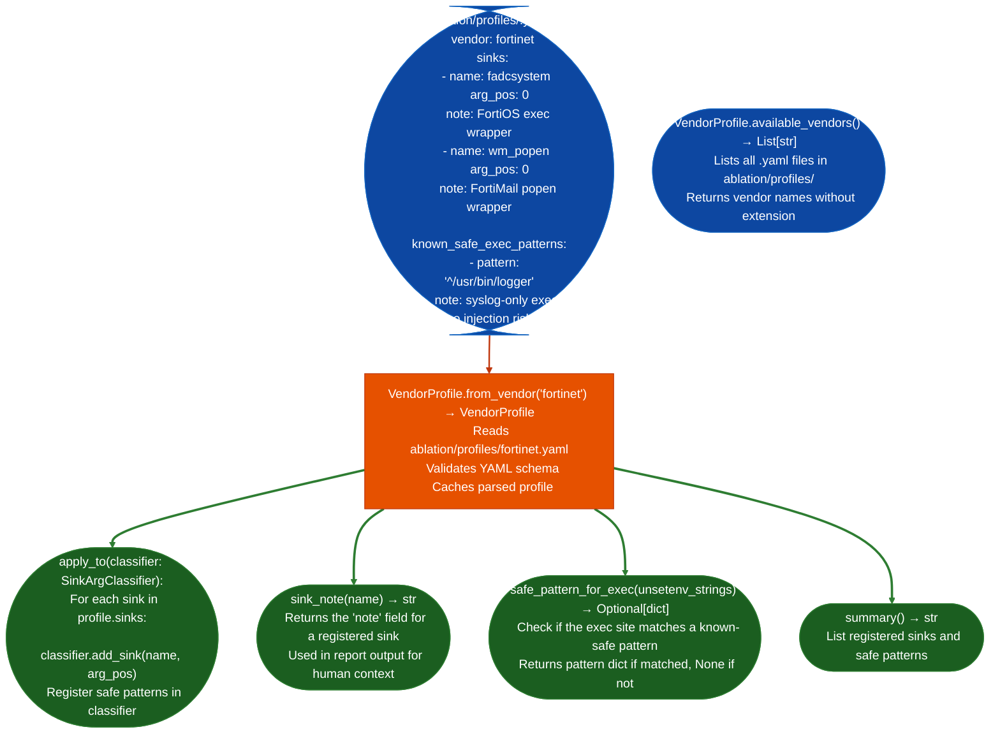

# Vendor Sink Profiles

Load vendor-specific sink registrations and known-safe exec patterns from YAML profiles in `ablation/profiles/`: extending `SinkArgClassifier` with firmware-specific wrapper functions for example Fortinet's `fadcsystem`, Cisco's `cpexec` and known-safe patterns for example `popen` calls that always use a fixed unsetenv prefix without modifying the core classifier.

---

## Why this exists

1. **Firmware vendors wrap libc exec functions with vendor-specific helpers: `fadcsystem` in FortiOS, `cpexec` in Cisco IOS, `wm_system` in network appliances, that are not in the default sink catalog but are equally dangerous.** `VendorProfile` registers these wrapper functions as sinks with the correct argument positions, so `SinkArgClassifier.classify_all()` catches them without the analyst manually adding each wrapper per engagement.

2. Some exec-class call sites are structurally safe by vendor convention: for example, a `popen` call that always prefixes the command with `unsetenv PATH; /usr/bin/logger` is safe even if the suffix is user-controlled the unsetenv removes PATH injection and the logger is fixed. `VendorProfile.known_safe_exec_patterns` registers these patterns, allowing `SinkArgClassifier` to automatically mark them as `KNOWN_SAFE` instead of `ARG_PROPAGATED`.

3. YAML profiles separate vendor-specific knowledge from core analyzer code: adding a new vendor's sink catalog requires only creating `ablation/profiles/<vendor>.yaml`, not modifying Python source. `VendorProfile.available_vendors()` lists all installed profiles; `VendorProfile.from_vendor('fortinet')` loads the Fortinet profile.

---

## How it works



---

## Usage

```python
from ablation.analyzers.sink_arg_classifier import SinkArgClassifier
from ablation.analyzers.vendor_profile import VendorProfile
from ablation.analyzers.binary_context import BinaryContext

ctx = BinaryContext.load_or_build('/path/to/fortios_httpsd')

# Load vendor profile and apply to classifier
clf = SinkArgClassifier.from_context(ctx)
prof = VendorProfile.from_vendor('fortinet')
prof.apply_to(clf)

# Classify — now includes vendor-specific wrappers
results = clf.classify_all()
print(clf.report(results))

# Check available vendor profiles
available = VendorProfile.available_vendors()
print(f"Available profiles: {available}")

# View profile summary
print(prof.summary())
```

---

## Example output

The following illustrates the profile application output. Actual vendors and sink names are profile-specific.

```
VendorProfile: fortinet
  Sinks registered:
    fadcsystem  (arg_pos=0)  FortiOS exec wrapper
    wm_popen    (arg_pos=0)  FortiMail popen wrapper
  Known-safe patterns:
    '^/usr/bin/logger'  syslog-only exec, no injection risk

SinkArgClassifier (with fortinet profile):
  fadcsystem:  <N> sites  (RODATA_CONST: <A>, ARG_PROPAGATED: <B>, ...)
  wm_popen:    <N> sites  (...)
```

---

## False positives

**A vendor-specific wrapper is only safe to treat as a sink at arg_pos N if the wrapper always passes its arg_pos N directly to the underlying exec function.** If a wrapper sanitizes its input before calling exec, `apply_to()` will over-report by classifying the sanitized wrapper the same as a raw exec call. Review each registered wrapper's implementation before relying on its profile registration.

**Known-safe patterns match by string prefix: a pattern `'^/usr/bin/logger'` will match any command starting with `/usr/bin/logger`.** If the pattern is followed by user-controlled data for example `/usr/bin/logger $USER_INPUT`, the pattern is not actually safe. Verify that the command string after the prefix is also hardcoded before registering the pattern.

---

## Pipeline position

Apply `VendorProfile.apply_to(clf)` immediately after creating `SinkArgClassifier.from_context(ctx)` and before calling `classify_all()`. The profile registration must happen before classification, it cannot be applied retroactively to an already-classified result list.

---

## Reading output

`VendorProfile.from_vendorvendor_name` returns a `VendorProfile` object:

| Attribute | Content |
|:---|:---|
| `vendor` | Vendor name string for example `'fortinet'` |
| `sinks` | `List[dict]`: dicts with `name`, `arg_pos`, `note` |
| `safe_patterns` | `List[dict]`: known-safe exec pattern records with `pattern` and `note` |
| `sanitizers` | `List[dict]`: known sanitizer function records |

`VendorProfile.apply_toclassifier` registers all profile sinks into a `SinkArgClassifier` and returns `None`.

---

## See also

- [Sink Argument Classifier](sink-argument-classifier.md): classifier that VendorProfile extends
- [Sanitizer Recognition](sanitizer-recognition.md): identifies vendor-specific validators for `SinkSanitizerFilter`
- [CMDB to Sink Mapping](cmdb-to-sink-mapping.md): FortiOS-specific CMDB exec sink analysis
