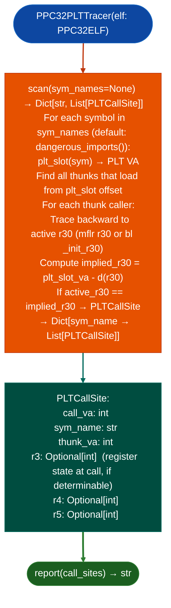

# PPC32 PLT Import Caller Tracing

Find every call site that calls a named imported symbol in a PPC32 BE position-independent `.so`: using the PLT-thunk calling model `LWZ rx,d(r30 + MTCTR + BCTR`) and verifying each caller's active `r30` against the expected `implied_r30` for the target symbol, eliminating false positives where multiple compilation units share a thunk VA but route to different PLT slots depending on their `r30`.

---

## Why this exists

1. **PPC32 PIC `.so` files do not call imported symbols with a direct `BL symbol` instruction.** Instead, they call a PLT thunk: `LWZ rx,d(r30)` load GOT entry from r30-relative offset → `MTCTR rx` → `BCTR`. Two compilation units can share the same thunk VA but reach different PLT slots if their `r30` values differ. A naive thunk-VA matcher produces false positives for every such shared thunk.

2. `PPC32PLTTracer` verifies each caller's active `r30` against `implied_r30` for the target symbol: eliminating the false-positive class entirely. The active `r30` is tracked backward from the call site to the `bl _init_r30` or `mflr r30` that establishes the GOT base for that compilation unit. Only callers whose `r30` matches the implied slot offset are reported.

3. `PPC32ELF.dangerous_imports()` provides the pre-filtered target symbol list: the same list used by `PPC32TaintTracker` for sink identification. `PPC32PLTTracer` uses this list to restrict tracing to security-relevant imports, avoiding the noise of tracing all 200+ imported symbols in a typical FortiGate `.so`.

---

## How it works



---

## Usage

```python
from ablation.analyzers.ppc32_plt_tracer import PPC32PLTTracer, PPC32ELF

elf = PPC32ELF('/path/to/libfortissl.so')
tracer = PPC32PLTTracer(elf)

# Trace all dangerous imports
call_sites = tracer.scan()
for sym, sites in call_sites.items():
    print(f"{sym}: {len(sites)} callers")
    for s in sites:
        print(f"  call_va={s.call_va:#x}  thunk={s.thunk_va:#x}")

# Trace a specific symbol
ssl_sites = tracer.scan(sym_names=['SSL_read'])
```

---

## Example output

The following illustrates PLT call site tracing output format. Actual addresses are binary-specific.

```
PPC32PLTTracer: libfortissl.so

Dangerous imports: <N>

  system: <A> callers
    call_va=<va>  thunk=<va>  r3=<va (rodata ptr)>
  SSL_read: <B> callers
    call_va=<va>  thunk=<va>  r3=None  (r30 not determinable)
  execv: <C> callers
    call_va=<va>  thunk=<va>
```

---

## False positives

**`r30` backward trace may not reach the GOT base setter**: if the function that calls the PLT thunk does not set `r30` itself specifically it inherits it from a caller, the tracer may not determine the active `r30` and will conservatively exclude the site. This produces false negatives, not false positives. Inspect call sites where `r3=None` manually.

**`PPC32ELF.dangerous_imports()` uses a static symbol blocklist**: if a dangerous symbol has a non-standard name in the target binary for example a renamed wrapper, it will not appear in `dangerous_imports()`. Add custom symbol names via the `sym_names` parameter to `scan()`.

---

## Pipeline position

Run `PPC32PLTTracer` after `PPC32ELF` is constructed from the target binary. Use the resulting `PLTCallSite` list to seed `PPC32TaintTracker` with verified sink call sites, bypassing the taint loop's own PLT resolution.

---

## Reading output

`PPC32PLTTracer.find_callerssym_name` returns `List[PLTCallSite]`: all verified call sites for the named import:

| Attribute | Content |
|:---|:---|
| `bl_va` | VA of the `BL` instruction calling the PLT thunk |
| `thunk_va` | VA of the PLT thunk function |
| `caller_r30` | Active `r30` value at the call site: used to verify PLT slot selection |
| `func_name` | Imported symbol name resolved from the thunk, or `None` if unresolved |

---

## See also

- [PowerPC PEF/CFM Binary Analysis](powerpc-pef-cfm.md): PEF equivalent for Mac Classic binaries
- [PPC64 BE Sink Classification](ppc64-be-sink-classification.md): PPC64 BE equivalent for FortiOS 7+ targets
- [Named Taint Sources and Bounds](named-taint-sources-and-bounds.md): `TaintTracker` for full dataflow from verified PLT call sites
