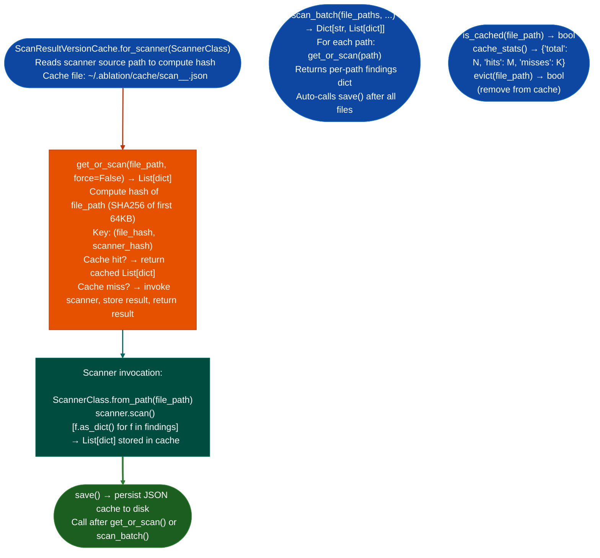

# Version-Aware Scan Caching

Persist scanner results as JSON-serializable dicts with automatic invalidation when the scanner source code or the target binary changes: returning cached results in under 1ms on repeated runs while detecting stale cache entries from code updates or binary replacements.

---

## Why this exists

1. **Most Ablation scanners take 5–60 seconds per binary: re-running them on the same binary across sessions wastes time when neither the scanner nor the binary has changed.** `ScanResultVersionCache.get_or_scan()` returns the cached result instantly when both the scanner source hash and the target file hash match; it re-runs the scanner and updates the cache only when either changes.

2. **Automatic invalidation from scanner source changes prevents stale results from persisting after a bug fix.** When a scanner is updated for example a false-positive fix in `LengthUnderflowScanner`, the cached results from the old version are invalid: they may report findings that the fixed version would not find. `ScanResultVersionCache` uses a hash of the scanner's source file to detect this: if the source has changed, the cache is invalidated automatically.

3. `scan_batch()` enables efficient multi-binary sweeps with per-file caching: for a firmware image with 40 shared libraries, `scan_batch()` scans all 40 files in sequence, using the cache for files it has seen before and invoking the scanner only for new or changed files. The net effect is that a firmware sweep that took 10 minutes on first run takes under 30 seconds on subsequent runs if no files changed.

---

## How it works



---

## Usage

```python
from ablation.analyzers.scan_result_version_cache import ScanResultVersionCache
from ablation.analyzers.length_underflow import LengthUnderflowScanner

# Set up cache for a specific scanner
cache = ScanResultVersionCache.for_scanner(LengthUnderflowScanner)

# Scan a single file (uses cache if available)
findings = cache.get_or_scan('/path/to/target.elf')
cache.save()

print(f"Findings: {len(findings)}")
for f in findings:
    print(f)

# Force re-scan (ignore cache)
findings_fresh = cache.get_or_scan('/path/to/target.elf', force=True)
cache.save()

# Batch scan of a firmware image
firmware_libs = [
    '/path/to/rootfs/lib/libssl.so',
    '/path/to/rootfs/lib/libcrypto.so',
    '/path/to/rootfs/lib/libhttpd.so',
]
batch_results = cache.scan_batch(firmware_libs)
for path, results in batch_results.items():
    print(f"{path}: {len(results)} findings")

# Cache statistics
print(cache.cache_stats())
```

---

## Example output

The following illustrates the cache output format.

```
ScanResultVersionCache: LengthUnderflowScanner
  Cache file: ~/.ablation/cache/scan_LengthUnderflowScanner_<hash>.json

get_or_scan('/path/to/target.elf'):
  Cache hit (file unchanged, scanner unchanged) → <N> findings in 0.8ms

scan_batch (3 files):
  /path/to/libssl.so:    cache hit  → <N> findings
  /path/to/libcrypto.so: cache miss → <M> findings (rescanned in 12.3s)
  /path/to/libhttpd.so:  cache hit  → <K> findings

cache_stats(): {'total': 3, 'hits': 2, 'misses': 1}
```

---

## False positives

**Cache invalidation is based on a 64KB file hash prefix**: a binary that is modified in a section beyond the first 64KB for example `.debug_info` appended to a large binary will not trigger cache invalidation. For binaries where debug sections are appended post-build, use `force=True` on the first scan after annotation.

**Scanner source hash covers only the scanner's own `.py` file**: changes to helper modules `BinaryContext`, `TaintTracker` that the scanner imports are not tracked. After updating a core dependency, `evict()` relevant entries or delete the cache file manually.

---

## Pipeline position

`ScanResultVersionCache` wraps any scanner, it is used by `fortinet_sweep.py` and similar sweep scripts to avoid re-scanning unchanged binaries across sessions. Use it when running the same scanner against a large set of firmware binaries over multiple sessions; for single-session analysis, the caching overhead is not worth the setup cost.

---

## Reading output

`ScanResultVersionCache.get_or_scan(path)` returns the scanner's native findings list: whatever `scanner.scan()` would return. The return type is identical whether the result came from cache or live scan.

`ScanResultVersionCache.cache_stats()` returns a dict:

| Key | Content |
|:---|:---|
| `scanner` | Scanner class name string |
| `scanner_version_hash` | SHA-256 prefix of the scanner source used to build the cache |
| `cache_path` | Absolute path to the JSON cache file on disk |
| `entries` | Number of entries currently in the cache |
| `cache_exists` | `True` if the cache file exists on disk |

---

## See also

- [Fortinet Multi-Phase Directory Sweeps](fortinet-multi-phase-directory-sweeps.md): sweep scripts that use `ScanResultVersionCache`
- [Generic Vulnerability Profile Sweeps](generic-vulnerability-profile-sweeps.md): `PatternLibrary.sweep()` that benefits from caching
- [Protocol Length Underflow Detection](protocol-length-underflow-detection.md): example scanner that benefits from version-aware caching
