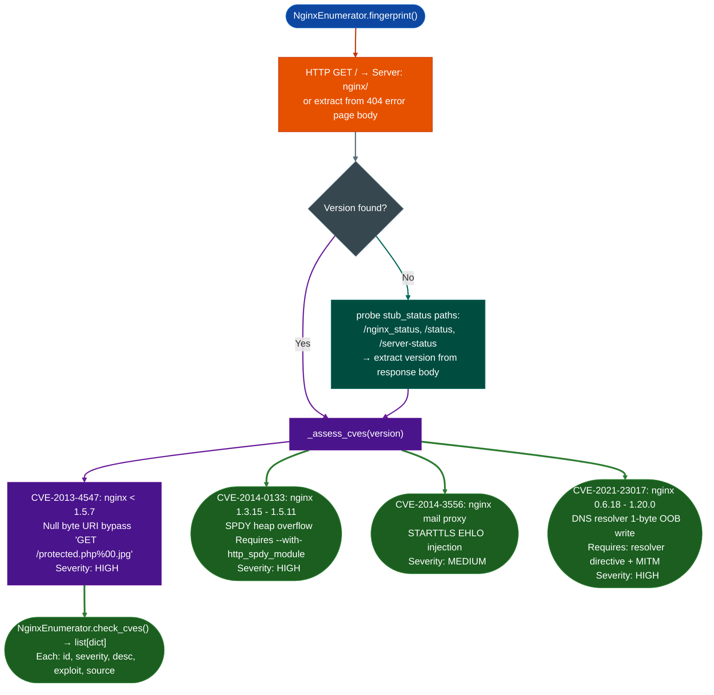

# Version-Linked Web Checks

Identify applicable CVEs based on the detected nginx server version: extracting the version from `Server` headers, error pages, and stub_status endpoints, then mapping it to known historical vulnerabilities.

---

## Why this exists

1. **nginx is the most widely deployed web front-end in network appliance firmware: FortiProxy, Cisco FMC, and hundreds of embedded management UIs run nginx as the HTTPS layer.** Many deployed appliances run nginx versions that are years behind the current release and have never been patched against public CVEs. A version-linked check finds high-severity issues RCE, auth bypass that require nothing more than the detected version number to confirm, no interactive exploit required.

2. **nginx `server_tokens off` suppresses the version from HTTP responses, but not from all locations.** `_extract_version()` attempts version extraction from three sources in order: the `Server` response header, the default nginx error page body, and the `/nginx_status` stub-status endpoint body. Operators who disable `server_tokens` often overlook the stub_status path, which may still expose the exact build version in its response.

3. **CVE-2021-23017 DNS resolver 1-byte overflow affects nginx 0.6.18 through 1.20.0: over 14 years of releases, but only when the `resolver` directive is configured and an attacker can perform MITM on the resolver path.** `check_cve_2021_23017()` reports the version-based exposure and notes that exploitability requires resolver configuration. This separates "version is in range" from "the service is exploitable" in the finding output.

---

## How it works



### Covered CVEs

| CVE | Affected range | Severity | Condition |
|:---|:---|:---|:---|
| CVE-2013-4547 | < 1.5.7 | HIGH | None: always exploitable |
| CVE-2014-0133 | 1.3.15 – 1.5.11 | HIGH | `--with-http_spdy_module` compiled in |
| CVE-2014-3556 | All mail proxy builds | MEDIUM | Mail proxy module enabled |
| CVE-2021-23017 | 0.6.18 – 1.20.0 | HIGH | `resolver` directive + MITM on DNS path |

---

## Usage

```python
from modules.nginx_enum import NginxEnumerator

en = NginxEnumerator(host='<target>', port=443, use_tls=True)

# Fingerprint to extract version
fp = en.fingerprint()
print(fp.get('version'))

# Version-linked CVE check
cves = en.check_cves()
for cve in cves:
    print(f"{cve['id']} [{cve['severity']}] — {cve['desc']}")

# CVE-2021-23017 separately (extended version extraction)
findings_2021 = en.check_cve_2021_23017()

# Full run (fingerprint + all probes + CVE check)
results = en.run()
print(en.report())
```

---

## Example output

The following illustrates the finding format. CVE applicability and version are target-specific.

```
[HIGH] CVE: CVE-2013-4547: Null byte in URI bypasses access controls and rewrite rules.
  Versions < 1.5.7. Allows bypass of auth restrictions.
  Exploit: GET /restricted.php%00.jpg
  Source: <target>:<port>

[HIGH] CVE: CVE-2021-23017: nginx 0.6.18-1.20.0 UDP DNS resolver 1-byte overflow.
  Exploitable when resolver directive is configured and attacker can MITM DNS path.
  Source: <target>:<port>
```

---

## False positives

**Version detection fails when `server_tokens off` is set and stub_status is not exposed.** In this case `_assess_cves()` falls back to returning all CVEs for a reference version (`1.7.10`): treating the target as potentially vulnerable to all tracked CVEs. These findings should be labeled as "version unconfirmed" and verified manually. The `fingerprint()` result includes `server_tokens` state to flag this.

**CVE-2014-0133 requires the SPDY module, which was a non-default compile option.** Most distribution-packaged nginx builds do not include SPDY. The finding reports the version as in range but notes the module requirement: confirm with `nginx -V` output if accessible.

---

## Pipeline position

Run `NginxEnumerator.check_cves()` after `fingerprint()` has successfully extracted a version. The finding severity is version-derived: a HIGH finding that requires `server_tokens off` bypass of version detection is lower confidence than one with a confirmed version. Pair with `probe_null_byte()` and `check_cve_2021_23017()` for the full nginx version-linked attack surface.

---

## Reading findings

`NginxEnumeratorhost, port.check_cves()` returns `List[dict]`: CVE findings for the detected version:

| Field | Content |
|:---|:---|
| `id` | CVE identifier for example `'CVE-2013-4547'` |
| `severity` | `'HIGH'` / `'MEDIUM'` |
| `desc` | Affected version range, description, and exploit path |
| `exploit` | Example exploit request string, or `None` |

Results are only emitted for CVEs where the detected nginx version falls within the affected range.

---

## See also

- [nginx Enum](nginx-enum.md): full NginxEnumerator reference: all probe methods, stub_status, auth bypass, SSRF
- [Web Path Enumeration](web-path-enumeration.md): path probing that often reveals stub_status exposure
- [TLS Policy Checks](tls-policy-checks.md): TLS version/cipher checks complementary to nginx version checks
