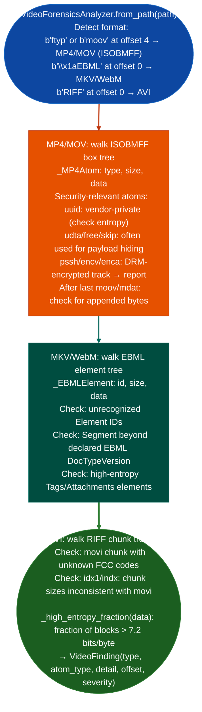

# Video Container Forensics

Detect appended payloads, embedded binary content in metadata atoms, malformed box structures, DRM-encrypted tracks, and entropy anomalies in MP4/MOV (ISOBMFF), MKV/WebM (EBML), and AVI (RIFF) video containers: without full video decoding: via `modules/video_container.py`.

---

## Why this exists

1. Video containers are polyglot attack vectors: MP4 files can embed arbitrary binary content in `udta`, `free`, `skip`, or `uuid` atoms without affecting video playback. `video_container.py` detects appended or prepended non-video payloads content after `mdat`/`moov` in ISOBMFF, before the `EBML` header in MKV by walking the container structure rather than relying on file extension or MIME type.

2. **`udta`, `free`, `skip`, and `uuid` atoms are standard ISO/IEC 14496-12 containers for vendor-specific metadata**, but their contents are opaque to playback software. `video_container.py` checks the entropy of these atom payloads: a `uuid` atom with Shannon entropy > 7.5 bits/byte is almost certainly encrypted or compressed binary content rather than metadata.

3. EBML Matroska/MKV and RIFF (AVI) use distinct TLV encodings: `_MP4Atom`, `_EBMLElement`, and the RIFF chunk parser each implement the format's length encoding. All three are needed because file extension is unreliable for forensic triage: a `.webm` file with an `.mp4` extension still uses EBML encoding and requires the EBML parser to walk its structure correctly.

---

## How it works



---

## Usage

```python
from modules.video_container import VideoForensicsAnalyzer

analyzer = VideoForensicsAnalyzer.from_path('/path/to/suspicious.mp4')
findings = analyzer.analyze()

print(f"Format: {analyzer.format}  Findings: {len(findings)}")
for f in findings:
    print(f"  {f.offset:#x}  [{f.severity}]  {f.type}: {f.detail}")
    if hasattr(f, 'entropy'):
        print(f"    entropy={f.entropy:.2f} bits/byte")
```

---

## Example output

The following illustrates video container forensics output format.

```
VideoForensicsAnalyzer: suspicious.mp4  (format=MP4/MOV)

Findings: <N>

  0x003c00  [HIGH]   EMBEDDED_PAYLOAD: uuid atom (high entropy 7.82 bits/byte, 2048 bytes)
  0x1f4000  [MEDIUM] DRM_TRACK: encv track in trak box
  0x2a0000  [HIGH]   APPENDED_DATA: <K> bytes after final moov atom (ELF magic)
```

---

## False positives

**`uuid` atoms are used legitimately**: vendor-specific metadata camera make/model, GPS coordinates, color space descriptors in `uuid` atoms will have high entropy if encoded as binary rather than XML. Verify by checking whether the `uuid` bytes match a known vendor UUID before treating the finding as malicious.

**Entropy threshold 7.5 bits/byte**: compressed video streams normally exceed 7.5 bits/byte. `_high_entropy_fraction()` only checks non-compressed metadata regions (atoms outside `mdat`). Findings in `mdat` itself are not reported.

---

## Pipeline position

Run `VideoForensicsAnalyzer` on any video file received from an untrusted source before opening it in media software. Detected appended payloads or embedded binaries feed binary RE analysis via `BinaryContext.load_or_build()`.

---

## Reading findings

`VideoContainerAnalyzer(path).scan()` returns `List[VideoFinding]`:

| Attribute | Content |
|:---|:---|
| `offset` | File offset of the suspicious atom or appended region |
| `severity` | `CRITICAL` / `HIGH` / `MEDIUM` / `LOW` |
| `category` | Finding category for example `EMBEDDED_BINARY`, `POLYGLOT`, `DRM`, `ENTROPY_ANOMALY`, `ANOMALOUS_STRUCTURE` |
| `description` | Short summary of the finding |
| `detail` | Extended detail: atom type, entropy value, size, or magic bytes |

`VideoFinding.fmt()` returns a single formatted line suitable for report output.

---

## See also

- [Office/PDF Triage](office-pdf-triage.md): similar polyglot/payload detection for Office and PDF documents
- [Packing and Anti-Analysis Indicators](packing-and-anti-analysis-indicators.md): entropy-based packing detection in PE/ELF extracted from video containers
