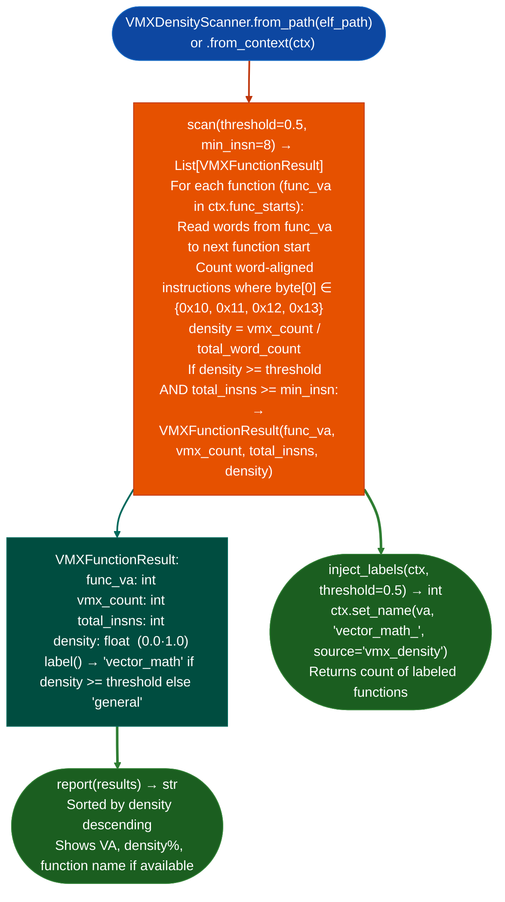

# VMX/AltiVec Density Ranking

Identify PowerPC64/PPC32 functions with high concentrations of VMX (AltiVec) vector instructions: labeling them as `vector_math` without requiring string cross-references, by counting primary-opcode-4 instructions (byte[0] ∈ {0x10–0x13}) in word-aligned big-endian code.

---

## Why this exists

1. **On Cell PPU (PS3), IBM POWER5–9, and G5 targets, math, physics, and renderer functions are heavily vectorized via VMX/AltiVec, these functions have no printable string references and appear opaque to `SemanticSearcher`.** `VMXDensityScanner.scan()` identifies them by VMX instruction density: functions above the density threshold are labeled `vector_math` and excluded from security analysis queues, preventing time waste on graphics/physics code.

2. **VMX instructions use primary opcode 4 0b000100 in the PowerPC ISA: in big-endian PPC64/PPC32 encoding, byte[0] of any word-aligned VMX instruction is one of {0x10, 0x11, 0x12, 0x13}.** This single-byte check is extremely fast: `VMXDensityScanner` processes 885 functions in approximately 35 seconds on a typical Cell PPU binary without capstone disassembly, making it practical as an early pre-filter.

3. `VMXFunctionResult.label()` integrates with `BinaryContext.set_name()`: functions labeled `vector_math` at density ≥ threshold are excluded from the taint analysis queue, and their names are set in the context so they appear as labeled in `FuncProfiler` output.

---

## How it works



---

## Usage

```python
from ablation.analyzers.ppc64_vmx_density import VMXDensityScanner
from ablation.analyzers.binary_context import BinaryContext

ctx = BinaryContext.load_or_build('/path/to/cell_ppu.elf')
scanner = VMXDensityScanner.from_context(ctx)

# Scan with default threshold (0.5 = 50% VMX density)
results = scanner.scan(threshold=0.5, min_insn=8)
print(scanner.report(results))

# Label high-density functions in BinaryContext
n_labeled = scanner.inject_labels(ctx, threshold=0.5)
print(f"Labeled {n_labeled} vector_math functions")

# Use lower threshold for partial vectorization
results_low = scanner.scan(threshold=0.3, min_insn=4)
high_density = [r for r in results_low if r.density >= 0.7]
print(f"Highly vectorized: {len(high_density)} functions")
```

---

## Example output

The following illustrates the density ranking output format. Actual counts are binary-specific.

```
VMXDensityScanner: cell_ppu.elf  (PPC64 BE)

Density ranking (threshold=0.50, min_insn=8):
  <va>   density=0.87   <N> VMX / <M> total   [vector_math]
  <va>   density=0.73   <N> VMX / <M> total   [vector_math]
  <va>   density=0.51   <N> VMX / <M> total   [vector_math]
  <va>   density=0.44   <N> VMX / <M> total   (below threshold)

Total vector_math functions: <K>
```

---

## False positives

**VMX opcode detection uses byte[0] ∈ {0x10–0x13} on word-aligned words**: data embedded in the code section jump tables, constant pools in old PPC ABIs may have bytes in the {0x10–0x13} range, inflating the VMX count. For functions with suspiciously high density on non-vector code, verify with capstone PPC64 disassembly.

**Threshold 0.50 is calibrated for Cell PPU**: on IBM POWER9 server binaries where vectorization rates are lower, lower thresholds 0.25–0.35 may be more appropriate.

---

## Pipeline position

Run `VMXDensityScanner.inject_labels()` early in the analysis of Cell PPU or IBM POWER binaries: before `SemanticSearcher.build_corpus()`, so that `vector_math`-labeled functions are excluded from the security analysis corpus. This prevents graphics and physics functions from appearing in `SemanticSearcher` results for vulnerability queries.

---

## Reading output

`VMXDensityScanner.scanthreshold, min_insns` returns a list of `VMXFunctionResult` objects sorted by descending density:

| Attribute | Content |
|:---|:---|
| `va` | Function VA |
| `total_insns` | Total instruction count |
| `vmx_count` | Number of VMX/AltiVec instructions |
| `density` | Float: `vmx_count / total_insns` |
| `label` | Property: threshold-based label for example `"vector_math"`, `"vector_trace"` |

`VMXFunctionResult.fmt(name_fn)` returns a formatted line for display. Pass `ctx.name` as `name_fn` to include resolved function names.

---

## See also

- [PS3 OPD Virtual Tables](ps3-opd-virtual-tables.md): PS3/Cell PPU virtual dispatch table analysis
- [PPC32/PPC476 Dedicated Lifting](ppc32-ppc476-dedicated-lifting.md): PPC32/PPC64 function analysis
- [Persistent Analysis Context](persistent-analysis-context.md): `BinaryContext.set_name()` for VMX label injection
