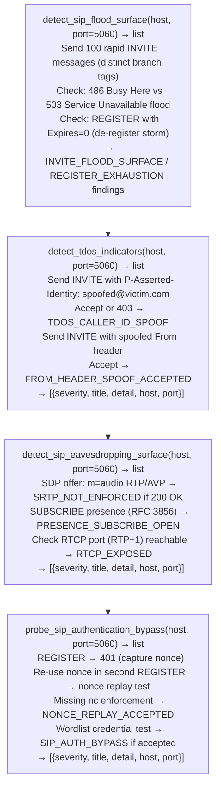

# Voice Abuse Indicators

Detect telephony denial-of-service susceptibility, call eavesdropping surfaces, signaling manipulation vectors, SIP authentication bypass conditions, and DTMF credential exposure through a suite of active probe functions — identifying VoIP abuse surfaces that are invisible to standard port scanning — via `modules/sip_enum.py`.

---

## Why this exists

1. **VoIP infrastructure exposes a set of attack primitives not present in HTTPS services** — SIP allows unauthenticated `INVITE` flood (Telephony DoS), DTMF-encoded credentials in RTP Information elements, REFER-based call hijacking, and media redirection via `re-INVITE`. Standard web vulnerability scanners do not model these attack classes. `detect_sip_flood_surface()` and `detect_tdos_indicators()` confirm whether a SIP registrar or proxy is vulnerable to registration exhaustion and caller-ID spoofing attacks.

2. **SRTP enforcement is rarely complete in enterprise deployments** — SIP infrastructure often negotiates RTP (cleartext audio) alongside SRTP (encrypted). `detect_sip_eavesdropping_surface()` checks whether the SIP server accepts an SDP offer with `RTP/AVP` (no encryption) rather than `RTP/SAVP` (SRTP required), and whether RTCP flows are observable without authentication. A server that accepts cleartext RTP and exposes RTCP means an on-path attacker can capture full audio streams.

3. **SIP authentication uses HTTP Digest — a challenge-response scheme vulnerable to nonce replay and offline dictionary attacks** — `probe_sip_authentication_bypass()` tests whether the server accepts repeated responses using a previously-issued nonce (replay), whether `nc` (nonce count) enforcement is missing (parallel replay), and whether weak credentials from a targeted wordlist succeed. Successful authentication bypass findings translate directly to unauthorized call placement.

---

## How it works



---

## Usage

```python
from modules.sip_enum import (
    detect_sip_flood_surface,
    detect_tdos_indicators,
    detect_sip_eavesdropping_surface,
    probe_sip_authentication_bypass,
    detect_sip_header_injection,
)

host = '<target-host>'

# All functions return [{severity, title, detail, host, port}]
all_findings = (
    detect_sip_flood_surface(host)
    + detect_tdos_indicators(host)
    + detect_sip_eavesdropping_surface(host)
    + probe_sip_authentication_bypass(host)
    + detect_sip_header_injection(host)
)

for finding in sorted(all_findings, key=lambda f: {'CRITICAL': 0, 'HIGH': 1, 'MEDIUM': 2}.get(f['severity'], 3)):
    print(f"  [{finding['severity']}] {finding['title']}: {finding['detail'][:80]}")
```

---

## Example output

The following is a schematic example showing output structure and field names. Values are illustrative.

```
detect_sip_flood_surface: <target-host>:5060

  [HIGH] INVITE_FLOOD_SURFACE
         Server returned 486 Busy Here after <N> rapid INVITEs —
         no rate limiting detected on INVITE flood path

detect_sip_eavesdropping_surface: <target-host>:5060

  [HIGH] SRTP_NOT_ENFORCED
         SDP offer with RTP/AVP (cleartext) accepted —
         server does not require SRTP for audio channels

probe_sip_authentication_bypass: <target-host>:5060

  [CRITICAL] NONCE_REPLAY_ACCEPTED
             Repeated nonce accepted without nc (nonce count) enforcement
```

---

## False positives

**`INVITE_FLOOD_SURFACE` on servers with network-layer rate limiting** — firewall or load balancer rate limiting upstream of the SIP server may absorb flood probes before they reach the application. The server returning `486 Busy Here` reflects normal resource constraints, not a TDoS vulnerability, if the rate limiting is verified in infrastructure configuration.

**`SRTP_NOT_ENFORCED` on B2BUA deployments** — back-to-back user agents (B2BUAs) sometimes accept cleartext SDP offers on the internal leg while enforcing SRTP on the external leg. Confirm whether the probed interface is the internal or external SIP leg before reporting SRTP non-enforcement as an external-facing vulnerability.

---

## Pipeline position

Run voice abuse indicator probes after `probe_sip_options()` confirms a SIP server is present on the target. Run `detect_sip_flood_surface()` and `detect_sip_eavesdropping_surface()` first (passive/read-only), then `probe_sip_authentication_bypass()` only in authorized assessment contexts — credential testing generates authentication log entries.

---

## See also

- [SIP Attack Surface Detection](sip-attack-surface-detection.md) — full set of SIP attack surface functions including header injection and signaling manipulation
- [VoIP Protocol Inspection and Covert Channels](voip-protocol-and-covert-channels.md) — DTMF extraction, RTP covert channels, RTCP abuse
- [Legacy Voice Protocols](legacy-voice-protocols.md) — H.323, SCCP/Skinny, MGCP probe coverage
