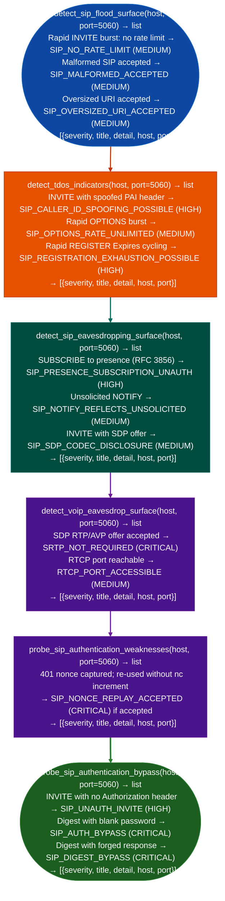

# Voice Abuse Indicators

Detect telephony denial-of-service susceptibility, call eavesdropping surfaces, SIP authentication bypass conditions, and SRTP/RTCP cleartext exposure: each via a dedicated probe function that targets a specific VoIP abuse class: via `modules/sip_enum.py`.

---

## Why this exists

1. SIP TDoS and registration exhaustion are not detected by standard port or vulnerability scanners: `detect_sip_flood_surface()` confirms whether a SIP registrar or proxy enforces rate limits on INVITE floods by sending repeated INVITE messages and measuring response behavior. `detect_tdos_indicators()` tests whether the server accepts caller-ID spoofing via `P-Asserted-Identity` (which enables telephony DoS by impersonating emergency services) and whether REGISTER with rapid `Expires` cycling exhausts session state. Neither attack class appears in a CVE lookup.

2. SRTP enforcement is optional in SIP and rarely complete in enterprise deployments: a SIP server that accepts an SDP offer with `RTP/AVP` cleartext audio instead of requiring `RTP/SAVP` (SRTP) means an on-path attacker can capture the full audio stream. `detect_voip_eavesdrop_surface()` sends an SDP offer with `RTP/AVP` to test acceptance and probes the RTCP port media port + 1 to determine whether session metadata is observable without authentication.

3. SIP Digest authentication has known weaknesses that probe-based testing directly confirms: `probe_sip_authentication_weaknesses()` tests nonce replay: it captures the `nonce` from a `401 Unauthorized` challenge and re-uses it in a second REGISTER without incrementing `nc`. Acceptance (`SIP_NONCE_REPLAY_ACCEPTED`) means the server does not enforce nonce count, enabling parallel credential replay. `probe_sip_authentication_bypass()` tests whether the server accepts an INVITE with no authentication header at all (`SIP_UNAUTH_INVITE`) or with a forged Digest response using a blank password `SIP_DIGEST_BYPASS`, `SIP_AUTH_BYPASS`.

---

## How it works



---

## Usage

```python
from modules.sip_enum import (
    detect_sip_flood_surface,
    detect_tdos_indicators,
    detect_sip_eavesdropping_surface,
    detect_voip_eavesdrop_surface,
    probe_sip_authentication_weaknesses,
    probe_sip_authentication_bypass,
)

host = '<target-host>'

# All functions return [{severity, title, detail, host, port}]
all_findings = (
    detect_sip_flood_surface(host)
    + detect_tdos_indicators(host)
    + detect_sip_eavesdropping_surface(host)
    + detect_voip_eavesdrop_surface(host)
    + probe_sip_authentication_weaknesses(host)
    + probe_sip_authentication_bypass(host)
)

severity_order = {'CRITICAL': 0, 'HIGH': 1, 'MEDIUM': 2, 'LOW': 3, 'INFO': 4}
for f in sorted(all_findings, key=lambda f: severity_order.get(f['severity'], 5)):
    print(f"  [{f['severity']}] {f['title']}: {f['detail'][:80]}")
```

---

## Example output

The following is a schematic example showing output structure and field names. Values are illustrative.

```
detect_sip_flood_surface: <target-host>:5060

  [MEDIUM] SIP_NO_RATE_LIMIT — TDoS via INVITE flood possible
           Server did not enforce rate limits on rapid INVITE burst

detect_tdos_indicators: <target-host>:5060

  [HIGH]   SIP_CALLER_ID_SPOOFING_POSSIBLE
           Server accepted INVITE with spoofed P-Asserted-Identity header

  [HIGH]   SIP_REGISTRATION_EXHAUSTION_POSSIBLE
           Rapid REGISTER/Expires cycling accepted without rate limiting

detect_voip_eavesdrop_surface: <target-host>:5060

  [CRITICAL] SRTP_NOT_REQUIRED — call media in cleartext
             SDP offer with RTP/AVP (cleartext) accepted — SRTP not enforced

probe_sip_authentication_weaknesses: <target-host>:5060

  [CRITICAL] SIP_NONCE_REPLAY_ACCEPTED
             Re-used nonce accepted without nc enforcement

probe_sip_authentication_bypass: <target-host>:5060

  [CRITICAL] SIP_AUTH_BYPASS
             Digest authentication accepted with blank password
```

---

## False positives

**`SIP_NO_RATE_LIMIT` when rate limiting is applied upstream**: a firewall or load balancer rate-limiting SIP upstream of the application may absorb the INVITE burst before it reaches the registrar. The probe result reflects what the registrar sees, not the external boundary. Confirm the network path before reporting.

**`SRTP_NOT_REQUIRED` on internal SIP legs of B2BUAs**: back-to-back user agents (B2BUAs) often accept cleartext RTP on their internal SIP leg while enforcing SRTP on the external leg. Confirm which leg internal or external is being probed before escalating to CRITICAL. The `RTCP_PORT_ACCESSIBLE` finding from `detect_voip_eavesdrop_surface` has the same consideration.

**`probe_sip_authentication_bypass` generates authentication log entries**: unlike passive probes, `probe_sip_authentication_bypass()` sends INVITE messages that will appear in the server's authentication audit log. Run only in authorized assessment contexts.

---

## Pipeline position

Run `detect_sip_flood_surface()` and `detect_sip_eavesdropping_surface()` first: they send passive/read-only requests. Run `detect_voip_eavesdrop_surface()` next SDP negotiation. Run `probe_sip_authentication_weaknesses()` and `probe_sip_authentication_bypass()` last, after confirming assessment authorization, as they generate auth log entries. Precede all probes with `probe_sip_options()` to confirm a SIP server is present.

---

## Reading findings

Voice abuse probe functions return `List[{severity, title, detail, host, port}]`:

| Field | Content |
|:---|:---|
| `severity` | `MEDIUM` (TDoS surface) / `HIGH` authentication bypass |
| `title` | Finding code for example `SIP_NO_RATE_LIMIT`, `TDOS_INVITE_FLOOD`, `SIP_ANONYMOUS_CALL_ACCEPTED` |
| `detail` | Description of the abuse surface and exploitation scenario |
| `host` | Target host |
| `port` | SIP port (typically `5060` UDP or `5061` TLS) |

---

## See also

- [SIP Attack Surface Detection](sip-attack-surface-detection.md): signaling manipulation, header injection, interception indicators
- [VoIP Protocol Inspection and Covert Channels](voip-protocol-and-covert-channels.md): DTMF extraction, RTP covert channels, RTCP abuse
- [Legacy Voice Protocols](legacy-voice-protocols.md): H.323, SCCP/Skinny, MGCP probe coverage
