# VoIP Protocol Inspection and Covert Channels

Probe DTMF extraction surfaces, detect RTP and SIP covert channels, assess H.323/SCCP/MGCP legacy telephony protocol exposure, enumerate WebRTC infrastructure attack surface, and bypass Cisco ASA SIP Application Layer Gateway (ALG) fixup inspection: covering nine standalone probe functions from `sip_enum.py`.

---

## Why this exists

1. **DTMF tones carry authentication credentials: PIN-based phone banking, voicemail passcodes, IVR access codes, and 2FA telephone delivery, and are transmitted through three parallel SIP/RTP mechanisms that each require a distinct extraction probe.** RFC 2833 out-of-band DTMF (RTP PT=101 telephone-event) separates digit events from audio into the RTP stream; SIP INFO Method with `signal=N` carries digits in SIP signaling; NOTIFY Event:telephone-event delivers DTMF state changes via SIP event subscription. `detect_dtmf_extraction_surface()` probes all three, and `probe_rtp_dtmf_digit_theft()` sends a crafted RFC 2833 burst digits 0–9 directly to the media port to confirm digit injection and extraction in a single RTP flow: without requiring any SDP negotiation.

2. **SIP and RTP covert channels bypass call-leg-stateful inspection because they use standard-compliant protocol syntax.** NOTIFY and PUBLISH sent out-of-dialog without a prior SUBSCRIBE state machine bypass firewalls that track call legs for session gating: the messages are syntactically valid SIP but carry no call-leg context. Binary `application/octet-stream` SIP MESSAGE bodies bypass content inspection that checks for `text/plain` or `application/sdp`. RTP with dynamic payload type 127 unassigned in RFC 3551 carries arbitrary data unrecognized by VoIP-aware DPI. RTCP APP packets with application name `HACK` RFC 3550 §6.7 are passed through by any RTCP-capable SBC that does not inspect APP sub-types. `detect_voip_covert_channel()` and `probe_rtp_covert_channel()` identify each of these surfaces.

3. **H.323, SCCP, and MGCP deployments predate modern SIP hardening: they carry cleartext signaling with no credential requirement on the base protocol, and most enterprise firewalls inspect them at the ALG layer without enforcing encryption.** H.323 Q.931/H.225 on TCP/1720 transmits call setup in ASN.1 PER encoding with no transport security; Cisco SCCP on TCP/2000 carries phone registration and DTMF in cleartext unless SCCP-TLS TCP/2443 + CAPF certificate provisioning is explicitly configured; MGCP RFC 3435 §5 mandates IPsec but does not enforce it: any AUEP/RQNT/CRCX command is accepted without authentication. `probe_h323_and_media_gateway()`, `detect_h323_inspection_surface()`, `detect_sccp_skinny_surface()`, and `detect_mgcp_surface()` cover the full legacy stack.

---

## How it works

```mermaid
flowchart TD
    A(["detect_dtmf_extraction_surface(host, port=5060)"]):::input --> B(["SIP INFO to ext 100: Content-Type: application/dtmf-relay, Signal=5\n200 → DTMF_INFO_ACCEPTED (HIGH)\n(in-band DTMF digit delivered via SIP signaling method)"]):::output
    A:::input --> C(["SUBSCRIBE Event:telephone-event to ext 100\n200 → DTMF_SUBSCRIBE_OPEN (MEDIUM)\n(DTMF event subscription accepted without auth)"]):::output
    A:::input --> D(["INVITE SDP with a=telephone-event/8000 (RFC 2833 PT=101)\n200 with 'telephone-event' in SDP → RFC2833_PT101_NEGOTIATED (MEDIUM)\n(RFC 2833 DTMF negotiated · digit stream in RTP flow)"]):::output

    E(["probe_rtp_dtmf_digit_theft(host, rtp_port=8000)"]):::input --> F(["RFC 2833 RTP packet: PT=101, marker=1, digit=5\nSent to observed media port\nUDP accepted (no ICMP unreachable) → DTMF_DIGIT_INJECT (HIGH)\n(digit injection possible without call-leg context)"]):::output
    E:::input --> G(["RFC 2833 burst: digits 0·9 (10 packets, 30ms interval)\nUDP accepted for all → DTMF_BURST_INJECT (HIGH)\n(full numeric keypad injectable · PIN theft primitive)"]):::output

    H(["detect_voip_covert_channel(host, port=5060)"]):::input --> I(["OPTIONS baseline → collect Allow header\nAllow includes PUBLISH → SIP_PUBLISH_COVERT (MEDIUM)\n(PUBLISH out-of-dialog bypasses call-leg inspection)"]):::output
    H:::input --> J(["NOTIFY out-of-dialog (no SUBSCRIBE state)\nAny non-481 → SIP_NOTIFY_OOD_COVERT (MEDIUM)\n(out-of-dialog NOTIFY passes SBC without call-leg check)"]):::output
    H:::input --> K(["MESSAGE Content-Type: application/octet-stream, binary body\n200 → SIP_BINARY_MESSAGE_COVERT (HIGH)\n(binary payload in SIP MESSAGE bypasses content inspection)"]):::output
    H:::input --> L(["SIP over TCP (CONNECT then REGISTER)\nTCP/5060 accepted → SIP_TCP_PERSISTENT_COVERT (MEDIUM)\n(TCP persistent connection not torn down between calls)"]):::output

    M(["probe_rtp_covert_channel(host, rtp_port=16384)"]):::input --> N(["RTP: PT=127 (dynamic, unassigned RFC3551)\nUDP accepted → RTP_DYNAMIC_PT_COVERT (HIGH)\n(payload type 127 unrecognized by VoIP DPI · arbitrary data)"]):::output
    M:::input --> O(["RTP: SSRC=0x00000000 (null SSRC)\nUDP accepted → RTP_NULL_SSRC_COVERT (MEDIUM)\n(null SSRC anomaly · SSRC=0 not valid per RFC3550§8)"]):::output
    M:::input --> P(["RTCP APP packet: PT=204, name='HACK' (RFC3550§6.7)\nUDP accepted (RTCP port = RTP+1) → RTCP_APP_COVERT (HIGH)\n(APP sub-type not inspected by SBC · arbitrary payload)"]):::output
    M:::input --> Q(["RTP: 1512-byte payload (MTU-busting oversized)\nUDP accepted without ICMP frag → RTP_OVERSIZED_COVERT (MEDIUM)\n(jumbo RTP frame accepted · fragmentation-based covert channel)"]):::output

    R(["detect_dtmf_extraction_surface / probe_rtp_dtmf_digit_theft combined"]):::input --> S(["Attack chain:\n1. Enumerate extension via SIP_EXTENSION_VALID\n2. RFC2833_PT101_NEGOTIATED confirms digit transport\n3. DTMF_DIGIT_INJECT confirms injection on media port\n4. Capture RFC 2833 PT=101 RTP stream during IVR session\n5. Reconstruct PIN from digit sequence"]):::output

    T(["detect_h323_inspection_surface(host, port=1720)"]):::input --> U(["Q.931 SETUP + embedded H.225 OID\nResponse → H323_SETUP_OID (HIGH)\n(H.225 OID in SETUP · full call signaling negotiation possible)"]):::output
    T:::input --> V(["H.245 tunneled in H.225 SETUP (tunnellingPresent=TRUE)\nResponse → H245_TUNNELED (HIGH)\n(H.245 media negotiation tunneled · bypasses H.245 ALG inspection)"]):::output
    T:::input --> W(["H.225 SETUP alias field: 256-byte string (overlong)\nNo crash/timeout → H323_ALIAS_OVERLONG (MEDIUM)\n(alias field length unchecked · heap overflow candidate)"]):::output
    T:::input --> X(["H.225 RAS GRQ to UDP/1719\nGCF or GRJ response → H323_GK_RESPONSIVE (HIGH)\n(gatekeeper confirms registration+admission control surface)"]):::output

    Y(["detect_sccp_skinny_surface(host, port=2000)"]):::input --> Z(["SCCP RegisterMessage: SEP000000000001, device_type=30 (7961)\nRegisterAck 0x0081 → SCCP_REGISTER_ACK (CRITICAL)\n(phone registration accepted without certificate validation)"]):::output
    Y:::input --> AA(["SCCP KeepAlive 0x0000 → KeepAliveAck 0x0120\nExpected; no auth → SCCP_KEEPALIVE (HIGH)\n(SCCP session maintained without SCCP-TLS)"]):::output
    Y:::input --> AB(["SCCP OpenReceiveChannelAck 0x0022 (media channel open)\nResponse → SCCP_MEDIA_OPEN (HIGH)\n(media channel opened without SRTP negotiation)"]):::output

    AC(["detect_mgcp_surface(host, port=2427)"]):::input --> AD(["AUEP wildcard (*@*): audit all endpoints\n200 → MGCP_AUEP_WILDCARD (CRITICAL)\n(all endpoints enumerated without auth)"]):::output
    AC:::input --> AE(["RQNT wildcard: request notification on all endpoints\n200 → MGCP_RQNT_WILDCARD (CRITICAL)\n(DTMF notification hijack on all endpoints via RQNT)"]):::output
    AC:::input --> AF(["CRCX: create a call connection on a gateway endpoint\n200 → MGCP_CRCX_UNAUTH (CRITICAL)\n(call creation without authentication · RFC3435§5 IPsec absent)"]):::output

    AG(["probe_asa_sip_fixup_legacy(host, port=5060)"]):::input --> AH(["Bare-host Request-URI: INVITE sip:100@<host> (no port, no params)\nASA fixup may rewrite or pass through → ASA_BARE_URI_BYPASS (MEDIUM)"]):::output
    AG:::input --> AI(["INVITE Via: SIP/2.0/UDP 192.0.2.1:5060 (RFC5737 TEST-NET-1)\n403 from ASA vs response from PBX → ASA_VIA_SPOOF_BYPASS (HIGH)\n(different behavior = fixup does not validate Via)"]):::output
    AG:::input --> AJ(["INVITE Content-Length:0 with non-empty SDP body\nASA may not reassemble → ASA_CONTENT_LENGTH_BYPASS (HIGH)\n(Content-Length:0 tricks SBC into skipping SDP inspection)"]):::output
    AG:::input --> AK(["REGISTER Expires:-1\nASA/PBX response → ASA_NEGATIVE_EXPIRES_BYPASS (MEDIUM)\n(negative Expires bypasses registration timeout enforcement)"]):::output

    AL(["probe_webrtc_signaling_exposure(host, port=8443)"]):::input --> AM(["Janus Gateway GET /janus: {'janus':'welcome'}\nHTTP 200 → JANUS_WEBRTC_GATEWAY_UNAUTH (CRITICAL)\nPOST /janus create → session_id → JANUS_SESSION_CREATE_UNAUTH (CRITICAL)"]):::output
    AL:::input --> AN(["Jitsi Meet GET /http-bind (BOSH endpoint)\n200/400 → JITSI_BOSH_ENDPOINT (HIGH)\nGET /about/config with TURN creds → JITSI_CONFIG_DISCLOSED (HIGH)"]):::output
    AL:::input --> AO(["Coturn UDP/3478 STUN Binding Request 0x0001\n0x0101 response → TURN_STUN_RESPONSIVE (HIGH)\nTURN Allocate 0x0003, non-0x0113 response → TURN_ALLOCATE_UNAUTH (CRITICAL)"]):::output
    AL:::input --> AP(["Asterisk ARI GET /ari/api-docs/resources.json\n200 Swagger → ASTERISK_ARI_EXPOSED (CRITICAL)\nGET /ari/asterisk/info → ASTERISK_INFO_UNAUTH (HIGH)"]):::output

    AQ(["probe_h323_and_media_gateway(host, port=1720)"]):::input --> AR(["TCP/1720 Q.931 TPKT SETUP frame\nResponse → H323_Q931_RESPONSIVE (HIGH)\n0x08/0x7e/0x03 marker in response → H323_CALL_SETUP_RESPONSIVE (CRITICAL)"]):::output
    AQ:::input --> AS(["UDP/1719 H.225 RAS GRQ stub\nGCF or GRJ → H323_GATEKEEPER_RESPONSIVE (HIGH)"]):::output
    AQ:::input --> AT(["UDP/2427 MGCP AUEP *\n200 + capability lines → MGCP_RESPONSIVE (HIGH) + MGCP_ENDPOINT_INFO (CRITICAL)"]):::output
    AQ:::input --> AU(["TCP/2000 SCCP KeepAlive 0x0000\nKeepAliveAck 0x0100 → SCCP_SKINNY_RESPONSIVE (HIGH)"]):::output
    classDef input     fill:#0d47a1,stroke:#1565c0,color:#fff
    classDef primary   fill:#e65100,stroke:#bf360c,color:#fff
    classDef secondary fill:#004d40,stroke:#00695c,color:#fff
    classDef tertiary  fill:#4a148c,stroke:#6a1b9a,color:#fff
    classDef neutral   fill:#37474f,stroke:#546e7a,color:#fff
    classDef output    fill:#1b5e20,stroke:#2e7d32,color:#fff
    linkStyle 0 stroke:#2e7d32,stroke-width:3px
    linkStyle 1 stroke:#2e7d32,stroke-width:3px
    linkStyle 2 stroke:#2e7d32,stroke-width:3px
    linkStyle 3 stroke:#2e7d32,stroke-width:3px
    linkStyle 4 stroke:#2e7d32,stroke-width:3px
    linkStyle 5 stroke:#2e7d32,stroke-width:3px
    linkStyle 6 stroke:#2e7d32,stroke-width:3px
    linkStyle 7 stroke:#2e7d32,stroke-width:3px
    linkStyle 8 stroke:#2e7d32,stroke-width:3px
    linkStyle 9 stroke:#2e7d32,stroke-width:3px
    linkStyle 10 stroke:#2e7d32,stroke-width:3px
    linkStyle 11 stroke:#2e7d32,stroke-width:3px
    linkStyle 12 stroke:#2e7d32,stroke-width:3px
    linkStyle 13 stroke:#2e7d32,stroke-width:3px
    linkStyle 14 stroke:#2e7d32,stroke-width:3px
    linkStyle 15 stroke:#2e7d32,stroke-width:3px
    linkStyle 16 stroke:#2e7d32,stroke-width:3px
    linkStyle 17 stroke:#2e7d32,stroke-width:3px
    linkStyle 18 stroke:#2e7d32,stroke-width:3px
    linkStyle 19 stroke:#2e7d32,stroke-width:3px
    linkStyle 20 stroke:#2e7d32,stroke-width:3px
    linkStyle 21 stroke:#2e7d32,stroke-width:3px
    linkStyle 22 stroke:#2e7d32,stroke-width:3px
    linkStyle 23 stroke:#2e7d32,stroke-width:3px
    linkStyle 24 stroke:#2e7d32,stroke-width:3px
    linkStyle 25 stroke:#2e7d32,stroke-width:3px
    linkStyle 26 stroke:#2e7d32,stroke-width:3px
    linkStyle 27 stroke:#2e7d32,stroke-width:3px
    linkStyle 28 stroke:#2e7d32,stroke-width:3px
    linkStyle 29 stroke:#2e7d32,stroke-width:3px
    linkStyle 30 stroke:#2e7d32,stroke-width:3px
    linkStyle 31 stroke:#2e7d32,stroke-width:3px
    linkStyle 32 stroke:#2e7d32,stroke-width:3px
    linkStyle 33 stroke:#2e7d32,stroke-width:3px
    linkStyle 34 stroke:#2e7d32,stroke-width:3px
    linkStyle 35 stroke:#2e7d32,stroke-width:3px
```



### Finding reference: DTMF and covert channels

| Finding code | Severity | Function | Trigger condition |
|:---|:---|:---|:---|
| `DTMF_INFO_ACCEPTED` | HIGH | `detect_dtmf_extraction_surface` | SIP INFO dtmf-relay Signal=5 → 200 OK |
| `DTMF_SUBSCRIBE_OPEN` | MEDIUM | `detect_dtmf_extraction_surface` | SUBSCRIBE Event:telephone-event → 200 OK |
| `RFC2833_PT101_NEGOTIATED` | MEDIUM | `detect_dtmf_extraction_surface` | INVITE SDP telephone-event/8000 in 200 answer |
| `DTMF_DIGIT_INJECT` | HIGH | `probe_rtp_dtmf_digit_theft` | RFC 2833 PT=101 digit=5 accepted on media port |
| `DTMF_BURST_INJECT` | HIGH | `probe_rtp_dtmf_digit_theft` | RFC 2833 digits 0–9 burst accepted on media port |
| `SIP_PUBLISH_COVERT` | MEDIUM | `detect_voip_covert_channel` | Allow: PUBLISH in OPTIONS response |
| `SIP_NOTIFY_OOD_COVERT` | MEDIUM | `detect_voip_covert_channel` | Out-of-dialog NOTIFY not rejected (not 481) |
| `SIP_BINARY_MESSAGE_COVERT` | HIGH | `detect_voip_covert_channel` | SIP MESSAGE application/octet-stream → 200 OK |
| `SIP_TCP_PERSISTENT_COVERT` | MEDIUM | `detect_voip_covert_channel` | TCP/5060 SIP accepted and persistent |
| `RTP_DYNAMIC_PT_COVERT` | HIGH | `probe_rtp_covert_channel` | RTP PT=127 accepted on media port |
| `RTP_NULL_SSRC_COVERT` | MEDIUM | `probe_rtp_covert_channel` | RTP SSRC=0x00000000 accepted |
| `RTCP_APP_COVERT` | HIGH | `probe_rtp_covert_channel` | RTCP APP PT=204 name='HACK' accepted |
| `RTP_OVERSIZED_COVERT` | MEDIUM | `probe_rtp_covert_channel` | 1512-byte RTP payload accepted without rejection |

### Finding reference: legacy protocols and WebRTC

| Finding code | Severity | Function | Trigger condition |
|:---|:---|:---|:---|
| `H323_SETUP_OID` | HIGH | `detect_h323_inspection_surface` | Q.931 SETUP with H.225 OID elicits response |
| `H245_TUNNELED` | HIGH | `detect_h323_inspection_surface` | H.245 tunneled in H.225: ALG bypass possible |
| `H323_ALIAS_OVERLONG` | MEDIUM | `detect_h323_inspection_surface` | 256-byte alias field accepted without truncation |
| `H323_GK_RESPONSIVE` | HIGH | `detect_h323_inspection_surface` | UDP/1719 RAS GRQ → GCF or GRJ response |
| `SCCP_REGISTER_ACK` | CRITICAL | `detect_sccp_skinny_surface` | SCCP RegisterMessage → RegisterAck 0x0081 |
| `SCCP_KEEPALIVE` | HIGH | `detect_sccp_skinny_surface` | SCCP KeepAlive → KeepAliveAck 0x0120 |
| `SCCP_MEDIA_OPEN` | HIGH | `detect_sccp_skinny_surface` | SCCP OpenReceiveChannelAck 0x0022 accepted |
| `MGCP_AUEP_WILDCARD` | CRITICAL | `detect_mgcp_surface` | AUEP *@* → 200 all endpoints enumerated |
| `MGCP_RQNT_WILDCARD` | CRITICAL | `detect_mgcp_surface` | RQNT wildcard → 200 DTMF notification hijack |
| `MGCP_CRCX_UNAUTH` | CRITICAL | `detect_mgcp_surface` | CRCX → 200 unauthenticated call creation |
| `ASA_VIA_SPOOF_BYPASS` | HIGH | `probe_asa_sip_fixup_legacy` | Different behavior via TEST-NET Via vs normal Via |
| `ASA_CONTENT_LENGTH_BYPASS` | HIGH | `probe_asa_sip_fixup_legacy` | Content-Length:0 with body passes SBC inspection |
| `H323_Q931_RESPONSIVE` | HIGH | `probe_h323_and_media_gateway` | TCP/1720 TPKT SETUP → any response |
| `H323_CALL_SETUP_RESPONSIVE` | CRITICAL | `probe_h323_and_media_gateway` | Q.931/H.225 marker bytes in response |
| `H323_GATEKEEPER_RESPONSIVE` | HIGH | `probe_h323_and_media_gateway` | UDP/1719 RAS GRQ → GCF or GRJ |
| `MGCP_RESPONSIVE` | HIGH | `probe_h323_and_media_gateway` | UDP/2427 AUEP → any response |
| `MGCP_ENDPOINT_INFO` | CRITICAL | `probe_h323_and_media_gateway` | MGCP AUEP 200 + capability lines |
| `SCCP_SKINNY_RESPONSIVE` | HIGH | `probe_h323_and_media_gateway` | TCP/2000 SCCP KeepAlive → KeepAliveAck |
| `JANUS_WEBRTC_GATEWAY_UNAUTH` | CRITICAL | `probe_webrtc_signaling_exposure` | GET /janus → welcome response without API key |
| `JANUS_SESSION_CREATE_UNAUTH` | CRITICAL | `probe_webrtc_signaling_exposure` | POST /janus create → session_id returned |
| `JITSI_BOSH_ENDPOINT` | HIGH | `probe_webrtc_signaling_exposure` | GET /http-bind → 200 or 400 confirming response |
| `JITSI_CONFIG_DISCLOSED` | HIGH | `probe_webrtc_signaling_exposure` | GET /about/config → TURN/STUN config in body |
| `TURN_STUN_RESPONSIVE` | HIGH | `probe_webrtc_signaling_exposure` | UDP/3478 STUN Binding Request → 0x0101 response |
| `TURN_ALLOCATE_UNAUTH` | CRITICAL | `probe_webrtc_signaling_exposure` | TURN Allocate without auth → non-0x0113 response |
| `ASTERISK_ARI_EXPOSED` | CRITICAL | `probe_webrtc_signaling_exposure` | GET /ari/api-docs/resources.json → Swagger spec |
| `ASTERISK_INFO_UNAUTH` | HIGH | `probe_webrtc_signaling_exposure` | GET /ari/asterisk/info → 200 with system info |

---

## Usage

```python
from modules.sip_enum import (
    detect_dtmf_extraction_surface,
    probe_rtp_dtmf_digit_theft,
    detect_voip_covert_channel,
    probe_rtp_covert_channel,
    detect_h323_inspection_surface,
    detect_sccp_skinny_surface,
    detect_mgcp_surface,
    probe_asa_sip_fixup_legacy,
    probe_webrtc_signaling_exposure,
    probe_h323_and_media_gateway,
)

TARGET = '<target>'
SIP_PORT = 5060
RTP_PORT = 16384  # observed from SDP or range scan

# DTMF extraction surface
for f in detect_dtmf_extraction_surface(TARGET, port=SIP_PORT):
    print(f"[{f['severity']}] {f['title']}: {f['detail'][:80]}")

# Direct RTP DTMF digit injection (requires observed media port)
for f in probe_rtp_dtmf_digit_theft(TARGET, rtp_port=RTP_PORT, timeout=3.0):
    print(f"[{f['severity']}] {f['title']}")

# SIP covert channel surfaces
for f in detect_voip_covert_channel(TARGET, port=SIP_PORT):
    print(f"[{f['severity']}] {f['title']}")

# RTP/RTCP covert channel surfaces
for f in probe_rtp_covert_channel(TARGET, rtp_port=RTP_PORT, timeout=5.0):
    print(f"[{f['severity']}] {f['title']}")

# H.323 deep inspection surface
for f in detect_h323_inspection_surface(TARGET, port=1720):
    print(f"[{f['severity']}] {f['title']}")

# SCCP/Skinny deep surface
for f in detect_sccp_skinny_surface(TARGET, port=2000):
    print(f"[{f['severity']}] {f['title']}")

# MGCP surface
for f in detect_mgcp_surface(TARGET, port=2427):
    print(f"[{f['severity']}] {f['title']}")

# Cisco ASA SIP fixup bypass
for f in probe_asa_sip_fixup_legacy(TARGET, port=SIP_PORT):
    print(f"[{f['severity']}] {f['title']}: {f['detail'][:80]}")

# WebRTC infrastructure (Janus, Jitsi, Coturn, Asterisk ARI)
for f in probe_webrtc_signaling_exposure(TARGET, port=8443, timeout=10.0):
    print(f"[{f['severity']}] {f['title']}: {f['detail'][:80]}")

# Combined legacy protocol probe (H.323 + MGCP + SCCP in one call)
for f in probe_h323_and_media_gateway(TARGET, port=1720, timeout=5.0):
    print(f"[{f['severity']}] {f['title']}")
```

---

## Example output

The following illustrates the output format for representative findings. Actual values: IP addresses, RTP ports, media capabilities, WebRTC session IDs, MGCP capability lines: will reflect the specific target.

```
[HIGH] DTMF_INFO_ACCEPTED: <target>:<port> returned 200 OK to SIP INFO with
  Content-Type: application/dtmf-relay; Signal=5; Duration=250. DTMF digits
  accepted via SIP INFO without authentication. PIN-theft primitive available.

[HIGH] DTMF_DIGIT_INJECT: UDP <target>:<rtp-port> accepted RFC 2833 PT=101
  telephone-event packet (digit=5, marker=1). RTP media port open to injected
  DTMF without SDP negotiation. Digit injection into active IVR session confirmed.

[HIGH] SIP_BINARY_MESSAGE_COVERT: <target>:<port> returned 200 OK to SIP MESSAGE
  with Content-Type: application/octet-stream and binary payload body.
  Binary SIP MESSAGE content not rejected — covert data channel via SIP MESSAGE.

[HIGH] RTCP_APP_COVERT: UDP <target>:<rtcp-port> accepted RTCP APP packet
  (PT=204, name='HACK'). RTCP APP sub-type not inspected. Arbitrary-payload
  covert channel via RTCP APP confirmed.

[CRITICAL] SCCP_REGISTER_ACK: TCP <target>:2000 returned SCCP RegisterAck (0x0081)
  to RegisterMessage for SEP000000000001. Cisco SCCP phone registration accepted
  without CAPF certificate validation. All SCCP signaling is cleartext.

[CRITICAL] MGCP_AUEP_WILDCARD: UDP <target>:2427 returned 200 OK to MGCP AUEP *
  (wildcard endpoint audit). <n> endpoints enumerated without authentication.
  RFC 3435 §5 IPsec absent — gateway fully accessible.

[CRITICAL] MGCP_CRCX_UNAUTH: UDP <target>:2427 accepted MGCP CRCX (create connection)
  without authentication. Call connections creatable on media gateway without credentials.

[CRITICAL] JANUS_WEBRTC_GATEWAY_UNAUTH: <target>:8088 Janus REST API returned
  {"janus":"welcome",...} on GET /janus. api-secret not configured.
  Full WebRTC media-relay chain accessible without credentials.

[CRITICAL] TURN_ALLOCATE_UNAUTH: UDP <target>:3478 responded to TURN Allocate
  (0x0003) with type 0x<type> (not 0x0113 error). Unauthenticated relay allocation
  accepted. Arbitrary TCP/UDP traffic can be proxied through this host.

[HIGH] ASA_CONTENT_LENGTH_BYPASS: <target>:<port> accepted INVITE with Content-Length:0
  and non-empty SDP body. ASA SIP fixup inspection bypassed via Content-Length mismatch.
  SDP not inspected — media pin-hole not properly enforced.
```

---

## False positives

**`SIP_NOTIFY_OOD_COVERT` fires whenever an out-of-dialog NOTIFY returns anything other than 481 Call/Transaction Does Not Exist, but RFC 3265 §3.3.4 permits 489 Bad Event as an alternative rejection.** If the server returns 489 subscription event type not supported, the finding does not fire; if it returns 200 or 202, the covert channel finding fires. Some SIP servers return 405 Method Not Allowed rather than 481 for out-of-dialog NOTIFY, which also does not fire the finding. Cross-check by sending a follow-up NOTIFY with a known-bad Event header such as `Event: nonexistent-fake-event` and compare the response codes.

**`DTMF_DIGIT_INJECT` fires on any UDP port that does not return ICMP Port Unreachable, but many operating systems do not send ICMP unreachables for UDP ports, regardless of whether a process is listening.** A finding that fires on all probed UDP ports in a range without any variation should be treated as a false positive due to ICMP filtering. Confirm `DTMF_DIGIT_INJECT` by correlating with `RFC2833_PT101_NEGOTIATED` (SDP confirms PT=101 support) and by observing whether the target's RTP stream SSRCs change after digit injection.

**`ASA_VIA_SPOOF_BYPASS` measures behavioral difference between a normal Via and a TEST-NET Via, but behavioral differences can arise from routing policy, not ALG inspection.** If the ASA has an ACL that blocks 192.0.2.0/24 source addresses, the differing response is from the ACL, not the SIP ALG. Confirm by sending a Via with a routable external IP that is not the prober's address another TEST-NET block, 198.51.100.0/24 and checking whether the behavioral difference persists.

**`H323_ALIAS_OVERLONG` sends a 256-byte alias but confirms only that no crash or timeout occurred, it does not confirm that the field was properly validated.** The finding is marked MEDIUM heap overflow candidate because the response arriving confirms the server processed the message, not that it validated the alias length. An actual heap overflow would more likely manifest as a crash, connection reset, or timeout. Treat this finding as a target for manual fuzzing with Peach Fuzzer or Sulley, not as a confirmed exploitable condition.

---

## Pipeline position

**Before this module:** Run `sip-service-and-extension-discovery.md` probes to identify SIP server type and confirm media port range via `check_rtp_port_range()`. Observe SDP negotiation during `probe_sip_media_interception()` to identify the active RTP port range for `probe_rtp_dtmf_digit_theft()` and `probe_rtp_covert_channel()`. For H.323 targets, confirm TCP/1720 reachability before running `probe_h323_and_media_gateway()`: the TCP connection attempt will timeout (5s) for each unreachable port. For WebRTC targets, confirm HTTP/HTTPS port accessibility before `probe_webrtc_signaling_exposure()`.

**After this module:** For `MGCP_CRCX_UNAUTH`: attempt MGCP RQNT to inject DTMF events into active calls on the confirmed gateway, referencing the endpoint identifiers returned by AUEP. For `JANUS_SESSION_CREATE_UNAUTH`: proceed to enumerate Janus plugin handles VideoRoom, AudioBridge, and Streaming via POST /janus/<session_id>. For `ASTERISK_ARI_EXPOSED`: enumerate `/ari/channels`, `/ari/bridges`, `/ari/recordings`, and `/ari/endpoints` for full PBX control surface. For `SCCP_REGISTER_ACK`: capture SCCP traffic with `tshark -d tcp.port==2000,skinny` to reconstruct phone registration sequence and DTMF events. Write confirmed findings to `~/VDT/VULNERABILITIES-<ip>.md`.

---

## Reading findings

| Field | Content |
|:---|:---|
| `f['severity']` | `CRITICAL`, `HIGH`, `MEDIUM`, or `LOW` |
| `f['title']` | Finding code string such as `MGCP_CRCX_UNAUTH` and `JANUS_SESSION_CREATE_UNAUTH` |
| `f['detail']` | Full finding narrative: host:port, observed protocol behavior, protocol reference violated, specific attack chain or exploitation path |
| `f['host']` | Target host IP or FQDN |
| `f['port']` | Port for this specific finding: note this varies UDP/2427 for MGCP, TCP/2000 for SCCP, UDP/3478 for STUN |

---

## See also

- [SIP Service and Extension Discovery](sip-service-and-extension-discovery.md): SIPEnumerator class, extension enumeration, registration hijacking, media interception posture
- [SIP Attack Surface Detection](sip-attack-surface-detection.md): TDoS/flood surfaces, authentication bypass, header injection, call interception, signaling manipulation, RTP injection
