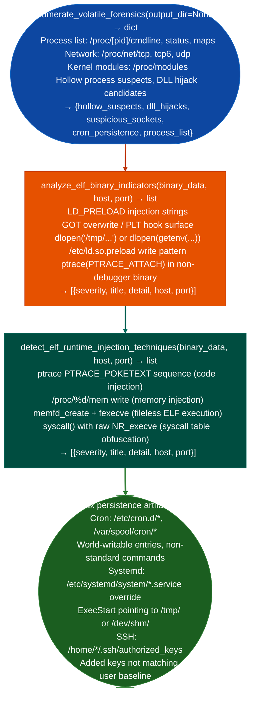

# Volatile and Linux Artifact Triage

Capture volatile host state running processes, network connections, kernel modules, open file descriptors before it changes, enumerate Linux filesystem persistence artifacts cron jobs, systemd unit overrides, LD_PRELOAD entries, SSH `authorized_keys`, and detect ELF runtime injection techniques: providing a complete pre-analysis snapshot for Linux incident response: via `modules/forensics_enum.py` and `modules/process_enum.py`.

---

## Why this exists

1. **Volatile data must be captured before any other analysis activity**: running processes, network connection state, kernel modules, and ARP tables are modified by every subsequent command. `enumerate_volatile_forensics()` in `process_enum.py` captures all of these to a timestamped output directory in a single call, establishing the ground-truth state of the host before any analysis tools interact with it.

2. **`analyze_elf_binary_indicators()` performs a broad static analysis pass on a Linux ELF binary**, it detects `LD_PRELOAD` injection strings referencing `/etc/ld.so.preload`, `putenv("LD_PRELOAD=``, GOT overwrite patterns, `dlopen`/`dlsym` dynamic loading of unusual paths, and `ptracePTRACE_ATTACH` calls in non-debugger context. These patterns appear in Linux userspace rootkits, shared library injectors, and credential-harvesting implants.

3. **`detect_elf_runtime_injection_techniques()` identifies process injection methods**: `PTRACE_POKETEXT` code injection into running process, `/proc/<pid>/mem` write memory write without ptrace, `memfd_create` + `fexecve` fileless execution, and `syscall()` with raw `execve` number syscall obfuscation. These are the Linux equivalents of Windows process hollowing and reflective DLL injection.

---

## How it works



---

## Usage

```python
from modules.process_enum import enumerate_volatile_forensics
from modules.forensics_enum import (
    analyze_elf_binary_indicators,
    detect_elf_runtime_injection_techniques
)

# Volatile state capture (do this first)
import tempfile
output_dir = tempfile.mkdtemp(prefix='volatile_')
snapshot = enumerate_volatile_forensics(output_dir)
# Return keys: hollow_suspects, dll_hijacks, suspicious_sockets, cron_persistence, process_list
print(f"Processes: {len(snapshot['process_list'])}")
print(f"Hollow suspects: {snapshot['hollow_suspects']}")
print(f"DLL hijack candidates: {snapshot['dll_hijacks']}")

# ELF binary analysis
data = open('suspicious_elf', 'rb').read()
indicators = analyze_elf_binary_indicators(data)
injection = detect_elf_runtime_injection_techniques(data)
for i in indicators + injection:
    # both functions return {severity, title, detail, host, port}
    print(f"  [{i['severity']}] {i['title']}: {i['detail'][:80]}")
```

---

## Example output

The following illustrates volatile and Linux artifact triage output format.

```
enumerate_volatile_forensics: /tmp/volatile_abc123/

Processes: <N> running
Suspicious kernel modules:
  kbdlog.ko  (loaded from /tmp/, non-standard path)

analyze_elf_binary_indicators: suspicious_elf

  [HIGH] LD_PRELOAD_INJECT: putenv("LD_PRELOAD=/tmp/lib.so") at 0x4050
  [HIGH] PTRACE_ATTACH: non-debugger binary calls ptrace(PTRACE_ATTACH)

detect_elf_runtime_injection_techniques:

  [CRITICAL] MEMFD_FILELESS: memfd_create + fexecve sequence at 0x6100
```

---

## False positives

**`enumerate_volatile_forensics()` kernel module path check**: some legitimate kernel modules in embedded distributions are located outside `/lib/modules/<kernel>/`. Verify the module's digital signature if kernel module signing is enforced and cross-reference against the expected module list for the distribution before flagging as suspicious.

**`detect_elf_runtime_injection_techniques()` `ptracePTRACE_ATTACH`**: debuggers, performance profilers `perf`, `gdb`, and containers using user-mode execution tracing all use `PTRACE_ATTACH`. This pattern is only suspicious in a binary that has no other indicators of being a debug tool. Filter by binary path and associated process context.

---

## Pipeline position

Run volatile capture as the very first step on any suspected compromised Linux host. ELF binary indicators and injection technique detection apply to any suspicious binary found during the volatile capture analysis.

---

## Reading findings

Volatile/Linux triage functions return `List[{severity, title, detail}]`:

| Field | Content |
|:---|:---|
| `severity` | `HIGH` / `MEDIUM` |
| `title` | Finding code for example `LD_PRELOAD_INJECT`, `PTRACE_ATTACH`, `SUSPICIOUS_KERNEL_MODULE` |
| `detail` | VA of the call, library path, module path, or process description |

`enumerate_volatile_forensics()` also returns a `processes` count and a `suspicious_modules` list.

---

## See also

- [Process and Memory Map Inventory](process-and-memory-map-inventory.md): `/proc/pid/maps` RWX region and DLL hijacking analysis
- [Linux Privilege Escalation Triage](linux-privilege-escalation-triage.md): SUID/capability escalation surface on the same host
