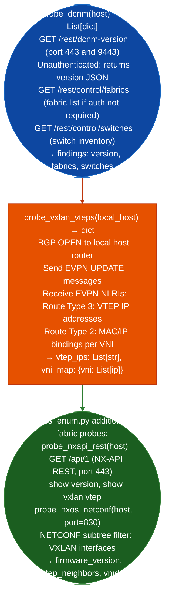

# VXLAN/DCNM Exposure

Probe Cisco DCNM Data Center Network Manager and VXLAN VTEP infrastructure: identifying unauthenticated version disclosure at DCNM REST endpoints, VTEP neighbor discovery via BGP EVPN, and firmware/license detail extraction: via `modules/nxos_enum.py` `probe_dcnm()` and `probe_vxlan_vteps()`.

---

## Why this exists

1. **DCNM `/rest/dcnm-version` returns the software version without authentication**: `probe_dcnm()` sends `GET /rest/dcnm-version` to ports 443 and 9443, which returns the exact DCNM version string without requiring login. DCNM version directly maps to known CVEs; version disclosure is confirmed unauthenticated regardless of whether the DCNM web console requires authentication.

2. **VXLAN VTEP discovery via BGP EVPN NLRIs**: `probe_vxlan_vteps()` sends BGP OPEN and UPDATE messages to discover EVPN routes that carry VTEP IP addresses and VNI assignments. This provides the full VXLAN fabric topology from any host that is routable to the BGP reflector, without requiring management plane access.

3. **DCNM has been superseded by NDFC on Nexus Dashboard**, but DCNM deployments port 9443 remain common in older data center environments. `probe_dcnm()` checks both the legacy DCNM port (9443) and the NDFC path (443), returning whichever responds, so the same function works against both deployment models.

---

## How it works



---

## Usage

```python
from modules.nxos_enum import probe_dcnm, probe_vxlan_vteps

# DCNM unauthenticated version probe
dcnm = probe_dcnm('10.0.0.20')
for finding in dcnm:
    print(f"  [{finding['severity']}] {finding['title']}: {finding['detail']}")

# VXLAN VTEP discovery
vteps = probe_vxlan_vteps('10.0.0.1')
print(f"VTEPs: {vteps.get('vtep_ips')}")
for vni, ips in vteps.get('vni_map', {}).items():
    print(f"  VNI {vni}: {ips}")
```

---

## Example output

The following illustrates VXLAN/DCNM enumeration output format.

```
probe_dcnm: 10.0.0.20

[INFO] DCNM version: 11.5(4) (port 9443)
[HIGH] DCNM version disclosure: /rest/dcnm-version unauthenticated

probe_vxlan_vteps:
  VTEPs: [10.0.0.101, 10.0.0.102, 10.0.0.103]
  VNI 10001: [10.0.0.101, 10.0.0.102]
  VNI 10002: [10.0.0.101, 10.0.0.103]
```

---

## False positives

**BGP EVPN probing**: `probe_vxlan_vteps()` opens a BGP session toward the local host router. If the target does not have BGP configured, the OPEN will be rejected. If BGP is configured with MD5 authentication, the session will not establish. Version-only probing via `probe_dcnm()` is always safe and does not require BGP.

**DCNM `/rest/control/fabrics` may require authentication**: some DCNM deployments require a session token for fabric list calls. `probe_dcnm()` attempts the fabric list call after version discovery; a 401 response on that call is not an error.

---

## Pipeline position

Run VXLAN/DCNM probes after identifying Cisco data center management IPs port 9443 or NX-API port 443. DCNM version disclosure is low-risk to execute. VTEP discovery provides the VXLAN fabric topology for network segmentation analysis.

---

## Reading findings

VXLAN/DCNM probe functions return `List[{severity, title, detail, host, port}]`:

| Field | Content |
|:---|:---|
| `severity` | `HIGH` unauthenticated API / `MEDIUM` version disclosure / `INFO` version fingerprint |
| `title` | Finding code for example `DCNM_UNAUTH_REST_API`, `DCNM_VERSION_DISCLOSURE`, `VXLAN_VTEP_ENUMERATED` |
| `detail` | Version string, VTEP IP list, or accessible REST endpoint path |
| `host` | Target host |
| `port` | Service port for example `9443` for DCNM |

---

## See also

- [NX-OS/ACI/APIC Fabric Enumeration](nx-os-aci-apic-fabric-enumeration.md): APIC/ACI fabric enumeration DCNM successor
- [Nexus Dashboard](nexus-dashboard.md): NDFC replacement for DCNM on Nexus Dashboard
