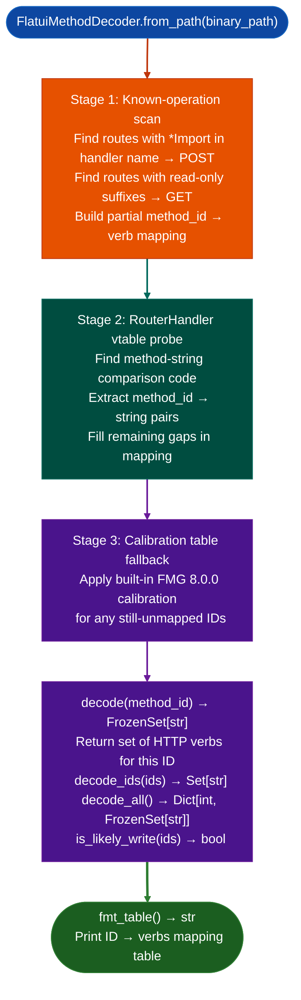

# Flatui HTTP Method Decoding

Decode flatui framework HTTP method integer IDs to HTTP verb sets: scanning route registration areas for known-operation routes, probing `RouterHandler` vtable method-string comparison code, and falling back to a built-in calibration table derived from FortiManager 8.0.0 analysis: enabling `PreAuthRouteAuditor` to correctly identify `GET`-only vs write-capable pre-auth routes.

---

## Why this exists

1. **The flatui framework encodes HTTP methods as integer IDs in `RouteMethodData`.** Without decoding, `PreAuthRouteAuditor` cannot determine whether a pre-auth route accepts only `GET` requests lower risk: information disclosure at worst or also accepts `POST`/`PUT`/`DELETE` higher risk: state mutation and command injection paths. `FlatuiMethodDecoder` resolves the method ID to the actual HTTP verb set.

2. **Three-stage decoding with fallback**: the decoder first scans known-operation routes `*Import` handlers → `POST`, read-only resource handlers → `GET` to anchor the ID→verb mapping, then probes the `RouterHandler` vtable for the method-string comparison code to extract the full mapping, then falls back to a built-in calibration table derived from FortiManager 8.0.0 binary analysis. The three-stage approach ensures correctness even when the binary is stripped.

3. **`FlatuiMethodDecoder.is_likely_writemethod_ids` returns `True` if any method in the set is `POST`, `PUT`, `PATCH`, or `DELETE`**: enabling `PreAuthRouteAuditor` to immediately flag pre-auth routes that accept write methods as higher priority than `GET`-only routes.

---

## How it works



---

## Usage

```python
from ablation.analyzers.flatui_method_decoder import FlatuiMethodDecoder

dec = FlatuiMethodDecoder.from_path('/path/to/libservice.so')

# Decode a specific method ID
verbs = dec.decode(11)
print(f"method_id 11 → {verbs}")  # e.g. frozenset({'GET', 'POST'})

# Check if a route accepts writes
if dec.is_likely_write([11, 3]):
    print("Route accepts write methods — higher priority pre-auth target")

# Print full mapping
print(dec.fmt_table())
```

---

## Example output

The following illustrates flatui method decoding output format. Actual IDs are binary-specific.

```
FlatuiMethodDecoder: libservice.so

Method ID → HTTP verb mapping (stage: vtable probe):
  0  → {GET}
  1  → {POST}
  3  → {GET, POST}
  11 → {GET}
  15 → {POST, PUT, DELETE}

decode(11): frozenset({'GET'})
is_likely_write([11, 15]): True  (15 includes POST/PUT/DELETE)
```

---

## False positives

**Stage 3 calibration table applies FMG 8.0.0 mappings to other targets**: flatui variants in different FortiOS products may use different integer IDs for the same verb. A wrong calibration table hit produces an incorrect verb assignment. Verify method ID mappings from Stage 1/2 results before relying on Stage 3 fallback values for non-FMG targets.

**`is_likely_write()` returns `True` for any method set containing `POST`**: a route that accepts `POST` only for fetching data non-mutating POST is still flagged as `is_likely_write`. Validate the actual handler function behavior before treating the route as a state-mutation risk.

---

## Pipeline position

Run `FlatuiMethodDecoder` immediately after route registration analysis and before `PreAuthRouteAuditor`. Pass the `FlatuiMethodDecoder` instance to `PreAuthRouteAuditor` so it can enrich route entries with their HTTP verb sets.

---

## Reading output

`FlatuiMethodDecoder.decode(ctx)` returns `Dict[int, Set[str]]`: method ID → set of HTTP verb strings for example `{0: {'GET'}, 1: {'POST'}, 15: {'POST', 'PUT', 'DELETE'}}`.

`FlatuiMethodDecoder.report(mapping)` returns a formatted string suitable for embedding in a findings report. Pass the dict from `decode()` directly.

---

## See also

- [Pre-Authentication Route Auditing](route-authentication-classification.md): `PreAuthRouteAuditor` that consumes `FlatuiMethodDecoder` results
- [CMDB Attack Surface Mapping](finding-corpus-mining.md): `CMDBSurfaceMapper` for complementary FortiOS attack surface enumeration
