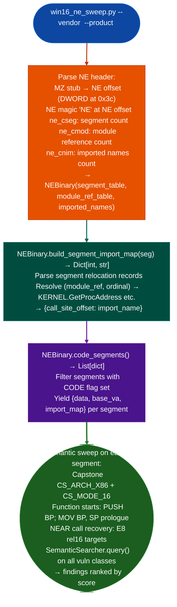

# Windows 16-bit NE Analysis

Parse Windows 16-bit New Executable (NE) binaries: resolving per-segment relocation records to import names from KERNEL, USER, GDI, and SHELL ordinal tables, and sweep CODE segments with Capstone `CS_MODE_16` and the full semantic model, via `sweeps/win16_ne_sweep.py`.

---

## Why this exists

1. **LIEF does not support the NE format**: every call to `lief.parse()` on an NE binary returns `None`. `win16_ne_sweep.py` implements a pure-Python NE header parser that reads the segment table, module reference table, and imported names table directly from the binary's NE header, without any external library dependency.

2. **NE binaries use per-segment relocation records to resolve imports.** There is no IAT. Each CODE segment contains a relocation table that maps each call site to a `module_ref, ordinal/name` pair. `NEBinary.build_segment_import_map()` resolves these to human-readable import strings for example `KERNEL.GetProcAddress` using the Win16 ordinal-to-name table for KERNEL, USER, GDI, and SHELL. This gives function-level call context to the semantic sweep without requiring symbol table support.

3. **16-bit function prologue recovery requires `CS_MODE_16`**: Capstone defaults to `CS_MODE_32` for x86; using it on 16-bit code produces incorrect disassembly. `win16_ne_sweep.py` uses `CS_ARCH_X86 + CS_MODE_16` and detects function starts via the 16-bit prologue: `PUSH BP; MOV BP, SP` (`0x55 0x8B 0xEC` or `0x55 0x89 0xE5`). NEAR call recovery (`E8 rel16`) provides additional function entry points within each segment.

---

## How it works



---

## Usage

```bash
# Single binary with vendor/product metadata
python3 sweeps/win16_ne_sweep.py \
    /path/to/target.exe \
    --vendor apple \
    --product qtvr \
    --version 2.1
```

```python
from sweeps.win16_ne_sweep import NEBinary
from pathlib import Path

data = Path('/path/to/target.exe').read_bytes()
ne = NEBinary(data)

for seg in ne.code_segments():
    imp_map = ne.build_segment_import_map(seg)
    print(f"  Segment imports: {list(imp_map.values())[:5]}")
```

---

## Example output

The following illustrates Win16 NE sweep output format.

```
NEBinary: target.exe  (NE at offset 0x40)
  Segments: <N>  |  CODE segments: <C>

Segment 1 imports (from relocation records):
  KERNEL.GetProcAddress
  KERNEL.LocalAlloc
  USER.MessageBoxA

Semantic sweep results:
  [HIGH] memory-safety:  0x<seg1_va>+0x<off>  score=0.89
  [MED]  input-parsing:  0x<seg2_va>+0x<off>  score=0.81
```

---

## False positives

**`PUSH BP; MOV BP, SP` prologue detection generates false positives on data sections that happen to contain this byte sequence.** NE segment type flags limit prologue scanning to segments with the CODE attribute set, but within those segments data that follows the prologue pattern will be treated as a function entry. Limit manual analysis to entries that are also call targets from the `build_segment_import_map` relocation records.

**Win16 ordinal tables for USER, GDI, SHELL are compiled-in**: if the NE binary imports from a DLL not in the built-in table, import names will show as `<module>.ordinal_<N>` rather than a named function. This is not an error; it reflects the limits of the ordinal map.

---

## Pipeline position

Run `win16_ne_sweep.py` on any Win16 NE binary. Output feeds the standard findings workflow: byte-verify → `PathSolver` feasibility → `FindingRegistry.register()` → RE module write.

---

## Reading output

`NEBinary(path)` parses on construction. Its key attributes are:

| Attribute | Content |
|:---|:---|
| `segments` | `List[dict]`: all NE segments, each with `index`, `file_offset`, `file_size`, `is_code`, `has_reloc`, `flags` |
| `module_names` | `List[str]`: imported module name list 1-indexed per NE format |

`NEBinary.code_segments()` returns only the segments where `is_code=True` and `file_offset > 0`.

`NEBinary.build_segment_import_map(seg)` returns `Dict[source_offset, 'MODULE!function']`: the per-segment import resolution from relocation records.

---

## See also

- [Windows LE/VxD Analysis](windows-le-vxd.md): `win16_le_vxd_sweep.py` for Linear Executable / Virtual Device Driver format
- [Injection and Persistence Indicators](injection-and-persistence-indicators.md): `FormatStringScanner` for format-string findings confirmed in NE CODE segments
