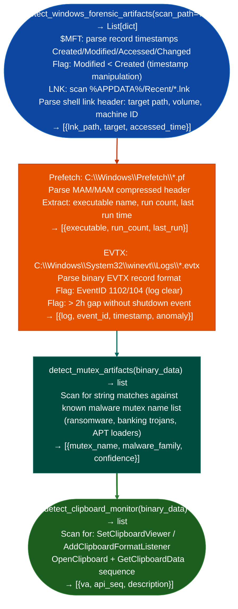

# Windows Artifact Discovery

Scan the Windows filesystem for $MFT timeline anomalies, LNK file targets recent documents, persistence shortcuts, Prefetch execution records, EVTX log gaps, mutex name artifacts from known malware families, and clipboard monitor patterns: providing a host-activity timeline from a mounted Windows volume: via `modules/forensics_enum.py`.

---

## Why this exists

1. **`detect_windows_forensic_artifacts()` builds a host-activity timeline without requiring Windows tools**, it reads `$MFT` for file creation/modification timestamps, scans `%APPDATA%\Microsoft\Windows\Recent\` for LNK files revealing what was accessed and when, reads Prefetch files from `C:\Windows\Prefetch\` for application execution records, and scans EVTX logs for gaps time ranges with no events, indicating log clearing. All parsing is pure Python with no Windows API calls.

2. `detect_mutex_artifacts()` identifies malware families by their mutex names: well-known malware families use consistent mutex names to prevent double-infection: `Global\{GUID}` patterns specific to ransomware families, APT loader names, and banking trojan mutex strings. `detect_mutex_artifacts()` scans binary data for string patterns matching a curated list of known malicious mutex names, providing a rapid family attribution signal without dynamic execution.

3. **`detect_windows_forensic_artifacts()` detects EVTX log tampering**, it reads Security Event Log entries and identifies System Event ID 1102 Audit log cleared and Security Event ID 104 System log cleared, which are direct evidence of attacker log clearing. It also detects temporal gaps in the EVTX event sequence where events jump more than a configurable threshold default: 2 hours without a system shutdown event.

---

## How it works



---

## Usage

```python
from modules.forensics_enum import (
    detect_windows_forensic_artifacts,
    detect_mutex_artifacts,
    detect_clipboard_monitor
)

# Filesystem timeline analysis (run on mounted Windows volume)
# Returns [{severity, title, detail, host, port}]
for a in detect_windows_forensic_artifacts('/mnt/windows'):
    print(f"  [{a['severity']}] {a['title']}: {a['detail'][:80]}")

# Mutex creation indicators from binary
data = open('sample.exe', 'rb').read()
for m in detect_mutex_artifacts(data):
    print(f"  [{m['severity']}] {m['title']}: {m['detail'][:80]}")
```

---

## Example output

The following illustrates Windows artifact discovery output format.

```
detect_windows_forensic_artifacts: /mnt/windows

  [MFT] C:\Users\user\Desktop\tools.zip: Modified < Created (timestamp rollback)
  [LNK] Recent\cmd.lnk → C:\Windows\System32\cmd.exe (accessed 2026-10-16)
  [PREFETCH] nc.exe → run_count=4  last_run=2026-10-16T14:32:00
  [EVTX] Security.evtx: EventID 1102 at 2026-10-16T14:30:01 (audit log cleared)

detect_mutex_artifacts:

  [HIGH] Global\{12AB34CD-...} → Ryuk ransomware family
```

---

## False positives

**`$MFT` `Modified < Created` timestamps**, this pattern indicates timestamp manipulation, which is present in both attacker anti-forensics and legitimate archiving tools ZIP extraction sets modification time from archive metadata, resulting in a modification timestamp before the local creation timestamp. Verify against EVTX event records for the same file.

**Mutex name matching is string-based**: mutex names from malware families can be coincidentally reproduced by legitimate software. A `HIGH` confidence match means the string is in the known-malicious list; it does not mean the file is confirmed malware without corroborating evidence.

---

## Pipeline position

Run Windows artifact discovery on any mounted Windows volume or memory image during post-compromise forensic analysis. EVTX timeline gaps identify the attacker's active window; Prefetch execution records confirm which tools were run.

---

## Reading findings

`detect_windows_forensic_artifactsmount_path` returns a list of finding dicts:

| Field | Content |
|:---|:---|
| `severity` | `HIGH` MFT rollback, EVTX clear / `MEDIUM` prefetch entry, LNK file |
| `title` | Artifact type: `MFT`, `LNK`, `PREFETCH`, or `EVTX` |
| `path` | Windows file path of the artifact |
| `detail` | Observation for example modified < created, run count, EventID |

---

## See also

- [Rootkit/Bootkit Indicators](rootkit-bootkit-indicators.md): kernel-level persistence patterns that accompany filesystem artifact manipulation
- [Timestamp/Log Anomaly Checks](timestamp-log-anomaly-checks.md): cross-platform timestamp validation and log tampering detection
