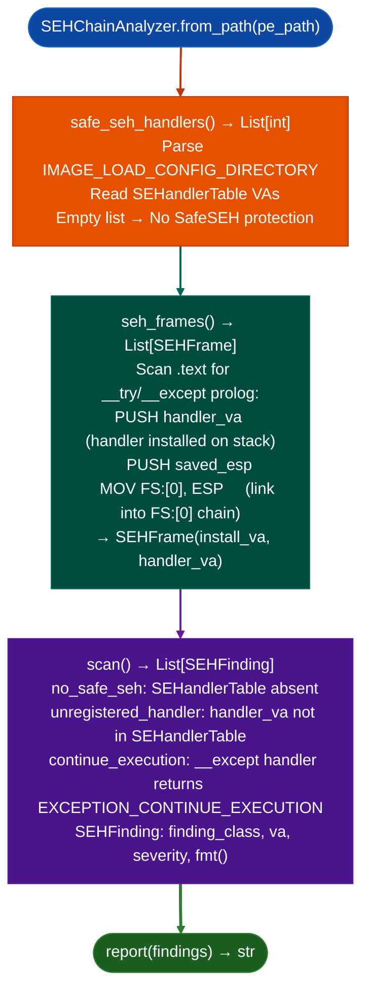

# SEH Chain Analysis

Analyze Structured Exception Handler (SEH) chains in x86 (32-bit) Windows PE binaries: detecting missing SafeSEH protection, unregistered exception handler VAs, and `EXCEPTION_CONTINUE_EXECUTION` returns that enable SEH-based stack control-flow hijacking.

---

## Why this exists

1. **x86 (32-bit) Windows uses a stack-linked list of SEH frames**: each frame lives on the stack at `FS:[0]` and holds a pointer to a handler function. An attacker who overwrites a stack SEH frame can redirect execution to an arbitrary address when an exception fires, without needing a return address overwrite. SEH exploitation remains relevant on legacy industrial, SCADA, and embedded Windows targets.

2. **SafeSEH (`IMAGE_LOAD_CONFIG.SEHandlerTable`) defends against this by listing all legitimate handler functions.** An exception dispatch to a handler not in `SEHandlerTable` triggers a process termination instead of calling the handler. `SEHChainAnalyzer.scan()` detects PE binaries that do not have a `SEHandlerTable` (`safe_seh_handlers()` returns empty): indicating that all handler addresses on the stack are valid dispatch targets for an attacker.

3. **`SEHChainAnalyzer.seh_frames()` extracts the static SEH frame layout from the binary's code**: identifying all `__try`/`__except` constructs compiled into the binary as `SEHFrame` entries. For binaries without SafeSEH, `seh_frames()` provides the list of all handler VAs that would be trusted by the exception dispatcher, which is the set of VAs an attacker must reach to exploit the chain.

---

## How it works



---

## Usage

```python
from ablation.analyzers.seh_chain_analyzer import SEHChainAnalyzer

analyzer = SEHChainAnalyzer.from_path('/path/to/legacy_service.exe')

safe_handlers = analyzer.safe_seh_handlers()
print(f"SafeSEH handlers: {len(safe_handlers)}")

frames = analyzer.seh_frames()
print(f"SEH frames: {len(frames)}")
for frame in frames:
    print(f"  install_va={frame.install_va:#x}  handler_va={frame.handler_va:#x}")

findings = analyzer.scan()
print(SEHChainAnalyzer.report(findings))
```

---

## Example output

The following illustrates SEH chain analysis output format. Actual addresses are binary-specific.

```
SEHChainAnalyzer: legacy_service.exe

safe_seh_handlers(): <N>  (<N>=0 → No SafeSEH)

SEH frames: <M>
  install_va=<va>  handler_va=<va>

scan() findings:
  [HIGH] no_safe_seh: IMAGE_LOAD_CONFIG.SEHandlerTable absent
    all <M> handler VAs are trusted by exception dispatcher
  [MEDIUM] continue_execution: handler at <va> returns EXCEPTION_CONTINUE_EXECUTION
```

---

## False positives

**`no_safe_seh` fires on all 32-bit PE binaries that predate SafeSEH**: binaries compiled before MSVC 7.1 Visual Studio 2003 do not support SafeSEH. The absence of SafeSEH is a finding, but exploitability requires a stack overflow or format-string write primitive on the same target.

**`seh_frames()` static extraction may not find all frames**: dynamically installed SEH frames for example from compiler-generated `__finally` blocks that are only installed at runtime are not visible in static analysis. The frame count from `seh_frames()` is a lower bound.

---

## Pipeline position

Run `SEHChainAnalyzer` on any x86 32-bit Windows PE binary as part of initial attack surface triage. Combine `no_safe_seh` findings with stack overflow candidates from `FormatStringScanner` or length-underflow findings to assess exploitation feasibility.

---

## Reading findings

`SEHChainAnalyzer.scan()` returns a list of finding dicts Windows escalation variant:

| Field | Content |
|:---|:---|
| `severity` | `HIGH` |
| `title` | Finding code for example `SEH_HANDLER_NOT_IN_TABLE`, `SAFESEH_ABSENT` |
| `install_va` | VA of the SEH frame installation |
| `handler_va` | VA of the SEH handler |
| `detail` | Description of the bypass condition |

`SEHChainAnalyzer.safe_seh_handlers()` returns `List[int]`: VAs registered in the SafeSEH table (empty list if SafeSEH is absent).

---

## See also

- [Injection and Persistence Indicators](injection-and-persistence-indicators.md): format string and stack control findings that enable SEH exploitation
- [BYOVD Capability Detection](byovd-capability-detection.md): `ByovdDetector` for kernel-mode SEH bypass via BYOVD
