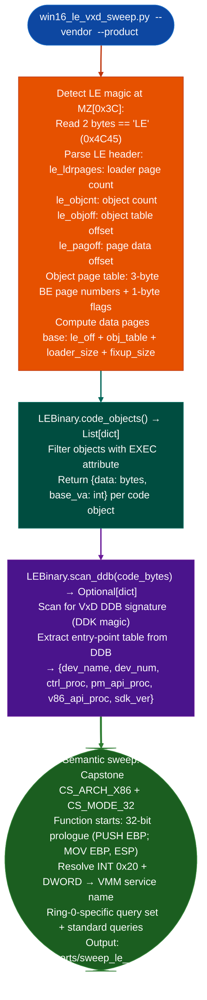

# Windows LE/VxD Analysis

Parse Windows 3.x Linear Executable (LE) Virtual Device Driver binaries: resolving VMM service calls via `INT 0x20 + DWORD service ID`, identifying entry-point functions from the Device Descriptor Block (DDB), and sweeping ring-0 code with a specialized vulnerability query set ring-0 overflow, ring-0 format string: via `sweeps/win16_le_vxd_sweep.py`.

---

## Why this exists

1. **LIEF and standard PE parsers reject LE binaries.** The LE magic `'LE'`, `0x4C45` at the offset stored in the MZ header field `0x3C` is distinct from the PE magic (`'PE\0\0'`). Standard parsers check for `PE` and fail with an invalid signature error. `win16_le_vxd_sweep.py` implements a pure-Python LE header parser that reads the object page table using the LE-specific 3-byte big-endian page number format.

2. **VxDs have zero imports: ring-0 VMM service calls use `INT 0x20 + DWORD service ID`**, there is no IAT to resolve. `win16_le_vxd_sweep.py` includes a compiled VMM service ID-to-name table derived from the WfW 3.11 and Win 3.1 DDK, mapping each service DWORD to its VMM name for example `0x00010009 → _HeapAllocate`. This provides function-level call context at ring-0 without an import table.

3. **Ring-0 code has a qualitatively different vulnerability profile**: a stack overflow or format string in a VxD does not hit a ring-3 exception handler; it corrupts the ring-0 stack and produces a kernel fault Blue Screen. `win16_le_vxd_sweep.py` includes ring-0-specific semantic queries: `vxd_ring0_recv_overflow` ring-0 buffer from network packet data, `vxd_ring0_alloc_overflow` kernel heap allocation size from 32-bit arithmetic on packet length, and `vxd_format_string_ring0` wsprintf/sprintf in ring-0 context. These queries target the Windows 3.x era network VxDs VTDI, VIP, VNBT where ring-0 packet processing vulnerabilities were historically found.

---

## How it works



---

## Usage

```bash
# Single .386/.vxd binary
python3 sweeps/win16_le_vxd_sweep.py VIP.386 \
    --vendor microsoft \
    --product tcpip32 \
    --version 3.11a

# Directory scan (all .386, .vxd, .drv files with LE magic)
python3 sweeps/win16_le_vxd_sweep.py /path/to/vxd_dir/ \
    --vendor microsoft \
    --product tcpip32 \
    --version 3.11a
```

---

## Example output

The following illustrates LE/VxD sweep output format.

```
LEBinary: VIP.386  (LE at offset 0x40)
  Objects: <N>  |  CODE objects: <C>
  VMM services resolved: <M>

DDB scan:
  Device_Init_VA:   0x<va>  → init_device
  PM_API_VA:        0x<va>  → pm_api_handler
  V86_API_VA:       0x<va>  → v86_api_handler

Semantic sweep:
  [HIGH] vxd_ring0_recv_overflow: 0x<va>  score=0.91
    VMM calls: _HeapAllocate (0x00010009), _VTDI_Recv_Packet (...)
  [MED]  vxd_ring0_alloc_overflow: 0x<va>  score=0.84
```

---

## False positives

**DDB signature detection**, not all LE binaries are VxDs with a standard DDB. Non-VxD LE binaries some 32-bit OS/2 executables also use the LE format will not have a DDB; `scan_ddb()` returns `None` in that case and the sweep continues without entry-point labels.

**`PUSH EBP; MOV EBP, ESP` prologue in 32-bit LE code**, this is standard 32-bit x86 but data sections that happen to contain this byte sequence will produce false function starts. Filter analysis to DDB-identified entry points and call targets before manual review.

---

## Pipeline position

Run `win16_le_vxd_sweep.py` on any Windows 3.x VxD binary `.386`, `.vxd`, `.drv` with LE magic. The ring-0-specific query set is unique to this sweep; do not substitute `pe_sweep.py` for LE targets. Findings feed the standard `FindingRegistry` workflow.

---

## Reading output

`LEBinary(path)` parses on construction. Its key attributes are:

| Attribute | Content |
|:---|:---|
| `objects` | `List[dict]`: all LE objects with `index`, `vbase`, `vsize`, `flags`, `mapsize` |
| `num_pages` | Total page count in the LE binary |
| `data_base` | File offset where page data begins |

`LEBinary.code_objects()` returns only objects with the EXECUTABLE flag set. Each result dict has `obj_index`, `vbase`, `vsize`, and `bytes` assembled code bytes.

`LEBinary.scan_ddbcode_bytes` returns `Optional[dict]`: `None` if no VxD DDB signature is found, or a dict with `ddb_off`, `sdk_ver`, `dev_num`, `dev_name`, `ctrl_proc`, `v86_api_proc`, and `pm_api_proc`.

---

## See also

- [Windows 16-bit NE Analysis](windows-16-bit-ne.md): `win16_ne_sweep.py` for segmented 16-bit NE executables
- [Windows Escalation Indicators](windows-escalation-indicators.md): `SEHChainAnalyzer` for SEH-based escalation patterns in PE targets
