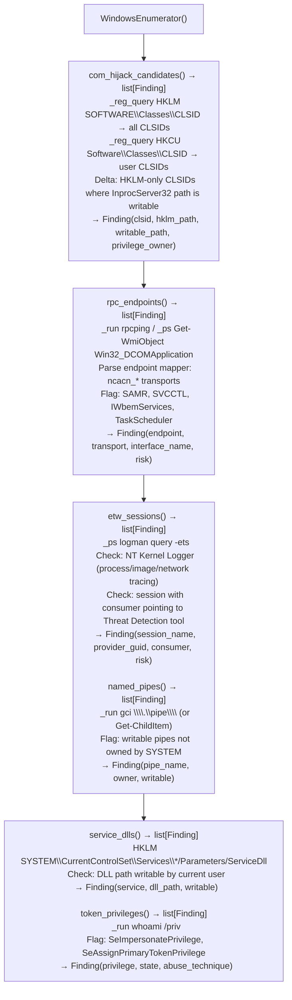

# Windows Live Enumeration

Enumerate COM hijacking candidates (HKCU vs. HKLM CLSID delta), active RPC endpoints, ETW session consumers, named pipe surfaces, service DLL hijacking paths, autoruns, token privileges, and system security feature status (CFG, DEP, ASLR policies) — providing a complete Windows live-system attack surface map — via `modules/windows_enum.py` `WindowsEnumerator`.

---

## Why this exists

1. **`WindowsEnumerator.com_hijack_candidates()` identifies COM classes that can be hijacked via HKCU override** — Windows COM resolution checks `HKCU\Software\Classes\CLSID\` before `HKLM\SOFTWARE\Classes\CLSID\`. Any COM class registered in HKLM but absent from HKCU can be overridden by a low-privilege user: writing a new `InprocServer32` entry under HKCU pointing to an attacker DLL causes the DLL to execute whenever a privileged process instantiates that class. `com_hijack_candidates()` computes the delta between HKLM and HKCU registrations for the current user.

2. **`rpc_endpoints()` enumerates active RPC endpoint mapper registrations** — RPC servers registered with the endpoint mapper often expose privileged functionality without requiring Windows authentication when accessed from the local system. `rpc_endpoints()` queries `ncacn_ip_tcp`, `ncalrpc`, and `ncacn_np` transport bindings and flags endpoints bound to `\pipe\svcctl`, `\pipe\samr`, or interfaces associated with known lateral movement primitives (`IWbemServices`, task scheduler).

3. **`system_security_features()` enumerates mitigation policy status** — Control Flow Guard (CFG) enforcement policy, Data Execution Prevention (DEP) policy (AlwaysOn vs. OptIn vs. OptOut), ASLR mandatory randomization, SEHOP (Structured Exception Handling Overwrite Protection), and Credential Guard / Device Guard status. This is the Windows equivalent of `host-platform-inventory` — it determines which exploit mitigation bypasses are necessary before attempting memory corruption.

---

## How it works



---

## Usage

```python
from modules.windows_enum import WindowsEnumerator

enumerator = WindowsEnumerator()
results = enumerator.enumerate_all()

# COM hijacking candidates
for f in results['com_hijack']:
    print(f"  {f.clsid}: {f.hklm_path} → writable by current user")

# Token privileges (impersonation escalation)
for f in results['token_privileges']:
    if 'SeImpersonatePrivilege' in f.description:
        print(f"  SeImpersonatePrivilege: {f.state} → Potato escalation possible")

# Print full report
print(WindowsEnumerator.report(results))
```

---

## Example output

The following illustrates Windows live enumeration output format.

```
WindowsEnumerator:

COM hijack candidates:
  {ABC12345-...}: HKLM=C:\Windows\System32\comsvcs.dll  → HKCU writable

RPC endpoints:
  ncalrpc:\pipe\svcctl  (Service Control Manager — unauthenticated local access)

Service DLL hijacking:
  svc_helper: C:\ProgramData\vendor\helper.dll  (writable by Users)

Token privileges:
  SeImpersonatePrivilege: Enabled  → Potato escalation path

system_security_features:
  CFG: Enabled  DEP: AlwaysOn  ASLR: MandatoryASLR  SEHOP: Enabled
```

---

## False positives

**`com_hijack_candidates()` writability check** — the module checks whether the DLL path stored in the HKLM CLSID entry points to a directory writable by the current user. Some enterprise environments add ACLs that prevent writable-path detection via standard API calls. Verify write access manually by attempting to create a test file.

**`named_pipes()` writable pipe detection** — writable named pipes not owned by SYSTEM are unusual but not always exploitable. A writable pipe requires a privileged process to connect to it for impersonation to succeed. Cross-reference with `service_dlls()` to find services that connect to user-accessible pipes.

---

## Pipeline position

Run `WindowsEnumerator` after gaining low-privilege access to a Windows host. COM hijacking and service DLL paths provide the most reliable privilege escalation candidates; token privileges determine whether impersonation attacks are immediately available.

---

## See also

- [Linux Privilege Escalation Triage](linux-privilege-escalation-triage.md) — equivalent Linux escalation enumeration
- [Windows Artifact Discovery](windows-artifact-discovery.md) — filesystem and registry timeline artifacts for forensic analysis
