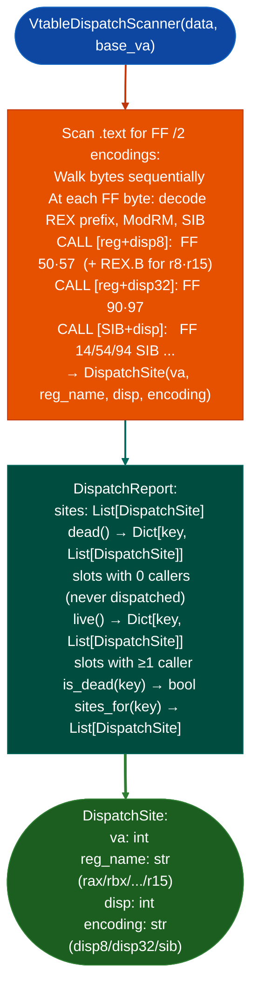

# x86-64 Virtual Dispatch Slot Analysis

Find every `CALL [reg+disp]` indirect dispatch site in x86-64 ELF `.text`: determining which virtual function slots are actually dispatched (`live`) versus never called (`dead`) in the binary: covering all standard x86-64 indirect call encodings including REX.B-extended registers (`r8`–`r15`) and `disp8`/`disp32` forms.

---

## Why this exists

1. **Virtual function tables are the primary attack surface for type confusion and use-after-free exploitation on x86-64 Windows and Linux.** Knowing which vtable slots are live dispatched by at least one call site narrows the set of slots an attacker must control to achieve code execution. Dead slots that appear in the vtable but are never dispatched cannot be hijacked for RCE.

2. x86-64 indirect call encoding is non-trivial: `FF /2` ModRM-based calls cover `[reg]`, `[reg+disp8]`, `[reg+disp32]`, and `[SIB+disp]` forms, and REX.B extends the register field to `r8`–`r15`. `VtableDispatchScanner` handles all encoding forms by decoding the full ModRM/SIB byte sequence, avoiding the false-negative class where indirect calls to `r8`–`r15` slots are missed.

3. `DispatchReport.live()` and `DispatchReport.dead()` provide slot-key indexed results: where the key is `reg+N` for example `rax+8`, `r10+16`. `DispatchReport.is_dead('rax+8')` allows a targeted check for a specific vtable slot before investing in full vtable layout analysis.

---

## How it works



---

## Usage

```python
from ablation.analyzers.vtable_dispatch_scanner import VtableDispatchScanner
from ablation.analyzers.binary_context import BinaryContext

ctx = BinaryContext.load_or_build('/path/to/libssl.so')
text_section = ctx.text_bytes()
scanner = VtableDispatchScanner(text_section, base_va=ctx.text_va())

report = scanner.scan()

print(f"Live slots: {len(report.live())}")
print(f"Dead slots: {len(report.dead())}")

# Check a specific slot
if report.is_dead('rax+8'):
    print("Slot rax+8 is never dispatched — hijack requires live dispatch path")

# All sites for a specific slot
for site in report.sites_for('rax+16'):
    print(f"  {site.va:#x}  {site.reg_name}+{site.disp}  ({site.encoding})")
```

---

## Example output

The following illustrates virtual dispatch slot analysis output format. Actual slots are binary-specific.

```
VtableDispatchScanner: libssl.so

Indirect call sites: <N>

Live slots: <L>
  rax+0:   <A> sites
  rax+8:   <B> sites
  r9+16:   <C> sites

Dead slots: <D>
  rax+24:  (never dispatched)
  rbx+32:  (never dispatched)
```

---

## False positives

**`CALL [reg+disp]` sites that are not vtable dispatches**: `VtableDispatchScanner` finds all indirect call encodings, including those that dispatch via function pointer fields in non-vtable structs. A site is reported as a dispatch even if the register holds a struct pointer rather than a vtable pointer. Filter by corroborating with vtable layout analysis to confirm the struct is a class with a vtable.

**Dead slot classification assumes static dispatch only**: a slot classified as `dead` may be dispatched via a dynamically loaded plugin or a JIT-generated dispatch path. Static analysis cannot observe runtime-loaded dispatch paths.

---

## Pipeline position

Run `VtableDispatchScanner` on any x86-64 ELF binary where vtable hijacking is a candidate exploitation technique. Pair with `cross_binary_taint.py` for cross-library dispatch path analysis where the vtable pointer crosses a shared library boundary.

---

## Reading output

`VtableDispatchScanner.scanslot_map` returns a `DispatchReport`:

| Method / Attribute | Content |
|:---|:---|
| `slot_offsets` | `Dict[str, List[DispatchSite]]`: vtable slot name → list of dispatch sites using that slot |
| `live()` | Returns only slots with at least one `DispatchSite` |
| `dead()` | Returns only slots with no `DispatchSite` unreachable slots |
| `sites_for(key)` | `List[DispatchSite]` for a named slot |

Each `DispatchSite` has `call_va: int`, `register: str` base register, e.g., `'rax'`, `slot_offset: int`, and `encoding: str` (`'disp8'` or `'disp32'`).

---

## See also

- [PS3 OPD Virtual Tables](ps3-opd-virtual-tables.md): PPC32/PS3 OPD-pointer vtable reconstruction non-x86 equivalent
- [Configurable Taint Reporting](configurable-taint-reporting.md): `CrossBinaryTaintTracker` for dispatch-path taint across library boundaries
