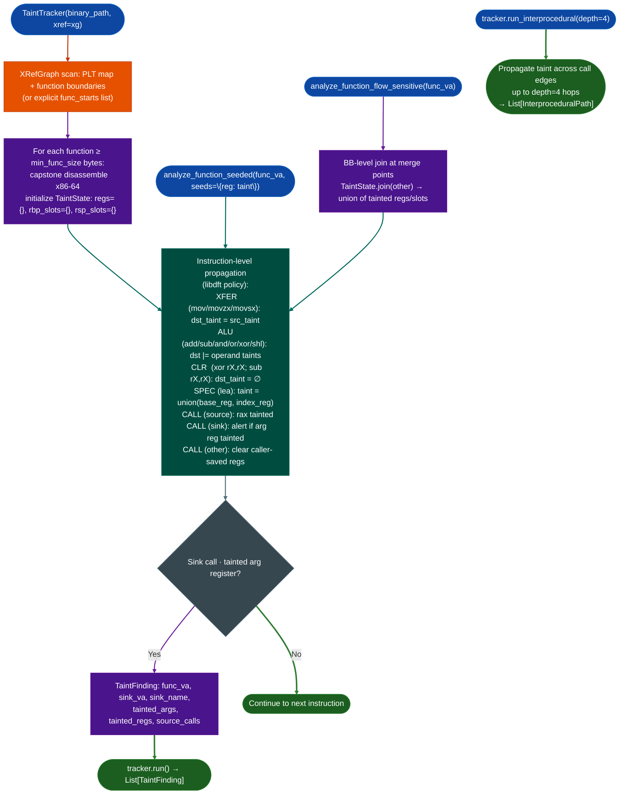

# TaintTracker

- [What is x86 / x86-64?](#what-x86--x86-64-is)
  - [Register file](#register-file)
  - [Calling conventions](#calling-conventions)
  - [Instruction encoding](#instruction-encoding)
  - [ELF and PLT/GOT on x86-64](#elf-and-pltgot-on-x86-64)
- [Taint tracking vs. decompilation](#taint-tracking-vs-decompilation-what-each-one-does)
- [Why this exists](#why-this-exists)
- [How it works](#how-it-works)
  - [Taint propagation rules](#taint-propagation-rules)
  - [Stack model](#stack-model)
  - [Built-in sources](#built-in-sources)
  - [Built-in sinks](#built-in-sinks)
- [Module relationships](#module-relationships)
- [API reference](#constructor)
  - [Constructor](#constructor)
  - [`TaintState`](#taintstate)
    - [Taint label model](#taint-label-model-bool-vs-taintlabel)
  - [Reading findings](#reading-findings)
    - [`InterproceduralPath`](#interproceduralpath)
- [Usage](#usage)
- [Example output](#example-output)
- [Worked example](#worked-example)
- [False positives](#false-positives)
- [Limitations](#limitations)
- [Pipeline position](#pipeline-position)
- [Comparison](#comparison-intraprocedural-vs-flow-sensitive-vs-interprocedural)
- [`cfg_x86`: CFG construction](#cfg_x86-cfg-construction)
  - [`BasicBlock`](#basicblock)
- [x86-32 mode](#x86-32-mode-archx86_32)
- [See also](#see-also)

Static intraprocedural and interprocedural taint analysis for x86-32 and x86-64 ELF binaries. Traces data flow from network receive sources to dangerous sinks using the libdft taint policy adapted for static analysis.

---

## What x86 / x86-64 is <sup>[↑](#taintracker)</sup>

**x86** (also written IA-32) is a 32-bit CISC processor architecture originating from Intel's 8086 (1978) and extended through the 286, 386, 486, and Pentium lines. The 386 (1985) introduced the flat 32-bit protected-mode model that IA-32 code still uses today. **x86-64** (also written AMD64 or Intel 64) is the 64-bit extension designed by AMD and released in the Opteron (2003). It extended the general-purpose register file to 16 registers, widened all registers to 64 bits, and defined a new calling convention. All modern x86 hardware runs in 64-bit mode by default; 32-bit code runs in a compatibility sub-mode.

x86 / x86-64 is the **dominant architecture for server, firewall, VPN concentrator, and network appliance firmware**: Cisco ASA, Cisco FTD, FortiGate (x86 variants), Palo Alto PAN-OS, Juniper SRX software, nginx, OpenSSL, and virtually every Linux-based network stack. When analyzing stripped server-side ELF binaries without symbols, you are almost always on x86-64.

**Why x86-64 binaries show up in RE work:** enterprise appliance vendors compile firmware on x86-64 Linux toolchains and ship the resulting ELF stripped. The binary has no symbols, no debug info, and no source. Vulnerability classes (command injection, format-string injection, stack overflow) are still detectable from taint paths in the disassembly, which is what this tracker provides.

---

### Register file <sup>[↑](#taintracker)</sup>

x86-64 has 16 general-purpose registers. Each register is accessible at four widths through overlapping names:

| 64-bit | 32-bit | 16-bit | 8-bit (low) | 8-bit (high) | Role |
|:--|:--|:--|:--|:--|:--|
| rax | eax | ax | al | ah | Return value; caller-save |
| rbx | ebx | bx | bl | bh | Callee-save |
| rcx | ecx | cx | cl | ch | Arg 4 (SysV); caller-save |
| rdx | edx | dx | dl | dh | Arg 3 (SysV); caller-save |
| rsi | esi | si | sil | n/a | Arg 2 (SysV); caller-save |
| rdi | edi | di | dil | n/a | Arg 1 (SysV); caller-save |
| rbp | ebp | bp | bpl | n/a | Frame pointer; callee-save |
| rsp | esp | sp | spl | n/a | Stack pointer |
| r8–r11 | r8d–r11d | r8w–r11w | r8b–r11b | n/a | Args 5–6 (r8–r9 SysV); caller-save |
| r12–r15 | r12d–r15d | r12w–r15w | r12b–r15b | n/a | Callee-save |

**RE-critical aliasing rule:** a 32-bit write (`mov eax, ecx`) **zero-extends to 64 bits**: the upper 32 bits of `rax` are cleared. A 16-bit or 8-bit write does not touch the other bits. The tracker normalises all register references to canonical 64-bit names (`rax`, `rcx`, etc.) and applies the zero-extension rule: any `mov r32, r/m32` clears the upper half of the destination's canonical register.

---

### Calling conventions <sup>[↑](#taintracker)</sup>

Two incompatible calling conventions appear in x86-64 ELF binaries from different build environments:

**SysV AMD64 ABI** (Linux, BSDs, macOS, all ELF targets):

| Argument | Register |
|:--|:--|
| arg0 | rdi |
| arg1 | rsi |
| arg2 | rdx |
| arg3 | rcx |
| arg4 | r8 |
| arg5 | r9 |
| Return value | rax |
| Caller-save | rax, rcx, rdx, rsi, rdi, r8, r9, r10, r11 |
| Callee-save | rbx, rbp, r12, r13, r14, r15 |

**Windows x64 ABI** (cross-compiled firmware from Windows build systems):

| Argument | Register |
|:--|:--|
| arg0 | rcx |
| arg1 | rdx |
| arg2 | r8 |
| arg3 | r9 |
| Return value | rax |
| Caller-save | rax, rcx, rdx, r8, r9, r10, r11 |
| Callee-save | rbx, rbp, rdi, rsi, r12, r13, r14, r15 |

**TaintTracker defaults to SysV.** If you are analysing firmware built with a Windows toolchain (check `file` output for PE format or look for the `_chkstk` / `__security_cookie` symbols), pass `abi='win64'` to the constructor. Applying SysV register assumptions to Windows x64 code maps `system(arg0)` to `rdi` when the actual argument is in `rcx`, producing zero findings.

For **x86-32** (`arch='x86_32'`), arguments are passed on the stack. The tracker models cdecl: arguments are pushed right-to-left; the call site's `push` sequence determines which stack slots are tainted.

---

### Instruction encoding <sup>[↑](#taintracker)</sup>

x86-64 instructions are **variable length, 1–15 bytes**. The REX prefix byte (`0x40`–`0x4F`) is inserted before the opcode to:

- Select 64-bit operand size (REX.W = bit 3)
- Extend ModRM.reg to access r8–r15 (REX.R = bit 2)
- Extend SIB.index to access r12 as index (REX.X = bit 1)
- Extend ModRM.r/m or SIB.base to access r8–r15 (REX.B = bit 0)

Without REX decoding, `mov r8d, ecx` (REX.R + opcode 0x89) looks like a prefix byte followed by a different instruction. Capstone handles REX decoding automatically; the tracker operates on Capstone instruction objects and never parses raw bytes directly.

Key instruction patterns for taint analysis:

| Mnemonic | Notes |
|:--|:--|
| `mov r64, r/m64` | Full 64-bit transfer. `dst_taint = src_taint`. |
| `mov r32, r/m32` | 32-bit transfer; **zero-extends to 64 bits**. `dst_taint = src_taint`; upper half cleared. |
| `movzx r, r/m8` or `r/m16` | Zero-extend. `dst_taint = src_taint`. |
| `movsx r, r/m8` or `r/m16` | Sign-extend. `dst_taint = src_taint`. |
| `lea r, [base+index*scale+disp]` | No memory access. `dst_taint = base_taint \| index_taint`. |
| `xor rX, rX` / `sub rX, rX` | Zero idiom. `dst_taint = ∅` (CLR). |
| `add/sub/and/or/xor/imul` | ALU: `dst_taint \|= src_taint`. |
| `push rX` | Stack write at `[rsp-8]`. Tracks taint in `rsp_slots`. |
| `pop rX` | Stack read. `rX_taint = rsp_slots[rsp]`. |
| `call PLT_entry` | Source: marks `rax` tainted. Sink: alert on tainted arg regs. Unknown: clear caller-save. |
| `ret` | No register written. Ends CFG block. |

---

### ELF and PLT/GOT on x86-64 <sup>[↑](#taintracker)</sup>

x86-64 firmware binaries are ELF. The dynamic linker resolves shared library calls through:

- **PLT** (Procedure Linkage Table): a sequence of 16-byte stubs in `.plt`. Each stub is a `jmp *[GOT_entry]` followed by a lazy-resolution fallback. `XRefGraph` maps PLT entry VAs to their symbol names (e.g. `system`, `recv`).
- **GOT** (Global Offset Table): `.got.plt` holds function pointers written at load time. The tracker does not model GOT at runtime; PLT VAs are resolved to symbol names at analysis time via `XRefGraph`.

In stripped binaries, `XRefGraph` recovers PLT-to-symbol mappings by parsing the `.rela.plt` relocation table, which survives stripping. Function boundaries are recovered via heuristic prologue scanning (`push rbp; mov rbp, rsp` and `sub rsp, N` patterns) or from explicit `func_starts` supplied by `BinaryContext`.

---

## Taint tracking vs. decompilation: what each one does <sup>[↑](#taintracker)</sup>

Ablation has two separate pipelines for x86 / x86-64. They answer different questions.

**The decompiler pipeline** (`BinaryLifter(arch='x86_64')` → IR → `PseudoCEmitter`) answers: *what does this function compute?* It lifts raw x86-64 instructions to an architecture-neutral IR, builds SSA form, and emits pseudo-C. Use it when you need to understand the logic of a candidate function confirmed by the taint tracker.

**The taint tracker** (`TaintTracker`) answers: *does attacker-controlled data reach a dangerous function call?* It does not try to understand what the code computes. It only asks whether a register holding user-controlled data is passed as an argument to `system()`, `execve()`, `printf()`, `strcpy()`, or similar sinks. This is the vulnerability scanner path.

The two pipelines are independent but complementary. A typical workflow:

```
1. SinkArgClassifier.from_context(ctx).classify_all()
       → eliminates RODATA_CONST and parameterless SNPRINTF_RODATA call sites
       → leaves ARG_PROPAGATED and UNKNOWN for taint analysis

2. TaintTracker.run()          → intraprocedural taint scan (all functions, fast)
   TaintTracker.run_flow_sensitive()
                                → BB-level join, lower false-positive rate
   TaintTracker.run_interprocedural(depth=4)
                                → cross-call-boundary taint for wrapper chains

3. TaintTracker.run_on_function(func_va, func_end_va)
                                → single confirmed candidate, after triage

4. BinaryLifter(arch='x86_64').lift_function(func_va)
                                → pseudo-C for context around a confirmed finding
```

Steps 1–3 locate candidates mechanically. Step 4 is confirmation and write-up. Never start at step 4.

---

## Why this exists <sup>[↑](#taintracker)</sup>

1. x86-64 is the dominant server, firewall, and network appliance architecture. Cisco ASA, FortiGate x86 variants, nginx, OpenSSL, and most network-stack binaries compile to x86-64 ELF stripped. The tracker finds direct paths from `recv`/`read`/`accept` sources to `system`/`execve`/`printf`/`strcpy` sinks across thousands of functions in under 60 seconds.

2. x86-64 calling convention and register aliasing create analysis complexity absent on RISC architectures. `rax`/`eax`/`ax`/`al` are the same storage location; `lea` propagates taint from both base and index registers; caller-saved vs callee-saved sets must be tracked across call boundaries. The tracker models all four widths as canonical names and applies the libdft propagation policy: XFER, ALU, CLR, SPEC, and CALL.

3. `analyze_function_flow_sensitive()` provides BB-level path sensitivity. Each basic-block join merges taint states via `TaintState.join()` rather than treating all paths as equivalent. This reduces false positives for functions that sanitize user input before passing it to a sink.

---

## How it works <sup>[↑](#taintracker)</sup>



### Taint propagation rules <sup>[↑](#taintracker)</sup>

| Instruction class | Taint rule |
|:---|:---|
| `mov`, `movzx`, `movsx` | `dst_taint = src_taint` |
| `mov r32, r/m32` | `dst_taint = src_taint`; upper 32 bits of canonical reg cleared (zero-extension) |
| `add`, `sub`, `and`, `or`, `xor`, `shl`, `shr`, `imul` | `dst_taint \|= src_taint` |
| `xor rX, rX` / `sub rX, rX` self-operand | `dst_taint = ∅`: CLR pattern |
| `lea dst, [base + index*scale + disp]` | `dst_taint = base_taint \| index_taint` |
| `push rX` | Write `rX` taint to `rsp_slots[rsp - 8]`; decrement rsp delta |
| `pop rX` | `rX_taint = rsp_slots[rsp]`; increment rsp delta |
| Call to known source: `recv`, `read`, and similar | `rax` → tainted; stack buffer arg tracked |
| Call to known sink: `system`, `execve`, and similar | Alert if relevant arg register tainted |
| Call to unknown function | Clear all caller-saved regs rax/rcx/rdx/rsi/rdi/r8-r11 |

### Stack model <sup>[↑](#taintracker)</sup>

`TaintState` tracks both rbp-relative slots `rbp_slots: Dict[int, bool]` and rsp-relative slots `rsp_slots: Dict[int, bool]` with stack-delta tracking for rsp. This handles both frame-pointer-based and frameless rsp-relative calling conventions, which appear in different compiler optimization levels.

Stack slot taint is propagated through `push`/`pop` pairs and through `mov [rbp - N], rX` / `mov rX, [rbp - N]` store/load pairs. A tainted register written to a stack slot and later loaded back into a different register carries the taint into that destination.

### Built-in sources <sup>[↑](#taintracker)</sup>

The following function names seed taint when called (mark `rax` tainted and, where a buffer-pointer argument is passed, mark that stack slot tainted):

```
recv      recvfrom   recvmsg   read      readv
fread     fgets      gets      getline   getdelim
accept    accept4    getenv    getopt    getopt_long
sscanf    fscanf     scanf
```

Calls to these names are detected by matching the PLT symbol name resolved from `XRefGraph`. Wrapper functions (e.g. a `safe_recv()` that calls `recv`) are not automatically promoted to sources. Add them via the `custom_sinks` dict with argument index `[-1]` to mark their return value as tainted.

### Built-in sinks <sup>[↑](#taintracker)</sup>

The following function names trigger a finding when a tainted argument register is present at the call site:

| Sink | Tainted arg that triggers a finding |
|:--|:--|
| `system`, `popen` | arg0 (rdi) |
| `execl`, `execlp`, `execle` | arg0 (rdi) |
| `execv`, `execve`, `execvp`, `execvpe` | arg0 (rdi) |
| `printf`, `fprintf`, `sprintf`, `snprintf` | arg0 for printf; arg1 for f/sprintf; arg2 for snprintf (format position) |
| `strcpy`, `strcat` | arg1 (rsi): source operand |
| `memcpy`, `memmove` | arg1 (rsi): source operand |

Sink matching strips PLT decorations (`@plt`, `@GLIBC_*` suffixes, leading underscores) before comparing names. Add target-specific sinks via `custom_sinks` or `custom_sink_vas`.

---

## Module relationships <sup>[↑](#taintracker)</sup>

```
TaintTracker
    ├── XRefGraph                     (xref_graph.py)
    │   ├── from_path() / from_context()
    │   ├── PLT → symbol name map (from .rela.plt)
    │   └── function boundary list (heuristic or from BinaryContext)
    ├── cfg_x86                       (cfg_x86.py)
    │   └── builds per-function BasicBlock CFGs for flow-sensitive mode
    ├── SinkArgClassifier             (sink_arg_classifier.py)
    │   └── pre-filter: eliminates RODATA_CONST before TaintTracker runs
    └── BinaryLifter(arch='x86_64')   (binary_lifter.py)
        └── decompiler pipeline - use AFTER a finding to read the code
```

`XRefGraph` is required. Everything else is optional but strongly recommended. `SinkArgClassifier` should always run before `TaintTracker` to eliminate constant-format-string call sites that cannot carry injection vulnerabilities.

---

## Constructor <sup>[↑](#taintracker)</sup>

```python
TaintTracker(
    binary_path:   str,
    xref:          XRefGraph,           # required - PLT map + function boundaries
    arch:          str = 'x86_64',      # 'x86_64' or 'x86_32'
    abi:           str = 'sysv',        # 'sysv' or 'win64'
    custom_sinks:  Dict[str, List[int]] = None,   # name → [arg_indices]
    custom_sink_vas: Dict[int, Tuple[str, List[int]]] = None,  # va → (name, [arg_indices])
    min_func_size: int = 16,            # skip functions smaller than this
    func_starts:   List[int] = None,    # override XRefGraph boundaries
)
```

**Or from a `BinaryContext` (recommended):**

```python
from ablation.analyzers.taint_tracker_x86 import TaintTracker
from ablation.analyzers.binary_context import BinaryContext

ctx = BinaryContext.load_or_build('/path/to/target.elf')
tracker = TaintTracker.from_context(ctx)
```

`from_context()` pulls `func_starts` and the XRefGraph directly from the context, which guarantees consistent function boundaries across all analysis tools. Using `from_path()` directly on a stripped binary gives approximately 22 function starts (heuristic only); `from_context()` gives the full set.

**`abi='win64'`** switches the argument register order to rcx/rdx/r8/r9 and adjusts the callee-save set. Use when the binary was built with MSVC or a Windows x64 cross-compiler. Check `file` output or look for `__security_check_cookie` in the PLT map.

---

## `TaintState` <sup>[↑](#taintracker)</sup>

Represents the taint state at a point in the program.

```python
@dataclass
class TaintState:
    regs:      Dict[str, bool]   # canonical reg name → tainted; absent = CLEAN
    rbp_slots: Dict[int, bool]   # rbp-relative offset → tainted
    rsp_slots: Dict[int, bool]   # rsp-relative offset → tainted (rsp delta tracked)
```

```python
state.is_tainted('rdi')           # bool
state.taint('rdi')                # mark rdi tainted in-place
state.clear('rdi')                # mark rdi clean in-place
state.join(other) -> TaintState   # union of all tainted regs/slots (new object)
state.tainted_arg_regs() -> List[str]   # subset of SysV arg regs that are tainted
state.copy() -> TaintState        # deep copy
```

`CLEAN` is the absence of a key or an explicit `False`. `is_tainted()` treats both as clean.

### Taint label model: bool vs TaintLabel <sup>[↑](#taintracker)</sup>

The x86 tracker uses a **boolean taint model**: a register is either tainted (`True`) or clean (`False`/absent). This differs from the Alpha tracker (`AlphaTaintTracker`) which uses a `frozenset[TaintLabel]` per register to track *which* source introduced the taint.

The practical consequence: in x86 mode, `seeds` passed to `run_on_function_seeded()` accept a string label name for human readability, but that label is not preserved in the propagation state. A finding's `source_calls` list is populated from PLT source calls observed during the scan, not from the seed label. If you seed `rdi='recv'` and the function never calls `recv` itself, `source_calls` will be empty even though the finding came from a seeded source.

---

## Reading findings <sup>[↑](#taintracker)</sup>

`TaintTracker.run()` and `run_flow_sensitive()` return a list of `TaintFinding` objects:

| Attribute | Content |
|:---|:---|
| `func_va` | VA of the function containing the sink |
| `sink_va` | VA of the sink call instruction |
| `sink_name` | Name of the sink function, for example `system`, `execve`, or `printf` |
| `tainted_args` | `List[int]`: argument position indices with taint, for example `[0]` for arg0 |
| `tainted_regs` | `List[str]`: register names carrying taint at the call site, for example `['rdi']` |
| `source_calls` | `List[str]`: source functions that introduced taint, for example `['recv']` |

### `InterproceduralPath` <sup>[↑](#taintracker)</sup>

`run_interprocedural(depth=N)` returns a list of `InterproceduralPath` objects: one per taint path that crosses at least one call boundary:

```python
@dataclass
class InterproceduralPath:
    call_chain:   List[int]   # VAs of functions on the path, outermost first
    sink_va:      int         # VA of the final sink call instruction
    sink_name:    str         # sink function name
    tainted_args: List[int]   # argument indices tainted at the sink
    depth:        int         # number of call boundaries crossed
```

```python
paths = tracker.run_interprocedural(depth=4)
for p in paths:
    chain = ' → '.join(hex(va) for va in p.call_chain)
    print(f'{chain} → {p.sink_name}(arg{p.tainted_args}) @ {hex(p.sink_va)}')
```

`call_chain[0]` is the outermost function (the one where the source call occurs or where the entry argument is tainted). `call_chain[-1]` is the function immediately containing the sink. A path with `depth=1` means the source and sink are in the same function; `depth=2` means one wrapper separates them.

---

## Usage <sup>[↑](#taintracker)</sup>

```python
from ablation.analyzers.taint_tracker_x86 import TaintTracker, TaintFinding
from ablation.analyzers.xref_graph import XRefGraph

# Build XRef graph (provides PLT + function boundaries)
xg = XRefGraph.from_path('/path/to/target.elf')
xg.build()

# Run intraprocedural taint analysis
tracker = TaintTracker('/path/to/target.elf', xref=xg)
findings = tracker.run()

# Run with custom sinks (target-specific functions)
tracker = TaintTracker(
    '/path/to/target.elf',
    xref=xg,
    custom_sinks={'exec_handler': [2], 'config_eval': [1]},
    custom_sink_vas={0x595c0: ('do_cmd', [0])}
)

# Flow-sensitive (BB-level join) - lower false-positive rate
flow_findings, flow_paths = tracker.run_flow_sensitive()

# Interprocedural - trace taint through call chains
paths = tracker.run_interprocedural(depth=4)

# Single-function (after manual triage)
func_findings = tracker.run_on_function(func_va=0x401200, func_end_va=0x401580)

# Seeded - inject taint at specific registers/VAs
seeded = tracker.run_on_function_seeded(
    func_va=0x401200,
    seeds={'rdi': 'recv'}
)
```

---

## Example output <sup>[↑](#taintracker)</sup>

The following illustrates the finding format. Actual addresses and register names are target-specific.

```
[TAINT] func=<func-va> sink=<sink-va> system(arg0)
  regs=['rdi'] sources=['recv']

[TAINT] func=<func-va> sink=<sink-va> execve(arg0, arg1)
  regs=['rdi', 'rsi'] sources=['read', 'getenv']

[TAINT] func=<func-va> sink=<sink-va> printf(arg0)
  regs=['rdi'] sources=['recv']
```

---

## Worked example <sup>[↑](#taintracker)</sup>

```python
from ablation.analyzers.binary_context import BinaryContext
from ablation.analyzers.sink_arg_classifier import SinkArgClassifier
from ablation.analyzers.taint_tracker_x86 import TaintTracker

# Step 1: load context (function boundaries + PLT from .rela.plt)
ctx = BinaryContext.load_or_build('/path/to/httpd')

# Step 2: pre-filter - eliminate constant-format-string call sites
sac = SinkArgClassifier.from_context(ctx)
classified = sac.classify_all()
candidates = [f for f in classified if f.classification in ('ARG_PROPAGATED', 'UNKNOWN')]
print(f'{len(candidates)} sink candidates after SAC filter')

# Step 3: intraprocedural taint scan
tracker = TaintTracker.from_context(ctx)
findings = tracker.run()
for f in findings:
    print(f'[TAINT] func={hex(f.func_va)} sink={hex(f.sink_va)} {f.sink_name}(arg{f.tainted_args})')
    print(f'  regs={f.tainted_regs} sources={f.source_calls}')

# Step 4: confirm with interprocedural scan for wrapper chains
ipc_paths = tracker.run_interprocedural(depth=4)
print(f'{len(ipc_paths)} interprocedural paths found')

# Step 5: lift a confirmed function to pseudo-C for write-up
from ablation.analyzers.binary_lifter import BinaryLifter
lifter = BinaryLifter(arch='x86_64')
pseudoc = lifter.lift_function(ctx, func_va=findings[0].func_va)
print(pseudoc)
```

---

## False positives <sup>[↑](#taintracker)</sup>

**`custom_sinks` argument indices are 0-based (arg0 = rdi on x86-64 SysV ABI), not 1-based.** A `custom_sinks={'exec': [1]}` entry watches arg1 (rsi), not the first argument. When wiring a custom sink, verify the argument index against the calling convention.

**Caller-saved register clearing on unknown calls eliminates false negatives through indirect call chains, but also clears taint that might have survived a call to a known-safe function.** The conservative model errs toward under-tainting false negatives rather than over-tainting false positives after unknown calls. Use `run_interprocedural(depth=N)` to follow taint through known call targets.

**`xor rX, rX` and `sub rX, rX` are treated as CLR: taint cleared.** Compilers use these as zero-idioms, not as actual XOR/SUB operations. If a function uses `xor rax, rax` after loading tainted data into rax, the finding for that path will not fire. This is intentional: the idiom is universally a zero, not a live value.

**32-bit writes zero-extend, which clears taint on the upper half.** A tainted `rdi` passed through `mov edi, edi` (a no-op used by compilers for alignment) loses taint on bits 32–63 but the low 32 bits remain tainted. The canonical-register model preserves the taint label on the whole register in this case. The upper half zero-extension does not produce a CLR.

---

## Limitations <sup>[↑](#taintracker)</sup>

1. **Memory taint is not modelled at the address level.** `mov rax, [rdi]` marks `rax` tainted if `rdi` is tainted (address-register propagation), not based on what value was stored at that address. A clean pointer into a tainted buffer produces a clean load. This is a known false-negative source for stack-allocated command buffers.

2. **Indirect call targets are not resolved.** `call [rax]` does not create a CFG edge to the callee; if `rax` is a function pointer to a sink, the finding is missed. Use `run_interprocedural()` with confirmed target VAs via `custom_sink_vas` to cover the most important indirect calls.

3. **No memory map for `strcpy`/`memcpy` chain tracking.** If tainted data is written to a stack buffer via `strcpy` and later loaded into an argument register for a second call, the second load produces a clean register (because `rsp` is not tainted). Seed `rsp` as tainted only for targeted investigation; it produces massive over-approximation across the whole binary.

4. **`run_flow_sensitive()` is per-function.** The BB-level join runs within a single function's CFG. Cross-function taint through join points requires `run_interprocedural()`.

5. **Heuristic function discovery on stripped binaries.** Without `BinaryContext`, function starts are recovered from `push rbp; mov rbp, rsp` and `sub rsp, N` prologues. Not all functions use these prologues (leaf functions, `-fomit-frame-pointer`, tail-call-optimised code). `BinaryContext.load_or_build()` gives a more complete list.

6. **SysV ABI is the default.** Windows x64 binaries will produce zero findings for sink calls with argument-register mismatch unless `abi='win64'` is passed. There is no auto-detection of ABI; check the build environment.

7. **x86-32 stack model is offset-based only.** In `arch='x86_32'` mode, arguments are on the stack at positive offsets from the call site. The rsp-delta model tracks pushed argument taint through `push`/`pop` pairs but does not model `[esp + N]` argument reads in the callee.

---

## Pipeline position <sup>[↑](#taintracker)</sup>

Run x86 taint tracking after `SinkArgClassifier.classify_all()` has eliminated `RODATA_CONST` and parameterless `SNPRINTF_RODATA` call sites. Those represent constant format strings and cannot carry injection-class vulnerabilities. Passing only `ARG_PROPAGATED` and `UNKNOWN` sinks to TaintTracker removes the majority of false-positive candidates before taint analysis runs.

---

## Comparison: intraprocedural vs flow-sensitive vs interprocedural <sup>[↑](#taintracker)</sup>

| Property | `run()` (intraprocedural) | `run_flow_sensitive()` | `run_interprocedural(depth=N)` |
|:--|:--|:--|:--|
| Crosses basic block boundaries | No (linear scan per function) | Yes (CFG worklist) | Yes (CFG + call edges) |
| Join at merge points | No | Yes (`TaintState.join()` union) | Yes |
| Callee return-value taint | No | No | Yes (up to `depth` hops) |
| Memory taint | No | No | No |
| Speed | ~60 s for 3000-function binary | 3–5× slower than `run()` | 5–10× slower than `run()` |
| False negatives | Higher (misses cross-block paths) | Lower | Lowest |
| False positives | Lower (narrower scope) | Lower (path-sensitive) | Higher (conservative join) |

**Workflow:** use `run()` for initial binary-wide triage. Escalate to `run_flow_sensitive()` for functions where `run()` fires but the path appears to go through a sanitizer. Use `run_interprocedural()` only when `run_flow_sensitive()` returns no findings but `SinkArgClassifier` classified the site as `ARG_PROPAGATED`: this indicates the tainted value enters through a wrapper chain.

---

## `cfg_x86`: CFG construction <sup>[↑](#taintracker)</sup>

`cfg_x86.py` builds per-function basic-block CFGs for `run_flow_sensitive()` and `run_interprocedural()`. Used internally by `TaintTracker`; available directly for manual CFG inspection.

```python
from ablation.analyzers.cfg_x86 import build_cfg

cfg = build_cfg(insns, entry=0x401200)
print(f'{len(cfg.blocks)} basic blocks, entry={hex(cfg.entry)}')
for bb in cfg.blocks.values():
    print(f'  BB {hex(bb.start)}–{hex(bb.end)}: succs={[hex(v) for v in bb.succs]}')
```

### `Block` <sup>[↑](#taintracker)</sup>

```python
@dataclass
class Block:
    start: int
    insns: List[Insn]
    succs: List[int]
    preds: List[int]

    @property
    def end(self) -> int:
        return self.insns[-1].address + self.insns[-1].size
```

CFG termination rules:

| Instruction | Effect on CFG |
|:--|:--|
| `jmp <target>` (direct) | One successor: the branch target |
| `jcc <target>` (conditional) | Two successors: fall-through and taken |
| `call <PLT>` | Does **not** create a CFG edge; treated as sequential (call-and-continue) |
| `call [rax]` / `jmp [rax]` | Block exits with `is_indirect=True`; no successors recorded |
| `ret` | Block exits with `is_ret=True`; no successors |

`build()` accepts an optional `func_end_va`. Without it, the builder follows edges until it hits a `ret` or `is_indirect` exit on every path. On very large functions with complex loops, supply `func_end_va` from `BinaryContext` to bound the scan.

---

## x86-32 mode (`arch='x86_32'`) <sup>[↑](#taintracker)</sup>

Pass `arch='x86_32'` to `TaintTracker` when analysing 32-bit ELF binaries (e.g. embedded Linux firmware, older network appliance images).

**Differences from x86-64:**

| Property | x86-64 | x86-32 |
|:--|:--|:--|
| Arguments | Registers (rdi/rsi/rdx/rcx/r8/r9) | Stack, right-to-left (cdecl) |
| Return value | rax | eax |
| General registers | 16 × 64-bit | 8 × 32-bit (eax–edi) |
| Register aliasing | 4 widths (rax/eax/ax/al) | 3 widths (eax/ax/al) + ah/bh/ch/dh |
| Caller-save | rax/rcx/rdx/rsi/rdi/r8-r11 | eax/ecx/edx |
| Callee-save | rbx/rbp/r12-r15 | ebx/esi/edi/ebp |

**Taint tracking in x86-32:** because arguments are passed on the stack rather than in registers, the tracker seeds taint in `rsp_slots` (stack slots) after each source call and traces those slots into the argument pushes before a sink call. The `tainted_regs` field in a `TaintFinding` will show stack slot offsets (e.g. `['[esp+0]']`) rather than register names when the tainted value travels through the stack.

**`-mregparm=N` (GCC fast-call variant):** some embedded Linux kernels and older glibc builds use `-mregparm=3`, passing the first three arguments in eax/edx/ecx rather than on the stack. There is no auto-detection; if findings are absent on a 32-bit binary that clearly has source→sink paths, check for regparm usage in the build flags and pass a custom seeding dict to `run_on_function_seeded()`.

---

## See also <sup>[↑](#taintracker)</sup>

- [Taint Analysis](taint-analysis.md): general taint model: sources, sinks, propagation policy
- [Binary Lifter](binary-lifter.md): lift x86-32/64 functions to pseudocode; pass `arch='x86_64'` or `arch='x86_32'`
- [SinkArgClassifier](sink-arg-classifier.md): pre-filter for x86-32 and x86-64 sink sites before TaintTracker
- [XRefGraph](xref-graph.md): required for function boundary discovery and PLT mapping
- [CFG Construction](control-flow-graph-construction.md): `cfg_x86.py` builds the CFG used by flow-sensitive analysis
- [SscanfSinkClassifier](scanf-family-overflow-candidates.md): scanf/gets/mktemp pattern detection for x86-64 targets
- [HeapVulnScanner](heap-vulnerability-scanner.md): integer overflow, UAF, double-free detection on x86-64
- [PathSolver](finding-validation.md): Z3 symbolic path feasibility check for confirmed x86-64 findings
- [AlphaTaintTracker](taint-tracker-alpha.md): the template this document follows; documents the cross-architecture taint model
- [FormatStringScanner](format-string-scanner.md): format string vulnerability detection, x86-64 primary target
- [LengthUnderflowScanner](length-underflow.md): C12-class header-subtraction underflow detection for x86-64 protocol parsers
