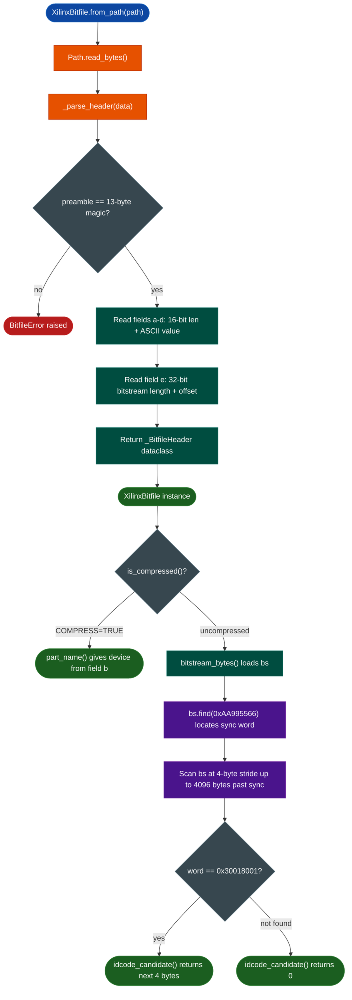

# XilinxBitfile

Parse a Xilinx .bit file header and optionally extract embedded strings or the silicon IDCODE from an uncompressed bitstream, without loading a BinaryContext.

---

## Why this exists

1. **ATLAS ITk strip firmware ships as .bit files, not ELFs.** FELIX FLX712, ABC130 driver, Atlys ITSDAQ, and HSIO boards all use Xilinx bitfile format. BinaryContext.load_or_build() cannot run on them, so the entire analysis chain is blocked until a parser exists that reads the metadata.

2. **The header fields a through d are always plaintext even when the bitstream is compressed.** Vivado COMPRESS=TRUE scrambles the config packets so they cannot be decoded, but it never touches fields a through d. A parser that reads only those fields returns design name, part number, and build timestamp from a 37 MB file by reading the first 256 bytes.

3. **IDCODE extraction lets you cross-check the declared part number against the silicon.** Every uncompressed 7-series bitstream contains a Type1 Write packet to the IDCODE register with header 0x30018001. Reading the four bytes that follow gives the actual silicon IDCODE. This matters because bitfile filenames and field-b strings are sometimes renamed or wrong.

4. **Batch RE of 100 or more firmware versions requires fast metadata enumeration.** scan_directory() parses all matching .bit files in a directory tree, skips malformed files, and returns XilinxBitfile instances ready for .design_name(), .build_datetime(), and .part_name() queries without touching the bitstream payload.

---

## How it works



---

## Constructor

```python
from ablation.analyzers.xilinx_bitfile import XilinxBitfile, scan_directory

bf = XilinxBitfile.from_path('/path/to/design.bit')
print(bf.summary())
```

No from_context() variant because this is a file-format parser that does not use BinaryContext.

---

## Key methods

| Method | Returns |
|---|---|
| `bf.summary()` | One block with design, part, date, bitstream size, and IDCODE |
| `bf.design_name()` | Field a: design name and Vivado directives |
| `bf.part_name()` | Field b: full part string such as xcku115-flvf1924-2-e |
| `bf.build_date()` | YYYY/MM/DD |
| `bf.build_time()` | HH:MM:SS |
| `bf.build_datetime()` | YYYY/MM/DD HH:MM:SS |
| `bf.is_compressed()` | True if COMPRESS=TRUE in design name |
| `bf.bitstream_bytes()` | Raw bitstream bytes, loads up to 37 MB into memory |
| `bf.extract_strings(min_len=6)` | ASCII strings from uncompressed bitstreams only |
| `bf.sync_word_offset()` | Byte offset of 0xAA995566 in the bitstream, or -1 |
| `bf.idcode_candidate()` | IDCODE from Type1 Write packet, or 0 if compressed or not found |
| `bf.device_name()` | Device string from XILINX_IDCODES table, or lowercase prefix of part_name |

---

## Batch use

```python
results = scan_directory('/media/research/flx_fw/', '*.bit')

from collections import Counter
parts = Counter(r.part_name().split('-')[0] for r in results)
print(parts)  # Counter({'xcku115': 39})

for bf in sorted(results, key=lambda x: x.build_datetime()):
    print(bf.build_datetime(), bf.design_name()[:60])
```

---

## Known IDCODEs

| IDCODE | Device | Application |
|---|---|---|
| 0x01C22093 | XC3S50AN | ABC130 driver PCB |
| 0x04001093 | XC6SLX45 | Atlys ITSDAQ board |
| 0x03651093 | XC7K325T | Genesys2 ITSDAQ |
| 0x0363C093 | XC7K160T | Generic 7-series |
| 0x38425093 | XCKU115 | FELIX FLX712 readout card |
| 0x14B37093 | XC2VP30 | Virtex-2 Pro legacy |

---

## Header format

```
Offset  Width  Field
0       13     Preamble: 00 09 0F F0 0F F0 0F F0 0F F0 00 00 01
13       1     Tag 'a' (0x61)
14       2     Length (big-endian uint16)
16       N     Design name (null-padded ASCII)
               Tags 'b', 'c', 'd' follow in the same format
               Tag 'e' (0x65)
               4     Bitstream length (big-endian uint32)
               N     Bitstream data
```

Fields a through d are always plaintext ASCII. Field e is the raw FPGA configuration bitstream. Vivado COMPRESS=TRUE applies a bitswap transform to field e only.

---

## Limitations

- Versal PDI format has a different header magic and is not handled. FLX155 and FLX182 use PDI.
- Compressed bitstreams: config packets are not parseable. Use part_name() for device identification.
- MCS format is not handled here.

---

## FORGE status

**PASSED** 0 CRITICAL, 0 HIGH, 2 MEDIUM. Cached in ~/.ablation/forge_cache.json.

| Finding | Severity |
|---|---|
| from_path() loads the entire file to parse a 128-byte header | MEDIUM |
| bitstream_len is not validated against file size so truncated files return short data silently | MEDIUM |
