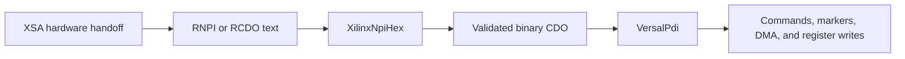

# XilinxNpiHex

- [Why this exists](#why-this-exists)
- [How it works](#how-it-works)
- [API reference](#api-reference)
- [Usage](#usage)
- [What this adds](#what-this-adds)
- [Limitations](#limitations)
- [Known platform](#known-platform)
- [See also](#see-also)

**File:** `ablation/analyzers/xilinx_npi.py`

## Why this exists

A Vivado XSA hardware handoff can contain the same configuration in two forms: a packaged binary PDI and text-based RNPI or RCDO build inputs. The text files look like hexadecimal dumps, but they are not Intel HEX and have no addresses or per-record checksums. They contain seven metadata lines followed by one 32-bit hexadecimal word per line.

`VersalPdi` already analyzes binary CDO streams. It cannot ingest this text representation directly. `XilinxNpiHex` is the small translation boundary that turns the text into validated bytes, after which the existing CDO parser, command inventory, DMA recovery, and register analysis can work unchanged.

This is a modest parser with a large practical effect. It connects source-side build artifacts to packaged firmware without duplicating the downstream analysis stack. It also exposed a valid 33.93 MB RCDO stream that the older binary scanner rejected at its former eight-million-word ceiling. CDO size is now bounded by the containing input rather than that separate cutoff.

## How it works

### Scope: hex images, not command scripts

The decoder accepts files beginning with `Xilinx ASCII NPI Deviceimage` and containing this layout:

```text
Xilinx ASCII NPI Deviceimage
Created by Deviceimage 2024.2 SW Build 5239630 ...
Design name:    felix_top;Version=2024.2
Architecture:   versalprime
Part:           xcvm1802-vsva2197-1MP-e-S
Date:           Wed Mar 25 18:07:05 2026
Bits:           271421152
00000004
004f4443
00000200
...
```

Some `.cdo` files instead contain command scripts with lines such as `marker`, `mask_write`, and `pm_init_node`. That is a different grammar. `XilinxNpiHex` deliberately rejects it. Treating every NPI text file as hexadecimal would silently confuse commands, comments, and raw data.

### Validated conversion

The parser:

1. Requires all seven metadata fields and a positive bit count divisible by 32.
2. Requires exactly eight hexadecimal digits on every payload line.
3. Packs each word as little-endian, so text `004f4443` becomes bytes `43 44 4f 00`, or `CDO\x00`.
4. Compares the decoded word count with the declared bit count.
5. Rejects extra words, missing words, non-ASCII input, long lines, invalid metadata, and oversized input.

Text input is capped at 128 MiB, decoded output at 128 MiB, and each input line at 4,096 bytes. Path reads stream through the parser rather than requiring a second full text copy. The decoded allocation is sized only after the declared bit count passes these checks.

### Where it sits in the workflow



The decoder establishes structure, not authenticity. The `Bits` field detects truncation or extra data, but it is not a signature. A valid CDO header checksum likewise does not authenticate the payload.

## API reference

### `XilinxNpiHex`

| Member | Returns | Purpose |
|---|---|---|
| `XilinxNpiHex.from_path(path)` | `XilinxNpiHex` | Stream and validate a text file |
| `XilinxNpiHex.from_bytes(data, label)` | `XilinxNpiHex` | Decode an in-memory text image |
| `.metadata` | `NpiHexMetadata` | Validated design and generator fields |
| `.word_count` | `int` | Number of decoded 32-bit words |
| `.decode()` | `bytes` | Little-endian binary payload |
| `.to_versal_pdi()` | `VersalPdi` | Parse the decoded bytes with the existing CDO machinery |

### `NpiHexMetadata`

| Field | Meaning |
|---|---|
| `created_by` | Deviceimage generator and build string |
| `design_name` | Design and optional version text |
| `architecture` | Declared device architecture |
| `part` | Full FPGA part identifier |
| `date` | Generator-provided date string |
| `bits` | Declared payload size in bits |
| `byte_count` | Derived byte count, `bits // 8` |

## Usage

Decode an RNPI or RCDO member already read from an XSA ZIP archive:

```python
import zipfile
from ablation.analyzers.xilinx_npi import XilinxNpiHex

with zipfile.ZipFile("design.xsa") as xsa:
    text = xsa.read("pdi_files/felix_top.rcdo")

image = XilinxNpiHex.from_bytes(text, "felix_top.rcdo")
print(image.metadata.part)
print(image.word_count)

pdi = image.to_versal_pdi()
for section in pdi.cdo_sections():
    print(hex(section.offset), section.length_words, len(section.commands))
```

Use `.decode()` when another tool needs the raw bytes. Use `.to_versal_pdi()` when the goal is CDO command analysis. The decoded blob has no PDI MetaHeader, so `pdi_type` is normally `unknown`; that does not prevent CDO discovery.

## What this adds

Before this decoder, an analyst could inspect the text manually or write a one-off conversion script, but could not feed it into Ablation's validated CDO workflow. Now the same input receives metadata checks, deterministic byte conversion, bounded resource use, CDO checksum validation, and command-level analysis.

The feature is intentionally a cog rather than a second PDI analyzer. Its value comes from reusing `VersalPdi` after a strict ingestion boundary. A future command-script parser should be separate and should not weaken the hex decoder's rejection rules.

## Limitations

- Command-script `.cdo`, `.rnpi`, or `.rcdo` variants are outside this decoder's accepted format.
- The parser does not decompress XSA archives itself. Read the desired member with `zipfile` first.
- Bootgen can add markers and NOPs and adjust command identifiers while packaging a PDI. Do not assume that decoded XSA input is byte-identical to the corresponding PDI partition.
- CDO command decoding does not by itself explain FPGA logic or prove runtime security policy.
- A declared bit count and CDO checksum are integrity metadata, not provenance or authenticity evidence.

## Known platform

**FELIX**, or Front-End LInk eXchange, is the ATLAS readout and control platform that moves detector data, timing, and configuration traffic between front-end lpGBT links and host computers. **FLX182** identifies the card and firmware configuration in this example, not the file format. This build is configured for an `xcvm1802` Versal AI Core FPGA and uses PDI as its packaged boot and configuration container. RNPI and RCDO represent the configuration side of that system, not the complete detector readout algorithm or a running-system inventory.

The FELIX FLX182 XSA contains both supported representations:

| Input | Decoded bytes | Decoded SHA-256 | CDO result |
|---|---:|---|---|
| `felix_top.rnpi` | 1,394,444 | `e21cdabd89588ead00d47847d15d1b053da64868ed40907146dff5f00e61dca0` | One valid section, 33,254 commands |
| `felix_top.rcdo` | 33,927,644 | `92fdf837bb95a4eb7d09de74b45358fe575f3b7ba331b3218ce1d93cc2372804` | One valid section, 45 commands |

The packaged FLX182 PDI contains five valid CDO sections, including the formerly skipped 33,927,716-byte RCDO payload. Synthetic tests cover metadata, little-endian conversion, malformed words, truncation, extra words, resource limits, and a valid CDO with 8,000,001 payload words.

## See also

- [VersalPdi](versal-pdi.md): binary PDI and CDO analysis
- [XilinxBitfile](xilinx-bitfile.md): older `.bit` containers, not Versal RNPI/RCDO
- [CAEN ASCII-Hex Containers](caen-ascii-hex.md): a different vendor format with records and an additive checksum
