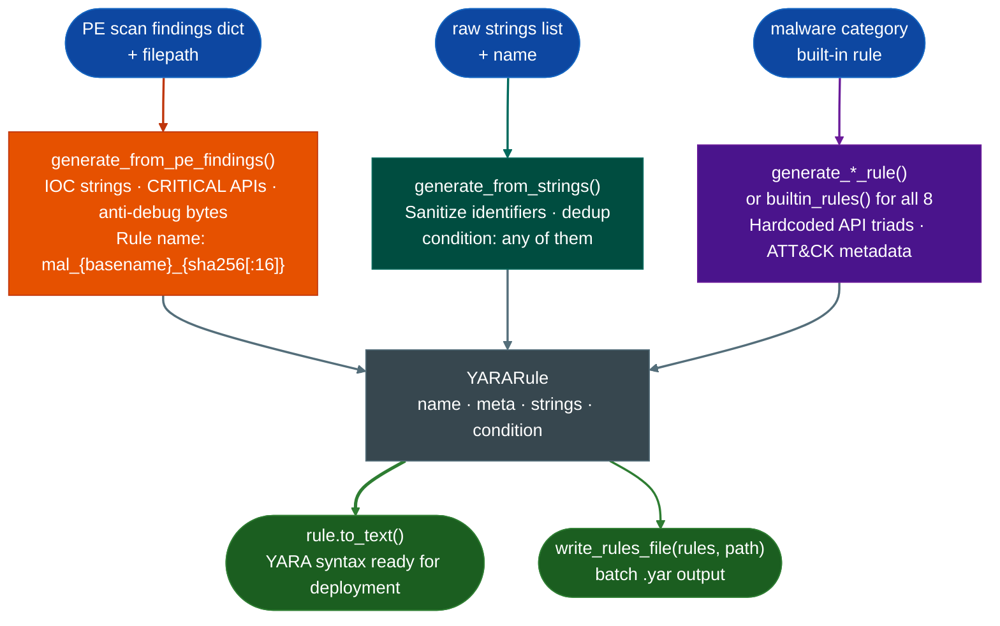

# YARA Rule Generation

Generate deployment-ready YARA detection rules from Ablation scan findings. Inputs are PE scan findings dicts, raw IOC string lists, or one of eight built-in malware-category templates. All paths produce a `YARARule` object with calibrated condition logic and ATT&CK technique metadata.

---

## What is YARA

YARA stands for "Yet Another Recursive Acronym", a self-referential joke name created by Victor Alvarez at VirusTotal that parodies the recursive acronym tradition (GNU stands for "GNU's Not Unix"). The tool itself is not a joke: YARA is the industry standard for writing pattern-matching rules that identify and classify malware samples, firmware images, and binary artifacts at scale.

A YARA rule describes a piece of software by its observable evidence: strings it contains, byte sequences it uses, or API names it imports. When a scanner runs a rule against a file or memory region, it reports a match if the content satisfies the rule's condition. A single rule can scan millions of files in seconds because YARA's matching engine is optimized for bulk binary search rather than symbolic execution or emulation.

YARA rules are portable and composable. A rule written against one malware sample runs on any YARA-compatible scanner without modification. VirusTotal, ClamAV, YARA-X, Elastic Security, Velociraptor, and dozens of endpoint products all consume the same rule format so a rule derived from a firmware finding immediately feeds threat intelligence platforms, EDR policies, and network detection systems without translation.

For firmware RE, YARA rules close the gap between a confirmed finding and operational detection. Identifying a vulnerable function in one firmware image answers whether that image is affected. A YARA rule derived from that finding answers whether any of the thousands of other firmware images in an enterprise environment contain the same vulnerability, and whether new firmware releases patch it or carry it forward.

---

## Why this exists

1. **Findings without detection rules have limited operational value.** An analyst who identifies a backdoor or malware sample in a firmware image still needs to answer whether this is detectable at scale across the environment, across ingested samples, and across new firmware versions. A YARA rule answers that question. Without automatic rule generation, analysts must manually translate findings into detection signatures, a step they skip under time pressure.

2. **IOC strings, malware API imports, and byte patterns have different detection properties.** A domain name in a C2 callback requires case-insensitive ASCII/wide matching. A `VirtualAllocEx` import requires a simple string match against the IAT. An anti-debug byte sequence (`EB 04 74 02`) requires a hex pattern match. The generator handles each category with the appropriate YARA string type and modifier so a single rule covers all three evidence types.

3. **YARA condition logic must balance sensitivity and specificity.** A rule that fires on any single matching string produces too many false positives in large malware corpora. The generator uses `2 of ($s_*)` for IOC strings requiring two independent matches and `any of ($api_*)` for CRITICAL API imports because a single CRITICAL import like `NtCreateThreadEx` is a strong signal on its own. The eight built-in rules use calibrated conditions derived from API co-occurrence patterns documented in Mohanta & Saldanha, "Malware Analysis and Detection Engineering" (Apress, 2020).

---

## How it works



### Rule naming

Rule names are automatically sanitized to YARA-safe identifiers. For PE file-based rules:
```
rule_name = mal_{basename}_{sha256[:16]}
```
The SHA256 prefix ensures uniqueness across renamed malware samples. Non-alphanumeric characters in the filename are replaced with `_`.

### String types and modifiers

| Source | YARA String Type | Modifiers |
|---|---|---|
| IOC strings (IP, domain, path, key) | `"quoted string"` | `ascii wide nocase` |
| CRITICAL malware API names | `"quoted string"` | `ascii wide` |
| Anti-debug byte patterns | `{ HH HH HH }` hex | (none) |

### Condition assembly

The condition combines the three string categories with `OR`:
- If IOC strings present: `2 of ($s_*)`
- If CRITICAL APIs present: `any of ($api_*)`
- If byte patterns present: `any of ($b_*)`
- If only one category: just that condition
- If nothing: `false` (empty rule that never matches)

---

## Built-in rule generators

Eight hardcoded malware-category rules cover the most common firmware threat classes. Each function returns a `YARARule` with ATT&CK technique metadata and a condition calibrated to the API co-occurrence patterns for that category.

| Function | Rule name | ATT&CK technique | Key indicators |
|:---|:---|:---|:---|
| `generate_process_injection_rule()` | `process_injection_classic` | T1055 | VirtualAllocEx + WriteProcessMemory + CreateRemoteThread |
| `generate_ransomware_rule()` | `ransomware_generic` | T1486 | CryptEncrypt + FindFirstFile + vssadmin delete shadows |
| `generate_rootkit_rule()` | `kernel_rootkit_generic` | T1014 | KeServiceDescriptorTable + IoCreateDevice + SSDT targets |
| `generate_downloader_rule()` | `downloader_dropper_generic` | T1105 | MSXML2.ServerXMLHTTP + ADODB.Stream + PS DownloadFile |
| `generate_rat_rule()` | `rat_generic` | T1219 | WSAStartup + SetWindowsHookEx + BitBlt + OpenClipboard |
| `generate_keylogger_rule()` | `keylogger_generic` | T1056.001 | SetWindowsHookEx + GetAsyncKeyState + special-key strings |
| `generate_fileless_powershell_rule()` | `fileless_powershell_macro` | T1059.001 / T1546.003 | -EncodedCommand + IEX + WMI EventFilter + VBA AutoOpen |
| `generate_worm_rule()` | `worm_lateral_movement` | T1021 / T1570 | WMI /node: + NetShareEnum + CopyFileEx + CreateRemoteThread |

`builtin_rules()` returns all eight as a list in the order above.

---

## Usage

```python
from ablation.core.yara_generator import (
    generate_from_pe_findings,
    generate_from_strings,
    generate_process_injection_rule,
    generate_ransomware_rule,
    generate_rootkit_rule,
    generate_downloader_rule,
    generate_rat_rule,
    generate_keylogger_rule,
    generate_fileless_powershell_rule,
    generate_worm_rule,
    builtin_rules,
    write_rules_file,
    YARARule,
)

# From a PE scan findings dict
findings = {
    'ioc_strings': [
        {'type': 'domain', 'value': 'c2.evil.com'},
        {'type': 'ip', 'value': '10.13.37.1'},
    ],
    'malware_apis': [
        {'api': 'VirtualAllocEx', 'severity': 'CRITICAL'},
        {'api': 'WriteProcessMemory', 'severity': 'CRITICAL'},
    ],
    'anti_debug': [],
}
rule = generate_from_pe_findings(findings, '/samples/malware.exe')
print(rule.to_text())

# From a raw list of IOC strings
strings = ['evil.example.com', 'cmd.exe /c', 'HTTP/1.1 200 OK']
rule = generate_from_strings(strings, name='suspicious_agent')
print(rule.to_text())

# Single built-in rule
rule = generate_process_injection_rule()
print(rule.to_text())

# All eight built-in rules at once
rules = builtin_rules()
for r in rules:
    print(r.name, len(r.strings), 'strings')

# Write multiple rules to a .yar file
write_rules_file(rules, '/path/to/output.yar')
```

### Building a rule manually

```python
rule = YARARule(
    name="custom_backdoor_detection",
    meta={
        "description": "Confirmed backdoor: recv_handler at 0x22ccc0",
        "author": "ablation",
        "date": "2026-10-25",
    },
    strings=[
        ("$str_0", '"admin_backdoor_key"', "ascii wide nocase"),
        ("$api_0", '"NtCreateThreadEx"', "ascii wide"),
        ("$bytes_0", "{ E8 ?? ?? ?? ?? 48 85 C0 74 }", ""),
    ],
    condition="($str_0 and $api_0) or $bytes_0",
)
print(rule.to_text())
```

---

## Example output

```yara
rule mal_malware_exe_3a4f8c1d2b9e7f5a
{
    meta:
        description = "Auto-generated rule for malware.exe"
        author_type = "automated"
        date = "2026-10-25"
        sha256 = "3a4f8c1d2b9e7f5aabcdef1234567890..."

    strings:
        $s_0_c2_evil_com = "c2.evil.com" ascii wide nocase
        $s_1_10_13_37_1 = "10.13.37.1" ascii wide nocase
        $api_0_VirtualAllocEx = "VirtualAllocEx" ascii wide
        $api_1_WriteProcessMemory = "WriteProcessMemory" ascii wide

    condition:
        (2 of ($s_*)) or (any of ($api_*))
}
```

---

## False positives

**Shared IOC strings with common values.** If an IOC string is a common domain or IP address such as `127.0.0.1` or `example.com`, the `2 of ($s_*)` condition does not filter it out because one widely shared string could still match alongside another. Remove obviously common values from the IOC strings input before calling the generator.

**API names in security utilities.** Anti-malware agents, EDR tools, and debugging utilities legitimately import `NtCreateThreadEx`, `VirtualAllocEx`, and other CRITICAL APIs for monitoring purposes. The CRITICAL threshold is calibrated for untrusted samples so applying generated rules to enterprise endpoint binaries will produce false positives.

**Empty rules (`condition: false`).** When the findings dict is empty (no IOC strings, no CRITICAL APIs, no byte patterns), the generator emits a rule with `condition: false`. This is a syntactically valid YARA rule that never matches. Validate that the findings input is populated before generating rules for deployment.

---

## Pipeline position

**Before this module:** Any Ablation scanner that produces findings with `type`, `description`, and `severity` fields. PE scan findings from the PE analyzer; string extractions from `BinaryContext.strings`; byte patterns from confirmed vulnerability findings.

**After this module:** YARA rules are ready for deployment to YARA scanners, threat intelligence platforms, or host-based detection systems. Test each rule against a known-positive sample before deployment.

---

## Reading the output

| Field | Content |
|:---|:---|
| `rule.name` | YARA rule identifier (alphanumeric + underscore, unique per binary SHA256) |
| `rule.meta` | Dict of metadata fields: description, author_type, date, sha256, technique |
| `rule.strings` | List of `(identifier, value, modifiers)` tuples |
| `rule.condition` | YARA condition expression |
| `rule.to_text()` | Full YARA rule in YARA syntax, ready for deployment |

---

## See also

- [YARA, JSON & SARIF Export](export.md): SARIF 2.1.0 and flat JSON export from the same findings that feed rule generation
- [ATT&CK Labeling](attandck-labeling.md): enrich findings with technique IDs before generating rules
- [Binary Context](binary-context.md): provides string extractions for rule generation
- [Finding Registry](finding-registry.md): source of confirmed findings for high-confidence rule generation
- [IOC Candidate Extraction](ioc-candidate-extraction.md): extract IP/domain/key candidates for `ioc_strings` input
