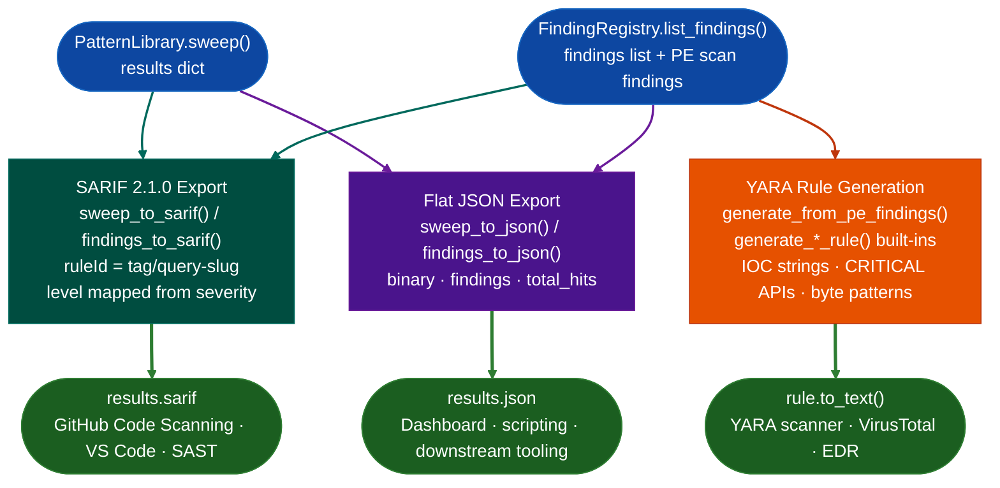

# YARA, JSON & SARIF Export

Ablation produces three output formats from the same confirmed findings or sweep results. `YARARule` generates pattern-matching detection rules that replay against new firmware. SARIF 2.1.0 exports results directly to GitHub Code Scanning and VS Code. Flat JSON covers programmatic consumption and dashboards. All three consume `PatternLibrary.sweep()` or `FindingRegistry.list_findings()` output so no re-analysis is required to produce any format.

---

## What is YARA

YARA stands for "Yet Another Recursive Acronym", a self-referential joke name created by Victor Alvarez at VirusTotal that parodies the recursive acronym tradition (GNU stands for "GNU's Not Unix"). The tool itself is not a joke: YARA is the industry standard for writing pattern-matching rules that identify and classify malware samples, firmware images, and binary artifacts at scale.

A YARA rule describes a piece of software by its observable evidence: strings it contains, byte sequences it uses, or API names it imports. When a scanner runs a rule against a file or memory region, it reports a match if the content satisfies the rule's condition. A single rule can scan millions of files in seconds because YARA's matching engine is optimized for bulk binary search rather than symbolic execution or emulation.

YARA rules are portable and composable. A rule written against one malware sample runs on any YARA-compatible scanner without modification. VirusTotal, ClamAV, YARA-X, Elastic Security, Velociraptor, and dozens of endpoint products all consume the same rule format so a rule derived from a firmware finding immediately feeds threat intelligence platforms, EDR policies, and network detection systems without translation.

For firmware RE, YARA rules close the gap between a confirmed finding and operational detection. Identifying a vulnerable function in one firmware image answers whether that image is affected. A YARA rule derived from that finding answers whether any of the thousands of other firmware images in an enterprise environment contain the same vulnerability, and whether new firmware releases patch it or carry it forward.

---

## What is SARIF

SARIF stands for Static Analysis Results Interchange Format. It is the OASIS standard that GitHub Code Scanning, VS Code, and most modern SAST platforms consume natively. A SARIF document is a JSON file that describes analysis results in a schema those tools understand so sweep results appear as PR annotations and Security tab findings without any custom integration work.

Each SARIF result carries a rule ID derived from the pattern tag and query, a severity level mapped from the finding's severity field (CRITICAL/HIGH become `error`, MEDIUM becomes `warning`, LOW becomes `note`), the virtual address of the hit in `physicalLocation.address.absoluteAddress`, and the cosine similarity score in `properties.score`. This structure lets GitHub Code Scanning display the hit location, severity, and evidence in the same UI as any other static analysis tool.

---

## Why this exists

1. **Confirmed findings have no operational value until they reach the systems that act on them.** A buffer overflow confirmed in firmware at VA `0x22ccc0` needs to reach GitHub Code Scanning for PR-level blocking, a SIEM for alerting, and a threat intelligence platform for indicator sharing. Each system expects a different format. This module produces all three from the same findings list so no manual translation step exists between analysis and detection.

2. **Sweep hits are evidence, not conclusions.** `sweep_to_sarif()` exports raw sweep hits with scores attached so a downstream reviewer can set a score threshold and treat the output as a triage queue. `findings_to_sarif()` exports only confirmed findings from `FindingRegistry` so the distinction between candidate and confirmed is preserved in the output format.

3. **YARA rules share the byte evidence from the analysis.** `generate_from_pe_findings()` builds a YARA rule from the same IOC strings, CRITICAL API imports, and anti-debug byte patterns that the PE scanner found so the rule replays against new firmware images to check whether a vulnerability was patched.

---

## How they work together



---

## Built-in YARA rule generators

Eight hardcoded malware-category rules cover the most common firmware threat classes. Each returns a `YARARule` with ATT&CK technique metadata and a calibrated condition.

| Function | Rule name | ATT&CK technique | Key indicators |
|:---|:---|:---|:---|
| `generate_process_injection_rule()` | `process_injection_classic` | T1055 | VirtualAllocEx + WriteProcessMemory + CreateRemoteThread |
| `generate_ransomware_rule()` | `ransomware_generic` | T1486 | CryptEncrypt + FindFirstFile + vssadmin delete shadows |
| `generate_rootkit_rule()` | `kernel_rootkit_generic` | T1014 | KeServiceDescriptorTable + IoCreateDevice + SSDT targets |
| `generate_downloader_rule()` | `downloader_dropper_generic` | T1105 | MSXML2.ServerXMLHTTP + ADODB.Stream + PS DownloadFile |
| `generate_rat_rule()` | `rat_generic` | T1219 | WSAStartup + SetWindowsHookEx + BitBlt + OpenClipboard |
| `generate_keylogger_rule()` | `keylogger_generic` | T1056.001 | SetWindowsHookEx + GetAsyncKeyState + special-key strings |
| `generate_fileless_powershell_rule()` | `fileless_powershell_macro` | T1059.001 / T1546.003 | -EncodedCommand + IEX + WMI EventFilter + VBA AutoOpen |
| `generate_worm_rule()` | `worm_lateral_movement` | T1021 / T1570 | WMI /node: + NetShareEnum + CopyFileEx + CreateRemoteThread |

`builtin_rules()` returns all eight as a list. `write_rules_file(rules, path)` writes them to a `.yar` file.

---

## Usage

### YARA rules

```python
from ablation.core.yara_generator import (
    generate_from_pe_findings,
    generate_from_strings,
    builtin_rules,
    write_rules_file,
    YARARule,
)

# From a PE scan findings dict
findings = {
    'ioc_strings': [{'type': 'domain', 'value': 'c2.evil.com'}],
    'malware_apis': [{'api': 'VirtualAllocEx', 'severity': 'CRITICAL'}],
    'anti_debug': [],
}
rule = generate_from_pe_findings(findings, '/samples/malware.exe')
print(rule.to_text())

# All eight built-in rules
rules = builtin_rules()
write_rules_file(rules, '/path/to/output.yar')
```

### SARIF export

```python
from ablation.export.sarif import sweep_to_sarif, findings_to_sarif
from ablation.export.json_export import write_sarif

sarif = sweep_to_sarif(sweep_results, binary_path='firmware.so', min_score=0.30)
write_sarif(sarif, 'results.sarif')

# Upload to GitHub Code Scanning
# gh api repos/<owner>/<repo>/code-scanning/sarifs \
#     -f commit_sha=$(git rev-parse HEAD) \
#     -f ref=refs/heads/main \
#     -f sarif=$(gzip -c results.sarif | base64 -w0) \
#     -f tool_name=ablation
```

### JSON export

```python
from ablation.export.json_export import sweep_to_json, findings_to_json, write_json

doc = sweep_to_json(sweep_results, binary_path='firmware.so', min_score=0.30)
write_json(doc, 'sweep.json')
```

---

## Pipeline position

Run all three export steps after `PatternLibrary.sweep()` or `FindingRegistry.list_findings()` completes. YARA rules deploy to scanners and threat intelligence platforms. SARIF uploads to GitHub Code Scanning for PR-level blocking. JSON feeds dashboards and downstream automation. No further Ablation modules depend on export output.

---

## See also

- [YARA Rule Generation](yara-generator.md): full YARA API, string type reference, condition assembly logic, false positives
- [JSON & SARIF Export](export.md): full SARIF field reference, API table, GitHub Code Scanning upload steps
- [ATT&CK Labeling](attandck-labeling.md): enrich findings with technique IDs before generating rules
- [Finding Registry](registry.md): persistent finding storage that `findings_to_sarif()` consumes
