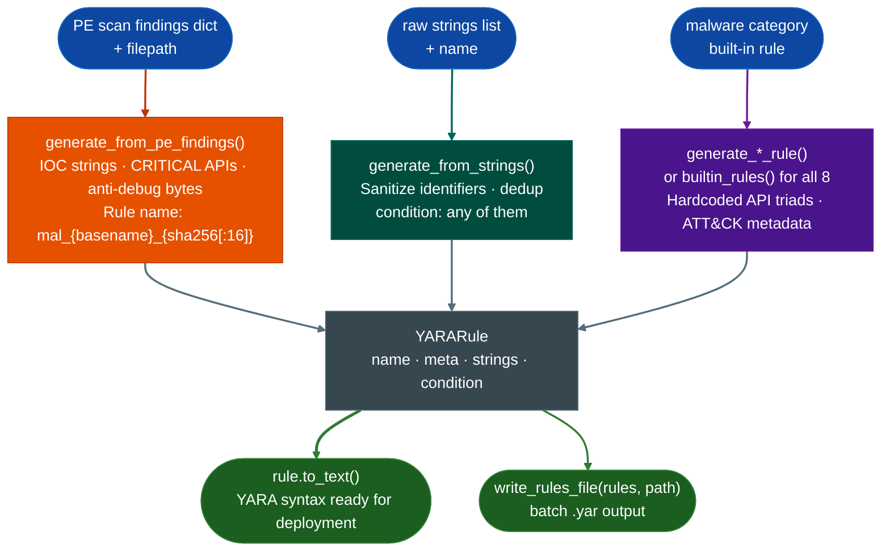
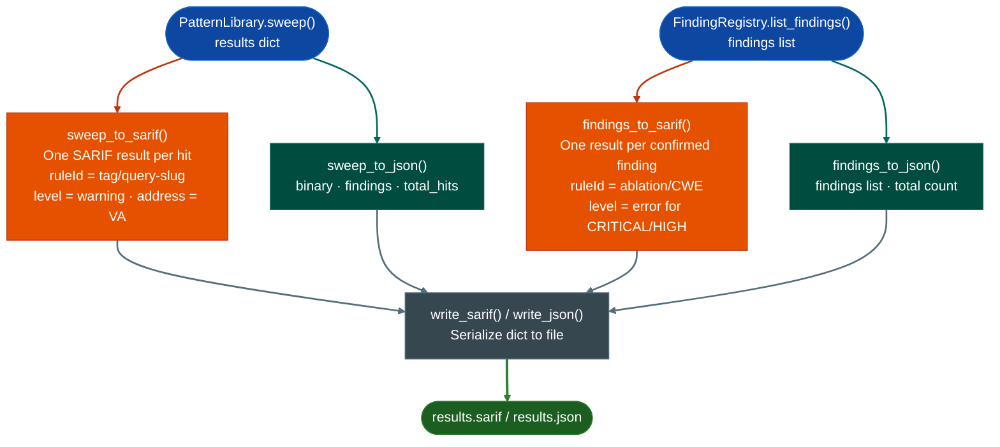

# YARA, JSON & SARIF Export

Ablation produces three output formats from the same confirmed findings or sweep results. `YARARule` generates pattern-matching detection rules that replay against new firmware. SARIF 2.1.0 exports results directly to GitHub Code Scanning and VS Code. Flat JSON covers programmatic consumption and dashboards. All three consume `PatternLibrary.sweep()` or `FindingRegistry.list_findings()` output so no re-analysis is required to produce any format.

---

## What is YARA

YARA stands for "Yet Another Recursive Acronym", a self-referential joke name created by Victor Alvarez at VirusTotal that parodies the recursive acronym tradition (GNU stands for "GNU's Not Unix"). The tool itself is not a joke: YARA is the industry standard for writing pattern-matching rules that identify and classify malware samples, firmware images, and binary artifacts at scale.

A YARA rule describes a piece of software by its observable evidence: strings it contains, byte sequences it uses, or API names it imports. When a scanner runs a rule against a file or memory region, it reports a match if the content satisfies the rule's condition. A single rule can scan millions of files in seconds because YARA's matching engine is optimized for bulk binary search rather than symbolic execution or emulation.

YARA rules are portable and composable. A rule written against one malware sample runs on any YARA-compatible scanner without modification. VirusTotal, ClamAV, YARA-X, Elastic Security, Velociraptor, and dozens of endpoint products all consume the same rule format so a rule derived from a firmware finding immediately feeds threat intelligence platforms, EDR policies, and network detection systems without translation.

For firmware RE, YARA rules close the gap between a confirmed finding and operational detection. Identifying a vulnerable function in one firmware image answers whether that image is affected. A YARA rule derived from that finding answers whether any of the thousands of other firmware images in an enterprise environment contain the same vulnerability, and whether new firmware releases patch it or carry it forward.

---

## What is SARIF

SARIF stands for Static Analysis Results Interchange Format. It is the OASIS standard that GitHub Code Scanning, VS Code, and most modern SAST platforms consume natively. A SARIF document is a JSON file that describes analysis results in a schema those tools understand so sweep results appear as PR annotations and Security tab findings without any custom integration work.

Each SARIF result carries a rule ID derived from the pattern tag and query, a severity level mapped from the finding's severity field (CRITICAL/HIGH become `error`, MEDIUM becomes `warning`, LOW becomes `note`), the virtual address of the hit in `physicalLocation.address.absoluteAddress`, and the cosine similarity score in `properties.score`. This structure lets GitHub Code Scanning display the hit location, severity, and evidence in the same UI as any other static analysis tool.

---

## What is flat JSON export

JSON (JavaScript Object Notation) is a human-readable text format for structured data. The flat JSON export in this module produces a simple, schema-free document that lists every sweep hit or confirmed finding with its virtual address and score. Unlike SARIF, flat JSON has no required schema so any script, dashboard, or downstream tool can consume it without a SARIF parser.

Flat JSON is the right choice when the consumer is a Python script, a CI pipeline that needs to count findings above a threshold, or a Grafana dashboard. SARIF is the right choice when the consumer is GitHub Code Scanning, VS Code, or any tool that expects the OASIS standard. Both formats are produced from the same input dict so there is no reason to choose one exclusively.

---

## Why this exists

1. **Findings without detection rules have limited operational value.** An analyst who identifies a backdoor or malware sample in a firmware image still needs to answer whether this is detectable at scale across the environment, across ingested samples, and across new firmware versions. A YARA rule answers that question. Without automatic rule generation, analysts must manually translate findings into detection signatures, a step they skip under time pressure.

2. **IOC strings, malware API imports, and byte patterns have different detection properties.** A domain name in a C2 callback requires case-insensitive ASCII/wide matching. A `VirtualAllocEx` import requires a simple string match against the IAT. An anti-debug byte sequence (`EB 04 74 02`) requires a hex pattern match. The generator handles each category with the appropriate YARA string type and modifier so a single rule covers all three evidence types.

3. **Confirmed findings have no operational value until they reach the systems that act on them.** A buffer overflow confirmed in firmware at VA `0x22ccc0` needs to reach GitHub Code Scanning for PR-level blocking, a SIEM for alerting, and a threat intelligence platform for indicator sharing. Each system expects a different format. This module produces YARA, SARIF, and JSON from the same findings list so no manual translation step exists between analysis and detection.

4. **YARA condition logic must balance sensitivity and specificity.** A rule that fires on any single matching string produces too many false positives in large malware corpora. The generator uses `2 of ($s_*)` for IOC strings requiring two independent matches and `any of ($api_*)` for CRITICAL API imports because a single CRITICAL import like `NtCreateThreadEx` is a strong signal on its own. The eight built-in rules use calibrated conditions derived from API co-occurrence patterns documented in Mohanta & Saldanha, "Malware Analysis and Detection Engineering" (Apress, 2020).

---

## How YARA rule generation works



### Rule naming

Rule names are automatically sanitized to YARA-safe identifiers. For PE file-based rules:
```
rule_name = mal_{basename}_{sha256[:16]}
```
The SHA256 prefix ensures uniqueness across renamed malware samples. Non-alphanumeric characters in the filename are replaced with `_`.

### String types and modifiers

| Source | YARA String Type | Modifiers |
|:---|:---|:---|
| IOC strings (IP, domain, path, key) | `"quoted string"` | `ascii wide nocase` |
| CRITICAL malware API names | `"quoted string"` | `ascii wide` |
| Anti-debug byte patterns | `{ HH HH HH }` hex | (none) |

### Condition assembly

The condition combines the three string categories with `OR`:
- If IOC strings present: `2 of ($s_*)`
- If CRITICAL APIs present: `any of ($api_*)`
- If byte patterns present: `any of ($b_*)`
- If only one category: just that condition
- If nothing: `false` (empty rule that never matches)

---

## How SARIF & JSON export works



### SARIF field reference

Each sweep hit becomes one SARIF `result` entry with these fields:

| Field | Value |
|:---|:---|
| `ruleId` | `<tag>/<query-slug>` e.g. `buffer-overflow/strcpy-no-length-check` |
| `level` | `warning` for sweep hits; `error` for CRITICAL/HIGH confirmed findings |
| `physicalLocation.address.absoluteAddress` | Virtual address as integer |
| `physicalLocation.address.name` | VA as hex string e.g. `0x1fa00` |
| `properties.score` | Cosine similarity score |
| `properties.va` | VA as hex string |
| `properties.tag` | Pattern tag from the sweep |

For confirmed findings from `FindingRegistry`, the rule ID is `ablation/<CWE>` and the level reflects the finding's severity field rather than a fixed `warning`.

---

## Built-in YARA rule generators

Eight hardcoded malware-category rules cover the most common firmware threat classes. Each returns a `YARARule` with ATT&CK technique metadata and a condition calibrated to the API co-occurrence patterns for that category.

| Function | Rule name | ATT&CK technique | Key indicators |
|:---|:---|:---|:---|
| `generate_process_injection_rule()` | `process_injection_classic` | T1055 | VirtualAllocEx + WriteProcessMemory + CreateRemoteThread |
| `generate_ransomware_rule()` | `ransomware_generic` | T1486 | CryptEncrypt + FindFirstFile + vssadmin delete shadows |
| `generate_rootkit_rule()` | `kernel_rootkit_generic` | T1014 | KeServiceDescriptorTable + IoCreateDevice + SSDT targets |
| `generate_downloader_rule()` | `downloader_dropper_generic` | T1105 | MSXML2.ServerXMLHTTP + ADODB.Stream + PS DownloadFile |
| `generate_rat_rule()` | `rat_generic` | T1219 | WSAStartup + SetWindowsHookEx + BitBlt + OpenClipboard |
| `generate_keylogger_rule()` | `keylogger_generic` | T1056.001 | SetWindowsHookEx + GetAsyncKeyState + special-key strings |
| `generate_fileless_powershell_rule()` | `fileless_powershell_macro` | T1059.001 / T1546.003 | -EncodedCommand + IEX + WMI EventFilter + VBA AutoOpen |
| `generate_worm_rule()` | `worm_lateral_movement` | T1021 / T1570 | WMI /node: + NetShareEnum + CopyFileEx + CreateRemoteThread |

`builtin_rules()` returns all eight as a list. `write_rules_file(rules, path)` writes them to a `.yar` file.

---

## Usage

### YARA rules

```python
from ablation.core.yara_generator import (
    generate_from_pe_findings,
    generate_from_strings,
    builtin_rules,
    write_rules_file,
    YARARule,
)

# From a PE scan findings dict
findings = {
    'ioc_strings': [
        {'type': 'domain', 'value': 'c2.evil.com'},
        {'type': 'ip', 'value': '10.13.37.1'},
    ],
    'malware_apis': [
        {'api': 'VirtualAllocEx', 'severity': 'CRITICAL'},
        {'api': 'WriteProcessMemory', 'severity': 'CRITICAL'},
    ],
    'anti_debug': [],
}
rule = generate_from_pe_findings(findings, '/samples/malware.exe')
print(rule.to_text())

# All eight built-in rules
rules = builtin_rules()
write_rules_file(rules, '/path/to/output.yar')

# Build a rule manually from a confirmed finding
rule = YARARule(
    name="custom_backdoor_detection",
    meta={"description": "Confirmed backdoor: recv_handler at 0x22ccc0", "date": "2026-10-25"},
    strings=[
        ("$str_0", '"admin_backdoor_key"', "ascii wide nocase"),
        ("$api_0", '"NtCreateThreadEx"', "ascii wide"),
        ("$bytes_0", "{ E8 ?? ?? ?? ?? 48 85 C0 74 }", ""),
    ],
    condition="($str_0 and $api_0) or $bytes_0",
)
print(rule.to_text())
```

### SARIF export

```python
from ablation.export.sarif import sweep_to_sarif, findings_to_sarif
from ablation.export.json_export import write_sarif

sarif = sweep_to_sarif(sweep_results, binary_path='firmware.so', min_score=0.30)
write_sarif(sarif, 'results.sarif')

# Upload to GitHub Code Scanning
# gh api repos/<owner>/<repo>/code-scanning/sarifs \
#     -f commit_sha=$(git rev-parse HEAD) \
#     -f ref=refs/heads/main \
#     -f sarif=$(gzip -c results.sarif | base64 -w0) \
#     -f tool_name=ablation
```

### JSON export

```python
from ablation.export.json_export import sweep_to_json, findings_to_json, write_json

doc = sweep_to_json(sweep_results, binary_path='firmware.so', min_score=0.30)
write_json(doc, 'sweep.json')
```

---

## Example output

### YARA rule

```yara
rule mal_malware_exe_3a4f8c1d2b9e7f5a
{
    meta:
        description = "Auto-generated rule for malware.exe"
        author_type = "automated"
        date = "2026-10-25"
        sha256 = "3a4f8c1d2b9e7f5aabcdef1234567890..."

    strings:
        $s_0_c2_evil_com = "c2.evil.com" ascii wide nocase
        $s_1_10_13_37_1 = "10.13.37.1" ascii wide nocase
        $api_0_VirtualAllocEx = "VirtualAllocEx" ascii wide
        $api_1_WriteProcessMemory = "WriteProcessMemory" ascii wide

    condition:
        (2 of ($s_*)) or (any of ($api_*))
}
```

### SARIF

```json
{
  "$schema": "https://json.schemastore.org/sarif-2.1.0.json",
  "version": "2.1.0",
  "runs": [{
    "tool": {"driver": {"name": "Ablation", "version": "2.57.0", "rules": [
      {"id": "buffer-overflow/strcpy-no-length-check",
       "shortDescription": {"text": "strcpy with user-controlled src, no length check"}}
    ]}},
    "results": [{
      "ruleId": "buffer-overflow/strcpy-no-length-check",
      "level": "warning",
      "message": {"text": "strcpy with user-controlled src (score=0.71)"},
      "locations": [{"physicalLocation": {"address": {"absoluteAddress": 130560, "name": "0x1fa00"}}}],
      "properties": {"score": 0.71, "va": "0x1fa00", "tag": "buffer-overflow"}
    }]
  }]
}
```

### JSON

```json
{
  "binary": "/path/to/firmware.so",
  "total_hits": 14,
  "findings": [
    {
      "tag": "buffer-overflow",
      "pattern": "strcpy with user-controlled src, no length check",
      "hits": [
        {"va": "0x1fa00", "score": 0.71},
        {"va": "0x2200c", "score": 0.63}
      ]
    }
  ]
}
```

---

## False positives

**Shared IOC strings with common values.** If an IOC string is a common domain or IP address such as `127.0.0.1` or `example.com`, the `2 of ($s_*)` condition does not filter it out because one widely shared string could still match alongside another. Remove obviously common values from the IOC strings input before calling the generator.

**API names in security utilities.** Anti-malware agents, EDR tools, and debugging utilities legitimately import `NtCreateThreadEx`, `VirtualAllocEx`, and other CRITICAL APIs for monitoring purposes. The CRITICAL threshold is calibrated for untrusted samples so applying generated rules to enterprise endpoint binaries will produce false positives.

**Empty YARA rules (`condition: false`).** When the findings dict is empty (no IOC strings, no CRITICAL APIs, no byte patterns), the generator emits a rule with `condition: false`. This is a syntactically valid YARA rule that never matches. Validate that the findings input is populated before generating rules for deployment.

**`sweep_to_sarif()` emits candidates, not confirmed findings.** A SARIF output from sweep results should be treated as a triage queue. Use `findings_to_sarif()` when the output must represent only confirmed findings from `FindingRegistry`.

---

## Pipeline position

Run all three export steps after `PatternLibrary.sweep()` or `FindingRegistry.list_findings()` completes. YARA rules deploy to scanners and threat intelligence platforms. SARIF uploads to GitHub Code Scanning for PR-level blocking. JSON feeds dashboards and downstream automation. No further Ablation modules depend on export output.

---

## Reading the output

### YARA

| Field | Content |
|:---|:---|
| `rule.name` | YARA rule identifier (alphanumeric + underscore, unique per binary SHA256) |
| `rule.meta` | Dict of metadata: description, author_type, date, sha256, technique |
| `rule.strings` | List of `(identifier, value, modifiers)` tuples |
| `rule.condition` | YARA condition expression |
| `rule.to_text()` | Full YARA rule in YARA syntax, ready for deployment |

### SARIF & JSON

| Function | Returns |
|:---|:---|
| `sweep_to_sarif(sweep_results, binary_path, min_score=0.0)` | `dict`: SARIF 2.1.0 document from `PatternLibrary.sweep()` output |
| `findings_to_sarif(findings, binary_path=None)` | `dict`: SARIF 2.1.0 document from `FindingRegistry.list_findings()` output |
| `sweep_to_json(sweep_results, binary_path, min_score=0.0)` | `dict`: flat JSON with `binary`, `findings`, `total_hits` keys |
| `findings_to_json(findings)` | `dict`: flat JSON with `findings` and `total` keys |
| `write_sarif(data, path)` | Writes SARIF dict to file; returns `None` |
| `write_json(data, path)` | Writes JSON dict to file; returns `None` |

---

## See also

- [YARA Rule Generation](yara-generator.md): full YARA API detail and all built-in generator functions
- [JSON & SARIF Export](export.md): full SARIF field reference and GitHub Code Scanning upload steps
- [ATT&CK Labeling](attandck-labeling.md): enrich findings with technique IDs before generating rules
- [Finding Registry](registry.md): persistent finding storage that `findings_to_sarif()` consumes
