# Understanding Ablation

Ablation is a local reverse-engineering and binary-triage toolkit. Its purpose is to help an analyst make sense of stripped binaries and firmware by building useful structural context, finding functions worth inspecting, and applying targeted static analyses. The analyst (or an assistant such as Codex) uses those outputs to investigate and validate hypotheses. Ablation does not, by itself, prove that a candidate is exploitable.

This page describes the implementation and docs in this checkout. It is intended as a practical map of what the system does, where its components live, and how to interpret its results. The package metadata currently reports version 2.5.0; the CLI and update notes contain newer commands and architecture work than the version label and some reference pages, so check `ablation --help` and the implementation before relying on an older example.

## The analysis model

Most workflows follow this sequence:

1. Load a binary and collect structural facts: format, architecture, segments, imports/PLT entries, exports, strings, probable function starts, calls, and cross-references.
2. Use that context to locate code relevant to a question. This can be semantic search over function descriptions, known signatures, pattern sweeps, string/call relationships, or a specialized scanner.
3. Inspect a candidate with function profiles, instruction windows, control-flow graphs, cross-references, and architecture-specific taint/dataflow analysis.
4. Verify the path and assumptions manually against the binary, its callers, input source, guards, and runtime behavior where possible.
5. Preserve useful analyst knowledge in the local name, function-identity, pattern, or finding stores, and in the target's session notes.

Ablation is a static analysis toolkit: it reads binaries without executing them. Static analysis can examine all code paths in principle, including error paths and rarely-triggered branches, but it cannot observe actual runtime values, heap layout, or dynamically loaded libraries. The complement is dynamic analysis (fuzzing, debugger tracing, instrumentation): it observes only paths that a given input triggers, but produces exact values and no false positives on executed paths. Ablation's pipeline ends at PathSolver, which is still static. Dynamic confirmation requires running the binary under instrumentation with a crafted input. That is the step that turns a PathSolver result into an observed crash.

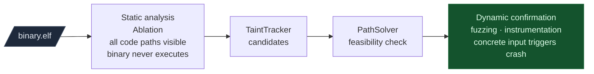

The tools use bounded static approximations and heuristics. A hit is a lead, a score is a ranking signal, and an apparent taint path is a model result. None should be presented as a confirmed vulnerability without validating reachability, input control, checks, sink behavior, and impact.

## Repository map

| Path | Responsibility |
|---|---|
| `ablation/cli.py` | Main `ablation` command line entry point and command dispatch. |
| `ablation/core/` | Binary/file-format helpers, disassembly engine, platform detection, firmware and protocol utilities, shellcode helpers, and exports such as YARA generation. |
| `ablation/analyzers/` | The main analysis library: binary context, xrefs, CFGs, dataflow/taint, semantic search, registries, diffing, crypto, Go analysis, kernel/heap/format-string scanners, and architecture-specific decoders. |
| `ablation/analyzers/llm_analyst/` | Optional Anthropic-backed analysis loop, context construction, retrieval, tools, and analyst tasks. It is an optional component, not required for Codex to use the CLI. |
| `ablation/export/` | JSON and SARIF serialization. |
| `ablation/integrations/` | Disassembler integrations; the current tree includes a Binary Ninja plugin. |
| `ablation/data/` | Seed finding and signature data shipped with the package. |
| `sweeps/` | A separate, older sweep implementation and report generation path. Its behavior/model should not be conflated with the main CLI's corpus and pattern path. |
| `modules/` | Standalone and target-oriented research scripts. This is not one uniform public API. |
| `targets/` | Product/vendor-specific reverse-engineering scripts and evolving session notes. These are research artifacts built using Ablation, rather than generic framework components. |
| `tests/`, `test/` | Unit tests and workflow notes. |
| `docs/` | User guides, module references, integration notes, release notes, and update notes. |

The checkout may also contain firmware, extracted filesystems, generated reports, vendor reference material, and other research artifacts. Such inputs are not all framework source, and their presence does not mean Ablation automatically analyzes them as one unified target.

## Binary context and disassembly

`BinaryContext` (`ablation/analyzers/binary_context.py`) is the common high-level context object. It uses LIEF, Capstone, NumPy, and related helpers to identify useful binary properties and construct indexes for later analysis. The context can expose summaries, function starts, names, call relationships, strings, and string references. Its cache is keyed by the binary SHA-256 under `~/.ablation/cache`, so a different build does not silently reuse the same cached context merely because its filename matches.

Function boundaries and references are inferred. The implementation combines format metadata, exported symbols, unwind information where available, instruction decoding, and prologue/call heuristics. Call-graph and string-reference coverage depends on architecture and instruction forms; direct-call scans do not magically resolve arbitrary indirect calls. Treat the indexes as navigation aids and inspect the actual instructions for consequential claims.

The core package contains ELF, PE, and Mach-O-related support, while analysis coverage is not identical across formats and architectures. The main context and much of the workflow are ELF-oriented. The architecture-specific analyzer and decoder modules implement different subsets of decoding, CFG construction, function discovery, and taint analysis. “Supports architecture X” should therefore be read as support by particular commands/components, not a guarantee that every feature has equivalent coverage on every ISA.

This is a binary analysis toolkit, not a general source-level decompiler equivalent to a full interactive commercial or open-source reverse-engineering suite. It offers disassembly, structural analysis, matching, and targeted analysis features; users should inspect each command's actual output and scope.

## Finding candidate functions

### Corpus construction and semantic search

`CorpusBuilder` gathers a textual description for functions and persists function identity/context in a SQLite database, normally `~/.ablation/func_id.db`. Descriptions can include names, inferred role, callees, strings, and analyst notes. `SemanticSearcher` embeds those descriptions and ranks them against natural-language queries. The default model in the implementation is `sentence-transformers/all-mpnet-base-v2`.

This is semantic similarity over the description corpus, not a direct semantic understanding of arbitrary machine code. In particular, the normal corpus description path does not automatically include a full instruction sequence or invoke angr for every function. A high score says the indexed description resembles the query; it does not establish that the function has the queried behavior. Signature data and analyst-provided names improve context but are also evidence to verify.

`SemanticSearcher` works by vector similarity over function descriptions, not by understanding machine code. `CorpusBuilder` generates a textual description for each function (names, callees, strings, inferred role) and embeds it with `sentence-transformers/all-mpnet-base-v2`. A search query is embedded with the same model and the closest functions by cosine distance are returned. A high score means the function's description resembles the query. It does not mean the function has the queried behavior.

Two consequences follow from this. First, a function with no symbols, no recognizable strings, and no known callees produces a thin description and matches poorly regardless of what the function actually does. Second, a function named `copy_data` that calls `memcpy` ranks high for "buffer copy" even if it is safe. Semantic search narrows the candidate list. `FuncProfiler` and `TaintTracker` determine what the candidates actually do.

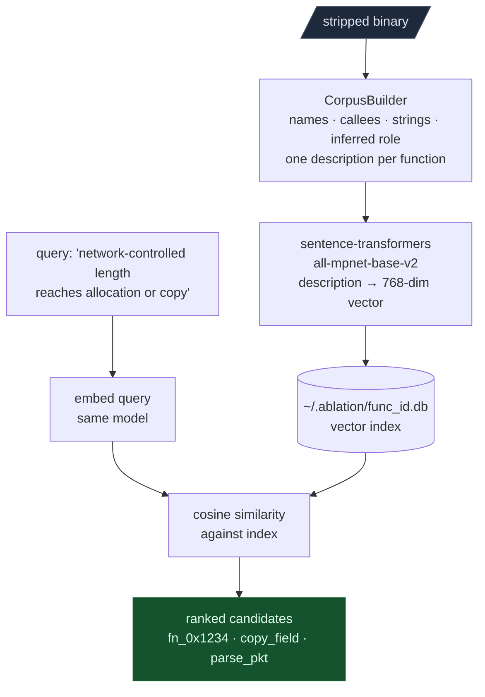

`PatternLibrary` stores reusable textual search patterns and hit metadata in a local JSON file under `~/.ablation`. A sweep applies patterns and reports candidates. A separate legacy `sweeps/base_sweep.py` path has its own extraction and embedding behavior, including a different model; do not assume it is interchangeable with `ablation sweep` without checking which entry point is being run.

### Names, identities, and findings

- `NameRegistry` stores analyst or inferred names keyed by binary identity in `~/.ablation/function_names.json`.
- `FuncIdDB` stores function records and cross-build identity/context in SQLite. Confidence labels distinguish confirmed identities from inferred/candidate records.
- `SigLibrary` applies shipped signatures to help identify functions.
- `FindingRegistry` stores finding records in a local SQLite database and can retrieve related prior records using embeddings.

These are local analyst knowledge stores, not necessarily shared/team databases. Keep private target data and sensitive finding details in mind when exporting or sharing them. A name or registry record is a useful annotation, not independent proof.

## Triage and program analysis

The CLI provides several levels of inspection:

- `analyze`: summarize the binary and optionally inspect entropy.
- `window`: print an annotated instruction window near an address, with optional calls/function starts.
- `profile`: collect function-level context such as strings, call-site arguments, and sink-like calls.
- `cfg`: build and print a function's basic blocks and edges, optionally including instructions.
- `search`, `corpus`, and `sweep`: build/query the semantic corpus and run registered patterns.
- `taint` and the architecture-specific taint commands: trace modeled input values through supported instruction and call behavior toward selected sinks.
- `overflow`, `fmtstr`, `heap`, `driver`, `byovd`, and `crypto`: run more specialized scans.
- `findings`, `sigs`, and `news`: inspect registry, signatures, or update information.

**Source/sink model.** Taint analysis requires two definitions: a source and a sink. A source is a function whose return value or output buffer carries attacker-controlled data. A sink is a function that is dangerous when called with that data. The analysis finds paths from sources to sinks. If no configured sink is matched in the binary, the analysis returns no findings. This is not a clean result: it means no matched sink was found, not that the binary is safe.

Default sources include `recv`, `recvfrom`, `read`, `fgets`, and `gets`. Default sinks include `system`, `popen`, `execve`, `strcpy`, `strcat`, `sprintf`, `memcpy`, and `malloc`.

Firmware wraps standard library functions in vendor-specific wrappers. A binary that calls `vendor_exec_cmd(input)` instead of `system(input)` produces zero findings because `vendor_exec_cmd` is not in the sink table. `SinkPropagator` discovers these wrapper chains automatically. `custom_sinks=` adds specific wrappers directly.

`SinkArgClassifier` classifies each sink argument before the interprocedural pass. `RODATA_CONST` means the argument is a hardcoded string and the sink is not dangerous at that call site. `ARG_PROPAGATED` means the argument comes from a function parameter and is worth tracing. Running `SinkArgClassifier` before `TaintTracker` eliminates call sites where the dangerous argument is provably constant, so the interprocedural pass only runs on sites where the value is actually attacker-influenced.

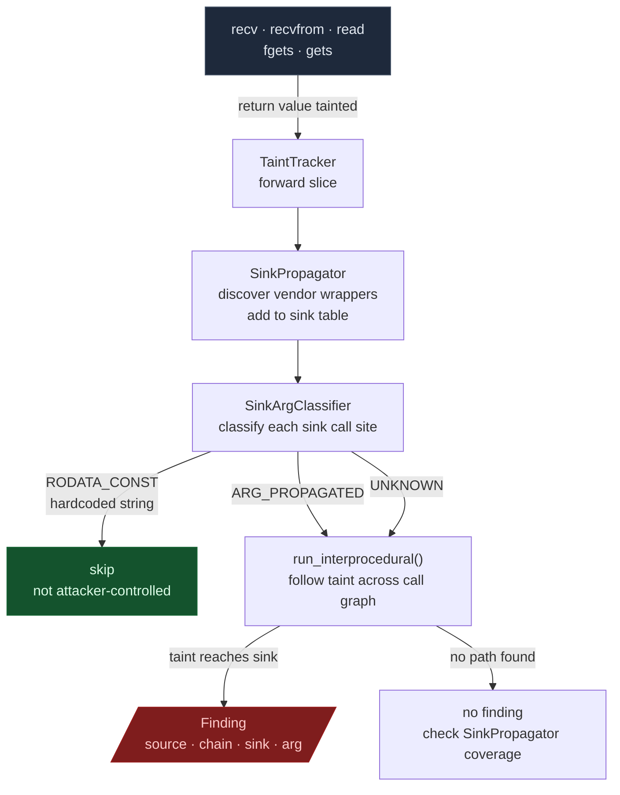

**Control flow and data flow.** The `cfg` command builds a Control Flow Graph (CFG): nodes are basic blocks, edges are possible branches. This is control flow analysis. It answers whether one instruction can execute after another. It says nothing about what values the registers hold. Taint analysis is data flow analysis built on top of a CFG: it propagates facts (tainted or clean) along CFG edges through each instruction's transfer function. `dataflow_engine.py` provides the shared CFG worklist and fixed-point machinery; architecture modules define the transfer functions. Correctness depends on the modeled instruction subset, the calling convention model, and CFG recovery quality.

The data flow analysis runs to a fixed point: it propagates facts around the CFG until the taint sets stop changing. For straight-line code this converges in one pass. For loops, the analysis revisits the loop body each time new taint facts appear. When a loop's taint state changes at each iteration, the analysis widens the taint state after a fixed number of passes and forces convergence by treating everything as tainted. The known-anomalies docs refer to this as the "loop fixpoint" limitation. It is conservative: the analysis terminates but may report taint in a register that is only tainted on some loop iterations.

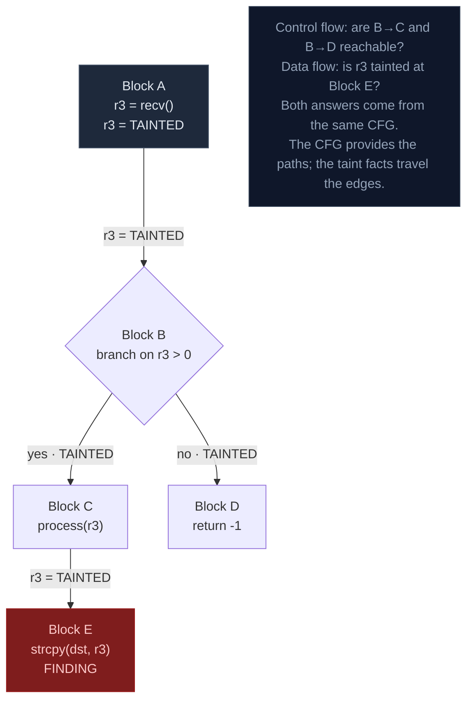

**Flow sensitivity vs path sensitivity.** Flow-sensitive analysis tracks the order of operations: `r3 = recv(); r3 = 0; system(r3)` produces no finding because the clean assignment came after the taint. Flow-insensitive analysis ignores order and flags a finding regardless of sequence.

Path-insensitive analysis merges facts from all branches when they join:

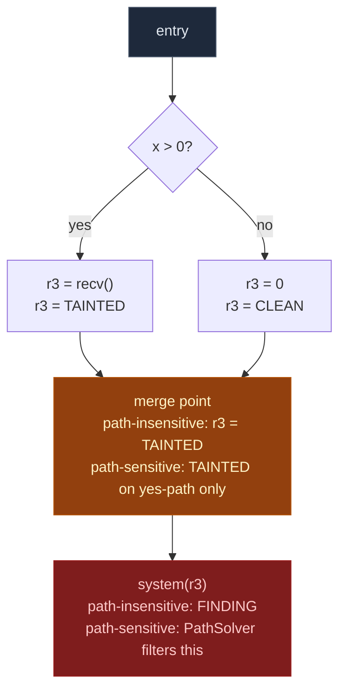

A path-sensitive analysis would track each branch separately and know `r3` is only tainted on the `x > 0` path. Tracking separate facts per path costs exponential time in the number of branches, so it does not scale to firmware binaries.

Ablation's trackers are flow-sensitive and path-insensitive. Findings at branch merge points may be false positives: taint from one branch appears to reach a sink that is only reachable on the other branch. PathSolver is the follow-up step that filters these by checking whether the tainted branch conditions are actually satisfiable.

**Intraprocedural vs interprocedural.** Intraprocedural analysis stays within one function and treats every callee as a black box. It misses paths where taint passes through a callee before reaching a sink in the caller. `run_interprocedural(depth=N)` follows taint across call boundaries with a BFS over the call graph. At the default `depth=4` it traces chains like `recv → parse_header → copy_field → strcpy`. Ablation's interprocedural analysis is context-insensitive: it computes one taint summary per function and reuses it at every call site. This is the correct tradeoff for stripped firmware where the call graph is uncertain. Intraprocedural mode (`run()` or `scan_function()`) is appropriate when a bounded scan of a confirmed candidate function is enough.

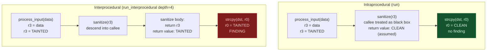

**Calling conventions and ABI.** A calling convention defines which registers hold function arguments, which holds the return value, which the callee must preserve (callee-saved), and which the callee may freely clobber (caller-saved). Every taint tracker embeds a calling convention model. When `run_interprocedural()` reaches a call site, it uses the convention to determine which registers carry tainted arguments into the callee, which register holds the return value, and which caller-saved registers the callee may have clobbered.

Getting this wrong produces silent incorrect results. A big-endian MIPS32 binary analyzed with `endian='little'` decodes every instruction's register fields incorrectly. An RH850 binary compiled with GHS `double=32-bit` default analyzed with the GCC `double=64-bit` model shifts argument registers for any function with a `double` parameter. The `arch=`, `endian=`, and `double_is_32bit=` parameters control which registers the ABI model assigns to argument positions. For stripped binaries with no symbol information, calling-convention mismatches produce findings at wrong VAs with wrong argument registers cited, which fail byte-verification.

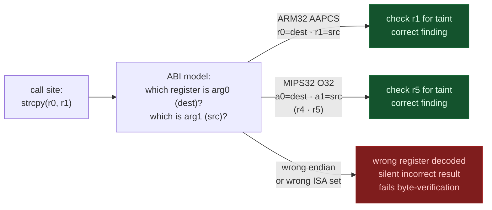

**Slicing and copy propagation.** A taint tracker computes a forward slice from a source: it tracks which registers and memory locations are reachable from `recv` and checks whether any path reaches a sink. Copy propagation makes register renaming transparent. Every `mov rd, rs` propagates taint from `rs` to `rd`. Without it, a tracker watching only the original source register misses the sink the moment the value is renamed. Some instructions clear taint because they bound the value to a fixed range. `uxtb`/`uxth` on HiSilicon RV32 bound a register to ≤255 or ≤65535. `andi rd, rj, mask` on LoongArch64 records the bound so PathSolver can check whether overflow is still possible past the mask. Address constants are not tainted because they load instruction addresses, not attacker-controlled data.

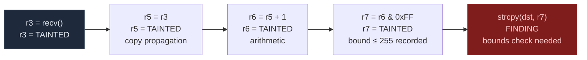

**Alias analysis.** Register taint is precise: each register is a distinct name and the tracker follows renames exactly. Memory taint is harder because two pointers can reference the same address. A store through one pointer taints a memory location; a load through a different pointer that holds the same address should recover that taint. Determining whether two pointer expressions alias requires alias analysis.

Ablation's trackers track memory taint at the level of base-register and offset pairs: a store to `r3 + 8` taints the slot `(r3, 8)` and a load from `r3 + 8` later in the same function recovers it. This handles struct field accesses. It does not handle aliased pointers: if `r5` holds the same address as `r3 + 8`, a load from `r5` does not recover the taint stored through `r3 + 8`.

This is why `read(fd, buf, n)` taints `r3` (the byte count returned) but not the buffer. The buffer is written through a pointer in `r4`. Tracking taint into the buffer requires following all loads from any pointer that might alias `r4`. The return-value taint model instead finds paths where the byte count reaches a size argument of `malloc` or `memcpy`, which is a distinct and common vulnerability class.

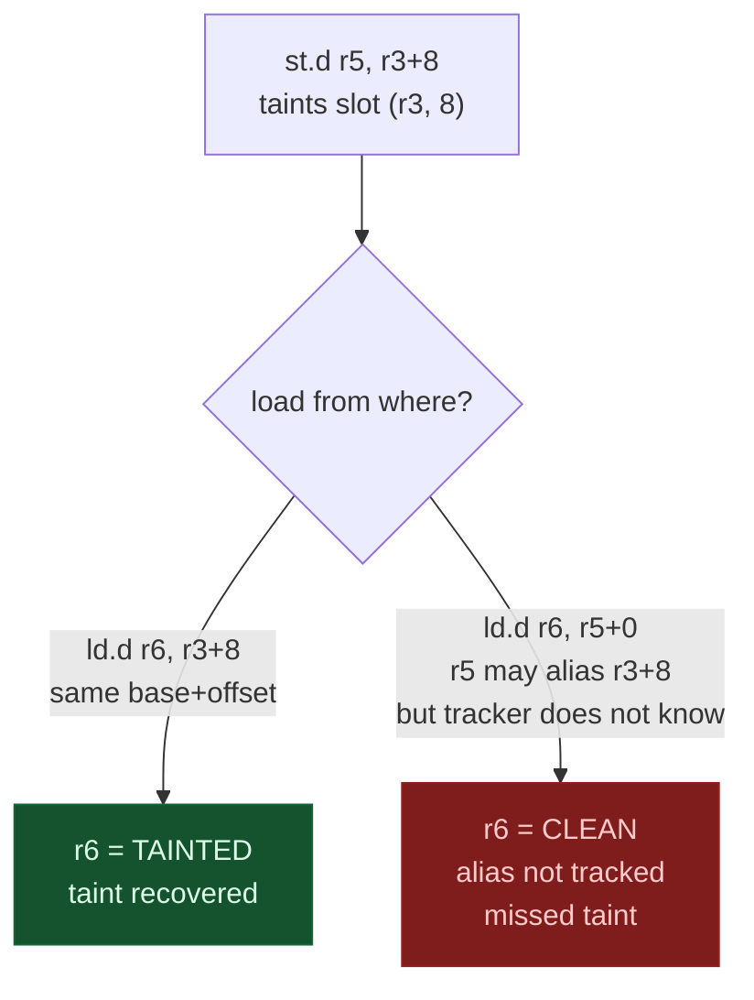

**Taint analysis vs symbolic execution.** Taint analysis answers whether attacker data can reach a sink. It does not answer whether the attacker can trigger that path or what value would be needed. `PathSolver` is symbolic execution: it assigns symbolic variables to source values, accumulates path constraints at each branch, and asks a constraint solver whether any concrete input satisfies all constraints. Taint produces candidates with false positives. PathSolver confirms one candidate with no false positives. PathSolver does not scale to a whole binary because branches multiply the paths that must be explored exponentially. The correct order is `TaintTracker.run_interprocedural()` on the whole binary to build the candidate list, then `PathSolver.solve_path()` on one candidate.

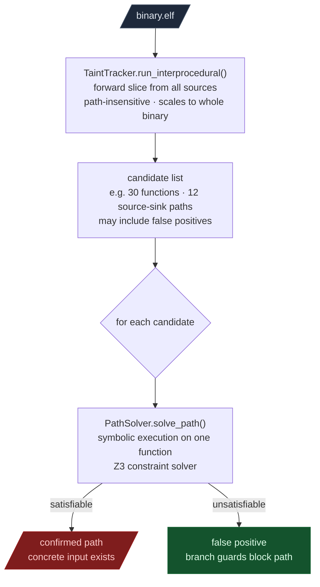

The x86 taint family includes intraprocedural and interprocedural modes, with a flow-sensitive CFG/MFP mode exposed by the CLI. Other ISA implementations have their own ABI assumptions, sink/source sets, and analysis limits. The CLI currently routes generic `taint` to ARM32 when detected and otherwise to its x86 tracker; other architectures have explicit commands. Always consult `ablation --help` and the command's implementation for routing and coverage.

## Cross-version diffing

Firmware vendors patch vulnerabilities without publishing diffs. The patched function moves to a new VA, loses its symbol, and may gain or lose basic blocks. Porting a name overlay or confirmed finding from build N to build N+1 requires matching functions by structure, not address.

Three tools answer three distinct questions. DTWMatcher answers whether two functions are from the same implementation era. MatrixProfileDiff identifies the most changed region when the answer is "patched." VersionDelta produces the unified diff and locates where the function moved.

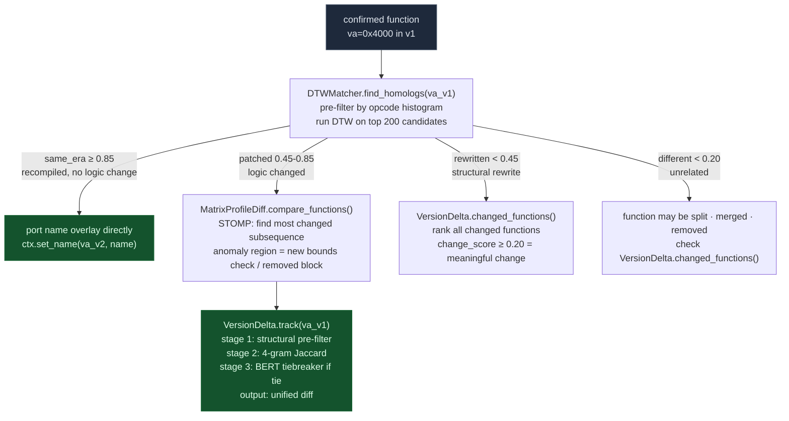

**DTWMatcher.** DTWMatcher uses Dynamic Time Warping over opcode category sequences. Opcode categories are a 12-bucket classification (DATA, ARITH, BIT, CMP, BRANCH, CALL, RET, FRAME, MEMOP, FLOAT, SIMD, OTHER) that normalizes away ISA-specific encoding differences. DTW is warp-invariant so it handles insertions and deletions of basic blocks that Jaccard penalizes unfairly. A function that gained one bounds-check block between firmware versions scores ~0.91 DTW versus ~0.65 4-gram Jaccard because DTW stretches the alignment to absorb the inserted block and scores the structural remainder as a match. The Sakoe-Chiba band (default 20% of sequence length) prevents pathological alignments where a 5-instruction stub matches a 200-instruction function.

`find_homologs()` pre-filters all functions in the target binary by opcode histogram L1 distance, then runs full DTW only on the top 200 candidates. Verdict thresholds are `same_era` (≥0.85), `patched` (0.45–0.85), `rewritten` (0.20–0.45), `different` (<0.20).

**VersionDelta.** VersionDelta localizes the change after a homolog is found. Stage 1 eliminates candidates whose basic block count or edge count differ by more than ±2 or ±30%. Stage 2 ranks survivors by mnemonic 4-gram Jaccard with addresses and immediates normalized to zero. Stage 3 applies SemanticSearcher BERT embeddings to break ties when the top two candidates are within 0.05 Jaccard. The output is a `difflib`-style unified diff with addresses and RIP-relative immediates stripped, so the diff shows only logic changes.

`changed_functions()` scores all functions between two builds and ranks by `change_score`. Functions with `change_score ≥ 0.20` had meaningful code changes, not just recompilation address shifts. This is the entry point for finding what a vendor actually fixed in a firmware update.

**MatrixProfileDiff.** When the change is a multi-instruction insertion or deletion, the inserted region appears as a subsequence in v2 with no close neighbor in v1. MatrixProfileDiff runs STOMP (O(n log n)) to find the region of T1 whose nearest match in T2 is most distant. That region is what changed. STOMP is better than VersionDelta's difflib output for inserted bounds checks (3–5 new instructions in a loop body) or removed authentication blocks.

**StructuralSim.** StructuralSim computes a five-signal composite score (opcode histogram, immediate value Jaccard, PLT overlap, branch density, size proximity) for cross-vendor comparison. Immediate value Jaccard is the key signal because struct field offsets, magic constants, and buffer sizes survive recompilation and optimization. A composite score ≥ 0.70 across two vendors' binaries predicts a shared codebase ancestor. When one vendor's version has a confirmed vulnerability, that score predicts whether the other vendor carries the same flaw.

## Additional analysis families

- **Version and structural comparison:** `VersionDelta`, `StructuralSim`, `DTWMatcher`, `MatrixProfileDiff`, and related modules are described in the Cross-version diffing section above. Similarity and diff outputs prioritize review; they do not independently prove shared vulnerable logic or a complete patch.
- **Crypto and firmware:** entropy mapping, XOR solving, crypto auditing, and firmware extraction helpers help identify regions and candidate key/format behavior. Entropy is a heuristic and cannot by itself distinguish encryption from compression or other high-entropy data.
- **Go binaries:** pclntab recovery, Go-specific string resolution, garble-oriented analysis, and subprocess scanning address Go runtime conventions. These are specialized heuristics and should be checked against binary/version details.
- **Kernel and memory-safety scanners:** driver/IOCTL, BYOVD, heap, format-string, integer-overflow, source/sink, and related modules look for selected patterns. Each scanner has a defined target/API surface; a clean result is not a general proof of safety.
- **Exports and integrations:** JSON and SARIF exporters support downstream review and code-scanning tools. The Binary Ninja plugin uses Ablation data and commands from inside that environment. Optional LLM analyst code is a separate integration path.

## Using Ablation with Codex

Codex can work with Ablation when it can access the checkout or an environment where the Ablation CLI is installed. The interaction is through ordinary shell commands and files: Codex runs a command, reads its output, and decides what evidence to inspect next. This checkout does not require a Codex-specific plugin or MCP server for that workflow.

From the repository environment, install the project into the Python environment used by the shell (or invoke its Python module in that environment):

```bash
python -m pip install -e .
ablation --help
```

Then give Codex the target binary path, the research question, and the relevant analysis boundary. A practical sequence is:

```bash
ablation analyze ./target.bin
ablation search ./target.bin "network-controlled length reaches an allocation or copy"
ablation profile ./target.bin 0xADDRESS
ablation cfg ./target.bin 0xADDRESS --insns
ablation taint ./target.bin
```

Use the architecture-specific commands when the generic `taint` route does not select the target ISA. For repeatable work, have Codex preserve exact commands, binary hashes, candidate addresses, and raw output in the user's research notes. Ask it to distinguish tool output from its own inference, then verify a candidate by tracing the relevant instructions, callers, guards, and input source. JSON/SARIF output can be useful where the corresponding command exposes those options; inspect the CLI help because export support differs by command.

Codex must run in an environment that can see both the executable and the binary. If the project is not installed, use the repository's virtual environment/Python interpreter or install from the checkout. A remote Codex session cannot use a binary that exists only on the user's workstation unless that binary is made available to the session. Do not assume that an LLM feature is active just because Codex is reasoning over CLI output; Codex's shell-driven analysis is distinct from Ablation's optional Anthropic `llm_analyst` package.

## Result quality and safe interpretation

Use Ablation to reduce search space and make evidence easier to inspect. For each candidate, establish:

1. The actual instruction and function boundaries around the reported address.
2. Whether attacker-controlled input can reach the relevant operation.
3. Whether bounds checks, sanitization, or error paths block the dangerous case.
4. Whether the called function uses the value as assumed.
5. Whether the path is reachable in the product configuration and has meaningful impact.

Static analysis can miss code, infer incorrect boundaries, and produce false positives or negatives. Confirm important claims with manual disassembly, dynamic experiments, or independent tooling as appropriate. Preserve uncertainty explicitly in reports.

## Documentation and implementation drift

Some existing docs contain aging examples or claims that no longer line up with the current code. Examples include stale command inventories, optimistic claims about semantic-search inputs, version summaries that stop at 2.5.0, and old contributor layout/API descriptions. The implementation and CLI parser are the source of truth for current command behavior. This page records the architecture and limitations visible in this checkout; it does not certify every old code comment, target-specific note, or third-party file in the working tree.

For installation and command examples see [Getting Started](getting-started.md). For the existing workflow and module guides see the [documentation index](INDEX.md). For changes by release see [CHANGELOG](CHANGELOG.md) and [updates](updates/).
