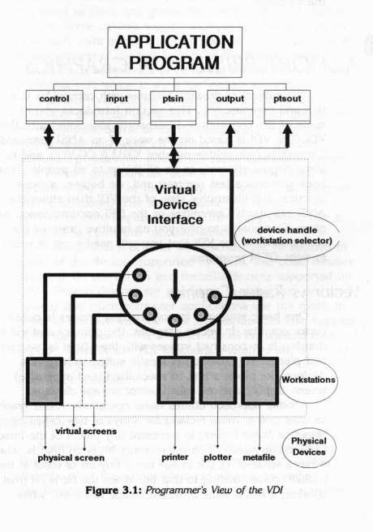

# GEM: executable Spatial IR for GUIAI

GEM is the geometric execution environment inside GUIAI Lab. It converts bounded JSON drawing programs into native Cairo/SVG previews and real signed little-endian GEM VDI metafiles, then evaluates spatial assertions directly against the geometry. GUIAI remains the investigation workbench: the tree, real agent terminal, selection, evidence states, and session history are unchanged.

The name refers to this project's **Geometric Environment Manager** and its GEM VDI output. It is not an emulator or a replacement for the original GEM desktop.

This guide documents the working implementation. For the complete GEM + Ablation + GUIAI idea set, research program, long-term architecture, and proposal status, see [GEM-VISION.md](GEM-VISION.md).

## Native Lab workflow

Open **Chart** and select **GEM** beside **Rings** and **Treemap**. The chart is derived from the same live investigation events as the other visualizations:

- Rectangles are Lab nodes; connectors join visible parents and children.
- Clicking a rectangle selects the real Lab node. Enter activates the selected node and Home selects the chart root.
- The caption reports source-constraint results. Failed objects receive dashed outlines and diagnostic tooltips.
- The layout displays at most 24 nodes through depth 3. Its title records when display limits omit nodes; omission is not analysis coverage.
- **Export GEM + VDI** writes a new run under `gem-runs/` in the current session, replays the files, and emits a stable `evidence:gem:DIGEST` node through the normal session protocol.

A successful evidence node is `complete_scoped` only for the stated source/VDI/device checks. It does not mean human confirmation, correct reverse engineering, or complete target coverage. Failed or constraint-free exports remain partial. Detailed agent attempts belong in `trajectory.jsonl`, not the high-level investigation history.

## Zoe and the native geometry atlas

Open **Chart → GEM → Zoe / MASTER GEM**, or run `gem zoe`, to enter the unified workspace. `gem master` and `gem brain` are compatibility aliases. Zoe adds deterministic BRAIN observation and recommendations, lazy HELEN predictions, exact toy multi-horizon continuations, and hash-checked research evidence to the native atlas. See [Zoe](docs/ZOE.md) for launch, evidence scope, and verification.

Run `gem atlas` to explore the native Procrustes, ellipse, parabola, circle, modular-clock, graph, accessible-volume, and onset-forecast modules directly. Procrustes landmarks support pointer dragging and keyboard movement; other modules expose their geometric parameters beside the Cairo view. **Export SVG**, **Export PNG**, and **Export GEM + VDI** all use the current Spatial IR scene.

Headless defaults are also available, for example `gem atlas --module procrustes --output atlas.svg` and `gem atlas --module onset --output onset.gem`. The Onset experiment requires NumPy and scikit-learn; other atlas modules do not require scikit-learn. See [Geometry Atlas](docs/GEOMETRY-ATLAS.md) for controls, equations, measured baselines, dependencies, and validation commands.

## CLI

After installing `guiai-lab`, the `gem` command is available. `python3 -m guiai.gem` is equivalent when running from a source checkout with `guiai-lab` on `PYTHONPATH`.

Export and verify the built-in house example:

```bash
gem demo --output runs/house
gem replay runs/house
```

Verify JSON and its VDI roundtrip, or render an individual artifact:

```bash
gem verify runs/house/scene.json --vdi
gem render runs/house/scene.json --output house.svg
gem render runs/house/scene.json --output house.png
gem render runs/house/scene.json --output house.gem
```

SVG and VDI use the Python standard library. PNG and the native chart require the existing optional Cairo/GTK bindings; the core engine does not import GTK. A missing PNG backend produces an error rather than silently substituting another renderer.

Generate and repair a scene with an installed external agent:

```bash
gem solve 'Draw a house with a touching roof, a contained door, and symmetric windows.' \
  --agent-command 'kimi -p {prompt}' \
  --attempts 3 --timeout 120 --output runs/agent-house
```

Kimi Pro supplies the account and inference; GEM supplies the bounded prompt, process management, and deterministic verifier. No credentials are bundled. `{prompt}` is replaced as an argument without invoking a shell. If the placeholder is omitted, the prompt is sent on standard input. Each process has a timeout, runs in its own process group, and is killed as a group on timeout. Prompts and output are size-bounded. The response must be one Spatial IR document, optionally fenced as JSON; validation diagnostics are included in the next repair prompt. Tests use a local fake agent and do not require live inference.

`--constraints required.json` supplies a JSON array of constraints the agent must preserve. A final export can fail even when source geometry passes if VDI recovery or a device invariant fails; its reports and trajectory are retained.

## Accessible volume and momentum

`gem volume` measures the shape of a full next-token probability distribution:

\[
A_\tau(S)=\sum_{a\in\mathcal O}\mathbf 1[P(a\mid h_T(S))>\tau]
\]

It also computes the complement \(|\mathcal O|-A_\tau(S)\), top candidate token IDs, source and probability-value hashes, a UTC observation timestamp, and monotonic elapsed time. The NPZ input must contain a finite, nonnegative, nonempty probability vector that sums to one within \(10^{-8}\). The default key is `probabilities`; use `--key` for another array name.

```bash
gem volume current.npz --output volume.json
gem volume current.npz --previous earlier.npz --tau 0.05 --output momentum.json
```

When `--previous` is present, GEM also computes **Accessible Momentum**:

\[
M_\tau(t)=A_\tau(S_t)-A_\tau(S_{t-1})
\]

Positive momentum means the forecast broadened; negative momentum means it narrowed. `--previous-key` selects the earlier array independently of `--key`. `--min-volume` and `--max-volume` define a target band. The report can suggest broadening context, narrowing context, letting the current trend continue, or continuing within the band. These are experimental recommendations, not automatic actions or evidence of correctness.

`VolumeBridge` provides the same bidirectional flow in Python: each `observe` call measures the present distribution and compares it with the previous one. Forward measurement and backward feedback form a loop, not an algebraic inverse. Accessible and complementary volumes sum to the vocabulary size; forward and reverse momentum sum to zero.



The VDI figure is an architectural analogy only. It is not evidence of model behavior. Interactive text-only agent CLIs still cannot supply the required distributions; a compatible model or a saved full-vocabulary artifact is required.

## Spatial IR

Schema version 1 supports `rectangle`, `polygon`, `polyline`, `line`, `ellipse`, and `text`. A minimal scene is:

```json
{
  "schema_version": 1,
  "id": "example",
  "canvas": {"width": 10000, "height": 6000},
  "objects": [
    {"id": "body", "type": "rectangle", "bounds": [2000, 2000, 8000, 5000], "fill": "white", "stroke": "black", "width": 20},
    {"id": "door", "type": "rectangle", "bounds": [4500, 3500, 5500, 5000], "fill": "yellow", "stroke": "black", "width": 20}
  ],
  "constraints": [
    {"type": "contains", "outer": "body", "inner": "door"},
    {"type": "inside_canvas", "object": "*"}
  ]
}
```

Coordinates are finite numbers within the signed VDI coordinate range. Object count, total points, constraints, identifiers, labels, prompts, JSON size, and agent responses have explicit limits. Unknown fields, object types, constraints, and references are rejected.

Available assertions:

- `contains`: inner axis-aligned bounds are within outer bounds.
- `touches`: axis-aligned bounding-box boundaries make contact within tolerance.
- `symmetric`: two centers are mirrored around an x/y value and both bounding-box dimensions match. Coincident equal objects satisfy this predicate; use `nonoverlap` separately when required.
- `aligned`: named bounds or center coordinates match.
- `inside_canvas`: one object or `*` has bounds inside the canvas.
- `nonoverlap`: positive-area bounding-box intersections are rejected; touching edges are allowed.
- `connected`: a line endpoint matches a named object anchor.

`contains`, `touches`, `symmetric`, `aligned`, and `nonoverlap` deliberately use axis-aligned bounds, not general computational-geometry proofs. Text bounds estimate width as `0.62 × size × character count`. Default tolerance is one thousandth of the smaller canvas dimension; a constraint can specify a nonnegative `epsilon`. “Verified” means direct deterministic numeric checks without an LLM image judge, not a proof of arbitrary shape semantics or visual quality.

## VDI and replayable runs

The writer emits actual VDI records, including `v_pline`, `v_gtext`, `v_fillarea`, `v_bar`, `v_rbox`, `v_ellipse`, `vst_height`, and drawing attributes. User-defined metadata records preserve object IDs and Lab roles for roundtrip recovery. Text uses CP437 with replacement for unrepresentable characters, and the classic VDI color palette is narrower than Cairo's RGB support. Arbitrary third-party metafiles and the full VDI API are outside this first version.

A successful run contains:

```text
scene.json                 Source Spatial IR
scene.gem                  Source-coordinate VDI metafile
scene-cga.gem              320 × 200 variant
scene-vga.gem              640 × 480 variant
scene-ndc.gem              32767 × 32767 variant
preview.svg                Inspectable vector preview
source-report.json         Source geometry results
vdi-report.json            Recovered-VDI geometry results
device-report.json         Per-device source/VDI and identity invariants
trajectory.jsonl           Export or generate/verify/repair records
run.json                   Scene identity, scope, and artifact SHA256 hashes
```

Replay validates artifact hashes, regenerates the device files, reconstructs scenes from VDI, recomputes every constraint, and compares the results with the recorded reports. It does not trust the manifest's `passed` flag. Existing nonempty run directories are not overwritten by default.

## Scope and related work

Geometric validation and vector-program generation have prior art, including GeoSVG-RL, SGP-GenBench, GeoGramBench, VGBench, and CADCodeVerify. This implementation does not claim those ideas are new. Its specific integration is native agent-generated GUIAI visualization, source and VDI-roundtrip checks, cross-device invariants, and evidence-linked agent trajectories in one Lab workflow.

## Validation

```bash
python3 stress/gem_stress.py
PYTHON=/usr/bin/python3 stress/nested_x11.sh /usr/bin/python3 stress/gem_stress.py
PYTHON=/usr/bin/python3 stress/nested_x11.sh /usr/bin/python3 stress/gtk_stress.py GtkCase.test_gem_shared_selection_export_and_evidence
```

The focused suite covers successful and failing constraints, malformed input, long Lab identifiers, VDI corruption, source/device roundtrips, replay tamper detection, real Cairo output, prompt delivery, fake-agent repair, timeouts, CLI calls, native hit-testing, and evidence export. Use the nested X11 launcher for isolated widget tests; it does not certify host graphics hardware or every external VDI consumer.
