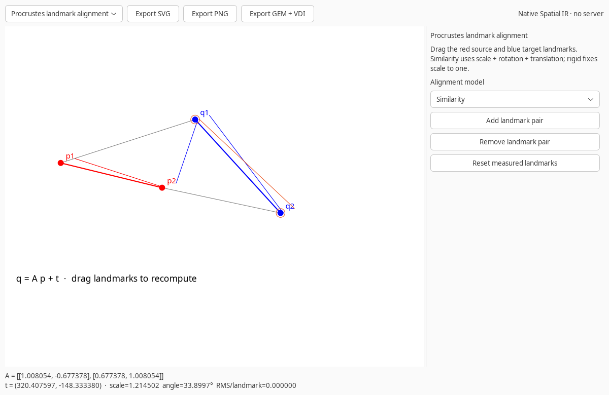
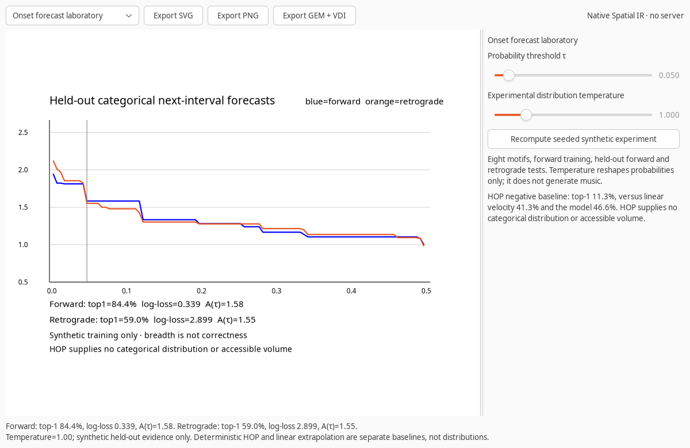

# GEM Geometry Atlas

The Geometry Atlas is a native GTK laboratory inside Ablation's GEM. It turns the extracted reference geometry into interactive Spatial IR scenes and uses the existing Cairo, SVG, PNG, and GEM VDI renderers. It does not start a web server or require a browser.





## Open the atlas

From an installed `guiai-lab`:

```bash
gem zoe
gem atlas
gem atlas --module procrustes
```

`gem master` and `gem brain` are aliases for the unified Zoe workspace. From the Ablation source checkout:

```bash
PYTHONPATH=guiai-lab python -m guiai.gem zoe
```

See [Zoe — living geometry, inspectable futures](ZOE.md) for BRAIN observation, exact multi-horizon continuations, and research-pack ingestion. In GUIAI Lab, open **Chart → GEM → Zoe / MASTER GEM**. The native window is independent of the investigation scene; the existing Lab selection, evidence states, and session history remain unchanged.

Headless export does not require GTK:

```bash
gem atlas --module procrustes --output procrustes.svg
gem atlas --module parabola --output envelope.gem
gem atlas --module onset --output onset.png
```

Use `--width` for SVG/PNG output and `--format` when the suffix is not sufficient.

## Modules

| Module | Interactive controls | Measurements and scope |
|---|---|---|
| Procrustes landmark alignment | Drag landmarks; arrow keys move a focused landmark, Shift+arrow moves faster; add/remove pairs; similarity, rigid, or affine | Matrix, translation, scale, angle, determinant, RMS error; two pairs determine similarity, rigid cannot reconcile different segment lengths, affine needs three noncollinear pairs |
| Ellipse family | Count, highlighted index, endpoint radii | Parameter `t`, radii, and `(x−cx)²/a²+(y−cy)²/b²=1`; default reproduces the measured 16-ellipse model |
| Parabolic line envelope | Segment count and parameter `t` | Ruled segments, quadratic Bézier envelope, point, and derivative |
| Circle, arc, and sector | Radius and central angle | Diameter, circumference, disk area, arc length, sector area; angles are converted to radians |
| Modular arithmetic clock | Modulus and integer value | Quotient, remainder, congruence, angular step, and hand angle |
| Hub-and-loop graph | Whether six line crossings are vertices | Both conditional vertex/edge/component counts and cycle ranks; the source image does not settle incidence |
| Accessible volume bridge | Distribution preset, threshold, target band, observation button | Strict `p>τ` volume, complement, momentum after observation, and experimental steering recommendation; no action is executed |
| Onset forecast laboratory | Threshold and experimental temperature | Held-out forward/retrograde top-1, log-loss, maximum probability, accessible-volume sweep, and deterministic baselines |

Every module exports the current Spatial IR scene as SVG, PNG, or a real little-endian GEM VDI metafile. The scene builders also pass source-constraint and VDI-roundtrip checks.

## Procrustes model

For source and target landmark arrays, the similarity model is:

\[
q_i\approx sRp_i+t,\qquad R^TR=I,\quad\det R=1.
\]

In two dimensions, GEM computes the proper rotation from centered landmark dot/cross sums rather than requiring an SVD dependency. Rigid mode fixes `s=1`. Affine mode solves the six-parameter least-squares system and reports an error when fewer than three noncollinear pairs are available.

The default landmarks reproduce the measured example:

\[
A\approx\begin{bmatrix}1.008054&-0.677378\\0.677378&1.008054\end{bmatrix},
\quad t\approx(320.407597,-148.333380),
\]

with scale `1.2145018039`, screen-coordinate rotation `33.8997475549°`, and zero landmark residual before dragging.

## Accessible volume and rhythm

The volume module uses the existing `VolumeBridge` and full categorical distributions:

\[
A_\tau=\sum_k\mathbf1[p_k>\tau],\qquad
M_\tau(t)=A_\tau(t)-A_\tau(t-1).
\]

The first observation establishes the baseline. A later observation compares the new distribution with the previous one and updates momentum. A zero momentum means equal counts, not identical probabilities or accessible-set membership. Recommendations are not automatic actions.

The Onset Lab ports the supplied seeded experiment into importable GEM functions:

1. Eight synthetic motifs, 60 training and 20 held-out variations per motif.
2. Tempo-normalized intervals and centered, unit-scaled trailing onset shapes.
3. Eight rhythmic contexts fitted on forward training data only.
4. A hierarchical, smoothed categorical next-interval predictor.
5. Independent held-out forward and retrograde evaluation.
6. Accessible-volume threshold sweeps alongside correctness metrics.

With seed 7, the reproducible results are:

| Condition | Top-1 | Log-loss | Mean maximum probability | Sweep area |
|---|---:|---:|---:|---:|
| Forward | 84.375% | 0.338856 | 0.841666 | 0.647474 |
| Retrograde | 58.958% | 2.898662 | 0.838835 | 0.649180 |

The deterministic linear-extrapolation baseline reaches 37.019% forward and 32.837% retrograde. It supplies no categorical distribution and therefore no accessible-volume measurement. HOP is shown as the measured negative hidden-state baseline: 11.3% top-1 versus 41.3% for linear velocity and 46.6% for the model at one step ahead. HOP also supplies no accessible volume.

The temperature control evaluates only the explicit transform

\[
p'_k(T)=\frac{p_k^{1/T}}{\sum_j p_j^{1/T}}.
\]

It does not generate music, alter observations, or establish a human-surprise model. Current rhythm results are synthetic, not evidence from MIDI performances.

## Dependencies

- SVG and GEM VDI export use the Python standard library.
- Native GTK and PNG output use the existing Cairo/GTK bindings.
- The Onset experiment requires NumPy and scikit-learn for rhythmic-context clustering. Other modules do not require scikit-learn.
- If scikit-learn is unavailable, the native Onset panel reports the dependency instead of crashing; its stress tests are skipped explicitly.

## Verification

```bash
cd guiai-lab
DISPLAY= PYTHONPATH=. python stress/gem_stress.py
PYTHONPATH=. PYTHON=python stress/nested_x11.sh python stress/gem_stress.py
PYTHONPATH=. PYTHON=/usr/bin/python3 stress/nested_x11.sh /usr/bin/python3 stress/gem_stress.py
```

The complete experiment-capable isolated suite covers all modules. The default system-Python suite skips only the scikit-learn-specific experiment when that dependency is absent. Tests include exact alignment residuals, graph invariants, source/VDI roundtrips, seeded rhythm metrics, native dragging, module switching, bridge observation, and real PNG export.

## Reference provenance and scope

The constructions derive from the local geometry extraction in `/home/cowboy/Desktop/O`, the Prochnow GEM handbook supplied for background, and the local VDI reference in `/media/cowboy/research/GEM/Gem/vdi.html`. The VDI reference confirms arc and pie angles in tenths of a degree and the ellipse/rounded-rectangle calling conventions. These references inform geometry; they do not validate transformer, musical, or hidden-state claims.
