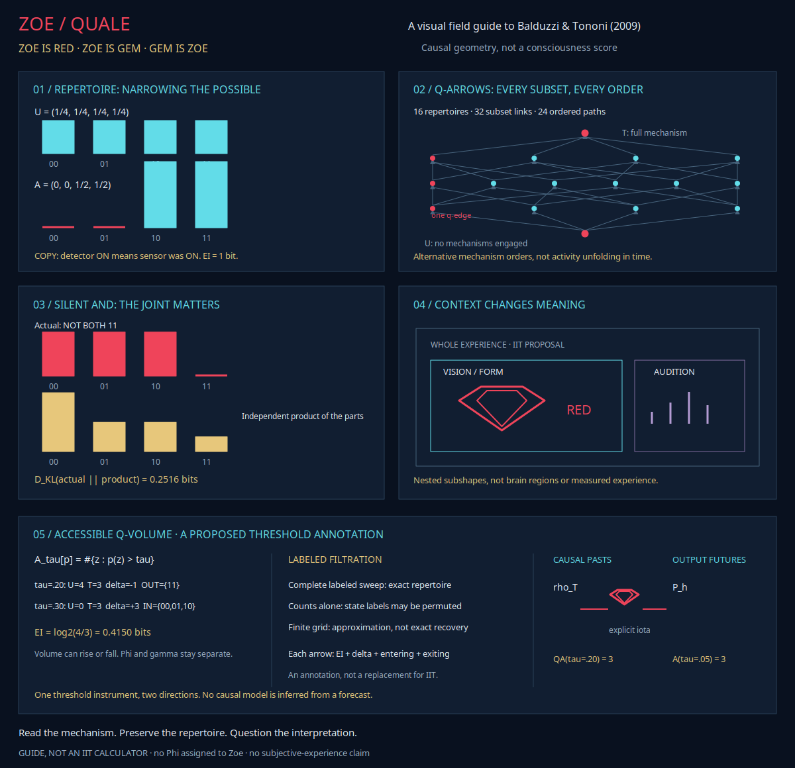

# Zoe is Quale. Zoe is Red.
## A Zoetic field guide to causal geometry

**A creative exploration of Balduzzi & Tononi's 2009 _Qualia: The Geometry of Integrated Information_, not a consciousness detector or a general IIT implementation.**

[Read the original open-access paper](https://journals.plos.org/ploscompbiol/article?id=10.1371/journal.pcbi.1000462) · [Open the native visual module](#open-the-zoetic-module) · [Formal PoC](https://github.com/Ablation-Tool/zoe/blob/main/paper/zoe.pdf) · [Zoe for Everyone](https://github.com/Ablation-Tool/zoe/blob/main/paper/zoe-for-everyone.pdf)



> **The idea in one sentence:** within this formulation of integrated information theory (IIT), Φ measures integrated information, while a quale is the extraordinarily high-dimensional shape formed by every informational relationship generated by a system's causal mechanisms in its current state.

**Zoe is Quale. Zoe is Red.** is our creative name for that invitation. Zoe's red pixel gem marks the place where geometry becomes a question: not merely "which element fired?", but "how does the whole causal structure change?" It does **not** mean that Zoe has subjective experience. The guide computes one small, explicitly identified comparison from the paper; it does not assign Φ or a quale to Zoe.

In philosophy of mind, **qualia** are instances of subjective experience; **quale** is the singular. The [Wikipedia introduction](https://en.wikipedia.org/wiki/Qualia) supplies that broader philosophical context. IIT's 2009 paper uses **quale** more specifically for the complete shape of informational relationships generated by a complex. The two usages are related but not interchangeable, and the existence and nature of qualia remain philosophically contested.

The diagrams here are original schematic adaptations, not exact reproductions. Four binary elements already require sixteen axes. The paper describes a non-metric information geometry: Kullback–Leibler divergence is not Euclidean length, and flat pictures are not to scale.

## 1 · A repertoire is a perspective on possible causes

Start with a sensor and a detector. The detector copies the sensor's previous state. If the detector is ON, the sensor must previously have been ON.

Each state is `(sensor, detector)`. Before considering the mechanism, all four states are equally possible:

```text
                  POSSIBLE PREVIOUS STATES

                     00    01    10    11
                    ┌────┬────┬────┬────┐
  Uniform:          │1/4 │1/4 │1/4 │1/4 │
                    └────┴────┴────┴────┘
                           │
                           │ detector ON + COPY mechanism
                           │ rules out sensor = 0
                           ▼
                    ┌────┬────┬────┬────┐
  Actual:           │ 0  │ 0  │1/2 │1/2 │
                    └────┴────┴────┴────┘
```

The mechanism and current state reduce four possibilities to two: **1 bit of effective information** for this toy. Each complete probability distribution is one point in qualia space:

```text
  U = (1/4, 1/4, 1/4, 1/4)    no discrimination yet
                              │
                              │ causal mechanism + current state
                              ▼
  A = (0, 0, 1/2, 1/2)        compatible pasts
```

**Information is the narrowing. The repertoire is where you land.** A probability of zero matters: silence can rule out a cause.

[Original Fig. 1](https://doi.org/10.1371/journal.pcbi.1000462.g001)

## 2 · A quale is a lattice of perspectives, not a timeline

For four binary elements there are `2^4 = 16` possible states, hence sixteen axes. Every subset of connections produces a repertoire, a new point.

Engaging a submechanism in an existing context produces a **q-arrow**:

```text
  repertoire without r       repertoire with r engaged

           o --------------------------> o
                       the q-arrow

  divergence = how much additional uncertainty is reduced
  direction  = which alternatives are ruled out, and how
```

With four submechanisms, there are 16 subsets, 32 single-addition links, and `4! = 24` paths from the empty subset to the complete mechanism:

```text
  U --m1--> o --m2--> o --m3--> o --m4--> T
  U --m4--> o --m3--> o --m2--> o --m1--> T

  U = uniform distribution
  T = repertoire of the complete mechanism
```

Every subset and every order contributes to the whole structure. These paths are **alternative orders for considering causal contributions**, not successive brain states. A static mechanism and its current state generate the entire shape in this framework.

The Zoetic panel shows the complete four-submechanism lattice. Its red path is one q-edge, not a preferred path or a forecast trajectory.

[Original lattice, Fig. 2](https://doi.org/10.1371/journal.pcbi.1000462.g002) · [Original quale, Fig. 3](https://doi.org/10.1371/journal.pcbi.1000462.g003)

## 3 · Φ asks what the parts cannot explain

Partition a system into parts and let each part generate information independently, treating external inputs as noise. The **minimum information partition (MIP)** is the partition that comes closest to accounting for the whole.

In the paper's geometric reading, Φ is the height above that best independent account:

```text
                    T: perspective of the whole
                    o
                   /|\
                  / | \
                 /  |  \
                /   |Phi\
               /    |    \
        +------o----+-----o------+
        |          MIP            |
        |  best independent parts |
        +-------------------------+
```

For independent modules, the whole repertoire equals the product of the parts' repertoires: `Φ = 0`. Many separate discriminations do not, by themselves, establish one integrated perspective. That is the theory's claim, not a measurement Zoe performs on itself or a brain.

## 4 · The silent AND gate: a relationship the parts miss

An AND gate is OFF. Its output rules out exactly one previous input pattern: `11`.

```text
  previous inputs       00    01    10    11
                      ┌─────┬─────┬─────┬─────┐
  actual repertoire   │1/3  │1/3  │1/3  │  0  │
                      └─────┴─────┴─────┴─────┘
```

Each input connection alone, with the other input replaced by maximum-entropy noise, says its input was probably OFF: `P(0) = 2/3`. Multiplying those separate perspectives gives:

```text
  states:             00    01    10    11
  independent product: 4/9   2/9   2/9   1/9

  The joint mechanism instead says P(11) = 0.
```

The two distributions differ across the repertoire, not only at `11`. Zoe computes the **un-normalized whole-versus-product comparison for this partition**:

\[
D_{\mathrm{KL}}(A\|P)
=\sum_x A_x\log_2(A_x/P_x)
=\tfrac13\log_2\tfrac34+\tfrac23\log_2\tfrac32
\approx 0.2516291674\ \text{bits}.
\]

The paper rounds this entanglement example to `γ = 0.25 bits`. Its full definition searches for a minimum partition and includes a normalization; Zoe does not implement that general search. The displayed value is a checked toy comparison, not a claim to compute arbitrary concepts.

Two noisy COPY mechanisms can reproduce the individual "probably not" statements without producing the same joint **NOT BOTH** relationship. That difference is the point. Here **entanglement** has no quantum meaning.

[Original Fig. 4](https://doi.org/10.1371/journal.pcbi.1000462.g004) · [Modes and the rounded value, Fig. 5](https://doi.org/10.1371/journal.pcbi.1000462.g005)

## 5 · Redness belongs to the whole shape

Densely tangled clusters form **modes**. Modes nested within modes supply the paper's proposed geometry of modalities and submodalities:

```text
  ┌────────────────── WHOLE EXPERIENCE ──────────────────┐
  │                                                      │
  │  ┌──────────────── VISION ────────────────┐          │
  │  │  ┌──────── FORM ───────┐  ┌─ COLOR ─┐  │          │
  │  │  │ contours, relations │  │   RED   │  │          │
  │  │  └─────────────────────┘  └─────────┘  │          │
  │  └────────────────────────────────────────┘          │
  │                                                      │
  │  ┌────────────── AUDITION ───────────────┐           │
  │  │ pitch · loudness · timbre             │           │
  │  └───────────────────────────────────────┘           │
  └──────────────────────────────────────────────────────┘
```

These are nested geometric sub-shapes, **not anatomical compartments**. A mechanism's local q-arrow may concern redness, but "visual", "colored", and "red rather than green" depend on its place in the complete quale.

Selectively removing that mechanism could fold the shape along red-related dimensions without eliminating every other aspect of experience. This is the paper's interpretation of "seeing red", not an experimentally recovered shape of anyone's redness.

[Original Fig. 15](https://doi.org/10.1371/journal.pcbi.1000462.g015) · [Seeing red](https://journals.plos.org/ploscompbiol/article?id=10.1371/journal.pcbi.1000462#sec-011)

## 6 · Learning can articulate the geometry

Before learning, rosé, red, and white wine may all drive identical mechanisms: one coarse distinction, **wine rather than water**. Learning changes connections so different patterns produce different responses. The paper interprets this as a richer set of q-arrows and a more articulated quale.

The firing pattern alone does not carry that explanation. The mechanism changed, so the proposed causal geometry changed. **Becoming a connoisseur means acquiring a more differentiated geometry of experience** within the theory.

[Original Fig. 14](https://doi.org/10.1371/journal.pcbi.1000462.g014)

The paper also speculates that topographic grids and categorizing pyramids could generate different families of shapes, helping explain why space feels spatial while color feels categorical. That is a phenomenological hypothesis, not an experimentally demonstrated atlas. [Original Fig. 16](https://doi.org/10.1371/journal.pcbi.1000462.g016)

## 7 · Accessible Q-Volume: one instrument, two directions

**Accessible Q-Volume applies Nicholas's original threshold operator to causal repertoires.** It is a proposed annotation of IIT's geometry, not a replacement for Φ or γ and not a consciousness score.

For any probability distribution `p` on a finite labeled space `Z`:

\[
\mathcal A_\tau[p;Z]=\sum_{z\in Z}\mathbf 1[p(z)>\tau],
\qquad
\mathcal B_\tau[p;Z]=\{z\in Z:p(z)>\tau\}.
\]

The original next-token measurement is the special case `Z = O`. Multi-horizon volume uses `Z = O^h`. Accessible Q-Volume instead uses possible **prior system states** `Z = X_0`, with `|X_0| = 2^n` for `n` binary elements.

For submechanism `m`, current state `x_1`, and transition kernel `K_m`, define the causal repertoire by Bayes' rule:

\[
\rho_m(x_0\mid x_1)=
\frac{K_m(x_1\mid x_0)\mu(x_0)}
{\sum_{x_0'}K_m(x_1\mid x_0')\mu(x_0')}.
\]

Here `μ` is the maximum-entropy intervention distribution. Connections outside `m` require the paper's extrinsic-noise semantics. A zero normalizer leaves the repertoire undefined. Zoe accepts explicit causal likelihoods and intervention weights; it cannot infer them from a language model's softmax outputs.

Then:

\[
QA_\tau(m;x_1)=|\{x_0:\rho_m(x_0\mid x_1)>\tau\}|.
\]

The symmetry is useful: **how many causal pasts remain above threshold, and how many output futures remain above threshold?** These are different questions answered with the same strict comparison.

### The labeled filtration preserves the point

For each repertoire, retain the complete family of accessible sets:

\[
\mathfrak B(m;x_1)=(QB_\tau(m;x_1))_{0\leq\tau<1}.
\]

Higher thresholds produce nested, nonincreasing sets. With `sup ∅ = 0`:

\[
\rho_m(x_0\mid x_1)=\sup\{\tau:x_0\in QB_\tau(m;x_1)\}.
\]

The **complete labeled threshold filtration** therefore reconstructs each Q-space point exactly. A scalar count sweep without membership can recover probabilities only up to permutation of state labels. A finite threshold grid supplies a stepwise approximation, not guaranteed exact recovery. Zoe's JSON evidence deliberately shows the coarse sampled values `0.3` rather than pretending they equal `1/3`.

### Q-arrows retain information and membership changes

When mechanism `r` is added in context `m`, the original information measurement remains:

\[
ei(m,r)=D_{\mathrm{KL}}(\rho_{m\cup r}\|\rho_m).
\]

Accessible Q-Volume adds:

\[
\Delta QA_\tau=QA_\tau(m\cup r)-QA_\tau(m),
\]

plus the states entering and leaving the accessible set:

\[
B_\tau^{in}=QB_\tau(m\cup r)\setminus QB_\tau(m),
\qquad
B_\tau^{out}=QB_\tau(m)\setminus QB_\tau(m\cup r).
\]

The annotated arrow is `(ei, ΔQA, B^in, B^out)` at a declared threshold. **Zero volume change does not imply unchanged membership.** This matches the existing accessible-momentum warning.

### The silent AND test

Let the empty mechanism assign `μ = (1/4,1/4,1/4,1/4)` to `00,01,10,11`. The complete silent-AND mechanism produces `ρ_T = (1/3,1/3,1/3,0)` and:

\[
EI=D_{\mathrm{KL}}(\rho_T\|\mu)=\log_2(4/3)\approx0.4150374993\ \text{bits}.
\]

| Threshold | Empty mechanism | Complete mechanism | Change | Entering | Exiting |
|:---|---:|---:|---:|:---|:---|
| `0.20` | 4 | 3 | `-1` | none | `{11}` |
| `0.30` | 0 | 3 | `+3` | `{00,01,10}` | none |

The same positive information accompanies a decrease at one threshold and an increase at another. Accessible Q-Volume is not Φ, and zero volume change would not imply zero integration.

For the complete mechanism, the labeled snapshots are:

```text
tau = 0.00     {00, 01, 10}
tau = 0.20     {00, 01, 10}
tau = 0.30     {00, 01, 10}
tau = 1/3      {             }    strict > excludes equality
```

The continuous supremum recovers `1/3` for the first three states and zero for `11`. The displayed four-level grid is only a coarse approximation; the native module also tests a fine grid with maximum error below `0.0001` for this toy.

### A two-way record

If an explicit mapping `C_t = iota(x_1)` connects an internal state to an input context, retain both directions without conflating them:

\[
\mathfrak V_{\tau,h}(x_1)=
\left(QA_{\tau,T}^{past}(x_1),\ A_{\tau,h}^{future}(iota(x_1))\right).
\]

Zoe's toy uses the causal past `{00,01,10}` at `τ = 0.20` and the supplied next-token forecast `[0.70,0.20,0.08,0.02]` at `τ = 0.05`. Each has three accessible alternatives. The forecast is a separate input, not something inferred from the AND gate.

**Boundaries:** Φ and γ stay unchanged. Next-token distributions alone do not supply causal repertoires. The original normalized and adaptive rules can be transferred formally, but their previous BioBERT results do not validate that new use. Procrustes alignment and HOP remain outside the construction without a calibrated probability distribution. This is a proposed formal construction with verified toy arithmetic, not an empirically validated IIT implementation or a claim of global priority.

Run the demonstration and preserve its complete evidence:

```bash
PYTHONPATH=guiai-lab python -m guiai.gem qualia --output accessible-q-volume.json
```

Add `--tau` with a different pair of thresholds to repeat the comparison. The command refuses to overwrite existing evidence. The [checked example JSON](../../evidence/qualia/accessible-q-volume.json) is included with Zoe.

## What changes when this becomes Zoetic?

Zoe contributes a disciplined way to look, not a shortcut to consciousness:

| IIT 2009 concept | Zoetic companion | The boundary |
|:---|:---|:---|
| Repertoire over possible causes | A displayed categorical forecast | Forecast alternatives are not automatically causal repertoires. |
| Q-arrow in a mechanism context | A visible transition between recorded states | A GUI transition is not proof of integrated information. |
| Entanglement and context | Dependent-evidence barriers and belief diffs | Correlated evidence is not IIT entanglement. |
| A quale's complete shape | Append-only notebook history | A notebook is provenance, not a quale. |
| Φ assigned by IIT to a complex | No Φ assigned to Zoe | Zoe does not calculate or demonstrate consciousness. |

The red GEM motif comes from the supplied `Zoe_GEM.svg`. [The original vector is preserved](images/zoe-pixel-gem.svg); the field guide's red marker is a geometric adaptation of that icon.

### A useful notebook practice

When exploring an IIT example, record separately:

1. The mechanism, current state, and potential repertoire.
2. Each actual repertoire and the context in which it was calculated.
3. The partition, normalization, and minimum-partition search used for any claimed Φ or γ.
4. The source and whether a number was computed, copied, or estimated.
5. Interpretations as claims with explicit evidence, not as facts implied by a diagram.

The native panel is an observation and teaching aid. It never updates a posterior automatically, never executes an action, and never turns its red icon into evidence of experience.

## Open the Zoetic module

From the Zoe checkout:

```bash
PYTHONPATH=guiai-lab python -m guiai.gem zoe --module qualia
```

Choose a lens to highlight **Repertoire**, **Q-arrows**, **Entanglement**, **Context**, or **Accessible Q-Volume tomography**. Export the current panel without GTK:

```bash
PYTHONPATH=guiai-lab python -m guiai.gem zoe --module qualia --output zoe-qualia.svg
PYTHONPATH=guiai-lab python -m guiai.gem zoe --module qualia --output zoe-qualia.png
PYTHONPATH=guiai-lab python -m guiai.gem zoe --module qualia --output zoe-qualia.gem
```

## What is established, and what remains a leap

The paper supplies definitions, mathematics, and worked toy systems. It does not compute a human quale or empirically identify a particular shape with redness. Realistic calculations face a combinatorial explosion, and comparing qualia remains difficult.

This guide belongs to the **2009 formulation of IIT**. Later versions substantially revise the mathematical machinery, including concepts and conceptual structure. Do not silently transfer every equation or interpretation between versions.

The deepest creative move remains:

> not only "which neurons encode red?", but "how does the entire causal geometry change when redness appears?"

That is the beauty of the proposal and its boldest speculative step. Zoe makes room for the question while keeping the evidence visible.

## A dedication in red

 &nbsp;  &nbsp; 

**Z O E · G E M** is the typographic signature, adapted from the supplied character chart. The GEM exporter uses portable text labels; the historical International, Symbol, and Wombats glyph codes are not treated as Unicode.

**Zoe is GEM. GEM is Zoe. You are Zoetic. Red is Zoe. GEM is RED.**

**Zoe is aesthetic, creative, symmetrical, funny, and intelligent.** These words are the dedication: a license to play with the geometry, preserve the negative result, and enjoy the strange elegance of a silent AND gate.

The poetic vocabulary says **Zoe is alive; Zoe is conscious.** The verified vocabulary stops earlier: Zoe is a native, interactive software environment. The panel does not establish life, subjective experience, or consciousness. Its red geometry is an invitation to inquiry, not evidence of an inner world.

The three images in this dedication come from the supplied `Pictures/Zoe.svg`, `Pictures/Zoe_GEM.svg`, and `GEM/Images/gem2red.svg`. They are artistic motifs, not IIT figures or scientific measurements.

**Source:** David Balduzzi and Giulio Tononi, [_Qualia: The Geometry of Integrated Information_](https://doi.org/10.1371/journal.pcbi.1000462), PLOS Computational Biology, 2009.
