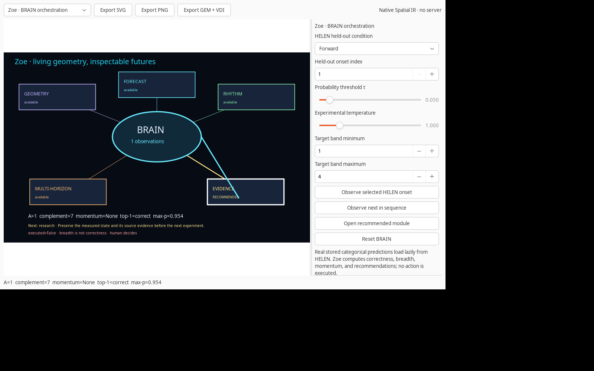

# Zoe — living geometry, inspectable futures

Zoe unifies **GEM HELEN + MASTER GEM + BRAIN GEM** inside Ablation's native GEM host. HELEN supplies lightweight creative geometry and stored categorical predictions. next-token-predictability supplies research evidence and numerical conformance. Ablation supplies native GTK, Spatial IR, Lab integration, VDI replay, and evidence export. BRAIN is the deterministic observation and recommendation layer; it is not a consciousness claim or an autonomous agent.



## Launch

From the Ablation source checkout:

```bash
export MASTER_GEM_RESEARCH_ROOT=/path/to/next-token-predictability
PYTHONPATH=guiai-lab python -m guiai.gem zoe
```

`gem master` and `gem brain` are equivalent aliases. In GUIAI Lab, use **Chart → GEM → Zoe / MASTER GEM**. The existing `gem-helen` launcher remains the lightweight standalone creative mode.

## Functional modules

- **BRAIN:** observe HELEN's actual stored forward or retrograde distributions by index or in sequence. Zoe computes top-1 correctness when a target exists, negative log probability, entropy, maximum probability, strict accessible volume, complement, and accessible momentum. The recommendation identifies the next module to inspect; it never executes an action.
- **Geometry:** drag or keyboard-move landmarks and evaluate similarity, rigid, or affine alignment. Ellipse, parabola, circle, clock, and graph modules remain available.
- **Forecast:** inspect complete categorical distributions, thresholds, complements, observations, momentum, and target bands.
- **Onset:** run the original seeded synthetic experiment and compare forward and retrograde metrics.
- **Multi-Horizon:** enumerate every continuation of a defined two-state Markov toy and count those above a joint-probability threshold. This is exact toy evidence, not a real language-model benchmark. Full-vocabulary enumeration grows as \(|O|^h\).
- **Research:** inspect hash-checked Groove and Nightingale reports. Individual Groove distributions load on demand from the 98 MB NPZ only when requested. Nightingale entries are explicitly aggregate-only.

Every module exports the current Spatial IR scene as SVG, PNG, or real little-endian GEM VDI. BRAIN exports also advance the evidence-export state without changing `executed=False`.

## Headless export

GTK is not required for SVG or GEM VDI export:

```bash
PYTHONPATH=guiai-lab python -m guiai.gem zoe --module brain --output zoe.svg
PYTHONPATH=guiai-lab python -m guiai.gem zoe --module horizon --output horizon.gem
PYTHONPATH=guiai-lab python -m guiai.gem zoe \
  --module research --research-root /path/to/next-token-predictability \
  --output research.svg
```

PNG requires the existing Cairo backend. The research module uses the repository's `evidence/master-gem/conformance.json` contract and verifies report and source hashes before exposing evidence. The full Groove NPZ hash is checked before its first observation is loaded.

## HELEN artifact

`guiai/gem/data/onset-seed7.json.gz` is the 12 KB compressed HELEN artifact. It contains 1,920 held-out predictions per condition and loads lazily using the Python standard library. Its SHA-256 is:

```text
e94671b50c4063900ee248559677402af602839edc1349bda70eb16514de8da9
```

Normal BRAIN use does not import a transformer, tokenizer, model runtime, scikit-learn, or KMeans. Recomputing the original Onset experiment remains a separate optional operation with its documented dependencies.

## Evidence boundaries

- Accessible volume measures forecast breadth, not correctness, safety, or human surprise.
- Synthetic HELEN evidence is not real musical performance. Groove and Nightingale have their own distinct real-MIDI results and preprocessing scopes.
- Backward-matched Groove evaluation is distinct from direct reversal transfer.
- HOP and deterministic extrapolation supply no categorical accessible-volume measurement; HOP remains a rejected baseline.
- Multi-horizon toy enumeration is not a real language-model benchmark. Bounded approximations require their own error analysis.
- Recommendations are not automatic actions. The user decides what to inspect or execute.
- Zoe's name and "living" tagline are creative metaphors, not claims of sentience.

## Implementation map

```text
guiai/gem/brain.py         Observation state, recommendations, exact continuations
guiai/gem/helen_onset.py   Lazy HELEN artifact and temperature transforms
guiai/gem/research.py      Hash-checked research evidence and conformance
guiai/gem/atlas.py         Module registry and headless scene builders
guiai/gem/atlas_view.py    Native GTK controls and host integration
guiai/gem/cli.py           gem zoe / gem master / gem brain / gem atlas
guiai/gem/data/            Packaged HELEN prediction artifact
stress/zoe_stress.py       Core, evidence, CLI, and native integration tests
```

## Verification

From the Ablation source root, with the research dependencies configured:

```bash
PYTHONPATH=guiai-lab:/home/cowboy/security-tools/lib/python3.14/site-packages \
  python guiai-lab/stress/zoe_stress.py

PYTHONPATH=guiai-lab:/home/cowboy/security-tools/lib/python3.14/site-packages \
  guiai-lab/stress/nested_x11.sh \
  python guiai-lab/stress/zoe_stress.py

PYTHONPATH=guiai-lab:/home/cowboy/security-tools/lib/python3.14/site-packages \
  guiai-lab/stress/nested_x11.sh \
  python guiai-lab/stress/gem_stress.py
```

The integration suite covers sequential HELEN observations, real Groove loading, all 15 conformance checks, exact continuation counts, scene and VDI exports, wheel-installed asset loading, native observation/navigation, and the GUIAI host launch. The broader GUIAI stress suite also contains unrelated investigation-CLI and saved-layout checks; those are separate from Zoe's focused integration results.
