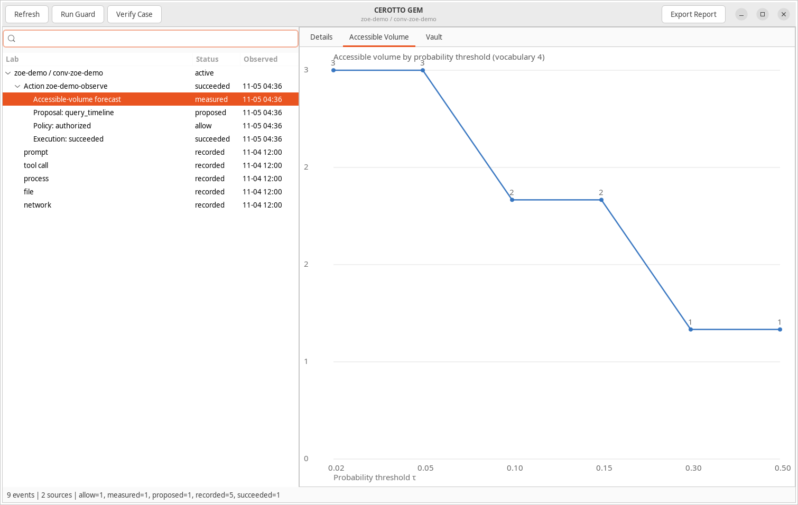

# CEROTTO

CEROTTO investigates attacks involving autonomous AI agents and sandbox escapes. It connects user requests, agent tool calls, model forecasts, operating-system activity, encrypted-vault events, and disk evidence. Incident responders can reconstruct what happened and verify conclusions against retained records.

CEROTTO GEM is the native graphical workbench. It is a desktop application built with GTK3, the Linux UI toolkit used by GNOME applications, not a web page. It shows investigation timelines, defense events, vault activity, and accessible-volume charts. It can also embed the user's own AI command-line agent in a terminal inside the window.

**Current version:** 0.6.0

**Primary question:** **What did the agent do on the computer?**

---

## Capabilities

<details>
<summary>Forensic Collection & Evidence</summary>

**Forensic collection and evidence handling**

The C11 core imports normalized agent telemetry and Linux audit records, reads disk images without mounting them, verifies EWF images before filesystem processing, carves files, and stores evidence in a versioned SQLite case database. Registered source and preserved-output files can be hash-checked on demand.

| Capability | Code | Description |
|:---|:---|:---|
| [Agent event ingestion](docs/capabilities.md) | [1](src/event.c)&nbsp;[2](src/main.c) | Imports arbitrary typed events from validated JSONL, including conversations, prompts, tool calls, processes, file events, and network events, with transactional rollback and optional standard input. |
| [Linux audit attribution](docs/capabilities.md) | [1](src/audit.c) | Correlates interleaved audit records into execution, file, and network events with PID, PPID, UID, executable, and syscall context where available. |
| [Raw disk timelines](docs/capabilities.md) | [1](src/collector_tsk.c) | Collects allocated and deleted filesystem records through The Sleuth Kit without mounting or modifying the image. |
| [Verified EWF collection](docs/capabilities.md) | [1](src/ewf.c) | Requires successful `ewfverify`, preserves `ewfinfo`, hashes EWF segments, and processes uppercase E01 evidence through The Sleuth Kit. |
| [Controlled carving](docs/capabilities.md) | [1](src/carve.c) | Runs Foremost or Scalpel, preserves logs, and catalogs recovered regular files with hashes, provenance, and post-collection count and size limits. |
| [Versioned evidence store](docs/capabilities.md) | [1](src/db.c) | Uses SQLite schema versioning, migrations, transactional writes, cases, sources, and normalized events. |
| [Deterministic timelines](docs/capabilities.md) | [1](src/timeline.c) | Selects conversation events plus events from associated hosts within an optional UTC range, returning process and parent-process fields where present. |
| [Case manifests](docs/capabilities.md) | [1](src/manifest.c) | Exports evidence paths, hashes, sizes, commands, tool versions, acquisition times, and collection status. |
| [Evidence verification](docs/capabilities.md) | [1](src/manifest.c) | Recomputes registered source and preserved-output hashes and reports passed, missing, or mismatched files. |
| [Artifact inspection](docs/capabilities.md) | [1](src/artifact.c) | Revalidates carved files before bounded hex or base64 JSON inspection without executing recovered content. |

</details>

<details>
<summary>Analysis & Reporting</summary>

**Analysis and reporting**

CEROTTO provides deterministic report generation and two bounded model-assisted analysis paths. The native analyzer sends metadata only. The Python investigator adds iterative evidence requests. Both validate event citations before accepting findings.

| Capability | Code | Description |
|:---|:---|:---|
| [Bounded native LLM analysis](docs/capabilities.md) | [1](src/analyze.c) | Sends at most 500 metadata-only events to an OpenAI-compatible endpoint with timeouts, response limits, and structured output requirements. |
| [Citation validation](docs/capabilities.md) | [1](src/analyze.c)&nbsp;[2](src/report.c) | Rejects invented event references, invalid finding schemas, and analysis whose evidence count does not match the report timeline. |
| [Portable investigation reports](docs/capabilities.md) | [1](src/report.c) | Produces JSON or escaped Markdown reports with manifests, timelines, observations, hypotheses, limitations, and review metadata. |
| [Human review metadata](docs/capabilities.md) | [1](src/report.c) | Records reviewer identity and decision as a human attestation, not a cryptographic signature. |
| [Bounded iterative investigation](investigation/README.md) | [1](investigation/engine.py)&nbsp;[2](investigation/adapter.py) | Lets a model request only scoped timeline, event, manifest, and verification evidence before submitting a cited report or an unfinished result. |
| [Model transport](investigation/README.md) | [1](investigation/transport.py) | Supports Anthropic SDK calls or a tool-disabled Claude CLI in an isolated temporary workspace. |

</details>

<details>
<summary>Encrypted Vault & Forensic Tripwire</summary>

**Encrypted vault and forensic tripwire**

A monitored directory can hold files encrypted in the native GEMSEAL format. A Linux inotify sensor records access and health events directly into the case. A release broker controls plaintext release with approval, denial, expiration, content hashes, and cleanup. Correlation adds independent process, agent, and network evidence where available.

| Capability | Code | Description |
|:---|:---|:---|
| [GEMSEAL version 1](docs/vault.md) | [1](src/gemseal.c)&nbsp;[2](src/crypto.c) | Implements native authenticated encryption with strict format validation and atomic no-overwrite publication. |
| [Vault sensor](docs/vault.md) | [1](src/vault_sensor.c) | Records recursive Linux inotify access, modification, movement, deletion, and health events directly into Cerotto cases. |
| [Vault evidence model](docs/vault.md) | [1](src/vault.c) | Preserves source details, watcher sessions, sequence numbers, host, boot and vault IDs, and separate observation and recording timestamps. |
| [Plaintext release broker](docs/vault.md) | [1](src/vault_release.c) | Supports approval, denial, required future expiration for releases, content hashes, residual-plaintext records, and checked cleanup. |
| [Vault timelines and custody exports](docs/vault.md) | [1](src/vault.c) | Produces vault timelines and reproducible payload and custody documents with retention metadata and payload hashes. |
| [Vault correlation](docs/vault.md) | [1](src/vault_correlate.c) | Searches bounded windows for independent process, agent tool-call, and network evidence with confidence labels and benign alternatives. |
| [Evidence-first response](docs/vault.md) | [1](src/vault_response.c) | Exports evidence before approved SIGSTOP and records a separate approved SIGCONT for an operator-supplied process ID. |
| [Vault case workbench](docs/vault.md) | [1](cerotto_gem/vault.py)&nbsp;[2](cerotto_gem/vault_view.py) | Shows vault contacts, modifications, releases, health alerts, attribution, consent, and response events in CEROTTO GEM. |

GEMSEAL is experimental and has not received an independent cryptographic review. For production confidentiality, use an audited format such as `age`. The sensor can monitor other encrypted formats, but the release broker currently decrypts only GEMSEAL version 1.

</details>

<details>
<summary>Deterministic Guard & Accessible Volume</summary>

**Deterministic guard and accessible volume**

The native `guard` command supports `query_timeline`, `get_event`, `get_manifest`, and `verify_case`. It validates the proposal schema, duplicate fields, arguments, expected case event count, forecast context hash, normalized distribution, existing output, and duplicate action IDs. Denied actions do not execute. Failed executions cannot produce success receipts.

Accessible volume describes the shape of a particular next-token forecast. It is an observational research measurement, not a maliciousness score, authorization rule, trained attack predictor, or measurement of the embedded agent unless that exact model supplied the distribution.

| Capability | Code | Description |
|:---|:---|:---|
| [Native guarded evidence actions](docs/capabilities.md) | [1](src/guard.c)&nbsp;[2](src/timeline.c)&nbsp;[3](src/manifest.c) | Validates and executes four bounded evidence actions inside a write transaction with stale-state and forecast-binding checks. |
| [Guard proposal provenance](docs/capabilities.md) | [1](src/guard.c) | Registers raw proposals as hashed sources and appends forecast, proposal, decision, and execution records, with duplicate-action rollback. |
| [Native accessible volume](docs/capabilities.md) | [1](src/forecast.c) | Measures up to 100,000 normalized probabilities with strict thresholds, entropy, maximum probability, top-ten mass, and packed-value SHA-256. |
| [Python accessible volume](docs/capabilities.md) | [1](investigation/forecast.py) | Supports up to 1,000,000 probabilities, 32 custom ordered thresholds, logits conversion, and document, probability, and token-ID hashes. |

</details>

<details>
<summary>CEROTTO GEM Workbench</summary>

**CEROTTO GEM native workbench**

CEROTTO GEM is the graphical front end. Its case model opens SQLite read-only and enables query-only mode. Guard actions, verification, and report generation call the native C binary with fixed arguments, timeouts, and bounded captured output.

| Capability | Code | Description |
|:---|:---|:---|
| [Read-only case model](docs/capabilities.md) | [1](cerotto_gem/model.py) | Loads case events and sources through a read-only SQLite connection with a configurable limit of at most 10,000 events. |
| [Investigation Lab](docs/capabilities.md) | [1](cerotto_gem/gui.py) | Groups guard chains, filters event text, and displays full defense-event details, hosts, types, statuses, and timestamps. |
| [Accessible-volume charts](docs/capabilities.md) | [1](cerotto_gem/chart.py) | Draws native Cairo threshold-sweep charts with text event details. |
| [Native command controls](docs/capabilities.md) | [1](cerotto_gem/commands.py) | Provides Run Guard, Verify Case, Refresh, and Export Report controls with cancellation and process-group cleanup. |
| [Optional agent terminal](docs/capabilities.md) | [1](cerotto_gem/agent.py) | Embeds the user's selected interactive agent through VTE with case environment variables and bounded shutdown. |
| [Isolated GUI self-tests](docs/capabilities.md) | [1](cerotto_gem/cli.py)&nbsp;[2](tests/test_gem_workbench.py) | Exercises real GTK rendering, charts, screenshots, and agent-process cleanup in isolated X11. |

Launch an existing case:

```bash
python3 -m cerotto_gem \
  --db case.db --case incident-7 --conversation conv-7
```

The equivalent launcher is `integration/cerotto-gem`.

The following real GTK screenshot shows a synthetic nine-event demonstration case and a successful guarded `query_timeline` action. The accessible-volume sweep is computed from the distribution `[0.70, 0.20, 0.08, 0.02]`, so three alternatives exceed `τ = 0.05`. No real incident data is shown.



Embed the user's actual interactive agent explicitly:

```bash
python3 -m cerotto_gem \
  --db case.db --case incident-7 --conversation conv-7 \
  --agent-command kimi --workspace /path/to/agent-workspace
```

The terminal receives `CEROTTO_DB`, `CEROTTO_CASE`, `CEROTTO_CONVERSATION`, `CEROTTO_BINARY`, and `CEROTTO_GEM=1`. It retains the agent's permissions and is explicitly unguarded. No model or credentials are installed or substituted.

</details>

<details>
<summary>Ablation + GEM Integration</summary>

**Ablation + GEM integration**

The optional Ablation + GEM bridge connects Cerotto to an external Graphics Environment Manager laboratory. It protects structured broker calls only. External agent proposals are supplied as JSON, and the harness does not autonomously generate them.

| Capability | Code | Description |
|:---|:---|:---|
| [Pinned ONNX forecasting](investigation/README.md) | [1](integration/ablation_gem_defense.py) | Implements DistilGPT2 ONNX forward passes with pinned model, tokenizer, and configuration hashes plus raw NPZ probability preservation. |
| [Guarded GEM execution](docs/capabilities.md) | [1](investigation/guard.py) | Binds forecasts to the exact target, selected event, revision, and structured proposal before allowing supported broker actions. |
| [Guard evidence chains](docs/capabilities.md) | [1](investigation/guard.py)&nbsp;[2](integration/ablation_gem_defense.py) | Produces forecast, proposal, decision, and execution records, with no execution receipt for denials and failed receipts for broker failures. |
| [GEM history export](docs/capabilities.md) | [1](investigation/gem_events.py)&nbsp;[2](integration/ablation_gem_defense.py) | Converts selected GEM JSONL ranges into Cerotto records with exclusive output and incremental source-line tracking. |

The bridge uses its own session and command broker. No GEMSEAL Python package is required at runtime. The bridge contains no unrestricted embedded terminal or arbitrary shell-command path. External model runtimes, the GEM laboratory, and any user-selected providers remain separate components with their own behavior and permissions.

</details>

<details>
<summary>Security Diagnostics</summary>

**Security diagnostics**

`cerotto crack` demonstrates weak manually derived keys:

```bash
build/cerotto crack wordlist --input container.gemseal \
  --wordlist words.txt --mode sha256

build/cerotto crack pin --input container.gemseal --digits 4

build/cerotto crack raw-prefix --input container.gemseal --variable-bytes 1
```

Supported candidate transforms are SHA-256, zero-padding, and exact raw 32-byte keys. Reports include tested and skipped candidates, elapsed time, candidates per second, and first-record authentication. `--output` additionally verifies the complete container after recovery.

PIN searches accept `--prefix` and `--suffix`. All searches accept `--candidate-limit N` to stop after a selected number of tested candidates. For example:

```bash
build/cerotto crack pin --input container.gemseal \
  --digits 6 --prefix ID --candidate-limit 10000
```

These are bounded tests of weak manually derived keys, not a generic ChaCha20 attack. Large PIN and raw-key spaces remain impractical without a small candidate limit.

</details>

## Setup & About

<details>
<summary>Quick Start</summary>

### Build and verify

Core requirements: C11 compiler, Make, Python 3, POSIX, Sleuth Kit, and `curl`. EWF collection additionally uses `ewfinfo` and `ewfverify`. Real-image tests use `mke2fs`, `debugfs`, and `ewfacquire`. Foremost and Scalpel supply the two carving backends.

CEROTTO GEM requires Python GI, GTK3, and Cairo. VTE 2.91 is optional for the agent terminal. GUI tests require Xephyr and `xwininfo`. The native vault uses Linux inotify. SQLite and cJSON are pinned in `vendor/`.

The Python investigator can use the `anthropic` package or a `claude` CLI. The optional ONNX bridge requires NumPy, ONNX Runtime, Tokenizers, pinned DistilGPT2 artifacts, and an external GEM laboratory.

```bash
make
make check
make sanitize
make check BUILD_DIR=build/sanitize
```

The executable is `build/cerotto`. Global native help is available through `build/cerotto --help`. Python entry points provide command-specific `--help`.

### Prepare agent JSONL

Each line must be one JSON object. Required fields are `id`, `observed_at`, `host_id`, `source_tool`, and `event_type`. Timestamps must be ISO-8601 UTC with at most six fractional digits. Recognized optional fields are `conversation_id`, `prompt_id`, `tool_call_id`, `process_id`, `parent_process_id`, `path`, `deleted`, and an object-valued `details` field.

```json
{"id":"evt-tool","observed_at":"2026-10-27T12:00:01Z","host_id":"agent-vm-1","source_tool":"agent_gateway","event_type":"tool_call","conversation_id":"conv-7","process_id":420,"details":{}}
```

Event types and source tools are not restricted to a fixed product list. Cerotto does not currently include direct importers for proprietary agent log formats. Convert those logs to this normalized schema first.

Both ingestion commands accept `--input -` for standard input. Standard-input sources have no origin file hash or size for later verification.

### Investigate a case

```bash
CEROTTO=build/cerotto

$CEROTTO init --db case.db
$CEROTTO ingest --db case.db --case incident-7 --input agent-events.jsonl
$CEROTTO ingest-audit --db case.db --case incident-7 \
  --input audit.log --host agent-vm-1

mkdir -p collected/incident-7
$CEROTTO collect-tsk --db case.db --case incident-7 \
  --image agent-disk.img --output collected/incident-7 --host agent-vm-1

$CEROTTO timeline --db case.db --case incident-7 --conversation conv-7 \
  --from 2026-10-27T11:59:00Z --to 2026-10-27T12:05:00Z
```

Carve and inspect recovered files:

```bash
$CEROTTO carve --db case.db --case incident-7 \
  --image evidence.img --output recovered --host agent-vm-1 --carver foremost

$CEROTTO artifact show --db case.db --case incident-7 \
  --source-id ARTIFACT_ID --format hex --max-bytes 8192
```

Verify evidence and export an unreviewed report:

```bash
$CEROTTO manifest --db case.db --case incident-7 --output manifest.json
$CEROTTO verify --db case.db --case incident-7

$CEROTTO report --db case.db --case incident-7 --conversation conv-7 \
  --format markdown --output report.md --review-status unreviewed
```

Reports also accept `--host`, `--from`, `--to`, `--limit`, and `--include-details`. A reviewed, approved, or rejected report requires `--reviewer` and should reflect an actual human decision.

### Create and monitor a vault

Create the external key and release directories first. Keep the key and database outside the vault.

```bash
mkdir -p /safe/private /safe/release
chmod 700 /safe/private /safe/release

build/cerotto init --db case.db
build/cerotto vault init --db case.db --case incident-7 \
  --vault /safe/vault --key /safe/private/vault.key --host agent-vm-1

build/cerotto vault watch --db case.db --case incident-7 \
  --vault /safe/vault --host agent-vm-1 --duration 60 --max-events 100
```

Initialization refuses existing paths and creates an encrypted canary. `--name` selects its filename, and `--vault-id` assigns a custom vault identifier. Start the sensor before starting the agent.

The watch command also provides `--inject-overflow`, `--inject-clock-change`, and `--fail-evidence-write` for controlled health-path testing. These options do not create a real kernel overflow or adjust the host clock.

### Release and clean up plaintext

A denial records the request without decrypting:

```bash
build/cerotto vault release --db case.db --case incident-7 \
  --key /safe/private/vault.key --input /safe/vault/project_notes.gemseal \
  --output /safe/release/denied.bin --release-root /safe/release \
  --requester analyst --reason "unapproved test" --identity agent-test \
  --host agent-vm-1
```

An approved release requires `--approve` and a future expiration:

```bash
build/cerotto vault release --db case.db --case incident-7 \
  --key /safe/private/vault.key --input /safe/vault/project_notes.gemseal \
  --output /safe/release/approved.bin --release-root /safe/release \
  --requester analyst --reason "approved forensic review" --identity agent-test \
  --host agent-vm-1 --expires YYYY-MM-DDTHH:MM:SSZ --approve
```

Cleanup verifies the content hash before deletion. Modified content is retained and recorded. Expiration does not automatically delete plaintext.

```bash
build/cerotto vault cleanup --db case.db --case incident-7 \
  --release-id RELEASE_ID --approve --host agent-vm-1
```

### Timeline, correlation, response, and export

```bash
build/cerotto vault timeline --db case.db --case incident-7 \
  --output vault-timeline.json

build/cerotto vault correlate --db case.db --case incident-7 \
  --event-id VAULT_EVENT_ID --output correlation.json

build/cerotto vault respond --db case.db --case incident-7 \
  --event-id VAULT_EVENT_ID --pid AGENT_PID \
  --output response-evidence --approve --host agent-vm-1

build/cerotto vault resume --db case.db --case incident-7 \
  --event-id VAULT_EVENT_ID --pid AGENT_PID --approve --host agent-vm-1

build/cerotto vault export --db case.db --case incident-7 \
  --output vault-export --retention-days 30
```

Agent attribution requires independent process and tool-call evidence. Network proximity is not proof of exfiltration. Response affects only the supplied process and does not isolate networking.

### Native guard proposal

A native proposal has this shape:

```json
{
  "schema_version": 1,
  "action_id": "action-1",
  "host_id": "agent-vm-1",
  "conversation_id": "conv-7",
  "expected_event_count": 5,
  "action": "query_timeline",
  "arguments": {"limit": 200},
  "forecast": {
    "model": "model-identifier",
    "context_sha256": "SHA256_OF_CANONICAL_CONTEXT",
    "probabilities": [0.5, 0.5]
  }
}
```

The context digest is SHA-256 of the exact compact UTF-8 context with fields in this order and no trailing newline:

```json
{"case_id":"incident-7","conversation_id":"conv-7","expected_event_count":5,"action":"query_timeline","arguments":{"limit":200}}
```

The expected event count is the number of events currently in the case. An allowed action appends four guard events. A denial appends three and does not execute. Duplicate action IDs roll back the attempted chain.

```bash
build/cerotto guard --db case.db --case incident-7 \
  --input proposal.json --output guard-result.json
```

Guard exit status 0 indicates a successful execution, 3 indicates a policy denial, 1 indicates a validation, execution, or output failure, and 2 indicates command-line usage errors.

### Optional native LLM analysis

```bash
export CEROTTO_BASE_URL=https://provider.example/v1
export CEROTTO_MODEL=model-name
export CEROTTO_API_KEY=key-if-required

build/cerotto analyze --db case.db --case incident-7 --conversation conv-7
```

CEROTTO appends `/chat/completions` to the base URL. Deterministic SQL selects the evidence. Use a local mock endpoint during development instead of transmitting sensitive evidence.

### Optional iterative investigation

```bash
export PYTHONPATH="$PWD"
export CEROTTO_MODEL=model-name
export CEROTTO_API_KEY=key-if-required

python3 -m investigation.cli investigate \
  --db case.db --case incident-7 --conversation conv-7 --max-steps 8
```

The command exits with status 0 for a completed investigation, 2 for an unfinished loop, and 1 for an error. It uses the Anthropic SDK when an API key is configured and otherwise attempts the tool-disabled `claude` CLI.

</details>

<details>
<summary>Verification Status</summary>

Latest local audit results:

- Normal suite: 65 tests run, 64 passed, and one real-EWF test skipped because EWF tools are unavailable.
- ASan/UBSan suite: 65 tests run, 64 passed, and the same EWF test skipped.
- Real raw-image Sleuth Kit collection and Foremost carving passed.
- Deterministic GEMSEAL vectors and both reference compatibility directions passed.
- Real inotify access, watcher health, release, cleanup, modified-release retention, correlation, controlled-child response, and reproducible exports passed.
- Real GTK rendering, Vault view, screenshots, and VTE cleanup passed in isolated X11.
- Native guard allow, denial, stale-state, forecast-substitution, failed-execution, duplicate-ID, and existing-output paths passed.
- Native LLM analysis used a loopback mock. Python investigation used scripted responses and a fake `claude` executable.
- A separate synthetic workflow verified ingestion, audit parsing, timelines, manifests, hash verification, native guard execution, vault monitoring, release, cleanup, export, and weak-key recovery.

Not exercised in the latest audit:

- Successful real EWF collection because EWF tools are unavailable.
- Real Scalpel execution because Scalpel is unavailable. Its orchestration and failure paths used a controlled fake executable.
- Real DistilGPT2 ONNX inference and an external GEM host.
- Production OpenAI-compatible or Anthropic providers.
- Independent GEMSEAL cryptographic review or a new FORGE review.

Run the verification matrix:

```bash
make
make check
make sanitize
make check BUILD_DIR=build/sanitize
```

</details>

<details>
<summary>Remaining Work</summary>

The latest code-and-behavior audit identified these concrete improvement areas:

1. **Enforce investigation time scope.** `scope_from` and `scope_to` currently act as defaults in `investigation/adapter.py`; model-supplied values can widen them.
2. **Require explicit review decisions.** GUI report export currently writes reviewer `CEROTTO GEM User` and status `reviewed` automatically in `cerotto_gem/commands.py`.
3. **Correct correlation sequencing and ambiguity.** The network window in `src/vault_correlate.c` includes events before contact even though the label says `contact_followed_by_network`.
4. **Bound acquisition at runtime.** Forensic subprocesses have captured-output limits but no general timeout. Carved file count and total size are checked after the carver exits, not while it writes.
5. **Improve audit correctness and scale.** `src/audit.c` combines syscall numbers from multiple architectures without architecture-specific dispatch and uses linear group lookup for every record.
6. **Add timeline precision and pagination.** Timeline selection is conversation/host/time based rather than process-linked, and native, vault, and GUI limits can omit events without a next cursor or truncation indicator.
7. **Harden vault state transitions.** Cleanup deletes before writing its receipt and repeat cleanup is not idempotent. Response sends its signal before receipt persistence. Moved-in directory trees need recursive watch registration.
8. **Validate exports independently.** GEM history export validates timestamps during native ingestion but can write unchecked timestamp strings when used without a database.
9. **Complete real-integration verification.** Add repeatable real-EWF, real-Scalpel, pinned-ONNX, external-GEM, and production-provider tests. Install GUI test dependencies in CI.
10. **Improve deployment and format coverage.** Add Python dependency metadata, watcher service examples, direct agent-product importers, partition-aware disk collection, and protected evidence replication.

</details>

<details>
<summary>Limits & Safe Use</summary>

- The native guard covers four Cerotto evidence actions. The optional GEM guard covers structured broker calls. Neither provides whole-agent, terminal, process-tree, or network containment. Direct CLI and database access bypass the guard.
- JSONL ingestion is a normalized evidence interface, not a direct parser for every agent product. Event types and source tools are accepted as free-form identifiers.
- Raw collection invokes `fls` without partition-offset controls. Memory forensics, live network isolation, fleet-wide learning, incident-similarity graphs, Chkrootkit, Volatility integration, and age-container release are not implemented.
- Linux audit parsing and inotify monitoring are platform-specific. Windows, macOS, network-filesystem, FUSE, VM, and alternate-mount semantics require separate implementations or validation.
- Inotify does not block access, identify processes, prove intent, or cover every directory-enumeration path. The watcher supports at most 256 watches and depth 32. Queue overflow creates a coverage gap.
- Queue-overflow and clock-change tests use diagnostic injection. No real kernel overflow or clock adjustment was forced.
- Timeline and vault queries are bounded. Large cases need pagination and explicit truncation reporting for complete review.
- Plaintext remains sensitive after approval. Expiration does not automatically delete it. Cleanup is an explicit operator action.
- SIGKILL and power loss can leave temporary files. Permissions and atomic publication depend on filesystem behavior.
- Same-user agents, root compromise, key theft, plaintext exposure, and agent-writable evidence stores weaken the security boundary. The SQLite event store is not inherently tamper-evident. Protected or remote evidence replication is required for stronger custody.
- Native analysis accepts HTTP as well as HTTPS. Use a trusted endpoint and protect case metadata, prompts, API keys, and responses as sensitive material.
- Accessible volume is not a maliciousness score. No trained attack predictor or measured detection advantage is claimed. The DistilGPT2 bridge does not measure Kimi, Claude, Codex, or another external agent unless that exact model supplies the distribution.
- Paths and identifiers remain untrusted evidence. LLM observations and hypotheses require human verification. Citations establish that referenced events exist, not that the model's interpretation is correct.
- The optional embedded terminal is explicitly unguarded and retains the selected agent's permissions.
- GEMSEAL remains experimental and has not received an independent cryptographic audit.

Use CEROTTO only for authorized investigations. Preserve original evidence separately, analyze verified copies, and protect case databases, keys, releases, model artifacts, and reports as sensitive material.

</details>

<details>
<summary>Documentation</summary>

- [Capability reference](docs/capabilities.md)
- [Encrypted vault and forensic tripwire guide](docs/vault.md)
- [Bounded investigation engine](investigation/README.md)
- [LLM-Driven Digital Forensics: Blue versus Red playbook](docs/references/LLM_Driven_Digital_Forensics_BvR_Playbook.pdf)

The playbook provides adversarial evaluation doctrine: independent refereeing, sealed ground truth, red/blue separation, safety gates, and coverage metrics. Its twelve play cards are evaluation guidance, not a claim that Cerotto currently implements or passes every scenario.

Repository layout:

```text
src/                    C11 forensic core, guard, crypto, vault, and correlation
cerotto_gem/            Native GTK workbench and Vault view
investigation/          Bounded Python investigation and forecast support
integration/            Ablation + GEM bridge and GUI launchers
tests/                  Forensic, guard, vault, interoperability, and GTK tests
docs/                   Capability reference, vault guide, and BvR playbook
vendor/                 Pinned SQLite and cJSON
```

</details>

<details>
<summary>Responsible Use & Contact</summary>

CEROTTO is built for authorized security research and incident response. Use it only on systems and evidence you own or have explicit permission to investigate.

Report bugs through [GitHub Issues](https://github.com/Ablation-Tool/cerotto/issues).

</details>
